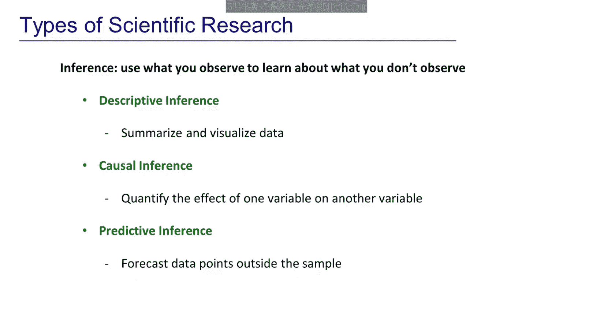
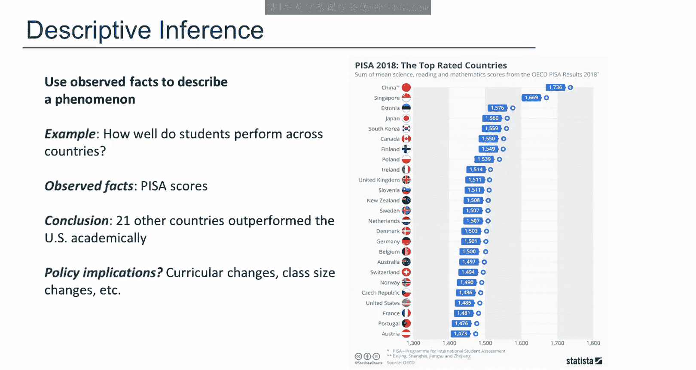
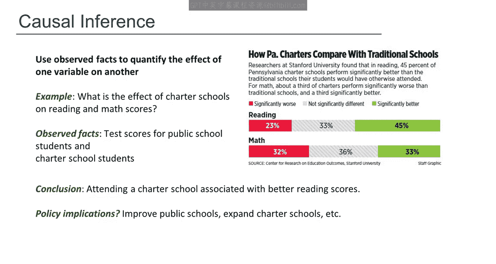
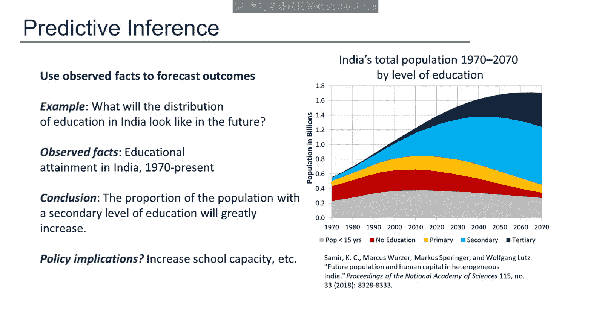
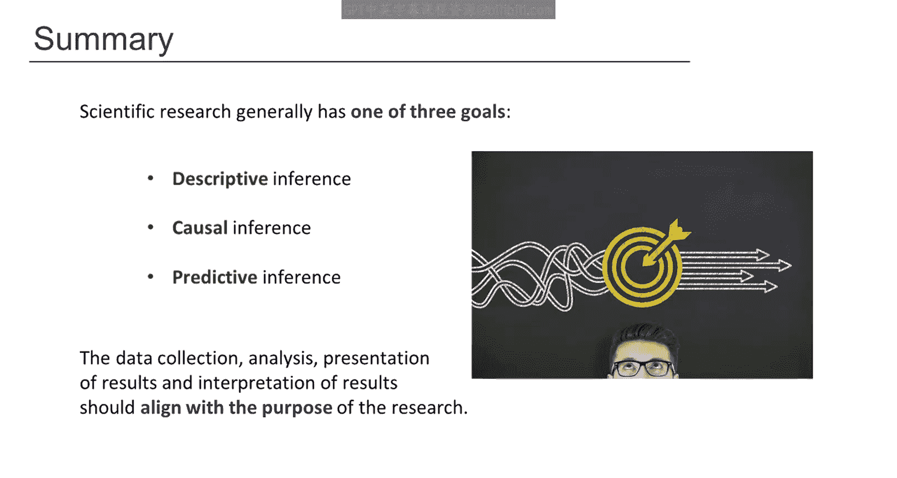

#  002：统计推断 🎯

在本节课中，我们将要学习统计推断的核心概念，并了解定量研究的三大主要目标：描述性推断、因果推断和预测性推断。理解这些目标将帮助你更好地解读和评估你所遇到的各种数据分析结果。

## 什么是定量研究的目的？

你无疑在许多场合见过统计结果的呈现，无论是在工作中、新闻里，还是在你阅读的书籍里。理解一项定量分析的第一步，就是识别该项研究的目的。

在本视频结束时，你应该能够识别并区分科学研究的三个主要目标：描述性推断、因果推断和预测性推断。

## 什么是科学研究？

科学研究的首要目标是推断。正如三位顶尖政治学家所解释的：科学研究旨在基于经验信息进行描述性或解释性推断。

推断是我们根据观察到的证据对世界得出的结论。这个结论可以是描述性的、因果性的或预测性的，我稍后会解释这些术语的含义。

## 研究过程概览

正如你可能从自己的工作中所知，从一个绝佳的研究想法到在项目结束时得出结论，中间需要采取几个步骤。

以下是研究过程的主要步骤：

1.  **提出问题并发展理论**：第一步要求你提出一个问题并发展一个激励性的理论。这个理论应基于与你问题相关的现有学术成果。
2.  **收集证据**：第二步涉及收集证据。这些证据可以是定性的，也可以是定量的。
3.  **分析证据**：第三步是分析你收集到的证据。你可以使用无数种方法来分析证据，所选方法应与你的研究问题保持一致。
4.  **得出结论**：最后，在你完成分析后，你将得出结论并回答研究问题。作为结论的一部分，你将指出研究发现的启示，并制定任何由此产生的、可操作的建议。

尽管我列出的步骤看起来可能很直接，但从问题到结论的旅程很可能充满曲折。一路上往往有许多障碍需要克服，尤其是在定量证据的收集和分析方面。有时，研究过程会让你感觉像是在迷宫中蜿蜒前行。你可能会尝试一种后来发现有问题的方法，也可能投入时间收集了后来发现不需要的数据。成功的关键在于专注于你的问题，不被必然出现的挑战所吓倒。

## 科学研究的类型

如前所述，推断有三种不同类型，即利用观察到的定量证据来了解你无法直接观察到的事物。

上一节我们介绍了研究过程，本节中我们来看看三种不同类型的推断。

以下是三种主要的研究类型及其目的：

*   **描述性推断**：目的是利用数据更好地理解一个现象。研究者通过**总结和可视化数据**来进行描述性推断。
*   **因果推断**：目的是利用数据更好地理解一个变量如何影响另一个变量。这是通过**采用统计方法来量化因果效应**实现的。
*   **预测性推断**：目的是进行预测。研究者将使用一个样本来预测样本之外的数据点。

让我们看几个例子。

## 描述性推断示例 📊

在描述性推断中，目标是更好地理解一个现象如何运作，或描述一个有趣的动态。

假设你的研究问题是：不同国家的学生学业表现如何？这是一个旨在提供描述性推断的研究问题。

为了回答这个问题，研究者可以使用观察到的事实，例如不同国家学生的阅读、数学和科学测试分数。研究者可以利用这个数据集得出结论，例如美国学生与其他国家学生的表现相比如何。

幻灯片右侧的图表显示了学生根据国际学生评估项目（PISA）测试分数在阅读、数学和科学方面的表现。我们可以从结果中得出几个结论。一个结论是，有21个其他国家在学业上表现优于美国。

如果你有教育政策背景，你或许可以根据图表和数据提出一些建议。例如，你可能会建议进行特定的课程改革或班级规模调整。当然，仅凭这张图表并不支持特定的政策改变，但它是一个证据片段，政策分析师可以在更广泛的评估中用它来探讨如何提高美国的学业表现。

关键要点是，数据集可以用来系统地描述一个现象，这个过程被称为**描述性推断**。

## 因果推断示例 ⚖️

因果推断用于量化一个变量对另一个变量的影响。其目标是理解一个变量如何影响另一个变量。

让我们看一个例子。假设你有兴趣研究特许学校与公立学校对学生学业成绩的影响。

观察到的事实可能包括宾夕法尼亚州学生的阅读和数学测试分数。例如，幻灯片上的图表显示，宾夕法尼亚州特许学校中45%的学生在阅读方面比公立学校的同龄人表现更好。

在数学方面，大约三分之一特许学校的学生比公立学校的学生表现更好，然而也有近三分之一的公立学校学生比特许学校学生表现更好。

总体而言，结果好坏参半，但可以合理地得出结论：就读特许学校为学生带来了阅读方面的益处。不过，同样，你需要比这一张图表更多的证据才能得出这个因果结论。

在得出结论后，你可能会制定关于如何改善公立学校或扩大特许学校的政策建议。

## 预测性推断示例 🔮

预测性推断要求研究者生成一个预测。

一个预测性推断研究问题的例子可能是：印度未来的教育分布将是什么样子？

在这种情况下，观察到的事实可能是印度从1970年至今的教育成就。推断是基于历史数据，我们可能对未来几十年的教育成就有何预期。

右侧的图表显示了截至2070年，印度按教育水平划分的预测人口。从这张图表可以得出的一个结论是，在未来几十年，拥有中等教育水平的人口比例将大幅增加。

看到这张图表的政策制定者可能会立即思考，如何在不久的将来最好地增加学校容量，以适应预期的人口增长。

## 总结

本节课中我们一起学习了科学研究通常有三个目标之一：描述性推断、因果推断或预测性推断。

研究者所采取的特定数据收集、分析、呈现和解释方法应与研究目的保持一致。例如，对预测性推断有用的方法，并不总是适用于因果推断。

随着你成为一名更有经验的分析师或分析结果的消费者，你将能够评估一项特定的研究是否使用了符合项目目标的方法。