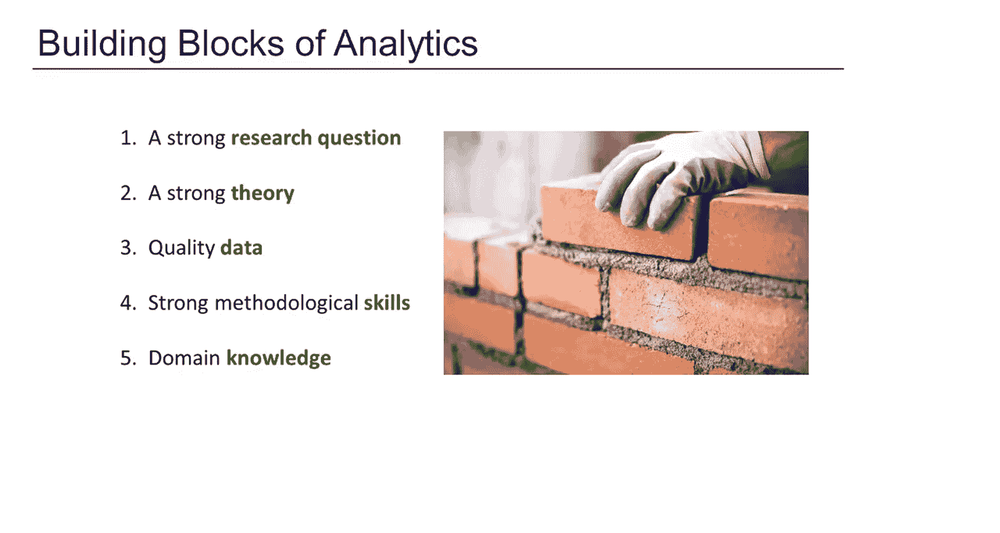
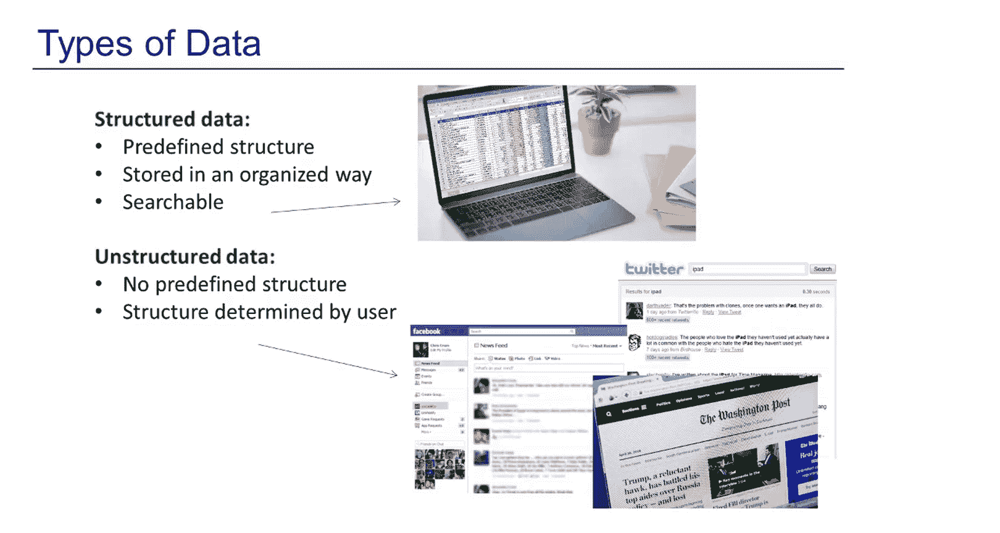
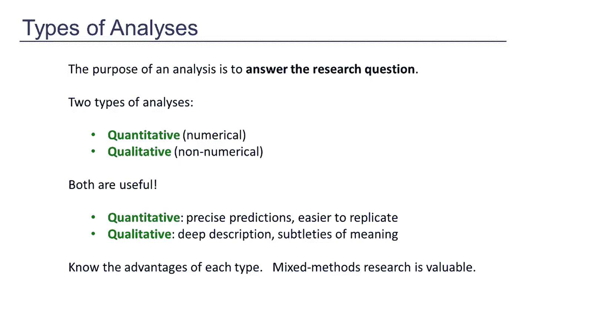
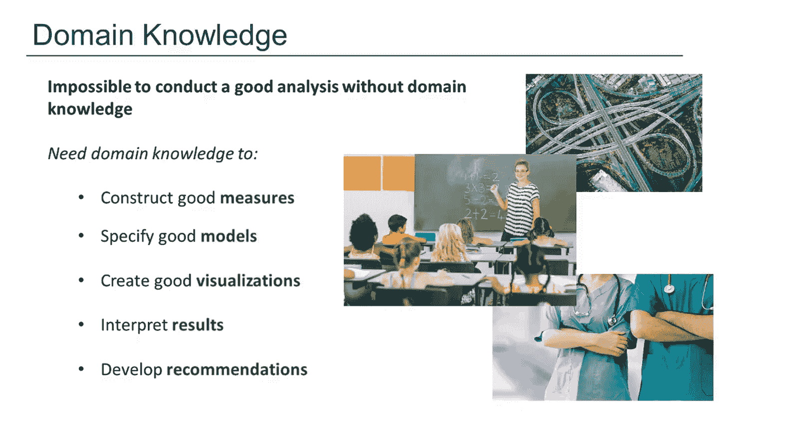
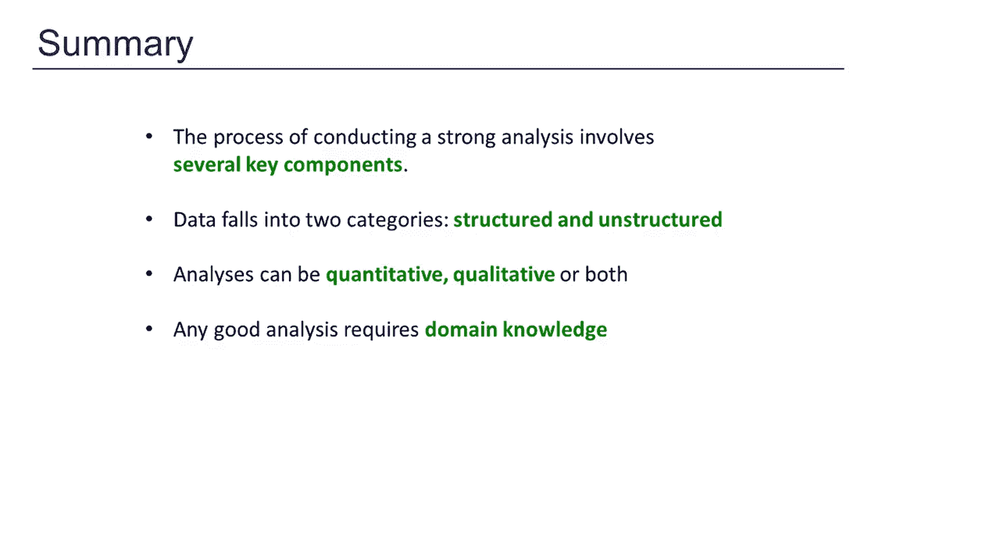

#  003：科学研究的组成部分 🔬

在本节课中，我们将要学习一项高质量分析所必需的关键组成部分。我们将了解分析过程的具体步骤，以及不同类型的数据和研究方法。

---

## 分析的基本构成要素 🧱

无论分析师进行的是描述性、因果性还是预测性推断研究，分析过程都应包含五个核心组成部分。

首先，分析师需要提出一个好的研究问题。研究问题应具备**具体性、重要性和原创性**。换句话说，研究问题应有明确的界定范围，针对有意义的议题，并旨在贡献原创知识。毕竟，研究一个已在现有研究中得到满意解答的问题意义不大。

研究问题还必须由一个强有力的理论所驱动。该理论应阐明对结果的预期及其原因。此外，理论还应解释该问题为何重要，以及它如何与现有相关研究相结合。我们将在下一个视频中详细探讨优秀理论的特性。

在将研究问题置于坚实的理论框架之后，分析师便可以收集和整理高质量的数据集。高质量数据应具备**准确性、与研究问题的相关性以及完整性**。在某些情况下，统计技术可以帮助处理数据问题，例如数据缺失。

与此相关，分析师需要一套强大的方法论技能。这些技能可能涉及数据汇总、量化因果效应、开发预测模型或其他类型的分析。这些技能通常是人们在想象学习统计学或定量方法课程时所想到的。

然而，仅拥有复杂的方法论技能不足以成为一名优秀的分析师。分析师还必须对所处理的实质性问题有深刻的理解。换句话说，分析师需要具备**领域知识**。你可以通过课程学习、个人经验或专业经验来获取这种领域知识。

---

## 数据的类型 📊

一般来说，分析师在研究中选择使用的数据有两种类型：结构化数据和非结构化数据。

**结构化数据**具有预定义的结构，并以有组织、可搜索的方式存储，例如电子表格。以表格形式出现的数据集，例如可以在Excel中查看的数据，就是结构化的。变量由创建数据集的人定义。

相比之下，**非结构化数据**没有预定义的结构。分析师需要量化数据并创建结构。非结构化数据包括Twitter和Facebook等网站上的社交媒体帖子，以及《华盛顿邮报》和《纽约时报》等媒体上的新闻报道。

分析师决定如何为帖子、句子、段落、故事或其他定义的分析单元分配数字代码。例如，分析师可能会根据推文表达对美国总统的积极或消极情绪来对其进行编码。分析师可能将相关推文编码为：0（积极）、1（中性）、2（消极）。

然后，分析师可以将这个测量指标纳入对总统言论与Twitter表达的情绪之间关系的统计分析中。

世界上结构化和非结构化数据的数量都在呈指数级增长。分析师除了知道如何使用统计方法分析数据外，还必须知道如何收集、组织和管理所需的数据。

---

## 分析的类型 🔍

虽然数据素养专项课程侧重于理解定量数据，但认识到定性方法同样有价值也很重要。任何分析的总体目的都是为了回答一个研究问题。分析可以通过定量分析或定性分析来解决问题。

**定量证据**是数字化的，可以用统计方法进行分析。**定性证据**是非数字化的，可以使用比较案例研究、民族志和焦点小组等方法进行分析。

定量和定性证据对于回答研究问题都很有用，每种分析类型都有其优点和缺点。例如，定量证据允许分析师量化一个变量对另一个变量的影响并生成精确的预测。此外，定量分析比定性分析更容易复制，这对于确保结果的可靠性至关重要。

然而，并非所有事物都可以量化。定性证据，如图像和访谈，允许研究者对现象进行深入描述，并探索术语和概念含义的细微差别。

重要的是要记住，在评估研究和进行自己的研究时，定量和定性证据都在科学研究中扮演着重要角色。考虑各自的优缺点，并认识到许多最好的研究都依赖于两者的结合。

---

## 领域知识的重要性 🧠

尽管当今的分析流行语包括机器学习、人工智能、自然语言处理以及其他与数据分析相关的术语，但必须记住，没有领域知识就不可能进行良好且完整的分析。

例如，分析师需要领域知识来构建良好的测量指标。想象一下，你的任务是测量交通成果、教育成果或健康成果。你需要对这些主题有深入的了解才能制定有效的测量指标。假设要求你衡量一个城市的公共交通质量。你可能需要考虑公共汽车、地铁系统、共享单车、网约车甚至电动滑板车。你如何确定公共交通的这些及其他组成部分是否运行良好？你会将质量衡量为公众满意度、环境友好性、效率还是其他标准？

同样，你需要领域知识来设定良好的、无偏的统计模型，创建有效的可视化图表，以有意义的方式解释结果，并提出有用的、可操作的建议。一个领域知识不足的编程大师或统计学家无法独自完成高质量的分析。这就是为什么分析项目通常由团队而非个人承担。

---

## 总结 📝

本节课中我们一起学习了进行强有力分析的过程所涉及的几个关键组成部分。请记住，这包括提出一个好的问题，用强有力的理论框架来驱动该问题，整理高质量的数据集，使用适当的方法分析数据，并以有意义的方式解释结果。

你分析的数据可以是结构化的或非结构化的，你可以决定使用定量分析、定性分析或两者的混合方法。无论采用何种分析方法，你都需要领域知识来做出良好的方法论和解释性决策。

接下来，我们将更深入地探讨构成一个优秀理论以驱动统计分析的具体要素。