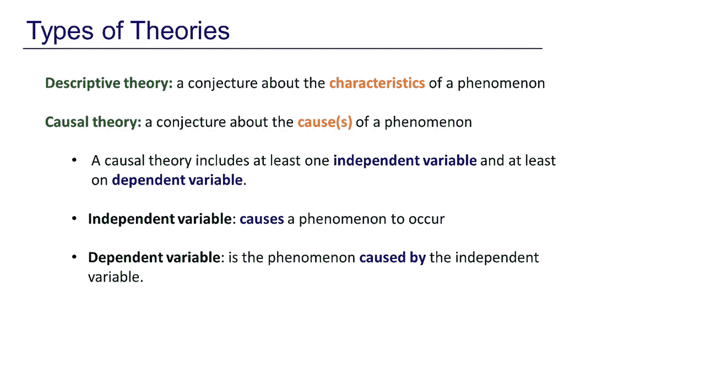
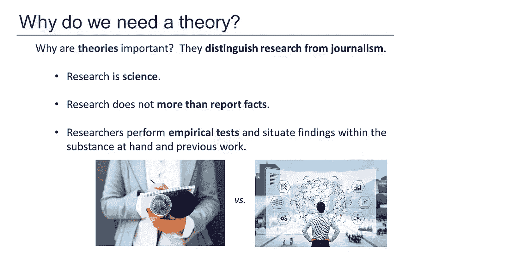
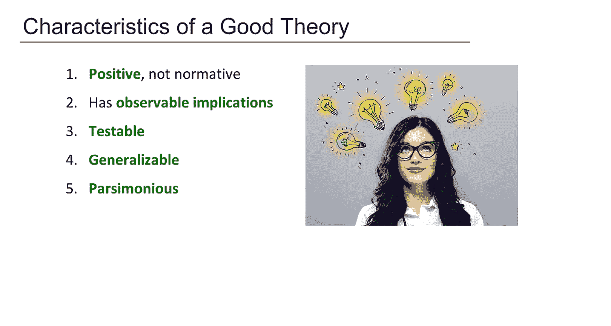
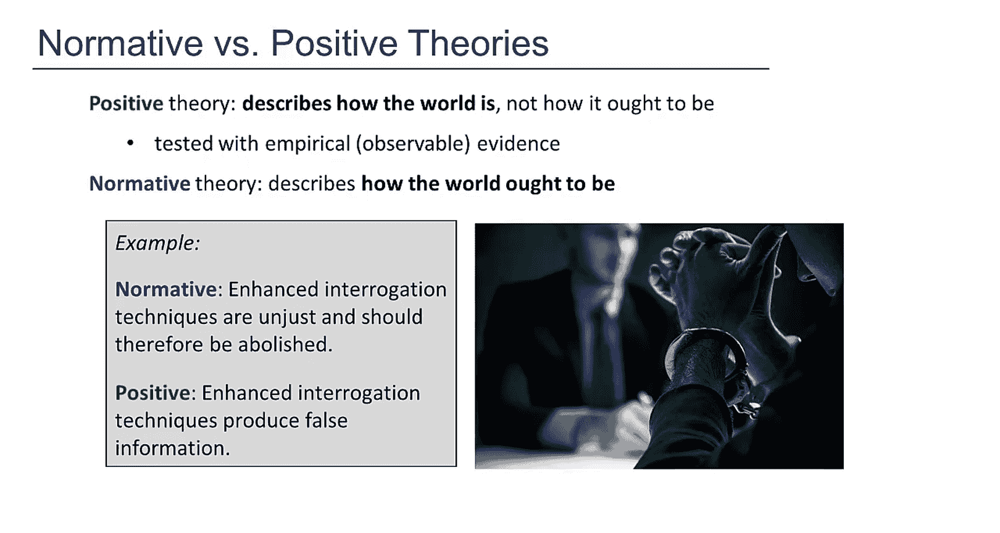
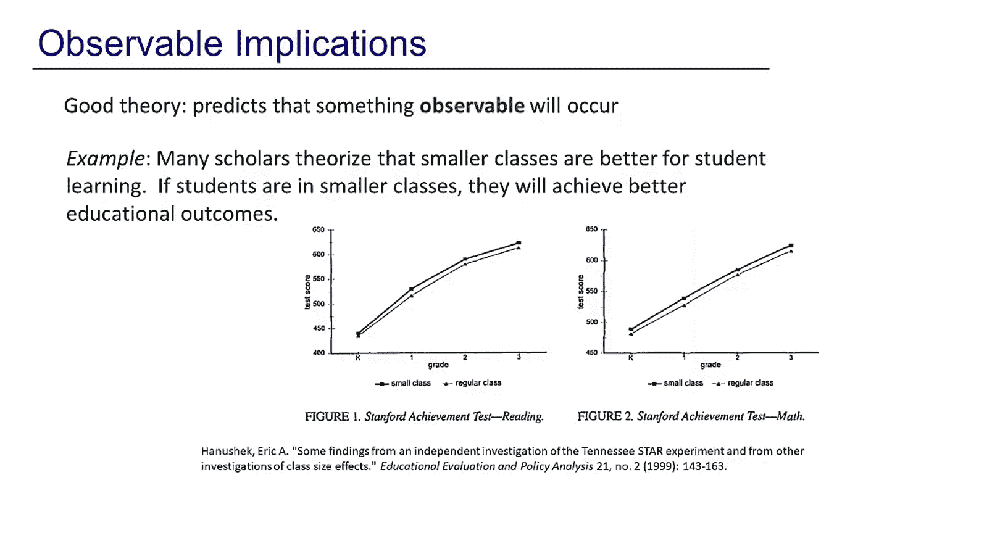
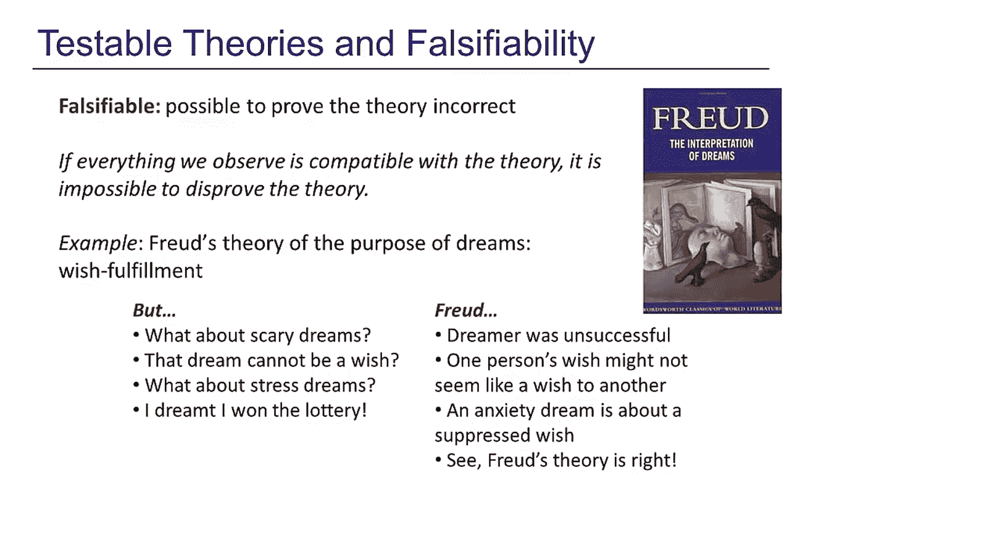
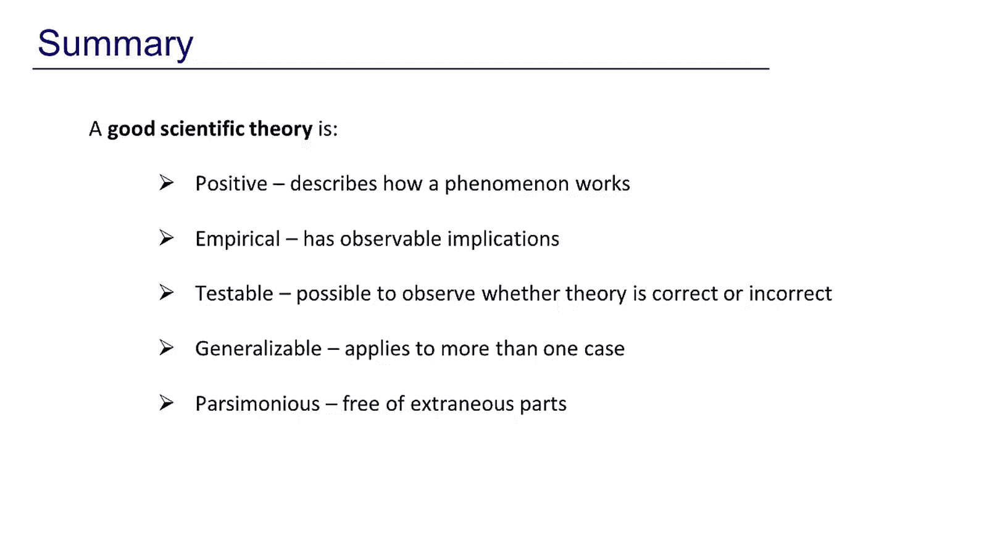

#  004：科学理论 🔬

在本节课中，我们将学习科学理论在数据分析中的核心作用。我们将探讨什么是好的科学理论，以及如何评估一个理论的质量。理解这些概念是进行严谨、有价值的数据分析的基础。

## 理论类型 📚

上一节我们介绍了科学理论的重要性，本节中我们来看看理论的主要类型。科学理论主要分为两大类。

以下是两种主要的理论类型：

*   **描述性理论**：这是对现象特征的推测。例如，我们可能研究“美国学生的学术表现比欧洲国家学生差”这一理论。
*   **因果性理论**：这是对现象原因的推测。例如，我们可能提出理论：“州立法机构的任期限制会导致州长权力增加”，或者“学校资源官员项目能减少校园暴力”，又或者“对无证移民实行州内学费标准能改善州经济”。这些理论都表明，一个可观察的结果有特定的原因。

一个因果理论至少包含一个**自变量**和一个**因变量**。自变量是导致现象发生的事物，因变量则是由自变量引起的。

## 为何需要理论？ 🤔

在了解了理论类型后，你可能会问：为什么我们需要理论？为什么不能直接收集感兴趣的数据并报告结果呢？

理论至关重要，因为它使我们的工作成为科学。理论将科学与新闻报道区分开来。新闻报道对社会和民主至关重要，但它不同于科学研究。一项研究不应仅仅报告事实。研究者需要进行实证检验，并将发现置于相关主题和现有学术体系之中。换句话说，**记者揭示和报道事实，而科学家检验理论**。

## 好理论的特征 ✨

并非所有科学理论都同样优秀。在本节中，我们将讨论优秀科学理论的五个特征。

以下是优秀科学理论的五个关键特征：

1.  **积极的**：理论描述世界“是”怎样的，而非“应该”是怎样的。
2.  **可观察的**：理论具有可观察的推论。
3.  **可检验的**：理论可以被检验。
4.  **可推广的**：理论适用于多个案例。
5.  **简洁的**：理论不包含不必要的部分。

那么，好的理论从何而来？这个问题没有唯一答案。学者们通常通过借鉴现有研究来构建理论框架，这是理论发展最有用的资源。此外，研究者还依赖其专业经验以及对世界如何运作的自身理解。综合来看，现有研究、专业经验和研究者自身的想法共同促成了一个可以用数据检验的好理论的形成。

## 规范理论与积极理论 ⚖️

让我们详细讨论第一个特征：理论应该是积极的。

*   **积极理论**描述世界“是”怎样的。
*   **规范理论**则描述世界“应该”是怎样的。

虽然规范理论很有趣，从学术角度也值得探讨，但它们无法用数据和事实来检验。让我们看一个例子。

强化审讯这个话题对国家安全和情报界极为重要。一个关于强化审讯的规范理论可能是：“强化审讯技术是不公正的，因此美国应该废除它们。”这个理论描述了一种世界观“应该”是怎样的。我们无法用事实来检验强化审讯的“公正性”，并基于此判断美国是否应废除这些技术。换句话说，**无法证明这个理论正确与否**。

这个理论的积极版本可以是：“强化审讯技术会产生虚假信息。”你可以想象通过检验通过强化审讯获得的信息的真实性来测试这个理论。测试这个理论可能存在实际挑战，但那是另一个问题。目前的关键在于，**这个理论可以用实证证据来检验**。

## 可观察的推论 👀

除了是积极的，好的理论还具有可观察的推论。换句话说，好的理论预测某些可观察的事情会发生。为了检验一个理论，研究者需要考察这些可观察的推论是否确实发生了。

让我们考虑一个关于班级规模影响的例子。许多学者认为，小班教学更有利于学生学习。这个理论有几个原因，例如小班规模允许师生之间进行更频繁、更有意义的互动。因此，该理论阐明：如果学生在更小的班级里，他们将取得更好的教育成果。这个理论具有清晰的可观察的推论。例如，本页幻灯片上的图表展示了一项研究的结果，该研究检验了一项班级规模实验中学生的测试成绩。研究者观察并比较了不同年级中，小班（实验组）和常规规模班级（对照组）学生的数学和阅读测试成绩。

## 可检验的理论与可证伪性 🔍

好的社会科学理论也是可检验的。要可检验，一个理论必须是**可证伪的**，这意味着必须有可能证明该理论是错误的。如果我们在世界上观察到的一切都与该理论兼容，那么就不可能反驳这个理论。换句话说，**如果一个理论是不可证伪的，它就无法被检验**。

这里有一个弗洛伊德《梦的解析》中的例子。其中有一章他讨论了梦的目的。弗洛伊德认为，所有的梦都是为了满足愿望。你可能会想：那噩梦呢？弗洛伊德会回应说，噩梦只是做梦者未能成功满足愿望的梦。你可能会说：我听过一个朋友的梦，那个梦不可能是愿望满足。弗洛伊德会回应说，一个人的愿望对另一个人来说可能不像愿望，你只是错误地解释了你朋友的梦。你可能会问：那关于压力的梦呢？弗洛伊德会说，压力梦实际上是关于被压抑愿望的梦。最后，你可能会想起最近做的一个美梦，比如中了彩票。弗洛伊德会说：看，我的理论是对的。关键在于，弗洛伊德对这个理论的任何可能反对都有回应。**这个理论是不可能被证伪的**。因此，该理论是不可证伪的，从实证角度来看也就不可检验。

## 实际可检验的理论 ⏱️

除了可证伪，一个理论还必须能够在实际约束条件下被检验。要可检验，你必须能对以下关于理论的问题给出肯定回答：我能获得必要的数据吗？我有足够的时间来检验这个理论吗？检验过程符合伦理吗？

让我们看一个例子。第一个理论是：“拥有专制父母的孩子长大后不信任政治领袖。”检验这个理论的一种方法是，观察那些拥有专制和非专制父母的孩子，然后观察这些人在成年后的政治信任度。然而，如果你没有20或30年的时间投入一个研究项目，这个研究设计就不可能实现。或者，你可以直接调查成年人，询问他们关于父母的情况以及对政府的信任度。虽然这个研究设计实际得多，但它有局限性。关于成年人童年的调查容易受到回忆偏差的影响，而关于敏感问题的调查则容易受到社会期望偏差的影响。研究者可能仍然决定进行这个项目，但应该牢记这些局限性。

## 可推广性与简洁性 🌍

最后，好的社会科学理论是可推广的和简洁的。让我们解释一下这些术语。

*   **可推广的理论**适用于不止一个案例。如果你发展了一个关于选举的理论，这个理论应该适用于多场选举。例如，一个只适用于2020年选举的理论用处不大。它无助于我们理解2020年之前的选举，对未来选举也没有预测价值。一个好的理论应该能让我们洞察一个现象的多个实例，无论是战争、选举、测试成绩、投票选择还是其他。
*   好的理论也应该是**简洁的**，意味着它们不包含不必要的部分。假设你对发展一个选民投票率的理论感兴趣。你的目的可能是根据公民的背景特征来预测他们投票的概率。一个投票理论可能指出，公民投票的概率由其教育水平、收入和居住稳定性决定。这些因素中的每一个都被充分证实能激励投票。第二个理论可能增加了头发颜色。然而，没有任何证据表明一个人的头发颜色与其投票概率有关。因此，理论1和理论2具有完全相同的解释力，但理论1更简单。所以，**理论1更可取**。

## 总结 📝

本节课中我们一起学习了优秀科学理论的关键特征。具体来说，一个好的科学理论是：
*   **积极的**：描述现象如何运作。
*   **可观察的**：具有可观察的推论。
*   **可检验的**：有可能获取和分析数据。
*   **可推广的**：适用于多个案例。
*   **简洁的**：不包含不必要的组成部分。

理解并应用这些特征，将帮助你构建和评估更严谨、更有价值的科学理论，从而为你的数据分析奠定坚实的基础。