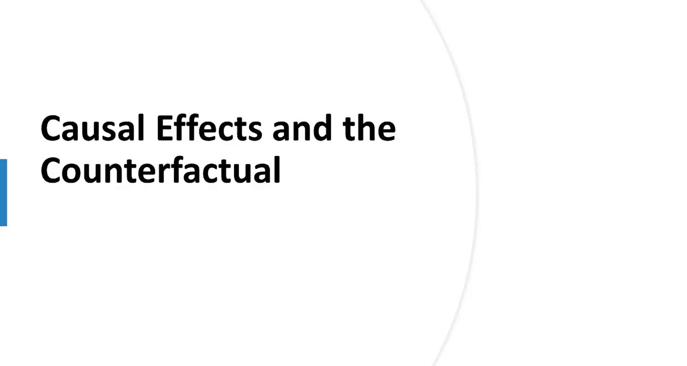
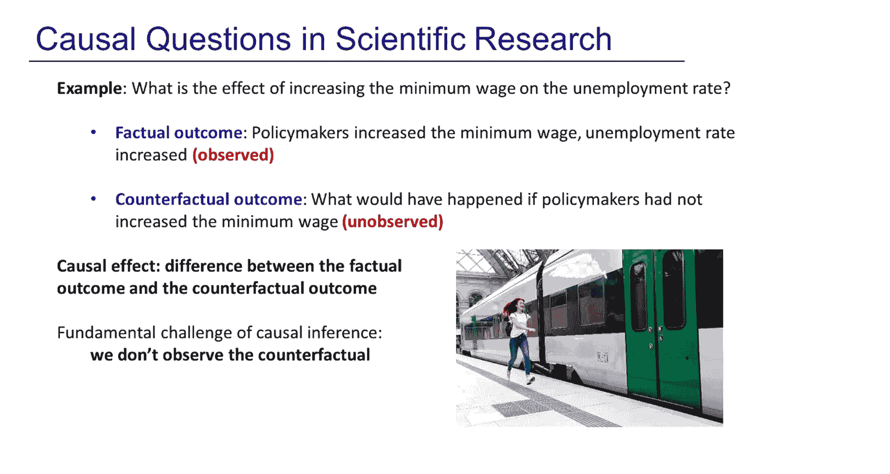
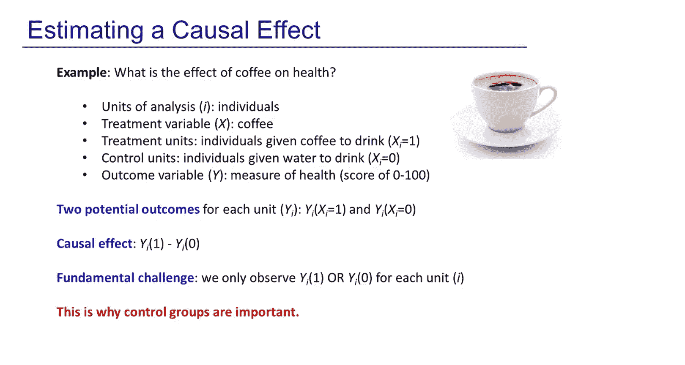
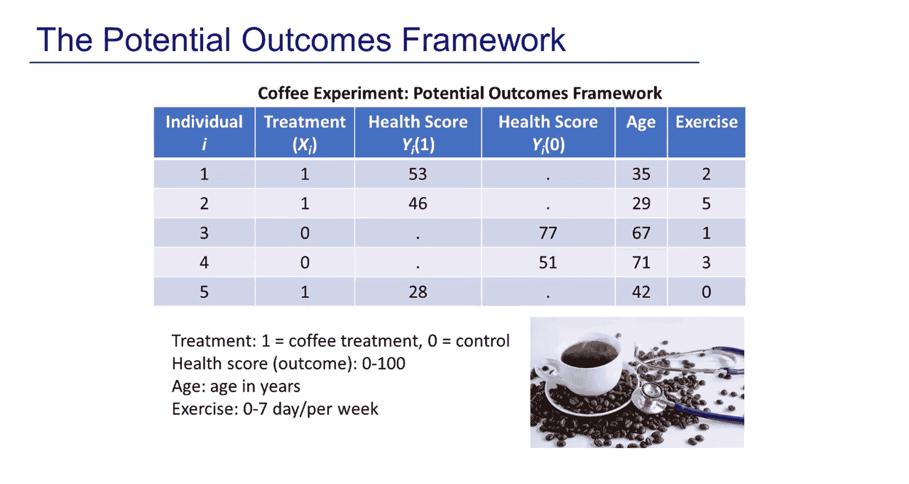
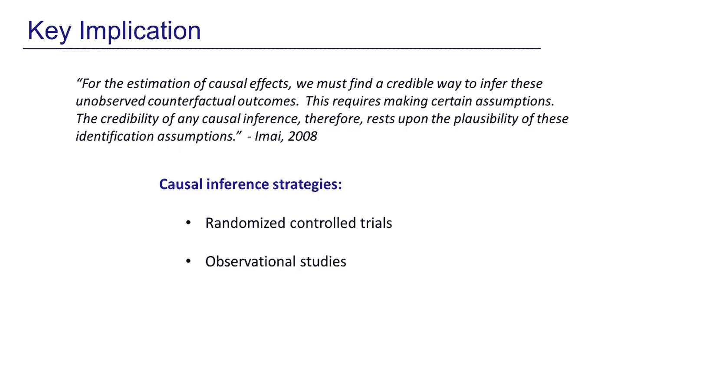

#  005：因果效应与反事实 🎯

在本节课中，我们将要学习因果推断的核心理论，特别是如何理解并估计因果效应。我们将介绍“反事实”这一关键概念，并探讨为什么估计因果效应在现实中充满挑战。

## 科学研究中的因果问题 🔬

上一节我们介绍了课程目标，本节中我们来看看科学研究中常见的因果问题。研究者通常希望理解对某事物的干预（例如公共政策的改变）如何影响一个我们关心的结果。

任何因果问题都包含两个部分：
*   **事实结果**：这是我们在特定干预下实际观察到的结果。
*   **反事实结果**：这是在没有该干预的情况下，本应发生的结果。

反事实结果是无法被观察到的。换句话说，我们不可能对完全相同的分析单元，同时观察到其接受干预和不接受干预的两种状态。

让我们通过一个例子来理解。假设一位研究者想估计提高最低工资对就业率的影响。现在，假设这位研究者观察到政策制定者实施了最低工资上调。事实结果就是他们观察到的现象，我们假设是失业率上升。反事实结果则是在**同一地理区域**、对**同一人群**，如果**同一批政策制定者**没有提高最低工资，本应发生的情况。显然，这个场景是无法被观察到的。**真正的因果效应是事实结果与反事实结果之间的差异**。

这个例子凸显了因果推断的根本挑战：**我们无法观察到反事实**。当然，电影除外。例如，电影《滑动门》就展现了一位女士刚好赶上即将离站的地铁后发生的故事，以及同一位女士因半秒之差错过地铁后发生的故事。换句话说，这部电影呈现了“赶上地铁”的反事实，而这在现实生活中是无法观察到的。

## 估计因果效应 ☕️

上一节我们了解了因果问题的核心挑战，本节中我们来具体看看如何估计一个因果效应。假设我们想估计咖啡对健康的因果效应。

首先，我们需要定义理解这个效应所需的关键术语。

*   **分析单元**：用 `i` 表示，在本例中是**个体**。分析单元定义了数据集中的行。这里我们关注的是个体，而不是州、国家、参议员等其他单元。
*   **处理变量**：用 `X` 表示，在本例中是**咖啡**。我们可以通过改变个体摄入的咖啡量来操纵这个处理。
*   **处理组**：包括那些被给予咖啡饮用的个体。对于这些个体，`X` 被设为 `1`。
*   **控制组**：包括那些未被给予处理的个体。在本例中，假设他们被给予水作为对照饮料。对于这些个体，`X` 被设为 `0`。
*   **结果变量**：用 `Y` 表示，是**健康**的度量。假设这是一个从0到100的分数。

对于每个单元，存在两种潜在结果：当 `X=1` 时的 `Y` 值，以及当 `X=0` 时的 `Y` 值。**因果效应被定义为这两种潜在结果之间的差异**，即 `Y_i(1) - Y_i(0)`。请注意，为了简洁，括号内的 `X=` 常被省略。

然而，如前所述，根本的挑战在于：**对于每个单元，我们只能观察到一种结果**。这个例子也说明了为什么控制组如此重要。作为后续内容的预告，我们将使用控制组来估计处理组的反事实结果。

## 潜在结果框架 📊

上一节我们通过咖啡的例子说明了因果效应的构成，本节中我们通过潜在结果框架来形式化这个例子。

下表展示了我们通过运行咖啡实验可能创建的数据集的前五行：

| 个体 (i) | 处理 (X) | 健康分数 (Y(1)) | 健康分数 (Y(0)) | 年龄 | 每周运动天数 |
| :--- | :--- | :--- | :--- | :--- | :--- |
| 1 | 1 | 85 | ? | 30 | 3 |
| 2 | 0 | ? | 78 | 25 | 5 |
| 3 | 1 | 90 | ? | 40 | 2 |
| 4 | 0 | ? | 82 | 35 | 4 |
| 5 | 1 | 88 | ? | 28 | 6 |

*   **第一列**索引每个个体。
*   **第二列**是处理变量，取值为 `0` 或 `1`。如果个体接受了处理（喝咖啡），则赋值为 `1`；如果个体在控制组（喝水），则赋值为 `0`。这种变量称为**虚拟变量**，它只取两个值（`0` 或 `1`），在统计学中经常使用。
*   **第三列**包含处理组个体的健康分数值。
*   **第四列**包含控制组个体的健康分数值。
*   **第五列和第六列**包含个体的一些额外信息，即年龄和每周运动天数。这些变量可能对检查和确保没有来自**混杂因素**的偏差很有价值，我们将在后续视频中讨论这个话题。

从这张表和潜在结果框架中得到的关键启示是：**对于每个单元，我们只观察到一个结果**。这个基本事实使得因果效应的估计充满挑战。

## 关键启示与后续策略 🧩

正如一位著名统计学家所解释的：为了估计因果效应，**我们必须找到一种可靠的方法来推断这些未被观察到的反事实结果**。这需要做出某些假设。因此，任何因果推断的可信度都取决于这些**识别假设**的合理性。

展望未来，我们将讨论两种可以用来估计因果效应的策略：
1.  **随机对照试验**
2.  **观察性研究**

以及每种策略所需的假设。当这些假设成立时，策略效果很好；然而，当假设被违反时，策略会导致不准确的估计。

---

**本节课中我们一起学习了**因果推断的核心概念。我们明白了真正的因果效应是事实结果与无法观察的反事实结果之间的差异。我们通过咖啡实验的例子，定义了分析单元、处理变量、处理组、控制组和结果变量，并引入了潜在结果框架来形式化这个问题。最后，我们认识到估计因果效应的关键在于为反事实结果找到可靠的替代估计，这依赖于合理的假设。在接下来的课程中，我们将探讨实现这一目标的具体方法。