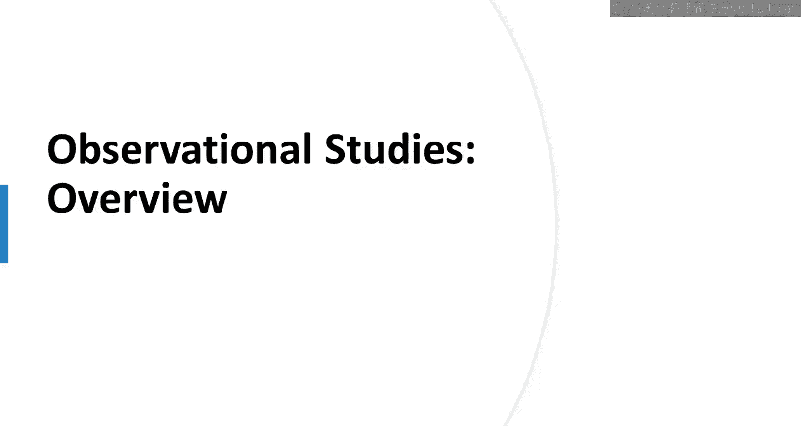
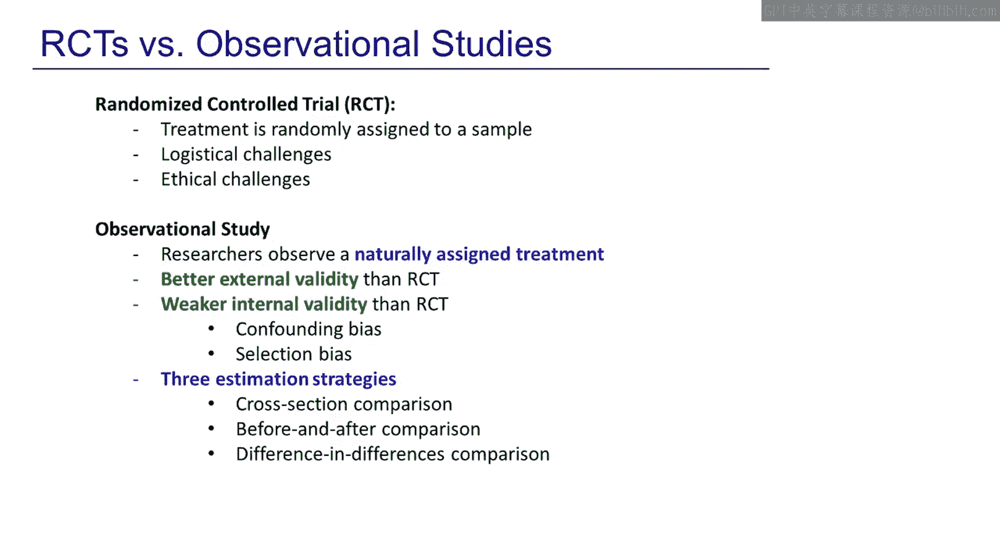
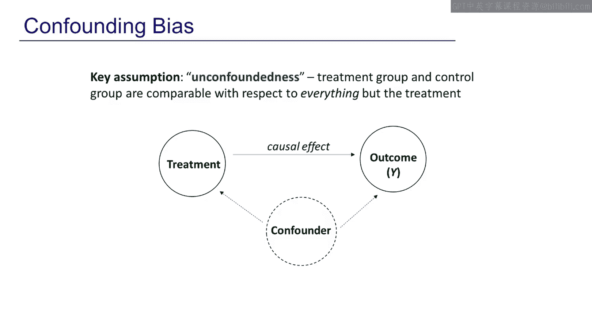

#  007：观察性研究概述 🧐

在本节课中，我们将学习观察性研究的基本概念。我们将了解它为何是随机对照试验的替代方案，并探讨其核心优势与挑战，特别是混杂偏倚问题。

## 随机对照试验与观察性研究 🔬

上一节我们介绍了随机对照试验（RCT）作为研究的“金标准”。然而，有时实施RCT并不可行。

以下是实施RCT面临的主要挑战：
*   **后勤挑战**：运行一个设计良好的RCT通常成本高昂且耗时。
*   **伦理挑战**：对于某些干预（如吸烟、药物使用或创伤），随机分配治疗存在重大的伦理问题。

因此，许多研究者转而使用观察性数据来估计因果效应。在**观察性研究**中，研究者观察的是**自然分配的处理**，即分析中的某些个体通过研究者干预之外的其他方式接受了某种处理。

## 观察性研究的效度权衡 ⚖️

与RCT相比，观察性研究通常在**外部效度**上表现更好。这是因为其处理是在自然、真实世界的环境中分配的，因此更容易想象该处理被分配给其他个体的情境。而RCT的条件通常受到高度控制，因此不能很好地复现真实世界。

然而，观察性研究的**内部效度**往往弱于RCT。这是因为它们更容易受到**混杂偏倚**和**选择偏倚**的影响。由于研究者在观察性研究中不控制处理分配，处理组和对照组很可能在许多重要方面存在差异。换句话说，某些个体接受处理而另一些没有，背后很可能存在相关的原因。

## 混杂偏倚详解 🧩

现在，让我们深入探讨混杂偏倚。任何因果分析的关键假设都是**无混杂性**，这意味着处理组和对照组在除是否接受处理外的所有特征上都是可比的。

如果存在一个变量，它既与**处理**相关，又会影响**结果变量**（通常用 **Y** 表示），那么这个变量就是一个**混杂因素**。这个变量将导致对“处理对结果的因果效应”的估计出现错误。

一个经典的混杂偏倚例子是冰淇淋消费量与溺水死亡数之间的表面关系。随着冰淇淋消费量增加，溺水死亡人数也上升。这是否意味着吃冰淇淋会增加溺水风险？答案是否定的。

在这个例子中，混杂因素是**温度**。更高的夏季气温是驱动这两个变量的根本原因。其关系可以表示为：
*   高温 **→** 冰淇淋消费量增加
*   高温 **→** 游泳人数增加 **→** 溺水风险增加

因此，冰淇淋消费量（处理）与溺水死亡数（结果）之间的观察到的关联是虚假的，由温度（混杂因素）导致。

## 观察性数据分析策略预览 📊

在下一个视频中，我将介绍三种使用观察性数据估计因果效应的策略。我们将讨论如何实施：
1.  **横截面比较**
2.  **前后比较**
3.  **双重差分比较**

每种策略都有其优点和缺点。

---

本节课中，我们一起学习了观察性研究。我们了解到，当随机对照试验不可行时，观察性研究是一种重要的替代方案。它虽然具有更好的外部效度，但内部效度较低，尤其容易受到混杂偏倚的影响。混杂因素会扭曲处理与结果之间真实的因果关系，因此在进行因果推断时必须谨慎识别并控制它们。