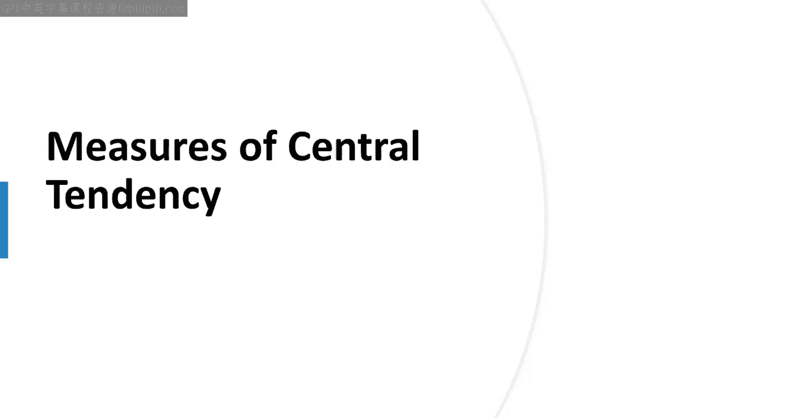
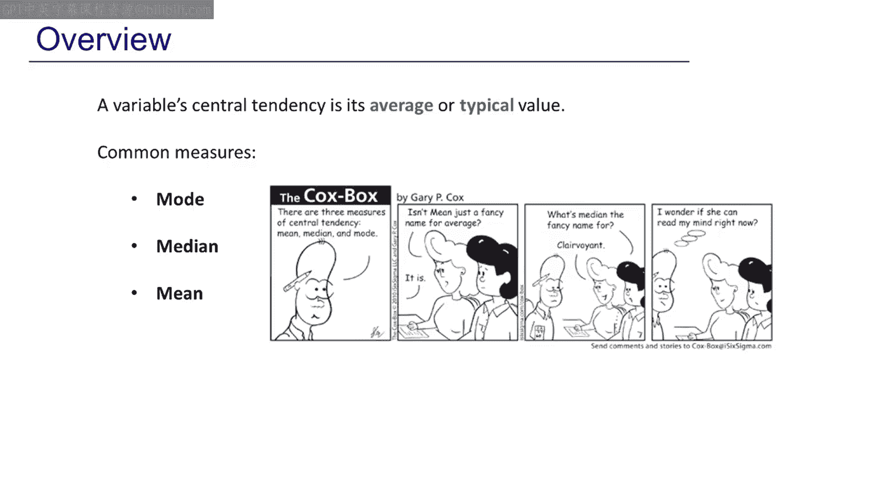
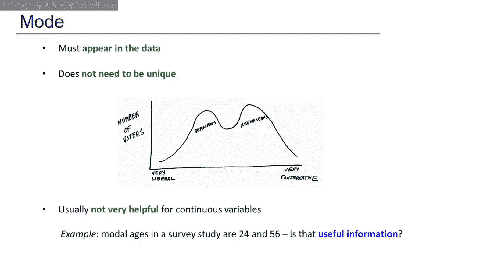
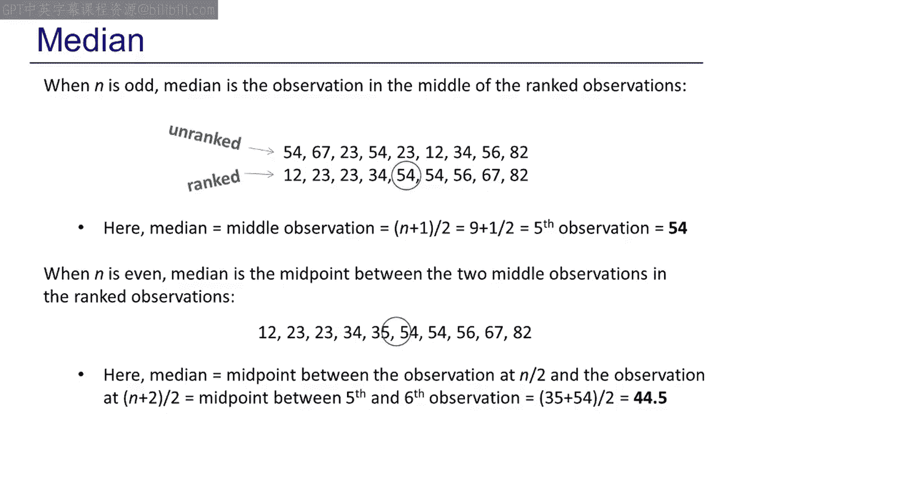
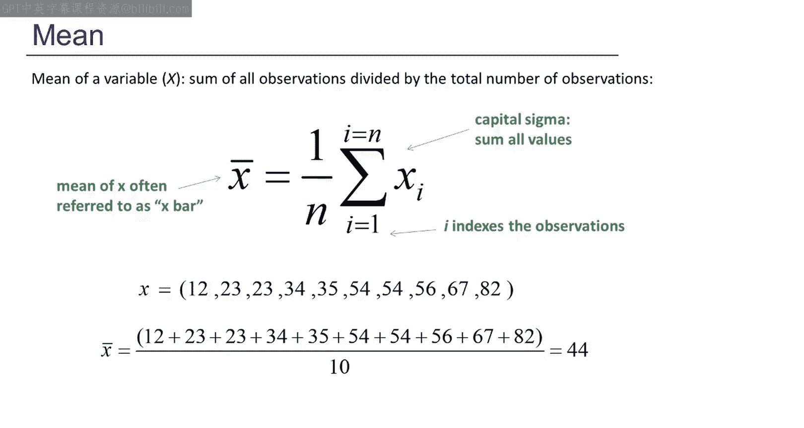
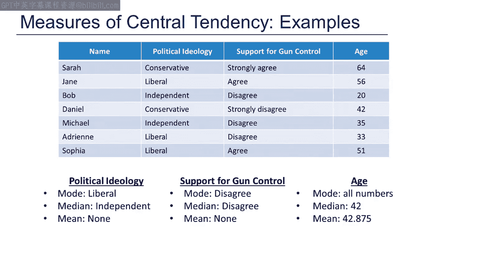

#  010：集中趋势的度量 📊

在本节课中，我们将要学习如何描述一个变量的“中心”或“典型”值。我们将介绍三种主要的集中趋势度量方法：众数、中位数和平均数。理解这些概念是进行任何数据分析的基础。

## 概述

变量的集中趋势是指其平均值或典型值。众数是变量中最常见的值。每个变量都有众数。但众数并不总是衡量集中趋势的最佳指标。中位数是这样一个值：50%的观测值低于它，50%的观测值高于它。某些变量，如无序分类变量，没有中位数。只有数值型或有序分类变量才有中位数。这是因为计算中位数要求变量的值具有客观的顺序。变量的平均值是其算术平均数。对于分类变量，研究人员有时会为类别分配数值以计算平均值。我们将在视频末尾通过几个例子来讲解。

## 众数

上一节我们介绍了集中趋势的概念，本节中我们来看看第一种度量方法——众数。让我们花几分钟时间更详细地讨论众数。

首先，请注意变量的众数必须出现在数据中。与平均数和中位数不同，众数值根据定义，必须至少被数据集中的一个观测值所拥有。

其次，重要的是要认识到众数不一定是唯一的。一个变量可以有多个众数，这意味着两个或更多的值同样常见。

此外，如果两个值的流行程度大致相等，研究人员会认为该变量是双峰的。换句话说，如果一个变量有两个值明显比其他值更常见，但流行程度不完全相等，我们仍然会认为该变量的分布是双峰的。

例如，本幻灯片上的图表是美国选民政治意识形态分布的草图。正如你可能想象的那样，这个分布是双峰的。政治意识形态有两个值，大多数选民聚集在这两个值周围。

然而，对于某些变量，众数并不是一个有用的概括性度量。让我们考虑年龄。假设我告诉你，在最近的一项调查研究中，众数年龄是24岁和56岁。这个信息有用吗？这只能告诉你24岁和56岁是最常见的年龄。对于这个变量，更好的集中趋势度量可能是平均数。

## 中位数

现在我们来讨论中位数。当样本量（用 **n** 表示）为奇数时，中位数是排序后观测值中间那个观测值的值。

请看幻灯片顶部的两个数字列表。第一个列表包含9个未排序的数字。第二个列表包含相同的9个已排序数字。在第二个列表中，我们可以看到中位数是54，因为54是中间值。

当样本量为偶数时，中位数是排序后观测值中两个中间观测值的中点。

请看幻灯片底部的数字列表。该列表包含10个已排序数字。中位数是两个中间数字35和54的中点，即44.5。

## 平均数

变量的平均值，比如 **X**，是所有观测值的总和除以观测值的总数。这个定义体现在幻灯片中间的公式中。

该公式表明，**x̄** 等于 **X** 中所有观测值从 **i=1** 到 **i=n** 的总和除以 **n**。对于那些不熟悉大写 Sigma（∑）用法的人，让我解释一下。Sigma 表示研究人员应该对数值求和。每个单独的观测值用下标 **i** 表示。起始观测值在 Sigma 下方标明，结束观测值在 Sigma 上方标明。所以，再次强调，本幻灯片上的公式表明，应该将 **X** 中从 **i=1** 到 **i=n** 的所有观测值求和，然后除以 **n**。

让我们看一个例子。假设 **X** 等于幻灯片上显示的值。平均值用 **x̄** 表示，等于所有 **X** 值求和后除以观测值总数，在本例中为10。所以，本例中的 **x̄** 等于44。

## 示例

现在，让我们看几个不同变量的众数、中位数和平均数的例子。本幻灯片上的小数据集包括7个观测值和四个变量：姓名、政治意识形态、对枪支管制立法的支持和年龄。

政治意识形态是一个有序分类变量。“独立”显然介于“保守”和“自由”之间。该变量的众数是“自由”，因为这个值出现了三次。中位数是“独立”。如果你把所有值排成一排，中间的值将是“独立”。从技术上讲，这个变量没有平均数。但是，你可以为类别分配数值，然后计算平均数。例如，假设我们给“自由”赋值为1，“独立”赋值为2，“保守”赋值为3。那么平均数将是1.86。

对枪支管制立法的支持也是一个有序分类变量。类别之间存在客观的顺序。该变量的众数是“不同意”，中位数也是“不同意”。虽然从技术上讲这个变量没有平均数，但我们同样可以为类别分配数值并计算一个。

年龄是一个连续变量。众数是数据集中的所有值，因为它们都同样常见。正如你所看到的，因此众数对于这个变量来说不是一个特别有用的概括性度量。这个数据集中年龄的中位数是42，平均值是42.875。

## 总结

本节课中我们一起学习了三种衡量数据集中趋势的方法：众数、中位数和平均数。众数代表最常见的值，中位数代表排序后的中间值，而平均数则是所有值的算术平均。每种方法都有其适用的场景和局限性，例如众数可能不唯一或不具代表性，中位数要求数据可排序，而平均数对极端值敏感。理解这些概念将帮助我们更准确地描述和理解数据的中心特征。在接下来的课程中，我们将讨论如何概括变量的离散程度。