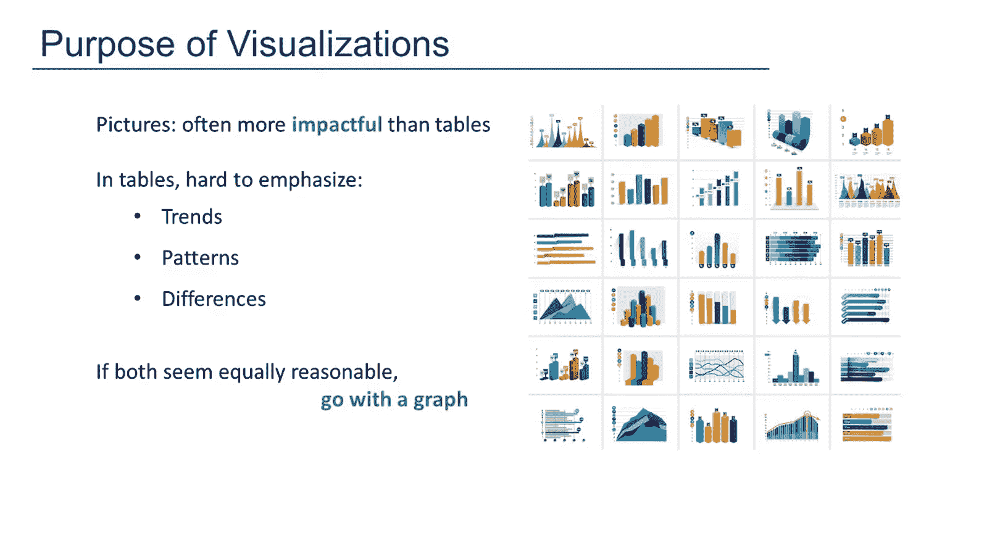
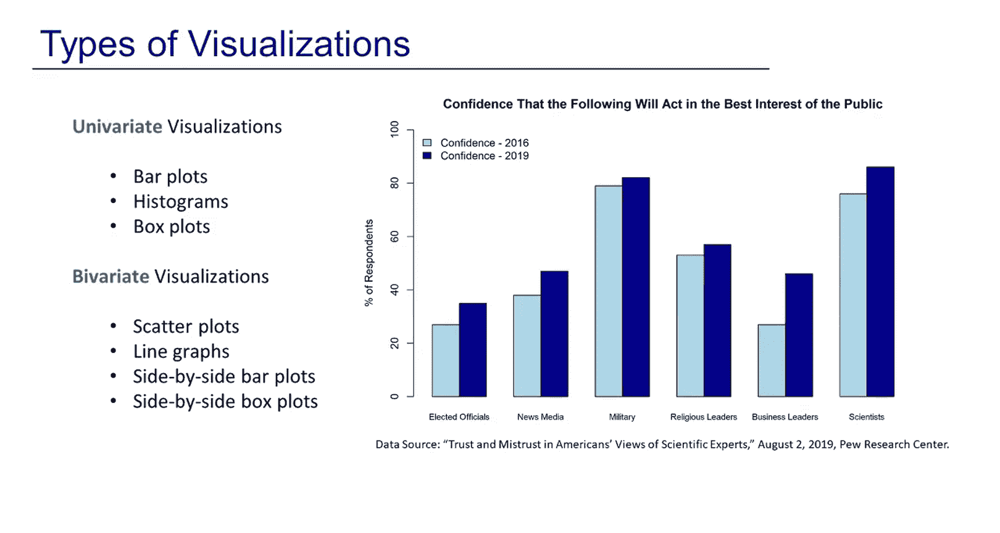
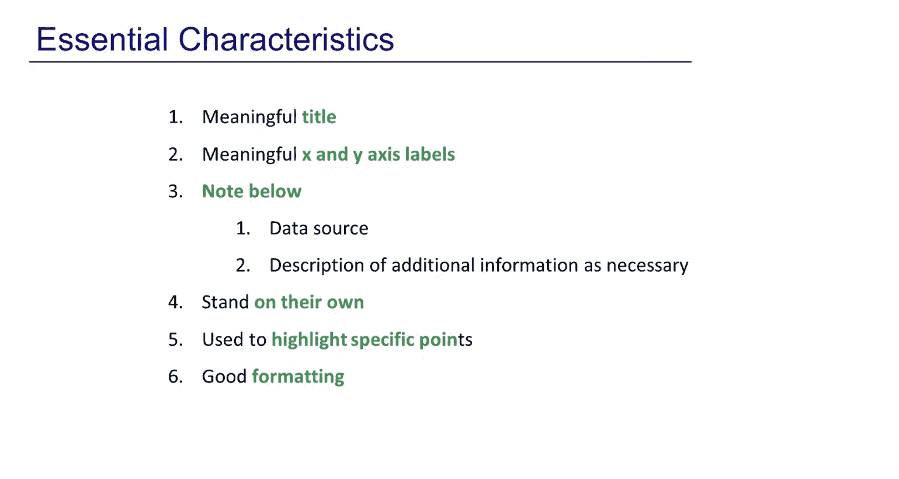

#  013：良好可视化的要素 📊

在本节课中，我们将要学习数据可视化的核心要素。我们将探讨可视化的目的、不同类型的图表，以及构成一个优秀数据图表所必需的关键特征。掌握这些知识，对于解读新闻、学术报告和研究中的图表至关重要。

## 可视化的目的

上一节我们介绍了课程目标，本节中我们来看看可视化的核心目的。虽然均值、中位数和标准差等汇总统计量有助于理解变量的分布情况，但图表通常能更直观地展示变量的分布，包括其中心和离散程度。

以下是可视化相较于数据表格的几个主要优势：
*   **直观展示分布**：图表能提供比数字表格更直观的变量分布描述。
*   **有效呈现趋势**：用数字表格展示变量随时间的变化（例如20个不同年份的数据）可能很困难，而图表能更有效地描绘任何时间趋势或模式。
*   **强调变量差异**：图表通常比表格中的数字更能有效地强调两个或多个变量之间的差异。

一般而言，如果表格和图表看起来同样合理，应选择使用图表。精心制作的图表比充满数字的表格更具视觉吸引力，也更容易解读。

## 可视化的类型

了解了可视化的目的后，本节中我们来看看常见的可视化类型。可视化的类型繁多，本课程将特别关注**单变量**（即单个变量）和**双变量**（即两个变量）的可视化。

以下是本课程将重点讨论的几种图表类型：
*   **单变量可视化**：我们将讨论如何创建和解读条形图、直方图和箱线图。
*   **双变量可视化**：我们将讨论如何创建和解读散点图、折线图、并列条形图和并列箱线图。

例如，本幻灯片上的图表是一个并列条形图，它可视化了美国人对各类领导者的信心程度。浅蓝色条形代表2016年的调查数据，深蓝色条形代表2019年的调查数据，数据来源于皮尤研究中心的调查。

我们可以从该图表中得出几个关键结论：
*   总体而言，在2016年至2019年间，美国人对所有类别领导者的信心水平都有所提高。
*   美国人对某些领导者群体（如科学和军事领袖）的信心远高于其他群体（如民选官员和新闻媒体）。

这些发现对民主制度的健康具有启示意义，因为可持续的民主依赖于公民信任。

## 优秀可视化的关键特征

我们已经了解了可视化的目的和类型，现在我们来探讨构成一个优秀数据图表的**关键特征**。无论图表类型如何，所有有效的图表都应具备一些共同的核心要素。

您可以使用多种软件程序（如Excel、R和Tableau）创建图表。这些软件允许您控制图表外观的几乎每个方面。在创建自己的图表时，务必花时间确保图表的每个组件都符合您的要求，不要让软件的默认设置主导您的可视化效果。

以下是每个优秀图表都应具备的六个关键特征：
1.  **有意义的标题**：标题应传达图表的主要观点。
2.  **有意义的坐标轴标签**：“有意义”意味着普通读者能够理解，应避免使用诸如 `Var1473` 等奇怪的变量名或数据集中难以解读的标签。
3.  **包含注释说明**：图表下方应包含注释，注明数据来源，并提供读者正确解读图表所需的任何额外信息（例如变量的测量方式或缩写的含义）。
4.  **图表应独立自洽**：读者应能在不阅读周边文本的情况下解读图表，反之亦然。换言之，读者不应需要参考周边文本来理解图表。
5.  **图表应有明确论点**：堆砌过多图表的论文或报告效果不佳。分析师在决定包含哪些图表时应审慎判断。因此，应仔细考虑每个图表的设计，以确保其尽可能具有影响力。
6.  **良好的格式设计**：这看似简单，但与颜色、字体大小等相关的格式选择对图表的视觉吸引力影响巨大。一个优秀的图表应该易于阅读，并能清晰地阐明关于世界如何运作的重要观点。

## 总结

本节课中，我们一起学习了数据可视化的核心要素。我们明确了可视化的目的是为了更直观、有效地展示数据分布、趋势和差异。我们认识了单变量与双变量可视化的主要类型，如条形图、直方图、散点图等。最重要的是，我们掌握了优秀数据图表的六个关键特征：**有意义的标题和坐标轴标签、包含数据来源和必要解释的注释、图表的独立自洽性、服务于明确论点、以及精心的格式设计**。记住这些原则，将帮助您创建和解读更具影响力和说服力的数据可视化作品。