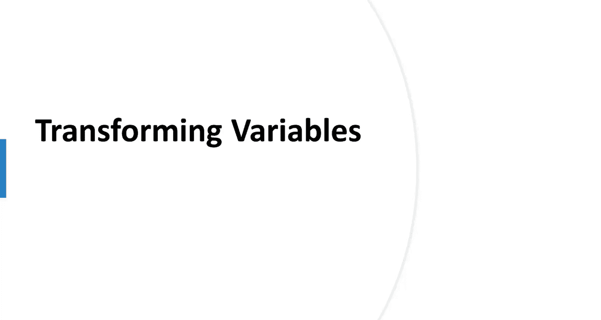
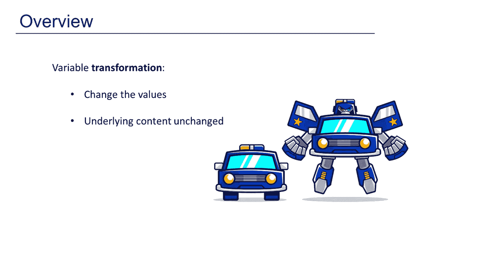
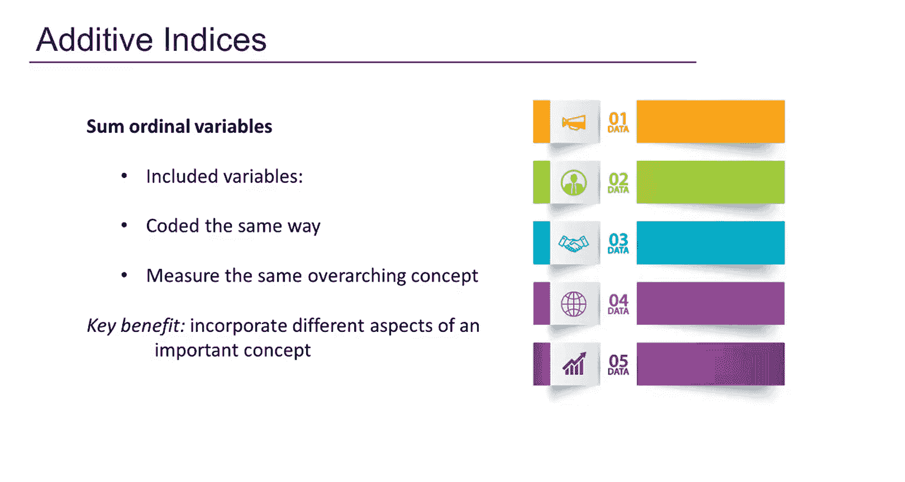
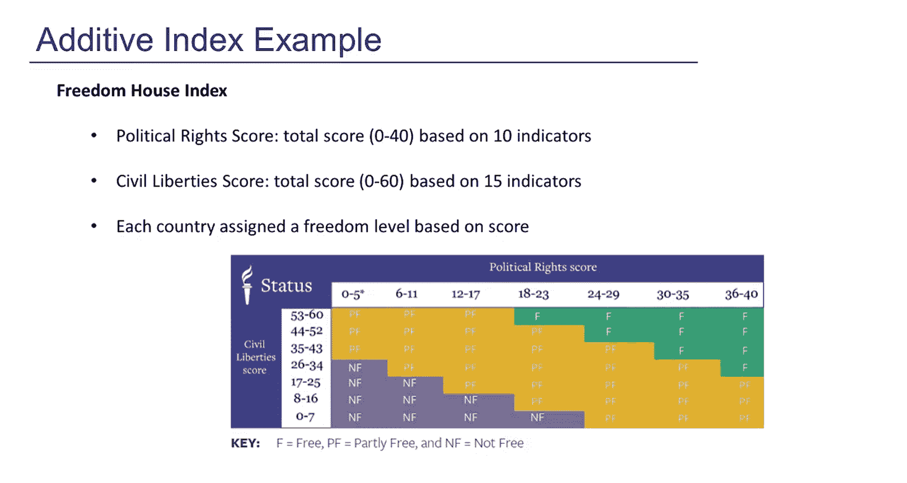
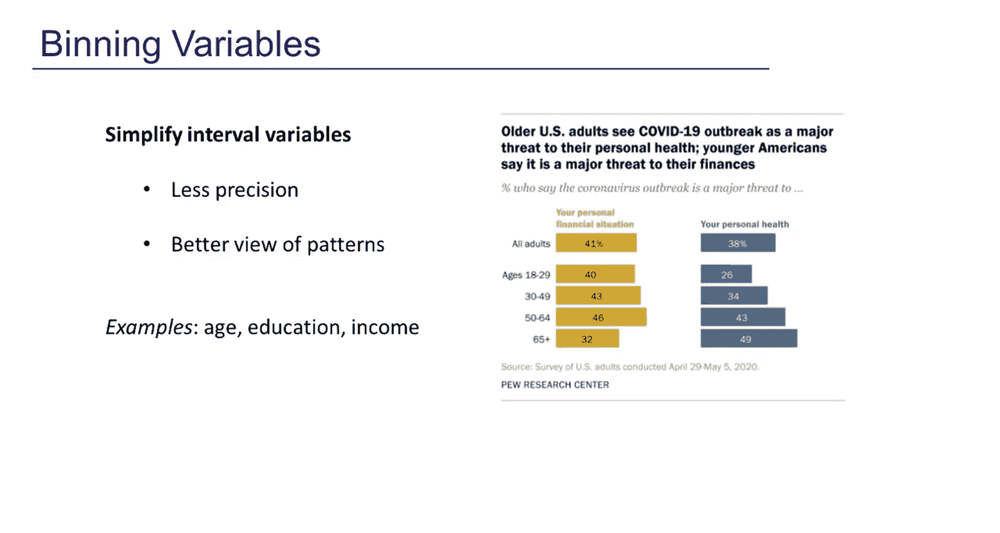
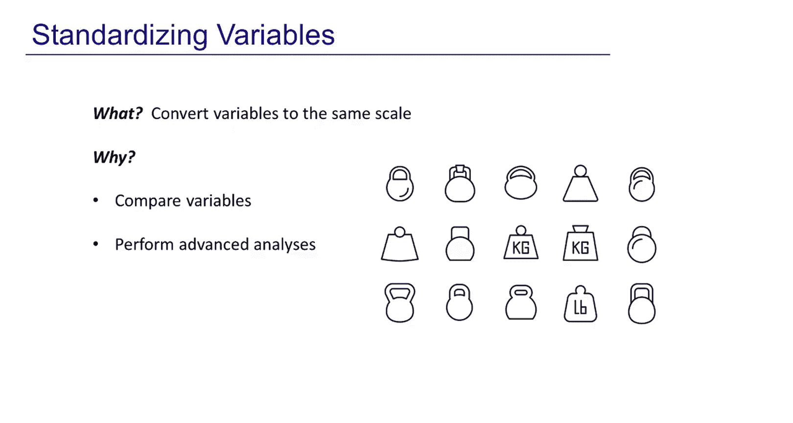

#  018：变量转换 🔄

在本节课中，我们将要学习数据预处理中的一个关键步骤：变量转换。当处理数据时，分析师常常会以某种方式转换变量，例如合并变量的某些类别，甚至将多个变量相加。这样做的目的是为了便于进行特定类型的统计分析，或者更容易地从数据中获取洞察。通过本节课的学习，你将能够识别和描述不同的变量转换方法，为数据分析做好准备。

## 概述 📋

转换一个变量意味着改变该变量的值，但这种转换并不会改变其底层的内容。在本视频中，我们将讨论三种不同的变量转换方式：创建**加性指数**、**分箱变量**和**标准化变量**。

在深入探讨之前，想象一个包含数百个变量的数据集，这在数据收集和存储日益便捷的今天越来越普遍。你可能拥有像年龄、受教育年限和家庭收入这样的定量变量，以及像政策态度、对各类公职人员的支持度、对各类社会机构的信心这样的定性变量。在开始分析之前，你可能需要处理其中许多数据，例如创建年龄类别，或者将几个政策态度测量值结合起来，为移民或医疗保健等重大议题创建一个单一的公众舆论衡量指标。现在，让我们逐一了解这些转换类型。

## 创建加性指数 📊

加性指数是通过将多个**序数变量**相加而创建的。请记住，序数变量是指包含排序类别的变量，例如衡量调查受访者对新的枪支管制立法支持度的变量。

要创建加性指数，所包含的变量必须采用相同的编码方式。例如，假设你有五个不同的公众舆论测量指标，涉及对当前医疗保健系统满意度的五个不同方面，如价格透明度和紧急护理的可及性。如果这五个测量指标都使用相同的量表，它们就可以相加。例如，如果每个指标都包含一个从“非常同意”到“非常不同意”的七点量表，你就可以将这五个测量值相加，创建一个关于公众对当前医疗保健系统满意度的指数。

然而，如果其中两个变量的答案选项使用的是五点量表，你就不能将它们纳入该指数。同样重要的是，指数中的所有测量指标都应衡量总体概念的某个方面。举个极端的例子，你不会想把关于学校满意度的变量纳入你的医疗保健系统公众满意度指数中。

创建指数的主要好处在于，你可以将一个重要概念的多个不同方面整合到一个单一的衡量指标中。然后，你可以使用这个指标来生成描述性统计、可视化图表，或者作为更高级统计分析的一部分。

以下是创建加性指数时需要注意的关键点：
*   **变量类型**：所有变量必须是**序数变量**。
*   **编码一致性**：所有变量必须采用**相同的量表和编码方式**。
*   **概念相关性**：所有变量应测量**同一核心概念**的不同方面。
*   **应用**：生成的指数可用于描述统计、可视化或更复杂的模型分析。

## 加性指数示例：自由之家指数 🗽

一个广为人知的指数例子是自由之家指数。自由之家是一个衡量世界各国自由度的组织。“自由”是一个具有多方面的复杂概念，因此衡量起来很棘手。

对于每个国家，自由之家会创建一个**政治权利分数**（范围0-40）和一个**公民自由分数**（范围0-60）。政治权利分数衡量一个国家政府赋予其公民政治权利的程度，它是通过汇总10个不同类别问题的得分来确定的，例如一个国家的选举过程和政治参与。例如，“选举过程”类别包括以下问题：
*   国家元首或其他最高国家权力机构是否通过自由公正的选举产生？
*   国家立法代表是否通过自由公正的选举产生？
*   选举法律和框架是否公平？

公民自由分数同样是通过汇总15个不同类别问题的得分来确定的，例如言论自由和组织权利。

根据其公民自由和政治权利分数，国家被划分为三种状态之一：自由、部分自由或不自由。本幻灯片上的图表显示了分配给每个分数范围配对的相应状态。

## 分箱变量 📦

转换变量的另一种方法是创建分箱。这是简化**区间变量**的一个好方法。虽然对变量进行分箱会降低其精确度，但它也能让研究者更容易看到模式。通常被分箱的变量包括年龄、教育程度和收入。

幻灯片右侧的图表显示了按年龄分组的美国成年人中，认为新冠疫情对其健康和财务状况构成重大威胁的百分比。请注意，图表将年龄分成了四个类别。通过对年龄变量进行分箱，很容易看出年龄与对自身健康的担忧之间存在正相关关系，而年龄与对财务状况的担忧之间的关系在前三个年龄组中上升，然后在第四组中下降。

如果年龄是按年份而不是按范围绘制的，要看出这些关系可能会困难得多，因为趋势看起来会起伏不平。分箱有助于平滑噪声，并揭示其中存在的模式。

以下是分箱变量的关键要点：
*   **适用对象**：主要用于简化**连续型区间变量**。
*   **作用**：**降低数据精度**，但能**凸显整体趋势和模式**。
*   **常见应用**：年龄、收入、教育年限等变量的分组。
*   **方法**：根据业务或分析需求，定义合理的区间范围。

## 标准化变量 📏

第三种变量转换方法是将其**标准化**。这样做是为了将变量转换到相同的尺度上。举个简单的例子，假设你有几个衡量体重的变量，但有些以磅为单位，有些以公斤为单位。如果你想比较它们，将所有变量转换到同一尺度上是合理的。

同样，假设你有几个标准化测试，但每个测试的可能分数范围不同。将这些测试分数变量进行转换以便比较是合理的，例如在同一个条形图或折线图上将它们可视化。

有几种不同的变量标准化方法。例如，**Z分数法**意味着对每个变量进行转换，使其**均值为0，标准差为1**。这也被称为数据**归一化**。

总的来说，标准化变量的目的是为了比较它们，以及执行高级分析，如主成分分析或聚类分析。本幻灯片和本视频的关键要点是，分析师可以通过多种方式转换变量，以最好地回答所关注的研究问题。

## 总结 🎯

本节课中，我们一起学习了三种核心的变量转换技术。首先，我们探讨了如何通过合并多个相关的序数变量来创建**加性指数**，从而综合衡量一个复杂概念。接着，我们了解了**分箱变量**如何通过将连续数据分组来简化分析并揭示潜在趋势。最后，我们介绍了**标准化变量**，它通过将不同尺度的数据转换到同一基准，使得变量间具有可比性，并为高级统计分析奠定基础。掌握这些转换方法，能帮助你更有效地准备数据，从而提取出有意义的洞察。