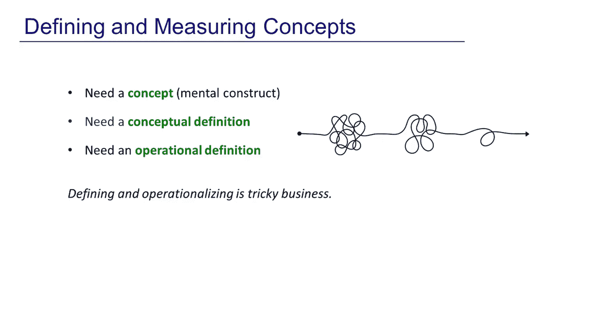
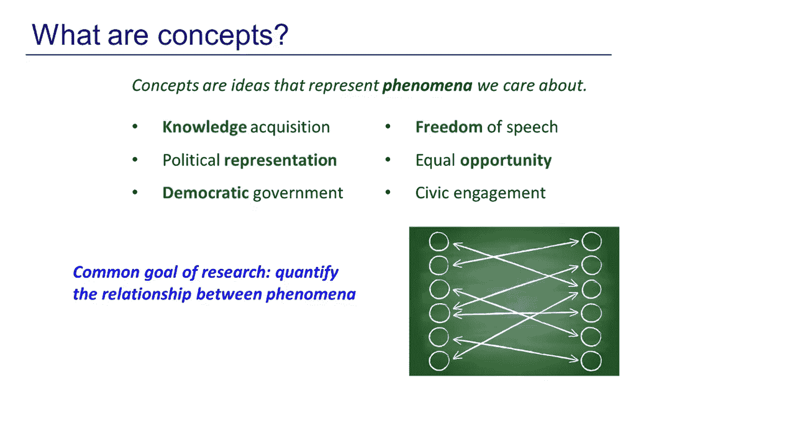
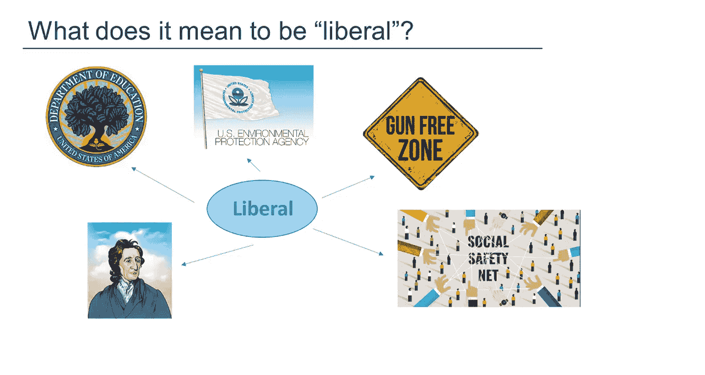
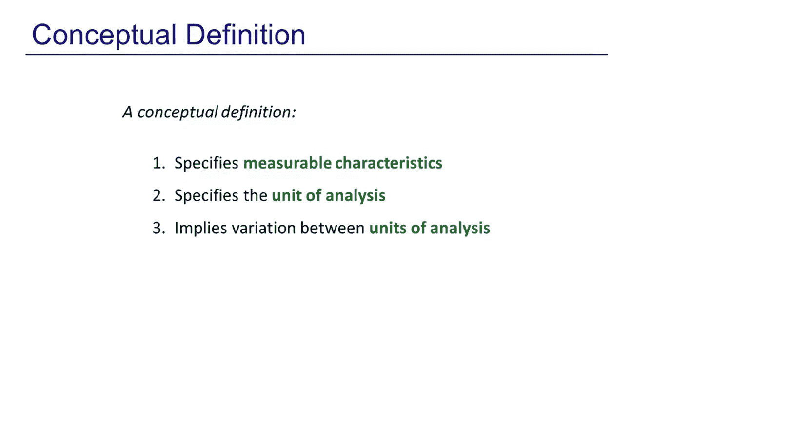
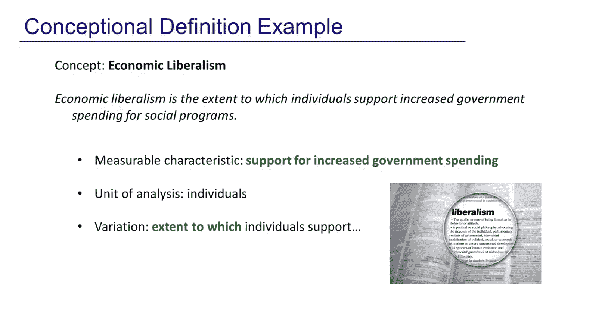
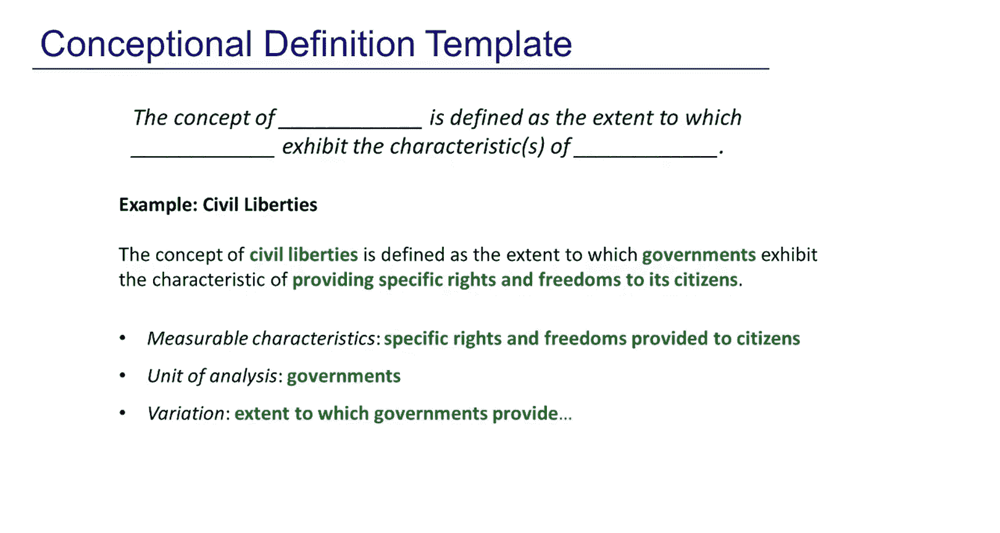
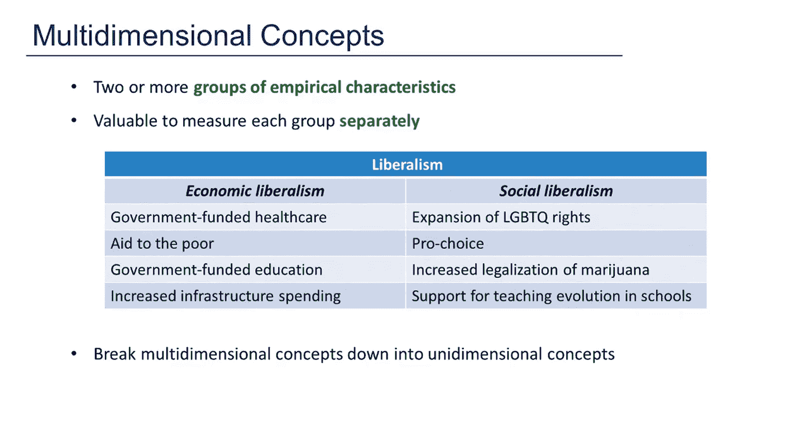
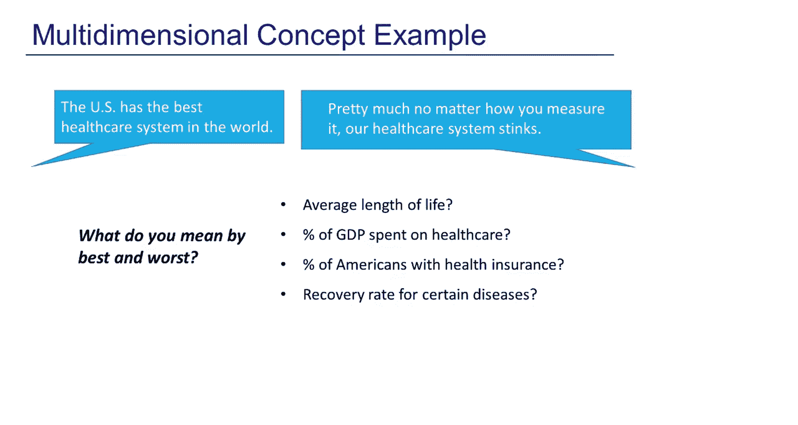

#  020：概念定义 📚

在本节课中，我们将要学习如何定义和测量概念。分析人员常常需要研究那些难以定义或复杂的概念，例如健康、平等和机会。通过本视频的学习，你将能够构建一个概念定义，并以此为基础创建操作化定义（我们将在下一个视频中讨论）。

## 什么是概念？🤔

上一节我们介绍了本模块的概览，本节中我们来看看什么是概念。概念是一种心理建构，它代表了我们所关心的某个想法或现象。概念可以是诸如政治意识形态、自由、政治参与或社会经济地位等事物。在我们思考如何测量这些概念之前，需要先定义我们所要研究的概念。

概念的定义应包含一个或多个可测量的属性，以及分析单位。在构建了概念定义之后，我们才能进一步制定操作化定义（这将在下一个视频中介绍）。定义和操作化概念是具有挑战性的，我们将在课程后面讨论为什么这项工作如此棘手。

---

首先，让我们退一步回答这个问题：概念究竟是什么？正如前面所说，概念是代表我们所关心现象的想法。概念可以是诸如拥有保守意识形态、获得政治代表权、成为民主政府的一部分、保护言论自由、拥有平等机会或积极参与公民事务等。

研究的一个常见目标是量化现象之间的关系，但为了能够量化这种关系，我们必须首先定义所涉及的概念。

---

## 定义“自由”意味着什么？🧐

当你开始思考概念时，可能会意识到有些概念比其他概念更难定义，有些则相当复杂。例如，让我们思考一下“自由”意味着什么。

如果你是一个自由主义者，你可能支持联邦政府在教育中扮演强有力的角色。因此，你可能会认为教育部应该增加资金。或者，你可能相信联邦政府有责任为那些陷入困境的人提供社会安全网。你也可能支持一个积极的环境保护机构。或者，你可能认为国家需要更严格的枪支管制法律。又或者，你可能想从古典的洛克式意义上定义自由主义者，即相信私有财产、有限政府和个人自由的人。

那么，你会在定义中包含这些属性中的哪一个？一个？一部分？还是全部？这些都是研究人员必须做出的决定，并且在撰写研究成果时必须解释和证明这些决定。

---

## 概念定义 📝

上一节我们探讨了概念的复杂性，本节中我们来分解概念定义的组成部分。一个概念定义需要完成三件事，并且确保定义涵盖所有这些项目非常重要。

具体来说，一个概念定义需要：
1.  指明可测量的特征。
2.  指明分析单位。
3.  暗示分析单位之间存在差异。

让我们通过一个例子来理解每一项的含义。

---

## 概念定义示例

假设我们想定义“经济自由主义”这个概念。我们可以将经济自由主义定义为：**个体支持增加社会项目政府支出的程度**。

在这个定义中：
*   **可测量的特征**是“对增加政府支出的支持”。之后，我们可以思考测量这种支持的不同方式，例如使用调查问题。
*   **分析单位**是“个体”。这意味着我们关心的实体是个人。
*   这个定义也**暗示了差异**。我们预期个体在经济自由主义的程度上会有所不同。短语“**程度**”就暗示了这种差异。因此，在你的概念定义中包含这个短语非常重要。

如果每个人在经济自由主义的程度上都相同，例如，你就无法研究经济自由主义的变化是否与感兴趣的结果（如投票选择）相关联。

---

## 概念定义模板

这个幻灯片展示了一个你可以用来构建良好概念定义的模板。

> **概念定义模板**：`[概念]` 被定义为 `[分析单位]` 表现出 `[可测量特征]` 特征的程度。

*   第一个空白处填入你想要定义的概念。
*   第二个空白处填入分析单位。
*   第三个空白处列出可测量的特征。

让我们看一个例子。假设你想定义“公民自由”这个概念。你可以说：

> **公民自由**被定义为 **政府** 向其公民提供特定权利和自由的特征的程度。

在这个定义中：
*   **可测量的特征**是“向公民提供的特定权利和自由”。之后，你可以思考实际测量这些特征的不同方法。
*   **分析单位**是“政府”。
*   通过使用“**程度**”这个短语暗示了差异。根据这个定义，政府在向公民提供特定权利和自由的特征上存在程度差异。

---

## 多维概念 🔄

许多概念是多维的。多维概念是指由两个或更多组经验特征构成的概念（“经验的”指的是事实的或可观察的）。如果你有一个多维概念，分别测量每一组特征可能很有价值。

例如，自由主义无疑可以被视为一个多维概念。我们可能希望分别测量经济自由主义和社会自由主义。

以下是经济自由主义的一些特征：
*   支持政府资助的医疗保健。
*   支持向穷人提供援助。
*   支持政府资助的教育。
*   支持增加联邦基础设施投资。

相比之下，社会自由主义则由另一组不同的可测量特征来定义。如果一个人符合以下特征，我们可能将其定义为社会自由主义者：
*   支持扩大LGBTQ权利。
*   支持堕胎合法化（pro-choice）。
*   支持大麻合法化。
*   支持在学校教授进化论。

关键在于，在构建概念定义时，要将多维概念分解为单维概念。

---

## 多维概念示例：医疗保健 🏥

医疗保健是多维概念的另一个例子。有些人认为美国拥有世界上最好的医疗保健系统，而另一些人则持完全相反的观点。但要评估我们医疗保健系统的质量，你首先需要确定“最好”和“最差”对你意味着什么。

我们如何知道一个医疗保健系统是最好的还是糟糕的？我们可以测量一个国家的平均寿命，或者医疗保健支出占GDP的百分比。我们可以测量拥有健康保险的美国人的比例，或者测量某些疾病的康复率。

这些可测量的特征可以被归类到不同的组中，每一组都代表了医疗保健概念的不同维度。

关键要点是：任何分析都需要测量，而良好的测量依赖于构建良好的概念定义。

---

## 总结 📋

本节课中我们一起学习了概念定义的核心内容。我们了解到，概念是代表我们所关心现象的心理建构。一个有效的概念定义需要明确可测量的特征、分析单位，并暗示单位间的差异。我们还探讨了如何使用模板来构建定义，并认识到许多复杂概念是多维的，需要被分解为更具体的单维概念进行定义和测量。掌握这些是进行严谨数据分析的第一步。在下一节中，我们将学习如何将这些概念定义转化为可实际测量的操作化定义。