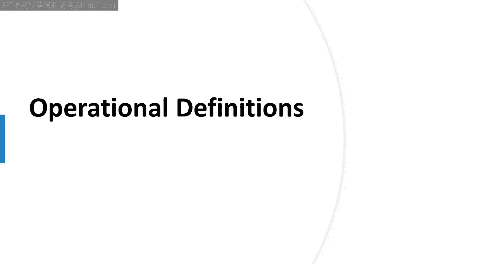
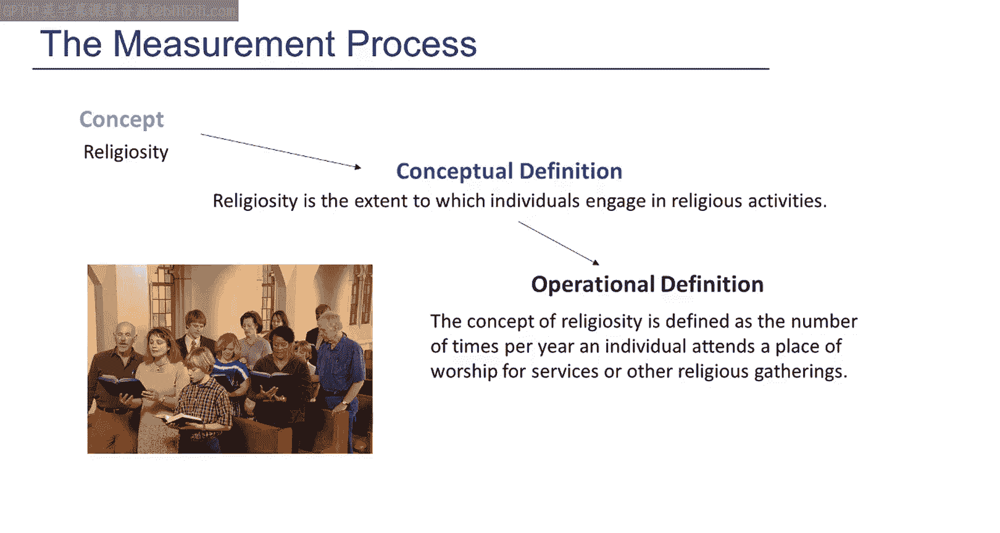
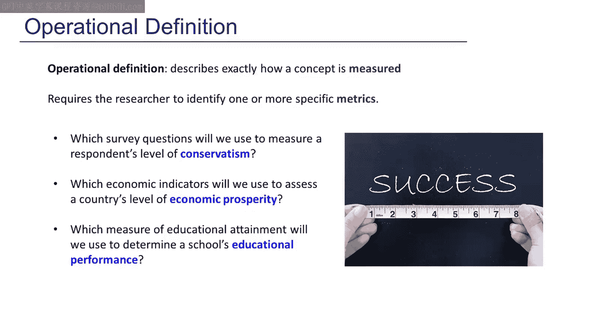
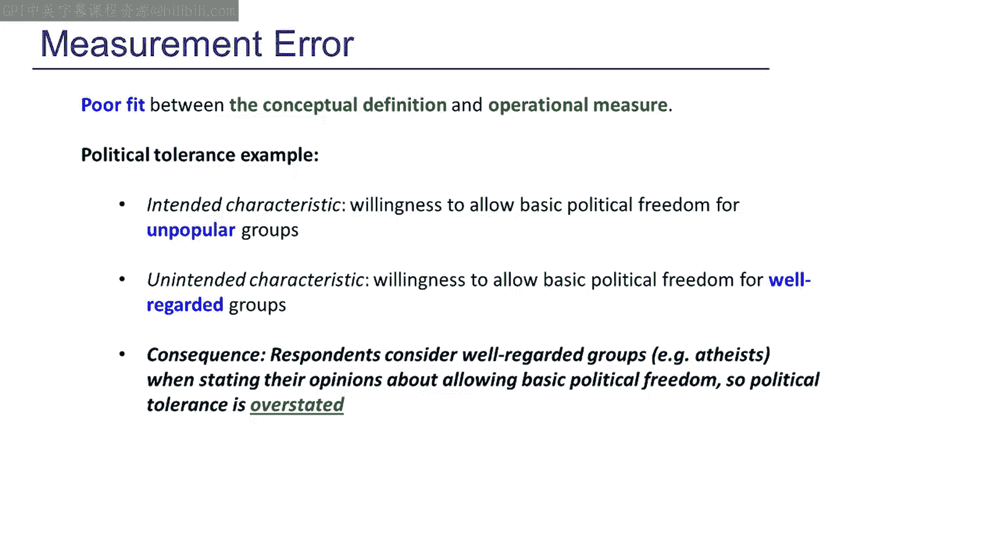

#  021：操作定义 📝

在本节课中，我们将要学习如何构建和评估一个概念的操作定义。操作定义是测量过程中的关键一步，它明确了我们如何具体测量所研究的概念。

---

上一节我们介绍了概念定义，本节中我们来看看如何将概念定义转化为可测量的具体步骤。

操作定义描述了测量一个概念的确切方式。它要求研究者确定一个或多个具体的度量指标。

以下是构建操作定义时需要考虑的几个方面：

*   **研究概念**：首先明确你要测量的核心概念是什么。
*   **具体指标**：确定用于量化该概念的一个或多个具体、可观察的指标。
*   **测量方法**：说明如何收集这些指标的数据（例如，通过调查、观察或现有数据）。

---

## 示例：测量政治容忍度

让我们通过一个例子来具体理解。假设我们研究的概念是“政治容忍度”。

一个合理的概念定义是：**政治容忍度是指个人表现出愿意允许不受欢迎的群体享有基本政治自由的特征的程度**。

这个定义包含了概念（政治容忍度）、分析单位（个人）以及一个可测量的特征（表达意愿的程度）。

接下来，我们可以用以下两个调查问题来操作化这个概念：

1.  是否应该允许无神论者、社会主义者、共产主义者和极端组织成员发表公开演讲？
2.  是否应该允许无神论者、社会主义者、共产主义者和极端组织成员出版书籍？

需要注意的是，在使用此类调查问题时，通常会对列出的每一个不受欢迎的群体重复提问。

现在，请思考一下：这些调查问题捕捉到的是否确实是“个人允许不受欢迎群体享有基本政治自由的意愿”？如果不是，那么在概念定义和操作定义之间就可能存在偏差。

---

## 测量误差

当概念定义与经验或操作测量之间匹配不佳时，就会发生**测量误差**。我们将在课程的第四模块更详细地讨论这个问题。

操作测量应该捕捉到**预期的特征**，而不是**非预期的特征**。

让我们回到政治容忍度的例子。

*   **预期特征**：个人允许**不受欢迎群体**享有基本政治自由的意愿。
*   **非预期特征**：个人允许**受尊重群体**享有基本政治自由的意愿。

在前面幻灯片提到的调查问题中，受访者被问及关于“无神论者”的看法。对许多受访者而言，无神论者可能并非一个不受欢迎的群体，甚至可能是一个受尊重的群体。其后果是，部分受访者在回答问题时，考虑的是受尊重的群体，从而导致受访者中政治容忍度的普遍程度被高估。

---

本节课中我们一起学习了操作定义的重要性及其构建方法。一个好的操作定义是进行有效测量的基石。同时，我们也看到了创建精准的操作定义所面临的挑战——确保其能准确捕捉概念的核心，而排除无关特征。

在评估任何一项研究时，仔细审视其所采用的操作定义实际测量了什么、又没有测量什么，是至关重要的。