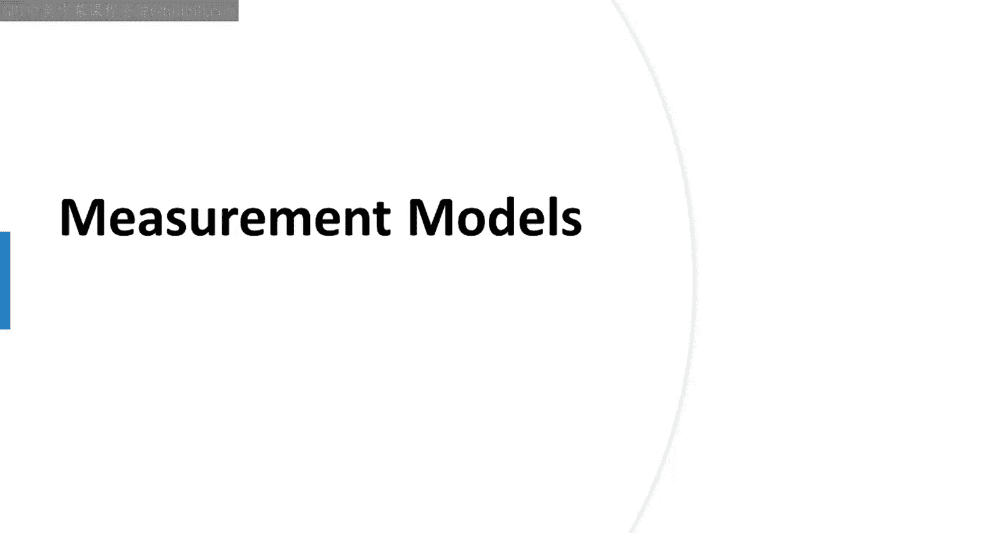
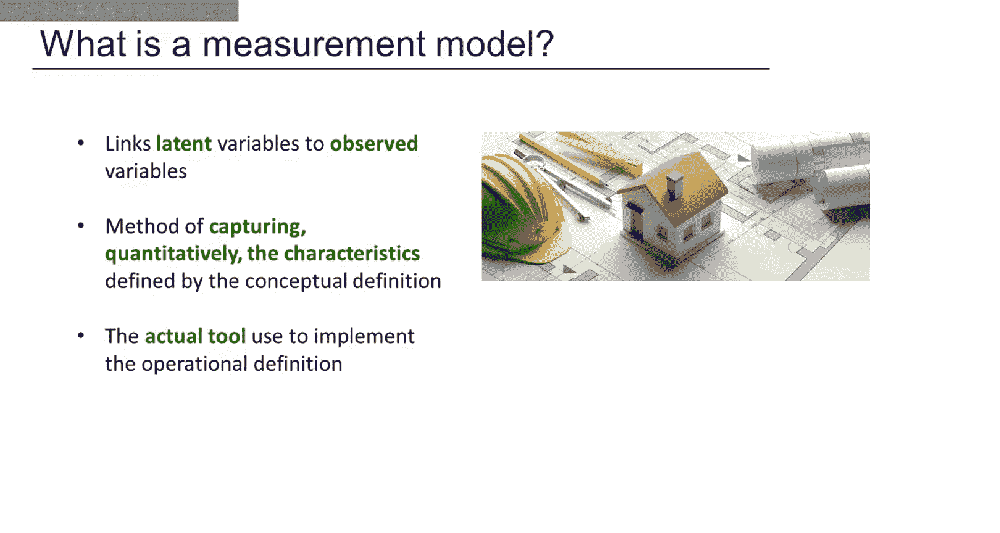
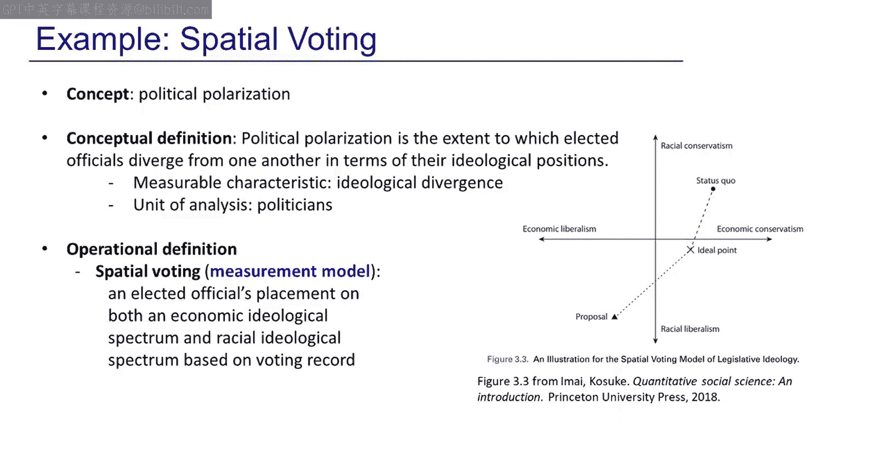
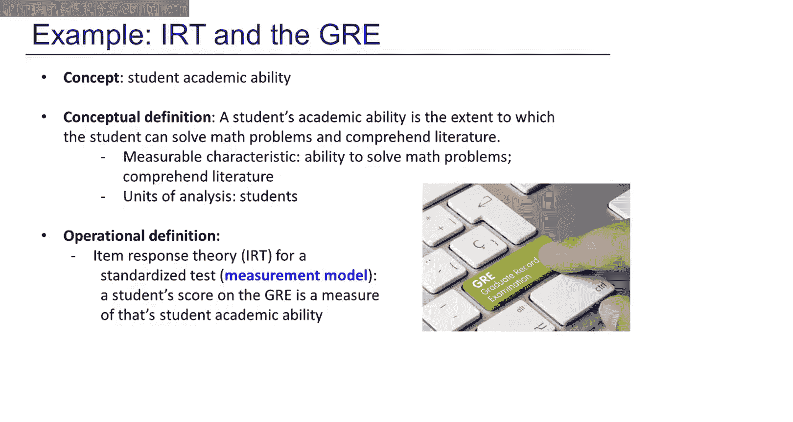
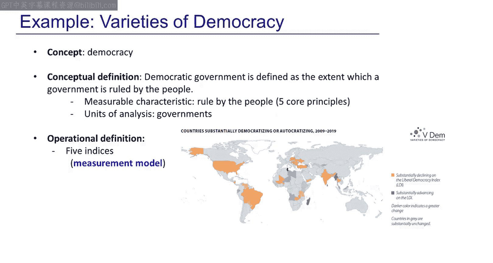

#  022：测量模型 📏

在本节课中，我们将要学习什么是测量模型，以及它在将抽象概念转化为可量化数据过程中的关键作用。我们将通过几个具体例子来理解测量模型的构成和应用。

## 什么是测量模型？🤔

测量模型是构建一个良好的概念定义和操作定义的最终成果。它们是研究者为实现收集关于感兴趣概念的定量信息这一目的，所采用的工具或方法。

测量模型有几种不同的描述和定义方式。首先，测量模型可以被视为一种将**潜变量**与**观测变量**联系起来的方法论。潜变量是我们无法直接观察到的事物，例如对政府的信任、教育机会与获取的质量。这些是我们想要研究的概念。观测变量则是这些概念的表现形式。例如，我们可能观察到调查受访者表示他们认可其民选官员，这就是对潜变量“对政府的信任”的一种测量。这个调查问题就是“对政府的信任”的操作化定义。

使用略有不同的术语，我们可以说测量模型是一种定量捕捉由概念定义所界定的特征的方法。换句话说，它是用于实施研究者操作定义的实际工具或仪器。

关键要点是：**测量模型是将概念的操作定义转化为数据的手段**。

## 示例一：空间投票模型 🗳️

上一节我们介绍了测量模型的基本概念，本节中我们来看看一个具体的例子。政治学家常用的一种测量模型是空间投票模型，它有助于更好地理解立法者的意识形态。

假设你对研究政治极化现象感兴趣。换句话说，政治极化是你的兴趣概念。一个有用的概念定义可能是：“政治极化是政治家在意识形态立场上彼此分化的程度。”这个定义之所以有用，是因为它包含了一个可测量的特征，即意识形态分化。它还定义了分析单位，在本例中是民选官员。你也可以想象测量公民甚至候选人的意识形态分化。

为了将这个概念定义操作化，我们可以采用空间投票模型，这是一种测量意识形态分化的方法。我们可以将其称为测量模型。在这种情况下，空间投票模型根据官员的投票记录，确定每位民选官员在经济意识形态光谱和种族意识形态光谱上的位置。一旦你获得了每位官员的位置，你就可以想象可视化官员之间或官员群体（例如民主党人和共和党人）之间的距离。

## 示例二：项目反应理论与GRE考试 📝

接下来，我们看看另一个常用的测量模型例子。假设你对研究学生的学术能力感兴趣。一个好的概念定义是：“学生的学术能力是指学生解决数学问题和理解文学作品的程度。”这个定义包含了可测量的特征，即解决数学问题和理解文学作品的能力，以及分析单位，在本例中是学生。

为了将这个操作化，研究人员开发了一种称为项目反应理论的测量模型，并将其应用于标准化测试。根据项目反应理论设计的测试，会向应试者呈现一系列问题，随着问题被正确回答，题目难度会增加，反之亦然。GRE考试就是根据项目反应理论设计的测试的一个例子，研究生项目招生委员会经常用它来衡量学生的学术能力。

## 示例三：民主多样性 🌍

对于那些有兴趣研究和比较政府的人来说，民主多样性是另一个有用的测量模型。在这种情况下，兴趣概念是民主。我们可以将这个概念定义为“政府由人民统治的程度”。这是一个非常简短的定义。当然，一个更有用的定义会扩展“人民统治”的含义，并确定关键原则，例如举行自由公正的选举、公民参与以及协商性政策制定和决策。这些都是可测量的特征。

在这种情况下，分析单位是政府。虽然民主多样性组织专注于国家层面的政府，但你也可以想象将这个测量模型应用于州甚至市政府。概念定义被操作化为五个指数。构成这些指数的有450个指标，其中大多数是通过由各国专家填写的问卷来测量的。然后，分析师可以检查数据，对国家进行分类，并观察民主化随时间的趋势，如幻灯片右侧图表所示。

## 总结与展望 📊

本节课中我们一起学习了测量模型的核心作用，它作为连接抽象概念与具体数据的桥梁。我们探讨了其定义，即通过观测变量来量化潜变量的方法论工具，并通过空间投票模型、项目反应理论（GRE考试）和民主多样性指数三个具体案例，展示了测量模型如何将“政治极化”、“学术能力”和“民主”等概念转化为可分析的数据。

数据科学家会使用许多测量模型，研究人员也经常创建自己的模型。在本课程的后续部分，我们将讨论如何从误差敏感性、可靠性以及效度等方面来评估这些模型。