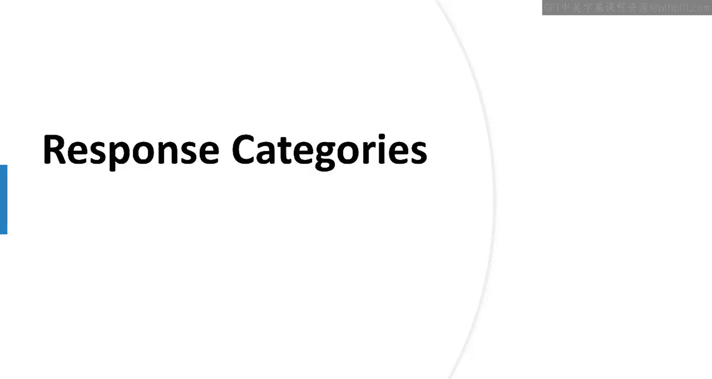
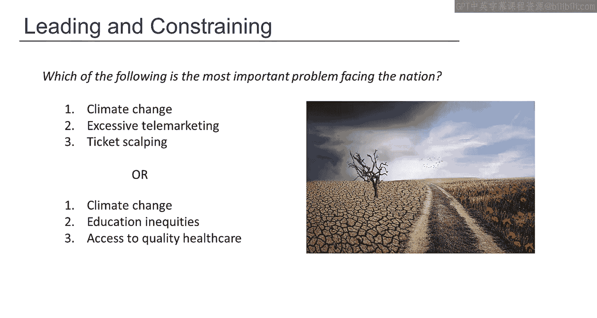
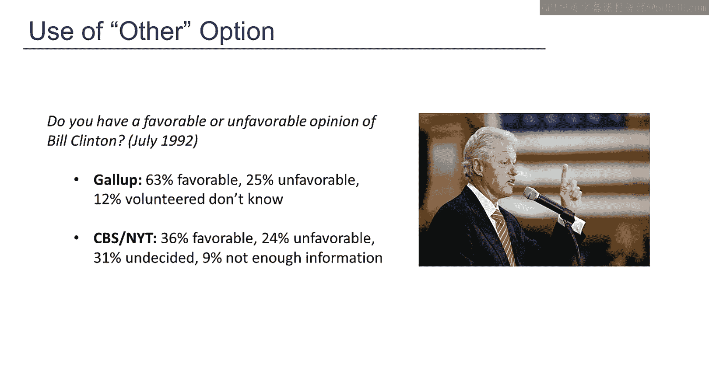
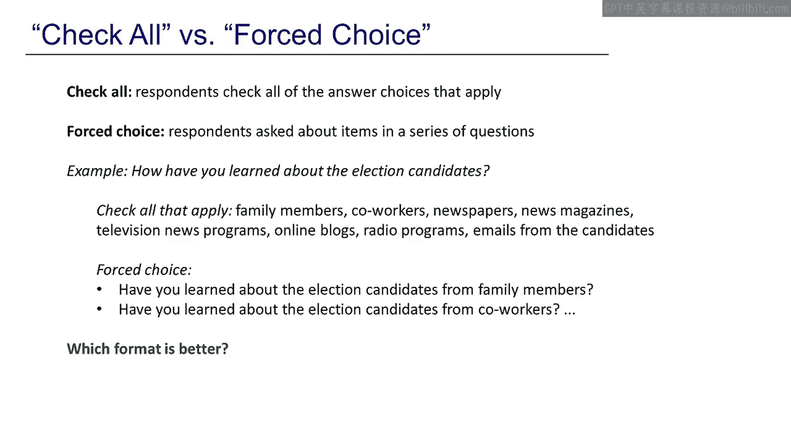

#  025：回答类别设计指南 📝

在本节课程中，我们将学习如何为调查问卷设计有效的回答类别。除了精心设计问题措辞，调查设计者还必须仔细考虑所使用的回答选项，并权衡不同回答格式的优缺点。课程结束时，你将能够评估特定调查问题的回答选项是否恰当。

---

## 引导与限制作用

上一节我们讨论了问题措辞的重要性，本节中我们来看看回答选项本身如何影响调查结果。为任何特定问题提供的回答选项，都可能引导受访者选择某个答案。这是因为，回答选项在定义上就常常限制或约束了受访者只能在该组选项中进行选择。

考虑一个常用问题：“以下哪项是国家面临的最重要问题？”

现在，假设答案选项组包含：**气候变化**、**过多的电话营销**和**票务黄牛**。显然，这是一个极端的例子，但它强调了关键点。给定这组选项，许多受访者会选择“气候变化”，因为许多人会认为这比其他两个选项更重要。

现在想象选项是：**气候变化**、**教育不平等**和**获得优质医疗保健**。你可以想象，如果提供这些选项，受访者的答案分布会分散得多。

核心要点是：提供给受访者的回答选项组限制了他们的选择范围，因此如果设计不当，可能会影响结果。

---

## “其他”或“不知道”选项

设计回答类别时的另一个考虑因素是是否使用“其他”或“不知道”选项。请看本幻灯片上的问题，该问题用于1992年7月比尔·克林顿首次竞选总统时的一项电话调查。

问题询问受访者对比尔·克林顿的看法是“赞成”还是“不赞成”。

盖洛普版本的问题没有包含“不知道”选项，而哥伦比亚广播公司/《纽约时报》的版本则同时包含了“未决定”选项和“信息不足”选项。

盖洛普调查中，**63%** 的受访者表示持赞成意见，只有 **12%** 的受访者主动提供了“不知道”的回答。请记住，比尔·克林顿在当时是国家政治舞台上的相对新人。

相比之下，哥伦比亚广播公司/《纽约时报》民意调查中，只有 **36%** 的受访者报告持赞成意见，而 **40%** 的受访者选择了“未决定”或“信息不足”选项。

这个例子凸显了使用“其他”或“不知道”选项的重要性，特别是当受访者没有完全成形的意见或回答是完全可以理解或合理的时候。

---

## “全选”与“强制选择”

最后，一些调查问题允许受访者“选择所有适用项”，而另一些调查则将这类问题分解为多个“强制选择”问题。让我们通过一个例子来理解。

假设一个调查问题询问受访者：“你是如何了解选举候选人的？”

一个“全选”的回答可能包括以下选项：
*   家人
*   同事
*   报纸
*   新闻杂志
*   电视新闻节目
*   网络博客
*   广播节目
*   候选人发送的电子邮件

相比之下，“强制选择”的回答方式会逐一询问上述每个答案选项，要求受访者回答他们是否从特定来源了解选举候选人。

实验研究表明，受访者在“强制选择”的回答结构下会选择更多项目。因此，这种选项通常更可取。虽然它更耗时，但证据表明它往往能产生更好的结果。

因此，正如你所见，在追求清晰、明确和简洁的目标之间需要权衡取舍。与定量研究中的常见情况一样，分析人员必须运用最佳判断，并对他们所做的方**法**选择保持透明。

---

## 总结

本节课中，我们一起学习了设计调查问卷回答类别的关键考量。我们探讨了回答选项如何**引导和限制**受访者的选择，强调了在适当情况下提供“**不知道**”选项的重要性，并比较了“**全选**”与“**强制选择**”两种格式的优劣。记住，良好的回答类别设计对于获取有效、无偏的数据至关重要。