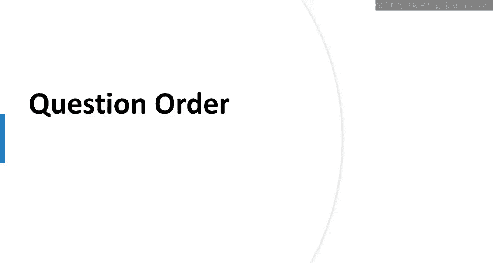
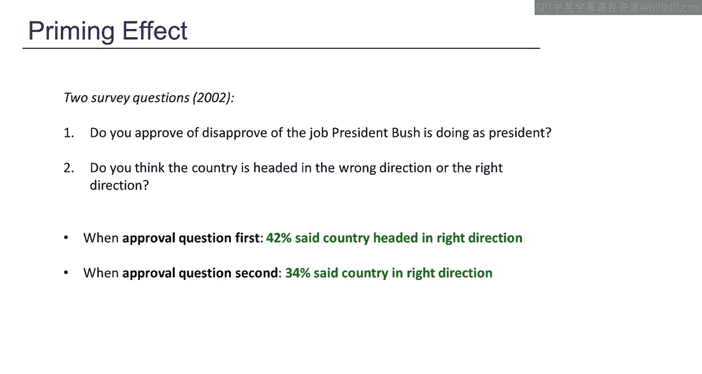
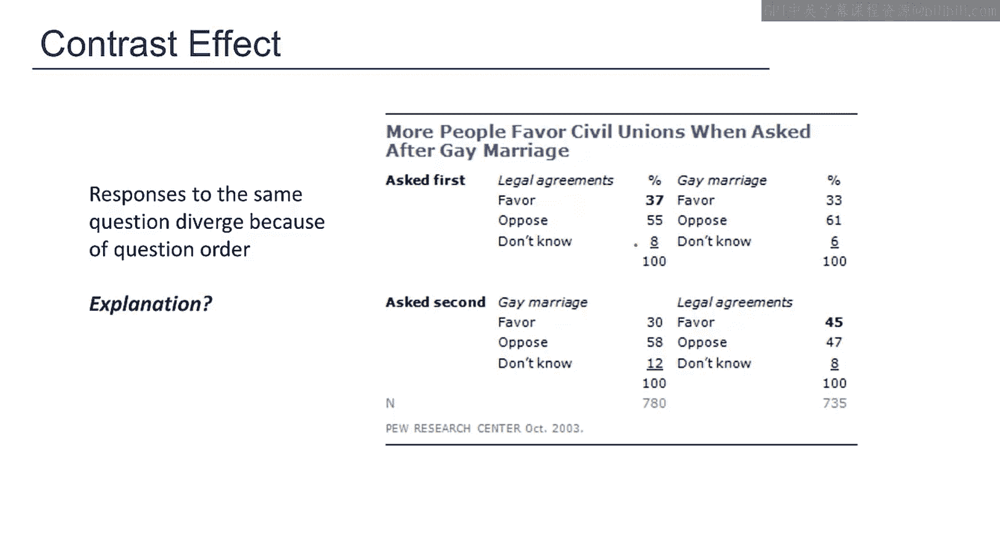
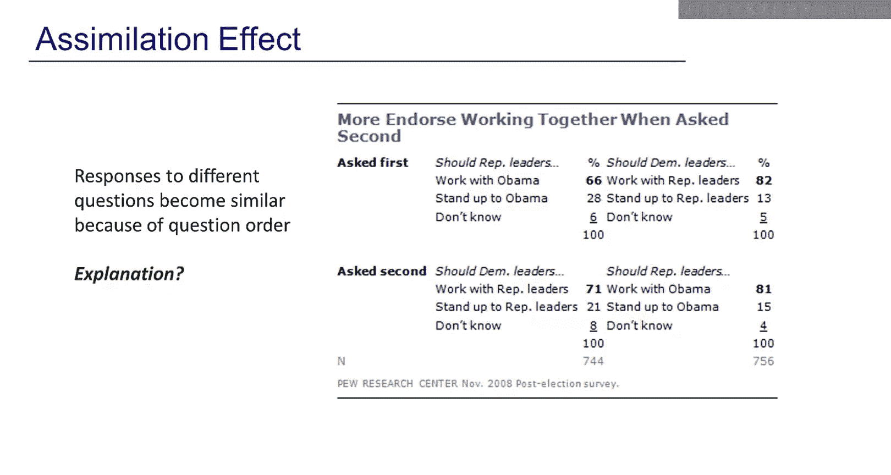

#  026：问题顺序 📋

在本节课中，我们将要学习问卷调查设计的第三个主要元素——问题顺序。除了问题措辞和回答选项，问题的排列顺序同样会显著影响调查结果。我们将探讨问题顺序如何通过启动效应、对比效应和同化效应来影响受访者的回答。

## 启动效应 ⚡

上一节我们介绍了问题顺序的重要性，本节中我们来看看第一种效应——启动效应。在调查语境中，启动效应是指研究者有意或无意地让受访者在回答某个问题时，先思考某个特定事物。

在单个研究问题中，如果问题以“如您所知”之类的短语开头，就会产生启动效应，受访者被明确要求在回答时考虑该信息。

在问题顺序层面，当受访者回答调查中的后续问题时，会考虑前一个问题中强调的议题或人物，启动效应便可能发生。

以下是2002年一项调查实验中的两个问题示例：

*   问题一：您赞成还是不赞成布什总统作为总统的工作表现？
*   问题二：您认为国家正朝着正确的方向还是错误的方向前进？

在该实验中，一半受访者先回答问题一，另一半先回答问题二。在**先回答总统支持率问题**的受访者中，有42%的人认为国家方向正确。而在**后回答总统支持率问题**的受访者中，只有34%的人认为国家方向正确。

因此，在思考国家方向时，通过问题顺序**启动**受访者去特别考虑布什总统，对回答的分布产生了显著影响。

## 对比效应 ↔️

我们已经了解了启动效应，接下来探讨问题顺序可能引发的另一种效应——对比效应。对比效应是指，由于问题顺序的不同，对同一个问题的回答出现分歧。

请看这张幻灯片上的表格，它报告了皮尤研究中心在2003年进行的一项调查实验的结果。该实验向每组受访者提出两个问题：

1.  是否应允许同性伴侣缔结法律协议，赋予他们与已婚夫妇相同的权利？
2.  是否应允许同性伴侣结婚？

当**先询问法律协议问题**时，支持法律协议和支持同性婚姻的受访者比例相近。相反，当**先询问同性婚姻问题**时，对法律协议的支持率与对同性婚姻的支持率之间出现了12个百分点的差距。此外，两个实验组之间对法律协议的支持率也相差8个百分点，这再次凸显了基于问题顺序的回答差异。

## 同化效应 🔄

与对比效应相反，同化效应是指由于问题顺序的影响，对不同问题的回答变得相似。

请看幻灯片上的例子。该表格显示了2008年美国大选后一项调查的实验证据。一组受访者先被问及“共和党领导人应该与奥巴马总统合作还是对抗他？”，然后被问及“民主党领导人应该与共和党领导人合作还是对抗他们？”。另一组则以相反的顺序回答同样的问题。

在**先被问及民主党与共和党合作问题**的组别中，绝大多数人支持两党合作，比例分别为82%和81%。而当**问题顺序颠倒**后，对两党合作的支持率更低且分歧更大，分别为66%和71%。这表明，问题顺序，特别是**不以奥巴马总统的问题收尾**，导致了回答的同化。

## 总结 📝

本节课中我们一起学习了问题顺序如何以强有力的方式影响调查结果，这与问题措辞和回答选项类别的影响类似。调查设计者必须密切关注这三个设计类别，而解读调查结果的人也必须同样考虑每一项在影响调查结果中所扮演的角色。核心要点在于，审慎设计问题顺序对于获取准确、无偏的数据至关重要。