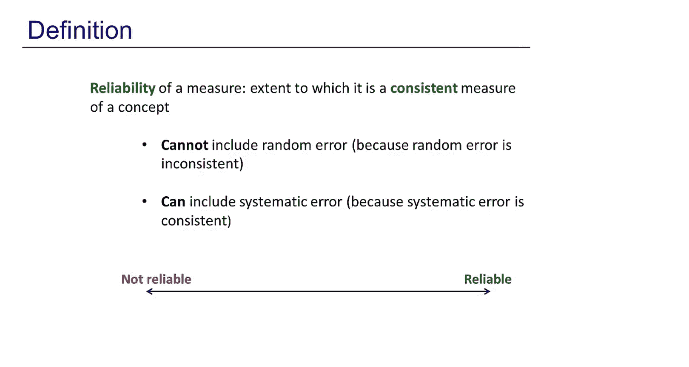
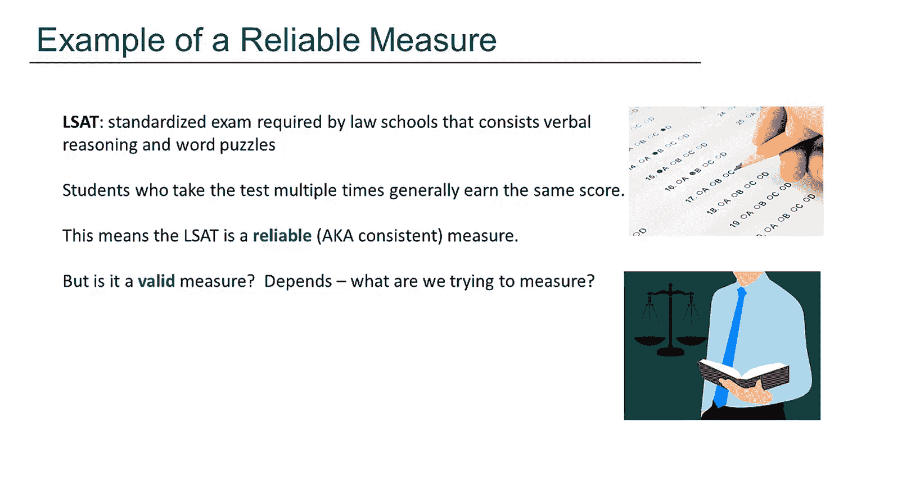
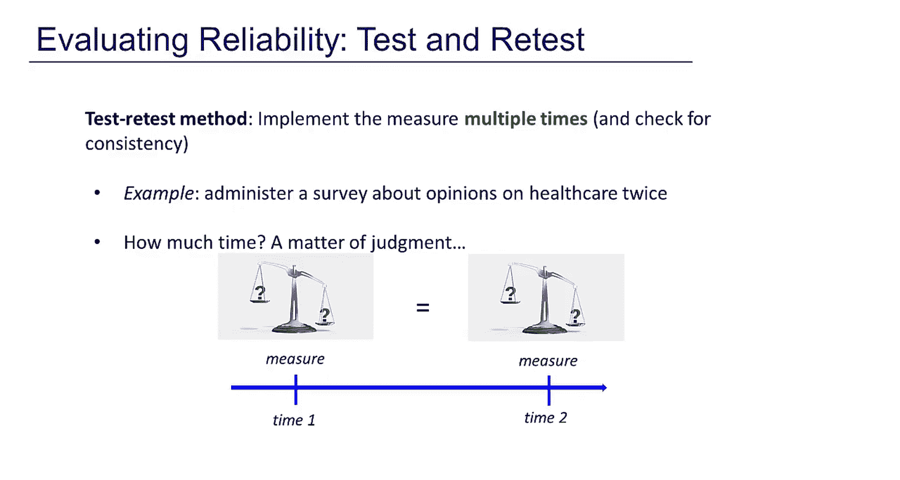
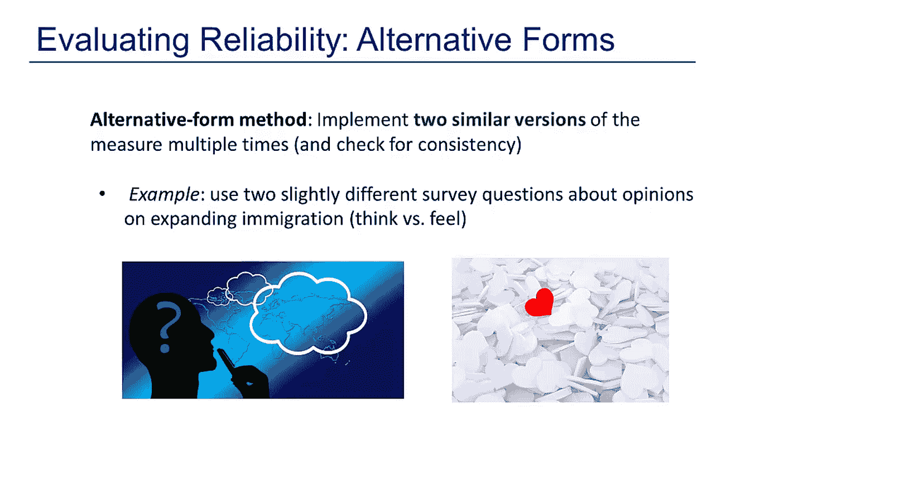
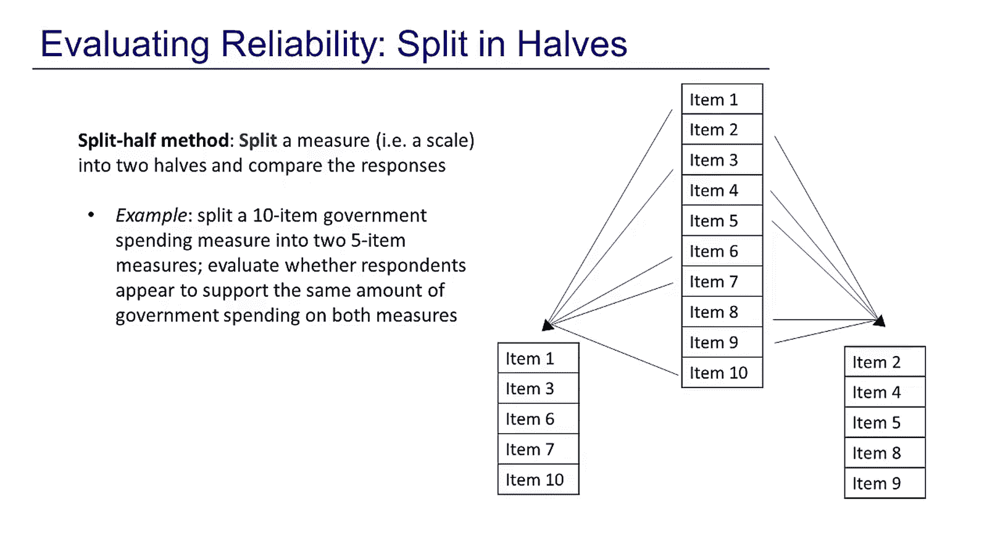

#  028：可靠性 📊

在本节课中，我们将学习如何评估测量工具的质量，重点聚焦于“可靠性”这一核心概念。可靠性关注的是测量结果的一致性。我们将探讨可靠性的定义、它与测量误差的关系，并介绍几种评估可靠性的具体方法。

## 可靠性的定义与核心概念

上一节我们介绍了评估测量质量的重要性，本节中我们来看看可靠性的具体含义。

测量的可靠性是指其作为某个概念测量工具的一致性程度。需要注意的是，一个可靠的测量**不能**包含随机测量误差，因为根据定义，随机测量误差是不一致的，它会在每次测量时使结果向不同方向偏移。

然而，一个可靠的测量**可以**包含系统测量误差。这是因为系统测量误差是**一致**的，它会在每次测量时使结果向同一个方向偏移。一个包含系统误差的可靠测量，仅仅意味着该测量是“一贯错误”的。

因此，可靠性完全关乎**一致性**。将可靠性理解为一个连续谱系很重要；一个测量并非简单地“可靠”或“不可靠”，而是具有**不同程度的可靠性**。在本视频结尾，我们将介绍几种评估测量可靠性水平的不同方法。

## 可靠性的示例：LSAT考试

为了理解可靠性，让我们看一个可靠测量的例子。LSAT（法学院入学考试）是法学院要求的标准化考试，包含言语推理和文字推理部分。即使学生多次参加LSAT考试，他们通常也能获得大致相同的分数。这意味着LSAT是一个可靠或一致的测量。

但它是一个有效的测量吗？这取决于情况。LSAT试图测量什么？它是试图测量某人在法律实践中的成功程度，还是作为智力的一般性测量？这些及相关问题的答案告诉我们该测量的效度，我们将在下一个视频中详细讨论。然而，从这个例子中得到的一个关键要点是：**可靠性并不总是等于效度**。一个测量可以是**一致的**，即使它没有精确捕捉到你想要测量的内容。

## 评估可靠性的方法

理解了可靠性的概念后，我们来看看如何实际评估它。以下是几种常用的可靠性评估方法。

### 重测法

重测法要求研究者多次实施同一测量并检查其一致性。例如，研究者可能就医疗保健意见对同一批受访者进行两次相同的调查，然后比较答案。如果调查是可靠的，两次实施的答案应该相同。

使用重测法时，研究者必须回答一个问题：我应该间隔多长时间对同一人群再次实施相同的调查？这是一个需要判断的问题，没有标准答案。通常，间隔一周进行再次调查似乎是合理的。

此方法也常用于评估测试工具。想象你是一名儿童心理学家，想创建一个测试来衡量儿童在不同领域的自尊水平。为了评估该测试的可靠性，你可以间隔一周对同一批儿童实施两次相同的测试。如果测试结果相同或至少高度相关，你就有了证据表明该测试是一个可靠的工具。

### 复本法

另一种评估可靠性的方法是使用复本法。

使用复本法时，研究者多次实施一个测量的两个相似版本，然后检查它们之间的一致性。例如，考虑两个略有不同的调查问题，用于测量对扩大移民的意见。在一个版本的问题中，研究者可能询问受访者对扩大移民进入他们国家的看法，而另一个版本可能询问受访者对扩大移民进入他们国家的感受。然后，研究者可以检查一个词的改变在多大程度上改变了调查回应。相似的回应表明该问题对这个词语变化不敏感，因此该调查问题可以被认为是可靠的。

### 分半法

最后，使用分半法时，研究者将一个测量（例如一个量表）分成两半，然后比较回应。例如，想象一个由10个不同项目组成的“对政府信任度”测量。每个项目都是一个调查问题，询问受访者关于对政府信任的不同方面，例如他们是否相信公职人员为国家的最佳利益行事，以及他们是否相信选举过程是公平的。

然后，研究者可以将这个10个项目的测量分成两个5个项目的测量，并评估受访者对这两个测量是否表达了相同水平的信任。如果这两个5个项目的测量高度相关，那就提供了证据，表明这些不同的信任指标是可靠的，因此将它们组合成一个单一的对政府信任度测量是合理的。

## 总结

本节课中我们一起学习了测量的可靠性。可靠性是测量的一个关键特征。如果一个测量每次实施都产生非常不同的结果，那将是非常令人担忧的。一个可靠的测量是每次实施都能捕捉到相同信息的测量。我们了解到，可靠性关乎一致性，它与效度不同，并且可以通过重测法、复本法和分半法等方法进行评估。在下一节中，我们将探讨与可靠性密切相关的另一个重要概念——效度。