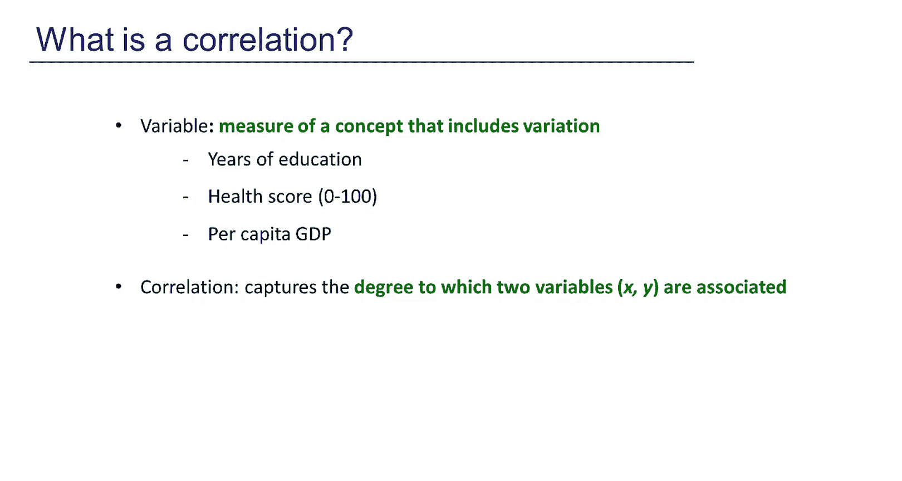
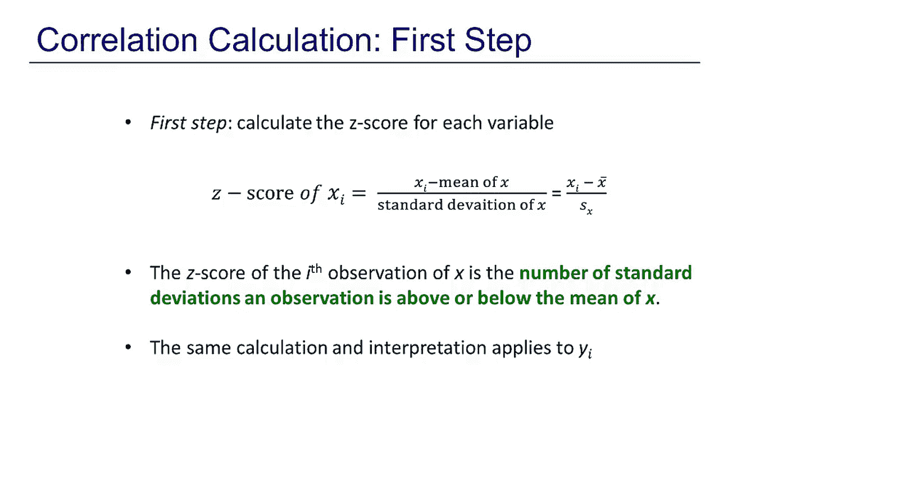
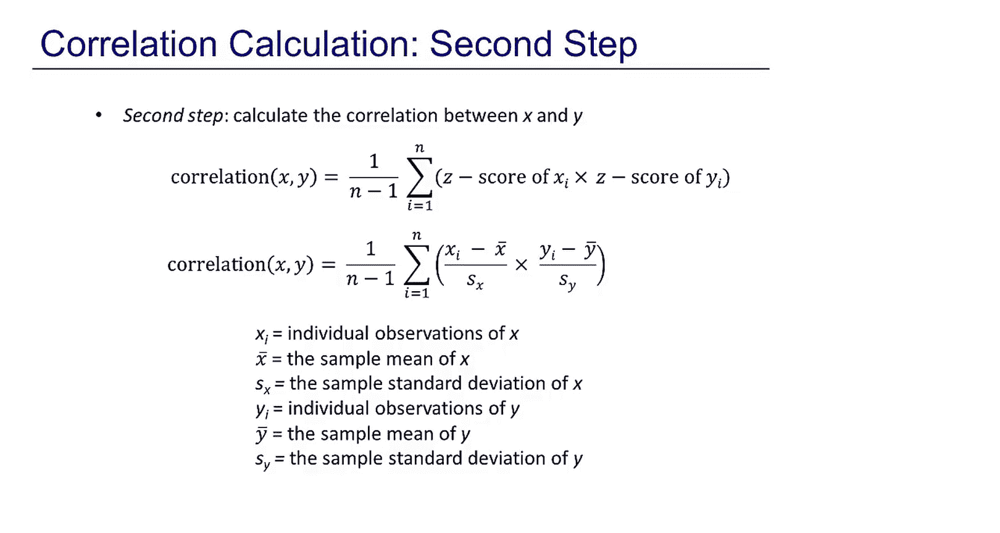
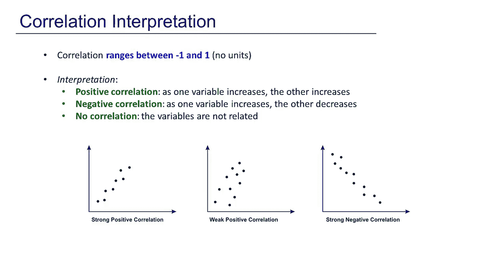
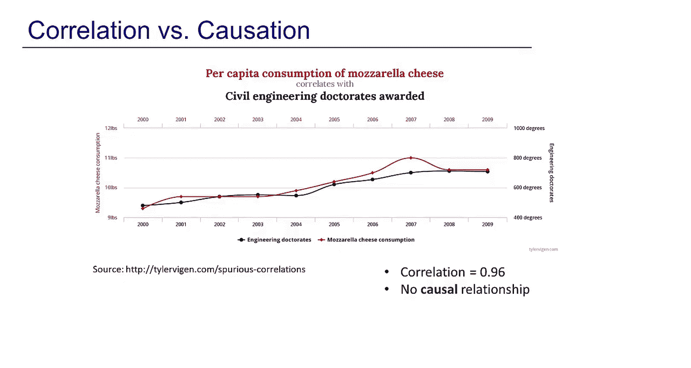
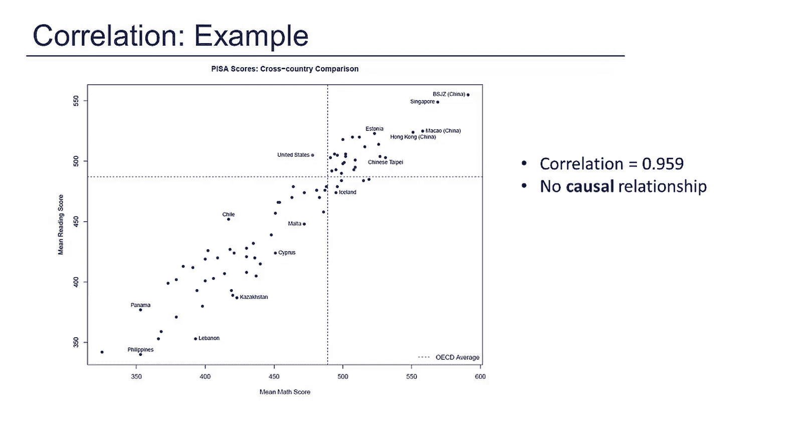
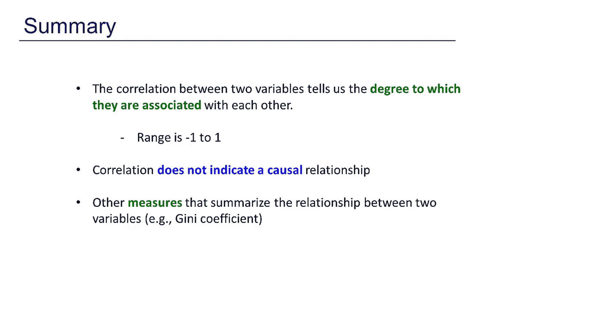

**数据素养：1.1：相关性 📊**

在本节课中，我们将学习如何量化数据中变量之间的关系。具体来说，我们将探讨**相关性**的概念，了解其计算方法、取值范围，并理解其与因果关系的区别。

---

在数据素养专项课程的第一门课中，我们讨论了描述数据中心和离散程度的不同方法。本节课程中，我们将进一步探讨如何量化数据中的关系。通过本视频的学习，你应该能够计算并解释两个变量之间的相关性。

虽然你不太可能需要手动计算两个变量的相关性，但思考其计算过程有助于更好地理解这个度量指标所捕捉的信息。让我们开始吧。

**什么是变量？**

在讨论两个变量的相关性之前，我们先简要定义一下变量。**变量**是对某个概念的度量。请注意，根据定义，变量必须包含变化。如果一个度量只包含一个数字，那它就不是变量，而是**常量**。例如，光速就是一个常量，而非变量。

常见的变量例子包括：
*   受教育年限。
*   在0到100分制上测量的个人健康评分。
*   一系列国家的人均GDP。

一个变量由多个观测值组成。

**什么是相关性？**

**相关性**衡量的是两个变量相互关联的程度。我们通常用字母来指代变量，例如，我们可能有两个变量 **X** 和 **Y**，并希望计算它们之间的相关性。

**如何计算相关性？**

计算 **X** 和 **Y** 之间的相关性分为两步。

第一步是计算 **X** 的每个观测值和 **Y** 的每个观测值的 **Z 分数**。

**X** 的每个观测值的 Z 分数计算公式为：该 **X** 值减去 **X** 的均值，再除以 **X** 的标准差。回顾数据素养第一门课程，一个变量的标准差是每个观测值偏离该变量均值的平均程度。

因此，**X** 的第 i 个观测值的 Z 分数，表示该观测值高于或低于 **X** 均值的标准差个数。对于 **Y** 的所有值也是如此。再次强调，你无需手动计算，但思考这些公式能帮助你更直观地理解相关性。

第二步计算相关性，需要将每一对 Z 分数相乘，将这些乘积求和，然后除以观测值数量减一。

以下是相关性的计算公式：

**公式 1（基于 Z 分数）:**
`r = Σ(z_xi * z_yi) / (n - 1)`

**公式 2（展开 Z 分数）:**
`r = Σ[ ( (xi - mean(X)) / sd(X) ) * ( (yi - mean(Y)) / sd(Y) ) ] / (n - 1)`

查看第二个公式：我们取每个 **X** 值偏离 **X** 均值的差，除以 **X** 的标准差；再取每个 **Y** 值偏离 **Y** 均值的差，除以 **Y** 的标准差；然后将这两个值相乘，并对所有观测值的乘积结果求和；最后将这个总和除以观测值数量减一。

从概念上讲，相关性同时考虑了两个变量的离散程度以及数据集的大小。你可以在统计软件中轻松计算相关性，但花时间思考其计算方式是值得的。

**相关性的取值范围与解读**

相关性始终介于 **-1** 和 **1** 之间。其中，**-1** 表示完全负相关，**1** 表示完全正相关。

*   当相关性为 **1** 时，所有的 **X** 和 **Y** 数据点将恰好落在一条斜率为正的 45 度直线上。
*   当相关性为 **-1** 时，所有的 **X** 和 **Y** 数据点将恰好落在一条斜率为负的 45 度直线上。
*   相关性越接近 **0**，关系越弱。如果你研究的两个变量之间没有关系，相关系数将恰好为 **0**。

本幻灯片底部的图表展示了一些相关性的例子：
*   第一张图显示了强正相关。
*   第二张图显示了弱正相关。
*   第三张图显示了强负相关。

**相关性不等于因果关系**

区分**相关性**和**因果关系**至关重要，我们将在课程中多次回到这个问题。

例如，这张图表绘制了随时间变化的人均马苏里拉奶酪消费量，以及随时间变化的土木工程博士学位授予数量。请注意，两条线遵循相似的模式。事实上，它们之间的相关性高达 **0.96**。然而，得出这两个变量之间存在因果关系的结论是荒谬的。**强相关的证据并非因果关系的证据**。相关性仅仅是衡量两个变量是否相关联的指标，而不是一个导致另一个。

**另一个例子**

这张幻灯片的图表强调了另一个例子，即两个变量之间存在高相关性，但并无因果关系。该图表是各国学生在国际学生评估项目（PISA）中数学平均分与阅读平均分的散点图。

强正相关告诉我们，如果一个国家的学生倾向于在数学考试中表现良好，他们在阅读考试中也可能表现良好。然而，这并不意味着其中一门考试的表现对另一门考试的表现有因果影响。相反，阅读和数学分数可能都由其他因素驱动，例如每个国家为学生提供的教育和社会经济资源。

**总结**

本节课中，我们一起学习了：
*   相关性告诉我们两个变量相互关联的程度，其取值范围在 **-1** 到 **1** 之间。
*   相关性，即使是强相关性，也不表示因果关系。
*   除了相关性，还有其他度量可以用来总结两个变量之间的关系。例如，**基尼系数**常用于计算不平等程度，如特定人群的收入不平等。
*   简而言之，随着你在数据分析或数据消费能力上的发展，你可能需要为工作学习更多关于变量间关联的度量方法。