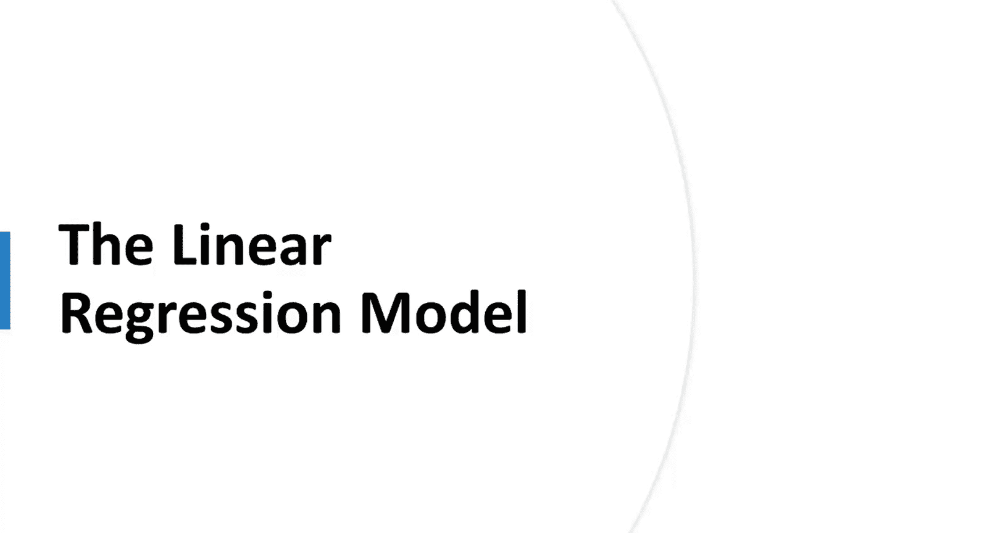
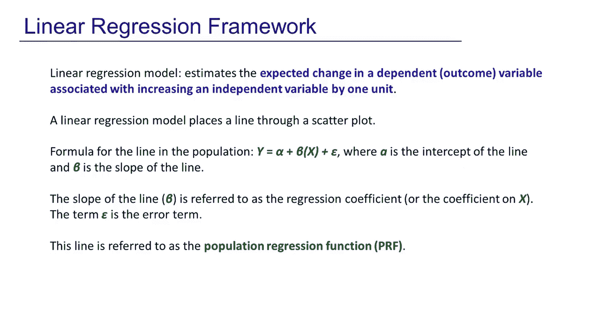
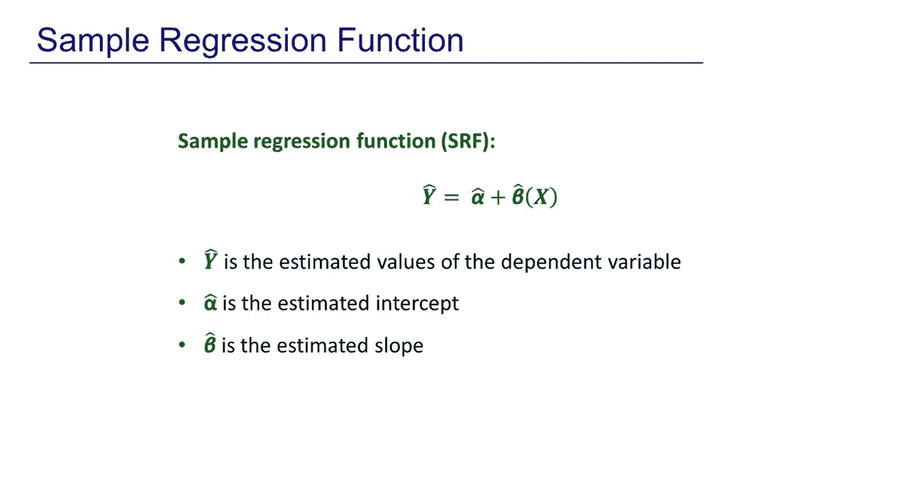
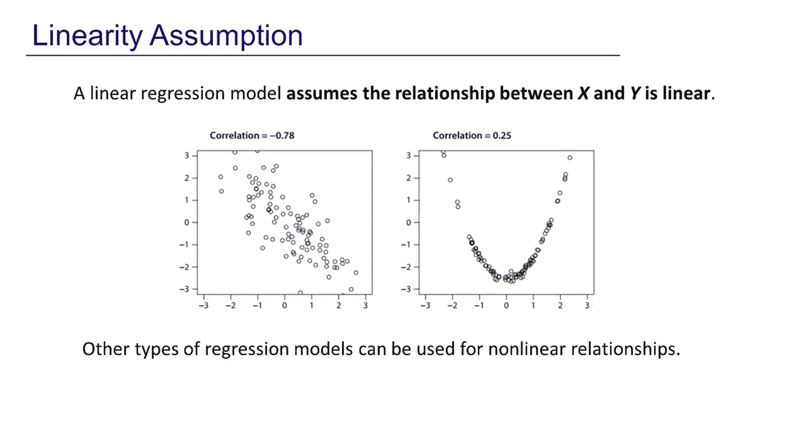
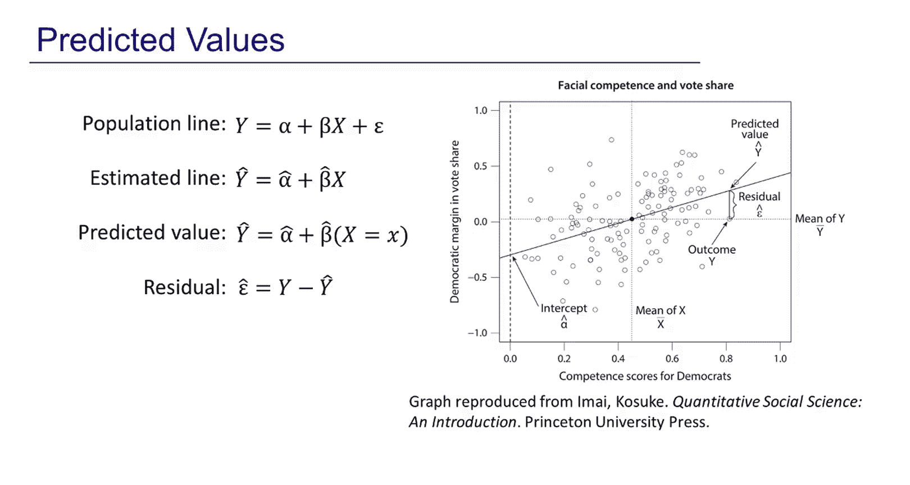
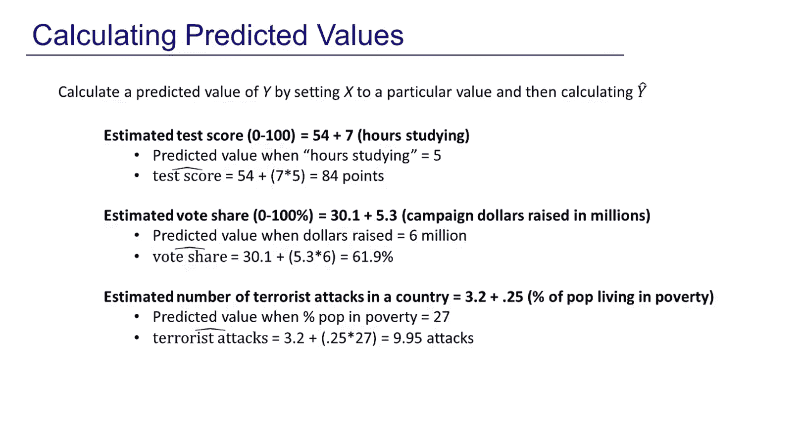

#  033：线性回归模型介绍 📈

在本节课中，我们将要学习线性回归模型。虽然相关系数和散点图提供了比较两个变量甚至生成预测的相对简单的方法，但通常需要估计更精确的关系。线性回归模型是统计学家用来量化一个变量的变化如何与另一个变量的变化相关联的重要工具。

## 总体与样本回归模型

上一节我们介绍了线性回归的基本概念，本节中我们来看看其具体的数学模型。线性回归模型允许我们计算，当自变量增加一个单位时，与因变量或结果变量的预期变化量。这是通过在散点图上放置一条直线来实现的。

重要的是要认识到，对于任何回归模型，都存在一个**总体回归函数**和一个**样本回归函数**。这些函数就是直线。总体回归函数是假设的直线，而样本回归函数是我们使用收集到的数据计算出的实际直线。

以下是这两个函数的公式：

*   **总体回归函数**：`y = α + βx + ε`
    *   其中 `α` 是直线的截距，`β` 是直线的斜率（也称为回归系数或x的系数）。
    *   `y` 是因变量（有时称为结果变量），`x` 是自变量。
    *   `ε` 被称为误差项。我们在总体回归函数中包含这一项，是为了提醒我们 `x` 并非 `y` 的完美预测因子。回想一下你见过的散点图，即使有很强的相关性，点也不会完美地落在一条线上。点偏离直线的程度由误差项捕捉。

*   **样本回归函数**：`ŷ = α̂ + β̂x`
    *   其中 `ŷ` 是因变量的估计值，`α̂` 是估计的截距，`β̂` 是估计的斜率。

总体回归函数是我们认为 `X` 和 `Y` 在总体中如何相互关联的模型。在指定了总体回归函数之后，我们可以使用数据来计算样本回归函数。

## 模型的线性假设

线性回归模型假设 `x` 和 `y` 之间存在线性关系。观察幻灯片上的两个图表。在左侧的图表中，用一条负斜率的直线穿过数据看起来相当合理。这条线能很好地代表数据。

现在，看右侧的图表。注意数据形成了一个紧密的U形，相比之下，用一条直线穿过这些数据似乎不合适。对于非线性数据，我们可以使用非线性模型。然而，本课程将重点介绍线性模型。一旦你对回归分析有了扎实的基础理解，你将能够轻松熟悉更高级的回归工具，这些工具可能最适合你正在分析的特定数据集。

## 计算预测值与残差

一旦你估计了一个回归模型，就可以用它来计算预测值。观察本幻灯片上展示的四个方程。正如我们已经讨论过的，第一个方程是总体回归函数，第二个是样本回归函数。第三个方程展示了如何使用样本回归函数计算预测值。

以下是计算和解释预测值与残差的步骤：

*   **计算预测值**：要计算预测值，你只需将自变量 `x` 设置为一个特定值，然后计算 `y` 的估计值。我们稍后将通过几个例子来演示如何计算预测值。
*   **计算残差**：在获得样本回归函数后，你还可以计算残差。每个数据点都有一个残差，它是该点到回归线的垂直距离。由于回归线穿过数据云的中心，一些残差将为负，一些为正。
    *   用方程表示，残差等于 `y` 的实际值减去 `y` 的估计值：`e = y - ŷ`。

本幻灯片的图表显示了一个散点图，内容是调查参与者根据民主党候选人的照片对其能力的感知与这些候选人的选举表现。图中的线是一条回归线。注意这条线的不同特征：截距是直线与y轴相交的点。残差是特定数据点的 `y` 观测值与该数据点的 `y` 预测值或估计值之间的差异。

附带说明一下，术语“预测的”、“估计的”和“拟合的”经常互换使用。预测值、估计值和拟合值通常指的是同一个东西，即 `ŷ`。

## 预测值计算示例

如前所述，我们可以通过将 `x` 设置为特定值然后计算 `ŷ` 来预测 `y` 的值。让我们看几个例子。

以下是三个样本回归函数及其预测计算：

1.  **学生成绩预测**：`ŷ = 54 + 7x`（`ŷ` 为估计的测试分数，`x` 为学习小时数）。
    *   要计算学习5小时（`x = 5`）时的预测测试分数：`ŷ = 54 + 7 * 5 = 89`。
    *   因此，预测的测试分数是 **89分**。

2.  **候选人得票率预测**：`ŷ = 30.1 + 5.3x`（`ŷ` 为估计的得票率百分比，`x` 为筹款金额，单位百万美元）。
    *   要计算筹得600万美元（`x = 6`）时的预测得票率：`ŷ = 30.1 + 5.3 * 6 = 61.9`。
    *   因此，预测的得票率是 **61.9%**。

3.  **恐怖袭击次数预测**：`ŷ = 3.2 + 0.25x`（`ŷ` 为估计的恐怖袭击次数，`x` 为贫困人口百分比）。
    *   要计算贫困率为27%（`x = 27`）时的预测袭击次数：`ŷ = 3.2 + 0.25 * 27 = 9.95`。
    *   因此，预测的恐怖袭击次数是 **9.95次**。

在解释预测值时，务必始终包含因变量的单位。

## 总结

本节课中我们一起学习了线性回归模型的基础知识。我们介绍了总体回归函数和样本回归函数的区别及其公式（`y = α + βx + ε` 和 `ŷ = α̂ + β̂x`），理解了模型对线性关系的假设，并学会了如何使用估计的模型计算预测值（通过代入特定的 `x` 值得到 `ŷ`）以及如何计算残差（`e = y - ŷ`）。在下一个视频中，我们将更具体地讨论如何解释估计模型中截距和斜率系数的数值含义。