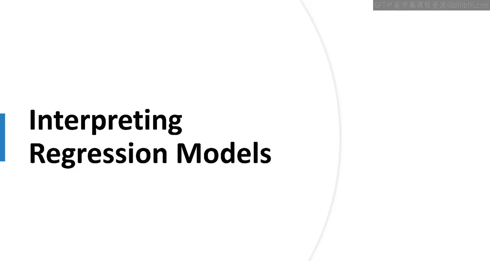
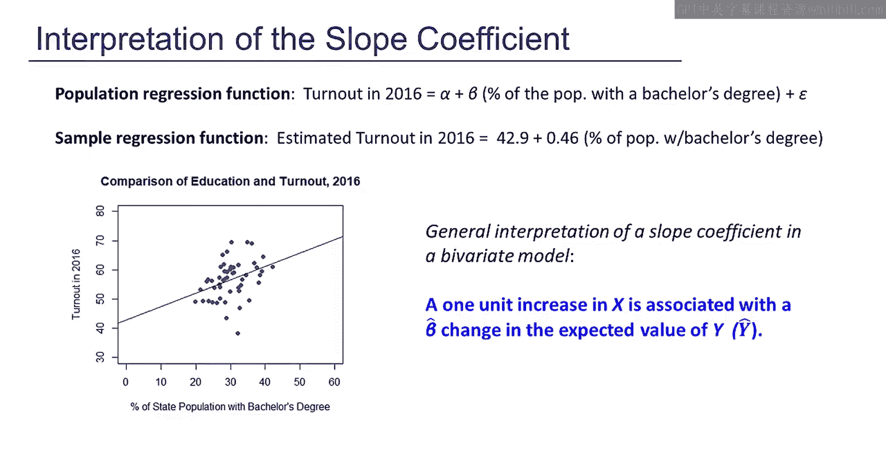
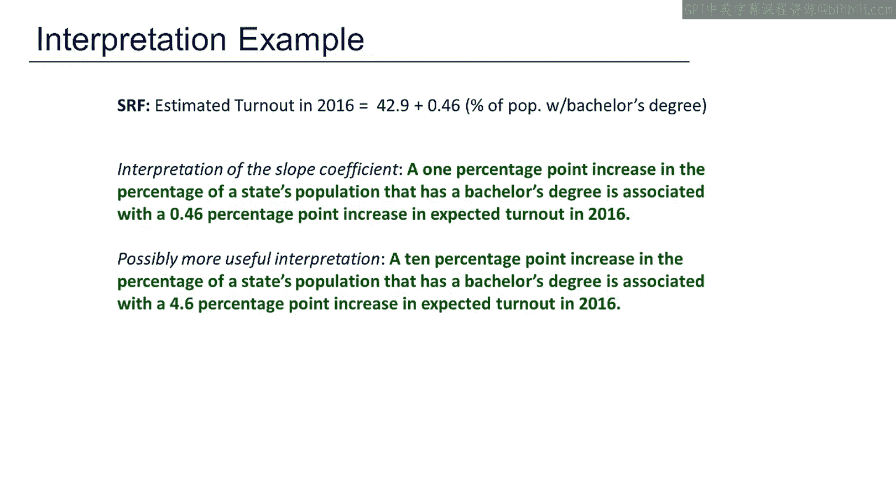
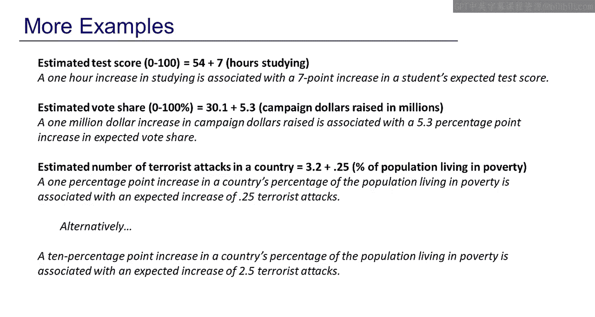
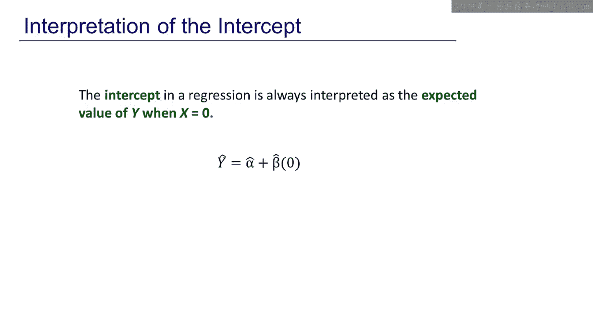
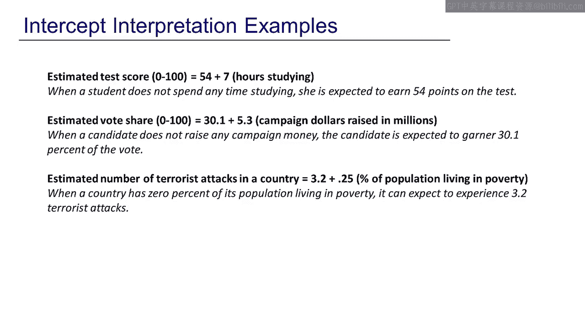

#  034：回归模型解释

在本节课中，我们将学习如何解释线性回归模型的结果。我们将重点理解斜率系数和截距的现实意义，并通过具体示例来掌握其解释方法。

上一节我们介绍了如何使用估计的模型计算因变量的预测值。本节中，我们来看看如何解释估计出的斜率和截距。

## 解释斜率系数

斜率系数量化了自变量与因变量之间的关系。在双变量模型中，斜率系数的解释遵循一个固定模板。

以下是斜率系数的解释模板：
> **一个单位的X增加，与Y的期望值（即Y帽）发生β帽单位的变化相关联。**

让我们通过一个具体例子来应用这个模板。假设我们想研究一个州拥有学士学位的人口比例对其在2016年总统选举中投票率的影响。

我们估计出的样本回归函数（SRF）为：
`预计投票率 = 42.9 + 0.46 * 学士学位人口比例`

根据解释模板，我们可以这样解释斜率系数0.46：
> **一个州拥有学士学位的人口比例每增加一个百分点，与2016年预期投票率增加0.46个百分点相关联。**

为了使解释对读者更有意义，我们可以将变化幅度放大。例如：
> **一个州拥有学士学位的人口比例每增加十个百分点，与2016年预期投票率增加4.6个百分点相关联。**

## 更多斜率系数解释练习

以下是几个不同样本回归函数中斜率系数的解释练习：

*   **示例一**：`预计考试成绩 = 54 + 7 * 学习小时数`
    *   解释：学习时间每增加一小时，与学生预期考试成绩增加7分相关联。

*   **示例二**：`预计得票率 = 30.1 + 5.3 * 筹款金额（百万美元）`
    *   解释：竞选筹款金额每增加一百万美元，与候选人预期得票率增加5.3个百分点相关联。

*   **示例三**：`预计恐怖袭击次数 = 3.2 + 0.25 * 贫困人口比例`
    *   解释：一个国家贫困人口比例每增加一个百分点，与预期恐怖袭击次数增加0.25次相关联。
    *   为使解释更清晰，可以调整为：贫困人口比例每增加十个百分点，与预期恐怖袭击次数增加2.5次相关联。

## 解释截距项

现在让我们讨论如何解释回归模型中的截距。截距总是被解释为当自变量X等于0时，因变量Y的期望值。

这在公式中很容易看出：估计的截距α帽，就是当我们把0代入X时Y的期望值。

以下是截距项的解释练习，使用与上文相同的样本回归函数：

*   **示例一**：`预计考试成绩 = 54 + 7 * 学习小时数`
    *   解释：当学生不花任何时间学习时，其预期考试成绩为54分。

*   **示例二**：`预计得票率 = 30.1 + 5.3 * 筹款金额（百万美元）`
    *   解释：当候选人没有筹集到任何资金时，其预期得票率为30.1%。

*   **示例三**：`预计恐怖袭击次数 = 3.2 + 0.25 * 贫困人口比例`
    *   解释：当一个国家贫困人口比例为0%时，预期会发生3.2次恐怖袭击。

需要注意的是，有时截距项可能没有实际意义。这通常发生在X取值为0本身没有意义的情况下。例如，在研究年龄与收入的关系时，知道一个0岁的人的预测收入并没有太大价值。

本节课中我们一起学习了如何解释线性回归模型的核心参数。关键在于，以有意义的方式解释回归模型的估计结果，使读者或听众能够从中得出结论和启示，是数据分析过程中必不可少的一环。