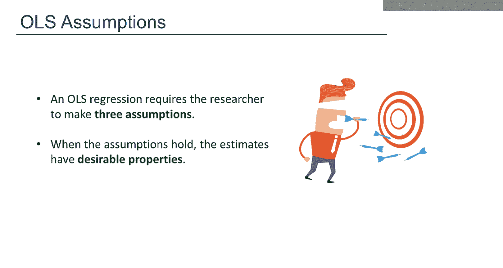
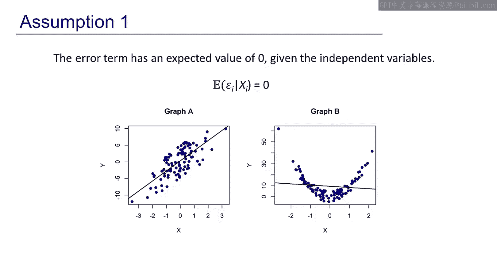
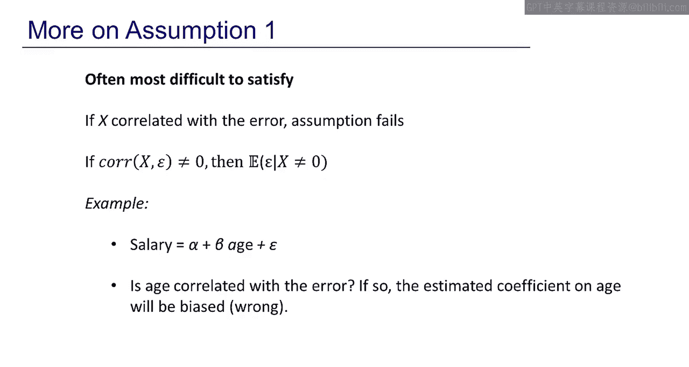
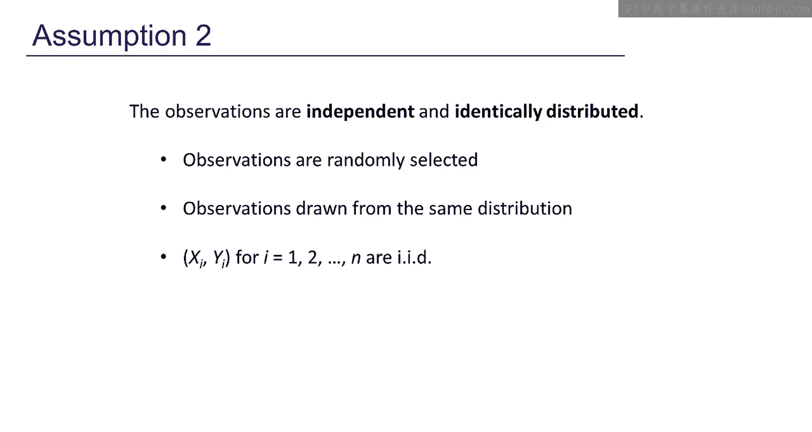
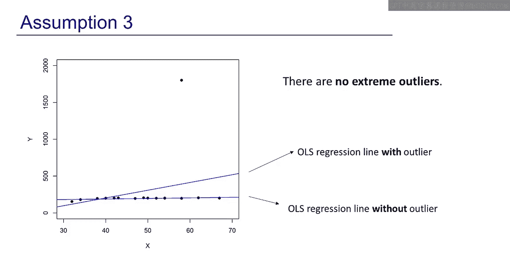
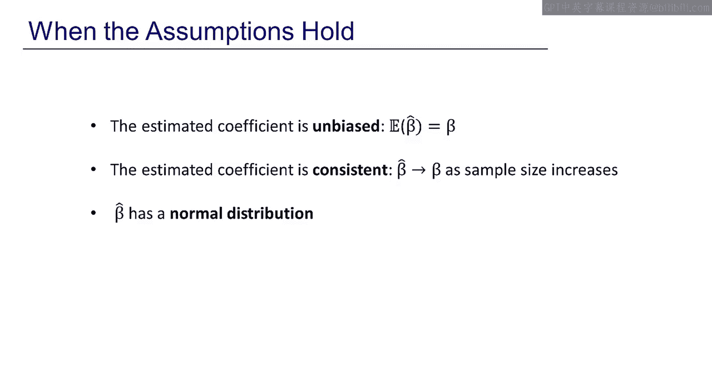

#  036：线性回归假设 📊

在本节课中，我们将要学习线性回归分析中必须满足的三个核心假设。理解并检验这些假设是确保回归模型结果可靠、结论有意义的关键。如果这些假设不成立，那么从回归模型中得出的结论就值得怀疑。

## 普通最小二乘法（OLS）假设概述

进行回归分析时，分析师必须做出几个假设。如果这些假设不满足，我们就应该质疑估计回归模型的结果。当这些假设成立时，估计的系数才具备良好的统计性质。如果一个或多个假设不成立，研究者就不应使用OLS回归模型，可能需要改用非线性模型等其他类型的回归模型，或在估计模型前从分析中排除某些观测值，甚至需要重新收集数据。

上一节我们介绍了OLS假设的重要性，本节中我们将逐一详细探讨这三个具体假设。

## 假设一：误差项的条件期望为零

第一个OLS假设指出，给定模型中的自变量，误差项的**期望值为0**。用公式表示为：**E(ε | X) = 0**。这意味着，对于任何给定的X值，我们对残差的最佳猜测应该是零。当模型中包含了所有必要的变量时，这一假设通常得以满足。

以下是关于此假设的两个关键点：
*   该假设本质上是线性假设的重述。如果数据点大致均匀地分布在回归线周围，则假设成立。
*   如果自变量与误差项相关，则假设一失效。公式表示为：**如果 Corr(X, ε) ≠ 0，则 E(ε | X) ≠ 0**。

让我们通过一个例子来理解。假设你想建立一个用个人年龄预测其薪水的模型。年龄变量很可能与误差项相关，因为年龄通常与工作经验、沟通技能或专业网络规模等因素相关，而这些因素都是薪水的决定因素。如果存在这种相关性，那么该双变量模型中年龄的估计系数就会是有偏的（即不准确）。在后续关于多元回归模型的课程中，我们将讨论如何解决这一问题。

## 假设二：观测值独立同分布

假设二指出，数据集中的观测值是**独立同分布**的。这意味着观测值是随机选取的，并且每个观测值都来自同一个总体。

以下是该假设的具体要求：
*   **独立性**：观测值应彼此独立地选取。例如，如果你调查10位密友，再让每位朋友推荐10位受访者，那么所有受访者可能在重要方面都很相似，导致样本不能代表总体。
*   **同分布**：所有观测值应来自相同的概率分布。
*   该假设的形式化表示为：观测值 **1** 到 **n** 是 **IID** 的。

## 假设三：无极端异常值

OLS回归的第三个假设是数据集中**没有极端异常值**。这是因为一个极端异常值会极大地改变回归线。

观察本页幻灯片中的图表，顶部附近有一个数据点。请注意，**排除**该数据点的回归线是平坦的，表明X和Y之间没有关系。然而，**包含**该数据点的回归线具有正斜率，表明X和Y之间存在正相关关系。因此，是否包含异常值的决定会对实质性结论产生重大影响。

## 满足假设的好处

当上述三个OLS假设都成立时，估计的系数将具备以下理想性质：
*   **无偏性**：系数估计值平均而言是准确的。
*   **一致性**：随着样本量增加，系数估计值会趋近于参数的真实值。
*   **正态性**：系数估计值服从正态分布，这允许我们计算有用的不确定性度量（我们将在数据素养专项课程的第四部分中涉及此话题）。

## 总结

本节课中我们一起学习了线性回归分析的三个核心OLS假设：误差项的条件期望为零、观测值独立同分布以及数据中无极端异常值。理解这些假设是评估模型有效性和结果可信度的基础。当这些假设得到满足时，我们才能确信回归系数的估计是无偏、一致且可用于统计推断的。如果假设被违反，则需要考虑改进模型设定、处理数据或选择其他分析方法。