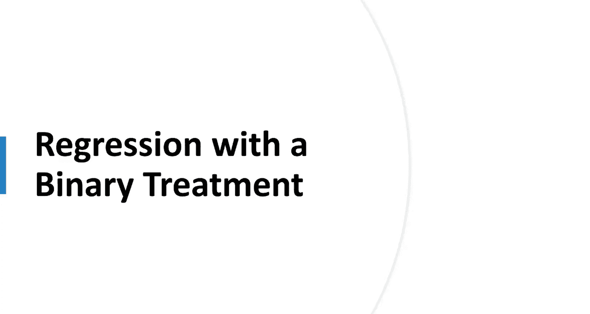
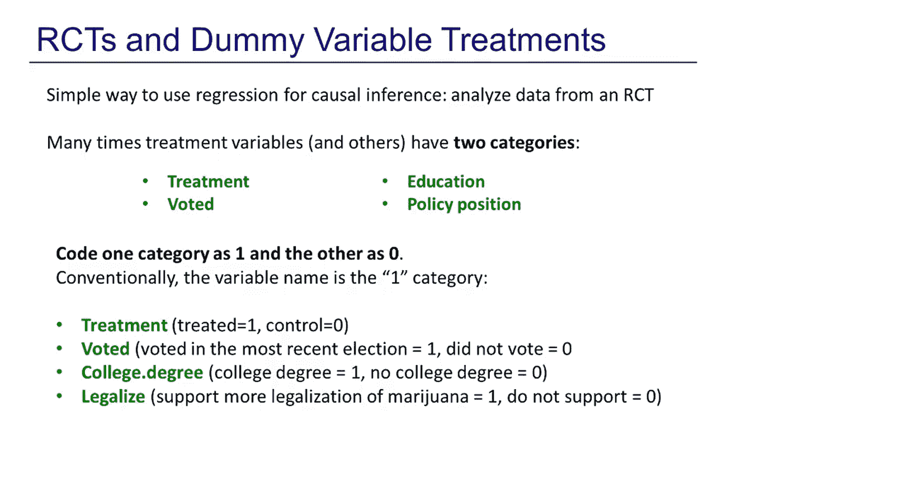
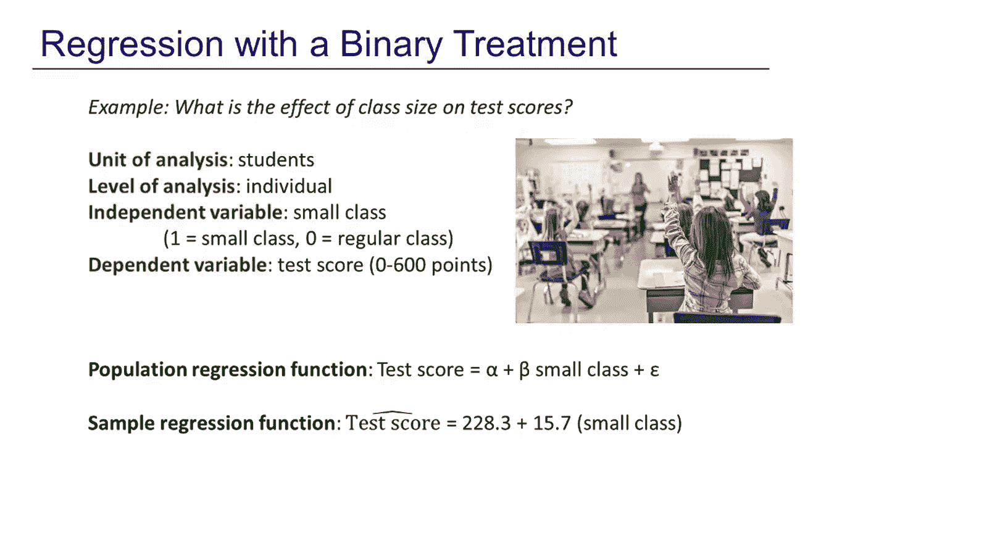
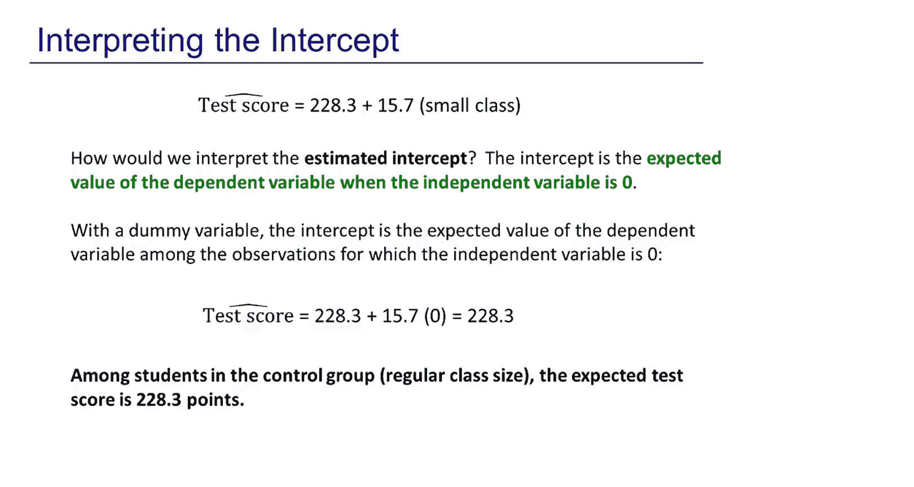
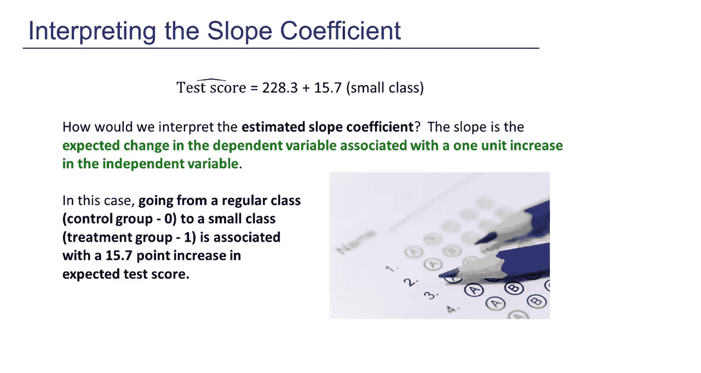
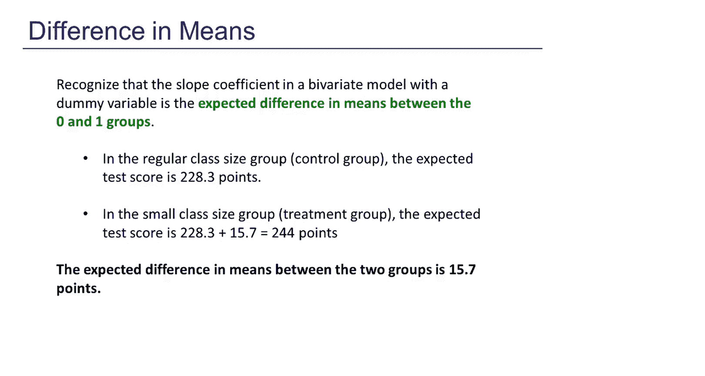
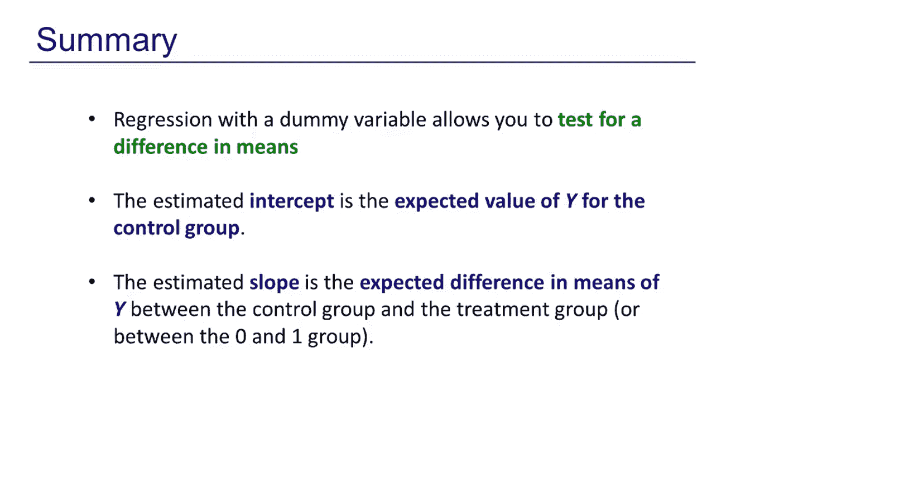

#  037：二元处理变量的回归 📊

在本节课中，我们将学习如何使用回归模型来分析一个特殊的自变量——二元处理变量。这种变量只取两个值（通常是0和1），例如“是否接受治疗”或“是否拥有大学学位”。我们将学习如何构建这样的回归模型，并准确解释其结果。

---

## 随机对照试验与虚拟变量处理 🔬

上一节我们讨论了回归模型的基本原理，本节中我们来看看当自变量是二元变量时的特殊情况。

在数据素养专项课程的前期，我们讨论过随机对照试验。由于处理是随机分配给参与者的，RCT对于进行因果研究极为有用。我们可以轻松地使用回归模型来估计处理的效果。

很多时候，处理变量以及其他变量只有两个类别，这些变量被称为**虚拟变量**（或哑变量）。例如，变量“处理”可能有两个类别：对照组和处理组。另一个变量“是否在最近一次选举中投票”也是如此。

需要认识到，很多时候研究者选择将变量定义为虚拟变量。像“教育程度”和“个人政策立场”这样的变量可以有多种定义方式。我们可以将它们视为连续变量或多类别变量，也可以将其构建为虚拟变量。例如，我们可以将个人分类为“拥有大学学位”或“没有大学学位”，以及“支持”或“反对”某项特定政策立场。

对于虚拟变量，将一个类别编码为1，另一个类别编码为0是有帮助的，原因将在我们解释系数时看到。按照惯例，研究者通常根据取值为1的类别来命名变量。

以下是几个例子：
*   我们可能创建一个名为 `treatment` 的虚拟变量，其中处理组成员编码为1，对照组成员编码为0。
*   或者创建一个名为 `voted` 的变量，其中在上次选举中投票的人编码为1，未投票的人编码为0。
*   对于名为 `college_degree` 的变量，拥有大学学位的人赋值为1，没有大学学位的人赋值为0。
*   最后，对于名为 `legalize` 的变量，我们可以将支持大麻进一步合法化的人赋值为1，不支持该政策立场的人赋值为0。

---

## 二元处理变量的回归 📈

现在你知道了什么是虚拟变量，让我们通过一个例子来学习二元回归模型，其中自变量是虚拟变量。

研究问题是：**班级规模对考试成绩有何影响？**

在继续之前，已经进行了大量的实验研究来回答这个问题。让我们先确定这个问题的关键组成部分。
*   **分析单位**：在本例中是学生。数据集中的每一行代表一个学生，而不是一个班级或学校。
*   **自变量**：是处理变量。在本例中，即是否处于小班。学生被随机分配到小班或常规班。处理组（即被分配到小班）的学生在处理变量上编码为1。对照组（即被分配到常规班）的学生在处理变量上编码为0。
*   **因变量**：是学生在数学和阅读测试中的表现。考试成绩变量的范围是0到600分。

总体回归方程如下：
`test_score = α + β * class_size + ε`
提醒一下，总体回归函数规定了自变量和因变量之间的假设关系。

如果我们有实际数据，就可以计算样本回归函数。我使用一个数据集进行了估算，得到了以下SRF：
`E(test_score) = 228.3 + 15.7 * small_class`

---

## 解释回归结果 🔍

现在我们有了样本回归函数，可以解释其结果了。

让我们从估计的**截距**开始。回想一下，截距是当自变量为0时因变量的期望值。
因此，对于虚拟自变量，截距是自变量为0的那些观测值的因变量期望值。
如果我们将0代入SRF中的自变量，可以看到学生的预期考试成绩是228.3分。
这意味着在对照组（即被分配到常规班级的学生）中，预期考试成绩是228.3分。

现在，让我们来看**斜率系数**，即 `small_class` 的系数。斜率系数是与自变量增加一个单位相关的因变量的预期变化。
在本例中，自变量有两个值，0和1。因此，一个单位的变化意味着从0变为1，在本例中即意味着从常规班级变为小班。
因此，斜率系数可以解释为：从常规班级变为小班，与预期考试成绩增加15.7分相关。

总结来说，当你有一个虚拟自变量的回归时：
*   **截距**是当虚拟变量等于0时因变量的期望值。
*   **斜率系数**是因变量在0组和1组之间的期望值差异。

---

## 均值差异 📊

让我们再花一分钟讨论这个SRF中的斜率系数，以重申最后一点。

在具有虚拟自变量的二元模型中，斜率系数是0组和1组之间的**期望均值差**。
该模型告诉我们，在常规班级组（对照组）中，预期考试成绩是228.3分。
该模型还告诉我们，在小班组（处理组）中，预期考试成绩是228.3 + 15.7，总计244分。
因此，两组之间的期望均值差是15.7分。

你可以随时暂停课程，花时间理解这些概念。正如你所见，数学本身相当简单，但可能需要几分钟来适应这个观念：截距是虚拟变量为0时y的期望值，斜率是y在0组和1组之间的期望差异。

---

## 总结 ✅

本节课我们一起学习了如何估计和解释带有虚拟变量的回归模型，这使你可以检验虚拟变量两组之间的均值差异。
*   估计的**截距**是因变量y在对照组（即虚拟变量为0的组）中的期望值。
*   估计的**斜率**是因变量y在对照组与处理组（或0组与1组）之间的期望均值差。

在接下来的课程中，我们将讨论如何向回归模型中添加更多变量，并在多元背景下解释系数。