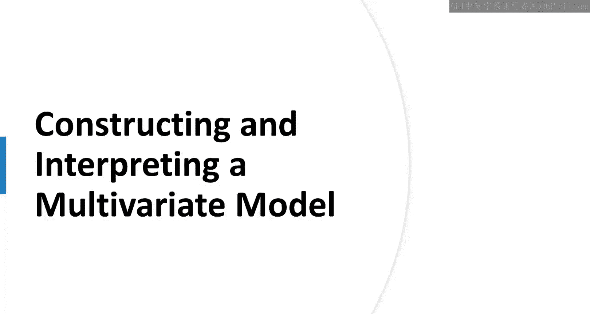
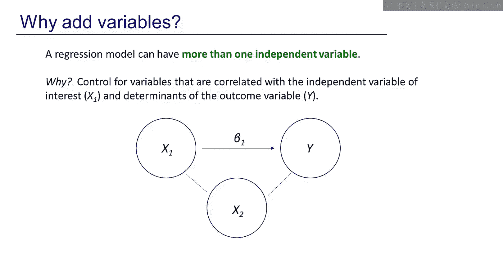
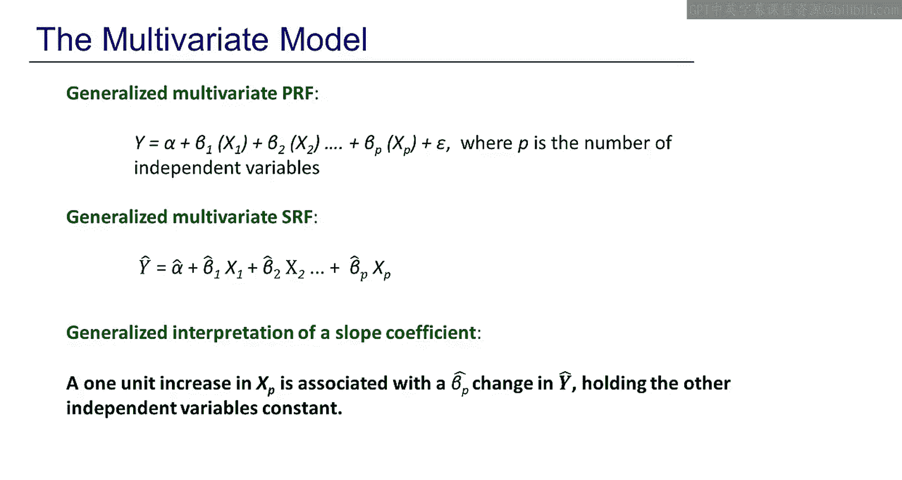
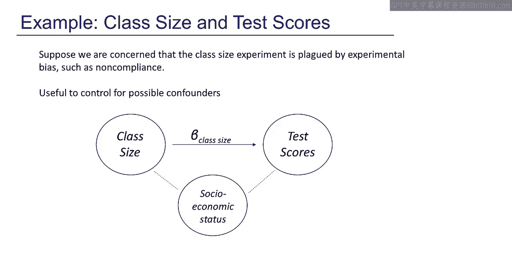
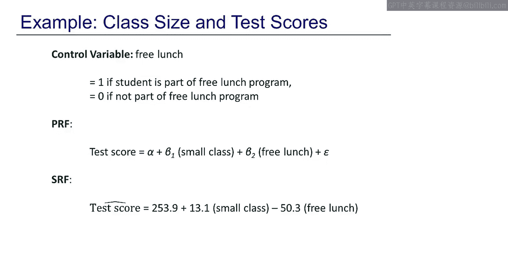
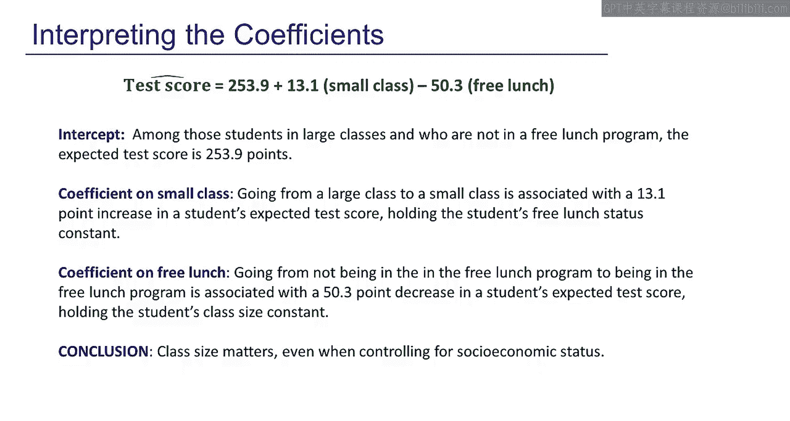
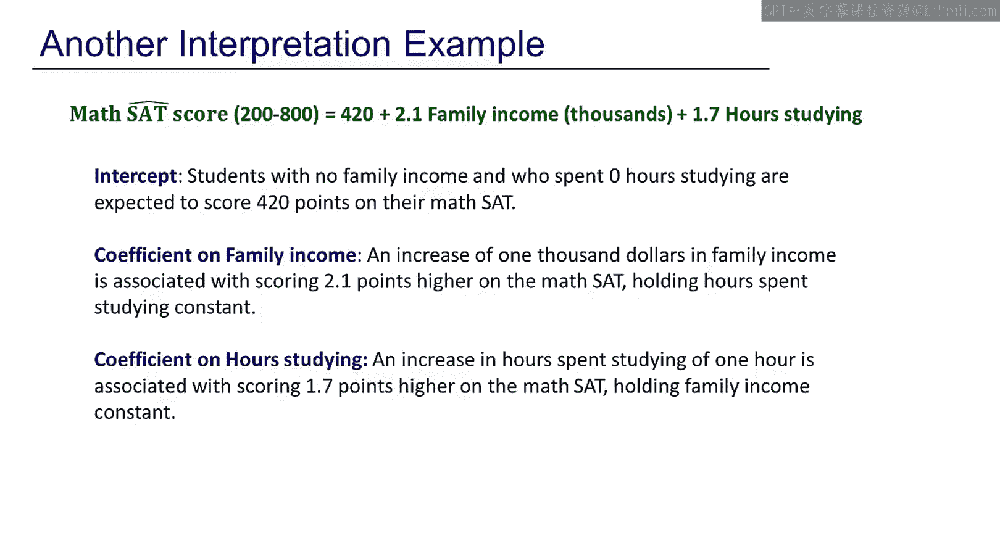
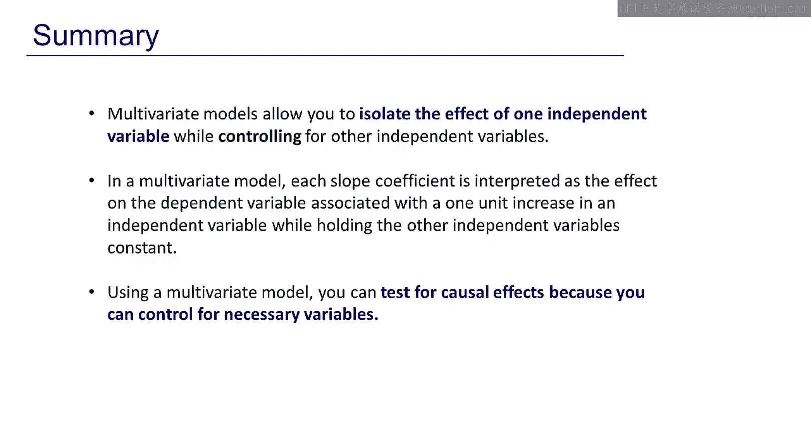

#  038：构建与解释多元模型 📊

在本节课中，我们将要学习如何构建和解释多元回归模型。我们将了解为什么在分析中需要引入多个自变量，以及如何正确解读模型中的系数。

## 概述

上一节我们介绍了双变量回归模型。本节中我们来看看多元模型。双变量回归模型的挑战在于我们无法控制可能的混杂因素。换句话说，如果存在第三个变量解释了我们关心的自变量与因变量之间的部分或全部关系，该怎么办？在这种情况下，我们必须使用多元模型，即包含多个自变量的回归模型。通常，我们将关心的自变量称为**关注的自变量**，而其他自变量称为**控制变量**。通过本视频的学习，你应该能够从多元回归模型的结果中得出结论。

## 为什么需要多元模型？🤔

正如前面提到的，一个回归模型可以包含不止一个自变量。我们来思考一下这为什么有价值。通过添加额外的自变量（通常称为控制变量），我们可以控制那些与关注的自变量相关、同时也是结果变量决定因素的变量。

本页幻灯片上的图表显示，我们关心的是估计 **x1** 对 **y** 的影响。这个影响由系数 **β1** 捕捉。但请注意，**x1** 和 **x2** 之间存在相关性，并且 **x2** 和 **Y** 之间也存在关系。在这种情况下，在估计 **x1** 对 **Y** 的影响时，控制 **x2** 就非常重要。稍后我们将通过一个例子来详细说明。

## 多元模型的公式 📝

首先，我们来讨论多元模型的总体回归函数和样本回归函数的一般公式。

总体回归函数如下：
**y = α + β₁x₁ + β₂x₂ + ... + βₚxₚ + ε**
其中，**p** 是自变量的数量，**ε** 是误差项。例如，有五个自变量，就会有五个斜率系数。

样本回归函数如下：
**ŷ = α̂ + β̂₁x₁ + β̂₂x₂ + ... + β̂ₚxₚ**
你可以看到，这些公式只是我们之前讨论过的双变量公式的扩展。

下一步是解释样本回归函数中的截距项和每个斜率系数。一般来说，我们这样解释多元模型中的斜率系数：**xₚ** 每增加一个单位，与 **ŷ** 发生 **β̂ₚ** 单位的变化相关联，同时**保持其他自变量不变**。截距项的解释与往常一样：当所有自变量等于 **0** 时，**ŷ** 的值。

## 实例分析：班级规模实验 🧑‍🏫

让我们通过回到班级规模实验的例子来逐步分析。假设我们担心实验受到某种实验偏倚的困扰，例如不依从。你可以想象，例如，一些家长非常希望将他们的孩子送入小班，因此没有遵守他们的治疗分配。

由此产生的一个假设可能是，来自较高社会经济背景的学生不成比例地进入了小班。请看图表。我们想估计班级规模对考试成绩的影响，但由于实验中的不依从性，学生的班级规模可能与学生的社会经济背景存在相关性。我们从先前的研究中知道，社会经济背景与考试成绩相关。因此，在估计班级规模对考试成绩的影响时，控制社会经济地位非常重要。

衡量社会经济地位的一种方法是使用变量 **免费午餐**。如果学生参与了免费午餐计划，该变量取值为 **1**；如果学生没有参与，则取值为 **0**。

如果我们在模型中包含这个控制变量，我们的总体回归函数是：
**考试成绩 = α + β₁ × 小班 + β₂ × 免费午餐 + ε**

而使用统计软件和数据集计算出的样本回归函数是：
**考试成绩预测值 = 253.9 + 13.1 × 小班 - 50.3 × 免费午餐**

## 解释系数估计值 🔍

现在我们来理解这些系数估计值的含义。

幻灯片顶部的样本回归函数作为提醒。我们可以这样解释截距项：在那些处于大班且未参与免费午餐计划的学生中，预期考试成绩是 **253.9** 分。

班级规模的系数（这是我们关注的自变量）解释如下：从大班转到小班，与学生的预期考试成绩增加 **13.1** 分相关联，同时**保持学生的免费午餐状态不变**。

现在解释控制变量的系数：从未参与免费午餐计划转为参与免费午餐计划，与学生的预期考试成绩减少 **50.3** 分相关联，同时**保持学生的班级规模不变**。

既然我们已经解释了估计值，关于班级规模与考试成绩之间的关系，我们能得出什么结论？我们的模型告诉我们，即使在控制了学生的社会经济地位之后，班级规模与考试成绩之间仍然存在正相关关系，小班的学生预期会获得更高的考试成绩。请记住，这个模型可能不完整，我们可能需要包含额外的控制变量，以确保我们关于班级规模的系数是准确的，即无偏的。

## 更多解释示例 💡

本幻灯片提供了一些额外的解释示例，以帮助你掌握方法。请看这个样本回归函数。在这个模型中，学生的预估数学SAT分数（范围从200到800分）等于 **420 + 2.1 × 家庭收入 + 1.7 × 学习小时数**。家庭收入以千美元为单位。

我们这样解释截距项：家庭收入为零且学习时间为零小时的学生，预计数学SAT得分为 **420** 分。记住，截距项是所有自变量等于 **0** 时因变量的预期值。

我们可以这样解释家庭收入的系数：家庭收入每增加 **1000** 美元，与数学SAT分数提高 **2.1** 分相关联，同时**保持学习小时数不变**。请注意，1000美元的增加是家庭收入变量的一个单位增加，因为该变量是以千为单位测量的。

最后，我们可以这样解释学习小时数的系数：学习时间每增加一小时，与数学SAT分数提高 **1.7** 分相关联，同时**保持家庭收入不变**。

## 总结

本节课中我们一起学习了多元模型的核心内容。多元模型的关键优势在于，它们允许你在控制其他自变量的同时，分离出一个自变量的影响。在多元模型中，每个斜率系数被解释为：在**保持其他自变量不变**的情况下，一个自变量增加一个单位与因变量变化相关联的效应。在因果推断的背景下，我们可以使用多元回归模型，因为我们可以控制必要的变量，即潜在的混杂因素。在接下来的课程中，我们将进一步讨论如何设定和评估多元模型。