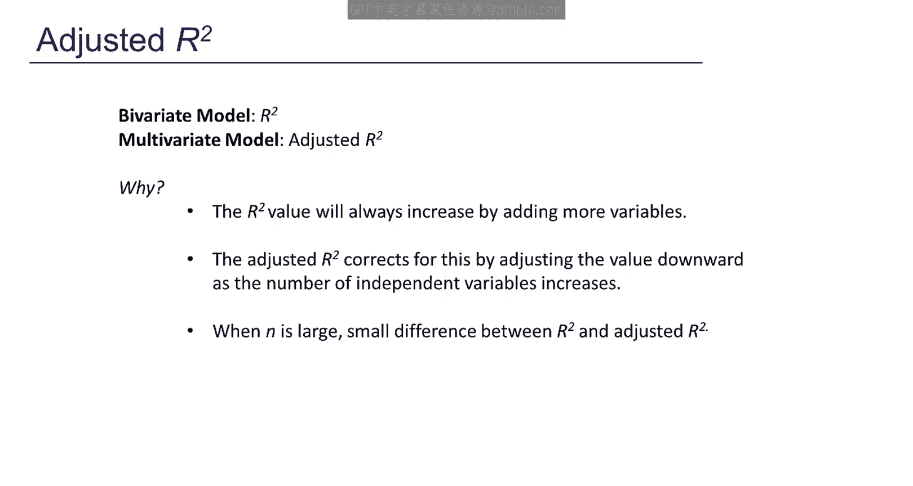
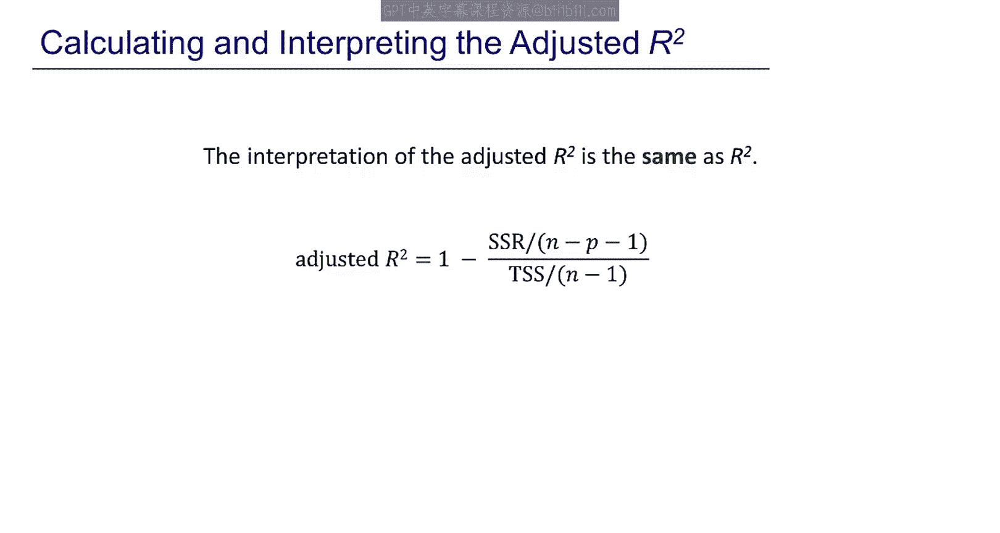
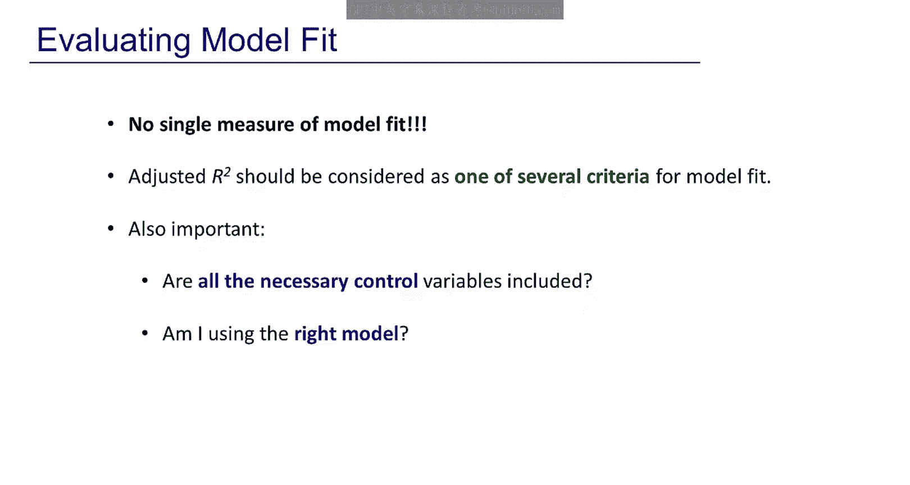

**数据素养：11：多元模型拟合** 🧮

在本节课程中，我们将学习如何评估多元回归模型对数据的拟合程度。模型评估是一个复杂的过程，拟合度与准确性是一个连续谱系。很少有模型是完全糟糕或近乎完美的，模型通常只存在较大或较小的问题。同时，模型只是对现实世界的简化表示，旨在提供有用的见解，而非捕捉所有细微差别。通过本节学习，你将能够解读调整后R平方值，并将其作为衡量模型拟合度的一个指标。

---

### **调整后R平方值** 📊

上一节我们介绍了在双变量回归模型中使用R平方值来评估模型拟合度。在多元模型的情境中，我们将转而使用调整后R平方值。

这样做有一个重要原因：R平方值会随着变量增加而**总是**增加。只要一个变量具有任何解释力，它就会导致R平方值上升。换句话说，增加额外变量永远不会使R平方值降低。

调整后R平方值通过根据自变量数量向下调整数值来纠正这一问题。具体而言：
*   如果一个新变量具有显著的解释力，调整后R平方值会因增加该变量而包含一个小的修正项，但总体上会因新增的解释力而上升。
*   如果一个新变量解释力很弱或没有解释力，调整后R平方值则会下降。
*   此外，当观测值数量非常大时，R平方值与调整后R平方值之间的差异会非常小，因为对自变量数量的修正会被观测值数量n所抵消。

请注意，两者的解释完全相同，即它们衡量了模型中自变量对因变量变异的解释百分比。

以下公式展示了如何计算调整后R平方值（实践中统计软件会自动完成）：
`调整后R² = 1 - [(1 - R²) * (n - 1) / (n - p - 1)]`
其中，`p`代表模型中的自变量数量。这正是R平方计算中未包含的修正项。

---

### **模型拟合的全面考量** ⚖️

必须牢记，没有单一的模型拟合度量标准。在考虑和评估模型拟合度时，调整后R平方值应被视为**多个标准之一**。

评估是否包含了所有必要的控制变量同样重要。换句话说，模型是否控制了所有与感兴趣的自变量相关且是因变量决定因素的变量？

询问回归是否使用了正确的模型形式也很关键：直线是否很好地拟合了数据？其他类型的模型是否会拟合得更好？在本课程的最后一个模块，我们将讨论一些不同的建模技术，如果简单的线性模型不适合你所研究的动态关系，这些技术可能会很有用。

---

**总结** 🎯
本节课我们一起学习了多元回归模型的拟合度评估。我们重点介绍了**调整后R平方值**，它克服了R平方值随变量增加必然上升的缺点，是评估多元模型解释力的重要指标。同时我们强调，模型评估是综合性的，需结合理论考量、变量控制以及模型形式选择等多方面进行判断。