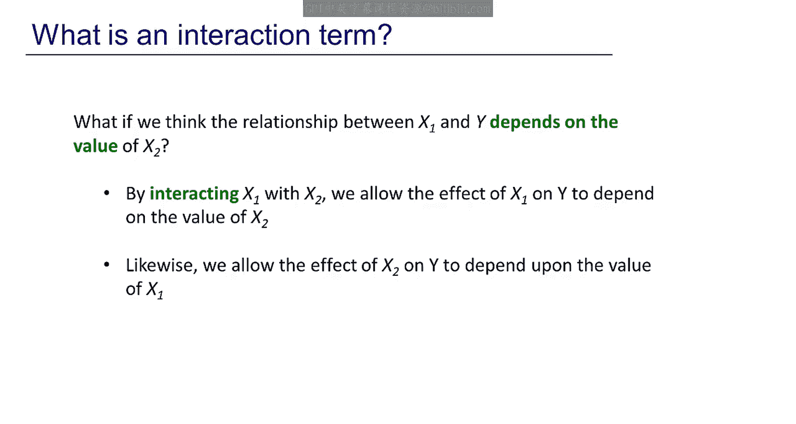
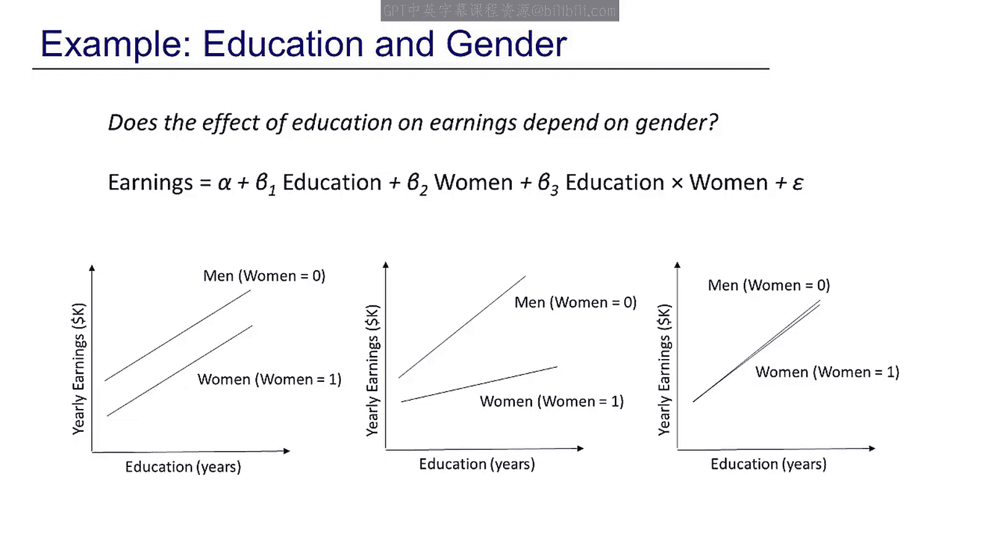
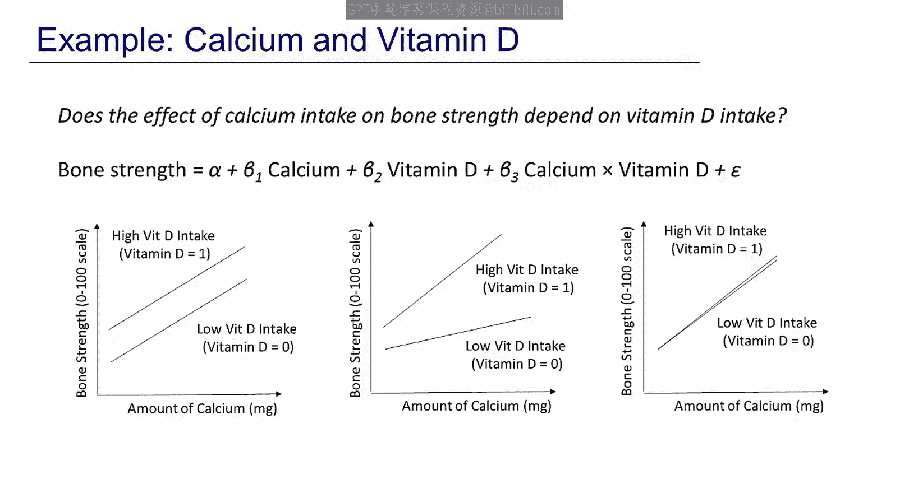
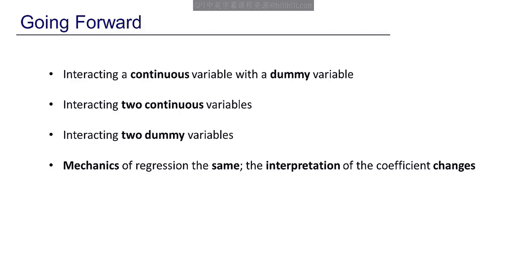

#  042：交互项介绍 🧩

在本节课中，我们将要学习回归分析中的一个重要概念——交互项。我们将探讨什么是交互项，为什么需要它，以及它如何帮助我们理解变量之间更复杂的关系。

---

到目前为止，我们使用回归模型来检验自变量对因变量的影响，同时控制可能的混杂因素。但是，如果我们认为自变量和因变量之间的关系并非如此简单呢？如果我们认为这种关系取决于另一个自变量呢？在这种情况下，我们需要在回归模型中包含一个交互项。通过本视频的学习，你应该能够解释交互项在回归分析中的价值。

## 什么是交互项？

如果我们认为 **x1** 和 **y** 之间的关系取决于 **x2** 的值（反之亦然），我们就应该让这两个变量产生交互，并将这个交互项包含在回归模型中。稍后我将逐步讲解如何操作以及一些示例。本页幻灯片的关键要点是：通过让 **x1** 和 **x2** 交互，我们允许 **x1** 对 **Y** 的估计效应依赖于 **x2**。同样，我们也允许 **x2** 对 **y** 的估计效应依赖于 **x1**。

让我们来看几个例子，以便你理解我的意思。

## 示例一：教育、性别与收入

上一节我们介绍了交互项的基本概念，本节中我们来看看一个具体的应用场景。

让我们思考一个问题：教育对收入的影响是否取决于性别？教育对收入的影响可能对男性和女性是不同的。

本页幻灯片上的三张图可视化了性别、教育和收入之间三种不同的关系，我们可以使用交互项来建模。

*   在左侧的图中，教育对收入的影响对男性和女性是相同的，但男性的收入始终更高。顶部的线显示了男性教育与收入的关系，而底部的线显示了女性教育与收入的关系。两条线的起点不同，但斜率相同。
*   在中间的图中，教育对收入的影响在男性和女性之间存在差异；根据此图，男性从教育水平提高中获得的收益比女性更大，并且男性的起始收入也更高。换句话说，注意在此情境下，两条线的截距和斜率都不同。
*   在第三张图中，教育对收入的影响对男性和女性大致相同。两条线的斜率几乎相同，并且在此情境下，两条线起点也大致相同。这表明性别和教育在与收入相关时没有交互效应。

幻灯片中间的方程是我们用来检验交互效应的总体回归函数。在下一个视频中，我们将讨论如何解释估计这类总体回归函数的结果。这些结果会告诉我们数据支持哪种情境。

## 示例二：钙、维生素D与骨骼强度

理解了性别与教育的例子后，我们再来看看另一个涉及连续变量的场景。

另一个例子是，或许一位研究人员想研究钙、维生素D和骨骼强度之间的关系。现有的一些研究表明，钙对骨骼强度的影响受个体维生素D摄入量的影响，因为维生素D似乎能增加钙的吸收。

我们可以构建一个回归模型，其中既包含钙和维生素D的摄入量，也包含这两个变量之间的交互项。

请注意，每当你在模型中包含一个交互项时，你应始终确保也包含各个单独的变量。这是因为你希望允许模型具有最大的灵活性。换句话说，你希望模型能够揭示直接效应、交互效应，或者两者兼有。

本页幻灯片上的图表与上一页幻灯片上的图表类似；这些图表可视化了我们通过估计总体回归函数可能发现的不同情境。

*   如果我们发现左侧的图表，那将表明钙对骨骼强度的影响对高维生素D摄入人群和低维生素D摄入人群是相同的，但高维生素D组的人群始终拥有更强的骨骼。同样，这两条线的斜率相同，但截距不同。
*   在中间的图表中，截距和斜率都不同。钙对骨骼强度的影响对高维生素D摄入组更高。顶部线的斜率更陡。
*   在右侧的图表中，钙摄入量和维生素D摄入量之间似乎没有交互效应。

再次强调，这些都是假设性的结果，如果我们使用数据来估计本页幻灯片上的总体回归函数，可能会发现这些结果。重点是，包含交互项允许所有这些可能的结果出现。一个没有交互项的模型，根据定义，会假设个体的维生素D摄入水平对钙与骨骼强度之间的关系没有影响。换句话说，排除交互项就假设右侧的图表是正确的，并且不允许出现左侧或中间图表的可能性。

## 后续内容与解释要点

在接下来的课程中，我们将讨论如何具体解释包含交互项的回归模型的结果。

我们将特别讨论如何解释以下三种情况下的回归结果：连续变量与虚拟变量的交互、两个连续变量之间的交互，以及两个虚拟变量之间的交互。

估计包含交互项的回归模型的机制基本上与简单的多元模型相同，但对系数的解释却大不相同。这是因为我们不能简单地让一个自变量增加一个单位，同时保持所有其他变量不变。请记住，有了交互项，一个变量现在在模型中出现了多次。因此，在保持 **x1** 和 **x2** 的交互项不变的同时增加 **x1** 一个单位是不可能的。

尽管解释稍微复杂一些，但经过一些练习后，你应该会逐渐熟悉它。就像统计中的许多任务一样，一旦你掌握了窍门，它就会变得容易，甚至微不足道。

---

本节课中我们一起学习了回归分析中的交互项。我们了解到，当怀疑一个自变量对因变量的影响取决于另一个自变量时，就需要引入交互项。我们通过教育和性别对收入的影响，以及钙和维生素D对骨骼强度的影响两个例子，看到了交互项如何帮助我们捕捉更复杂的现实关系。记住，在模型中包含交互项时，也必须包含构成交互项的各主要变量，以确保模型的灵活性。