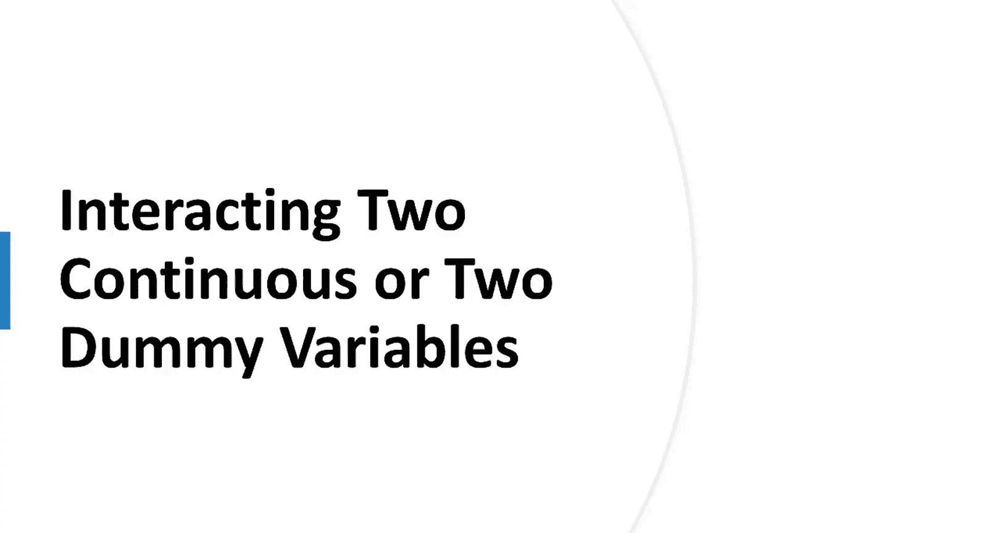
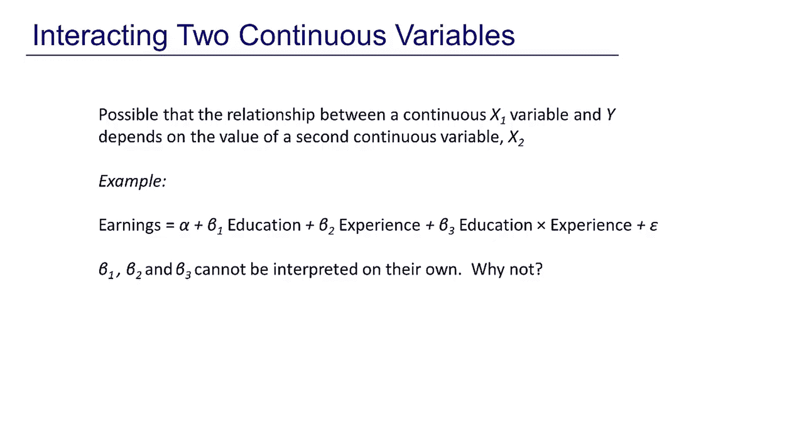
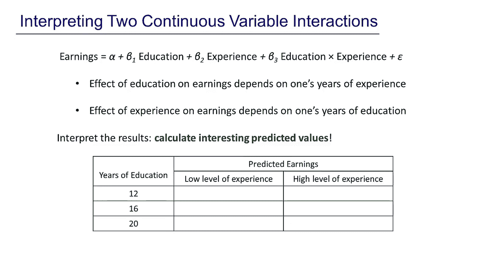
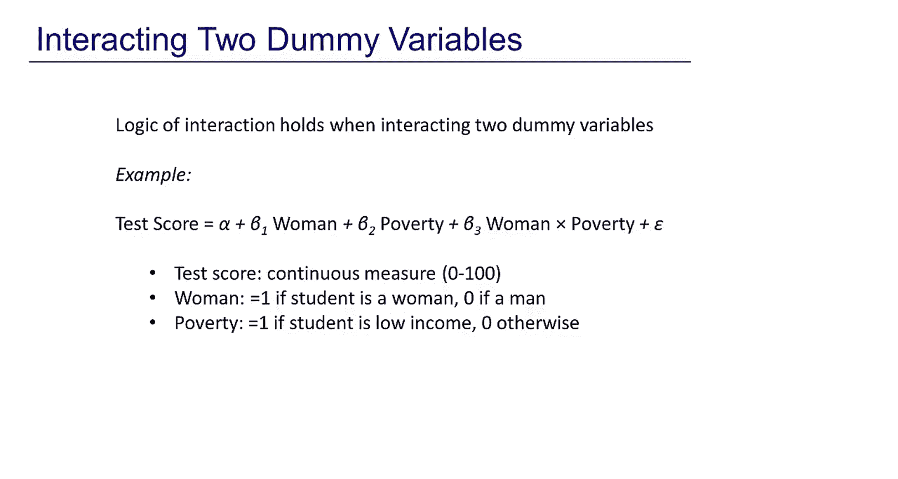
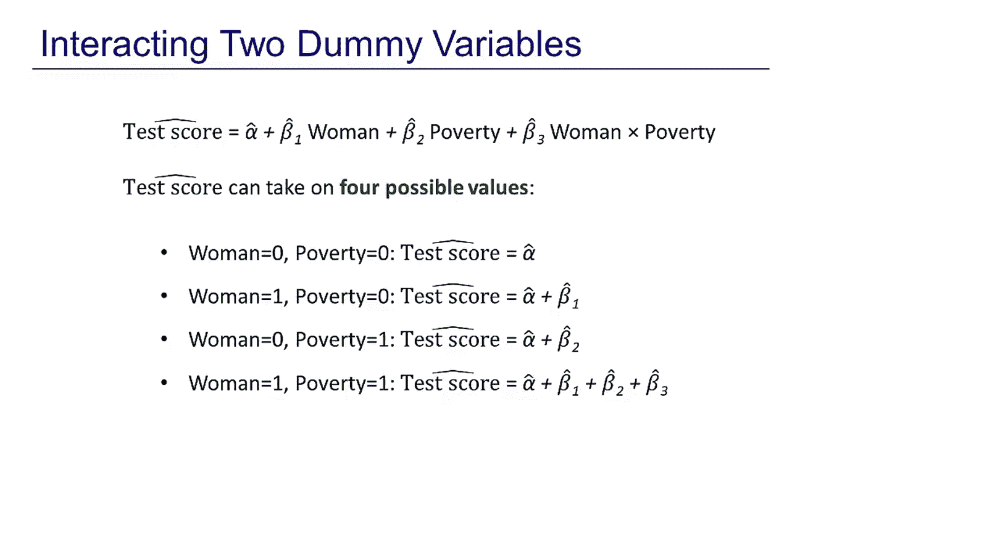
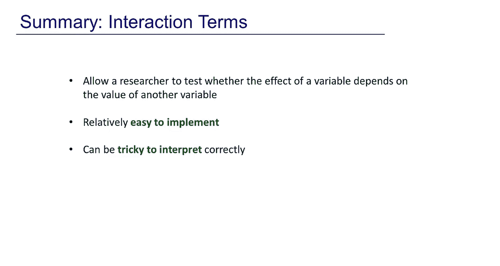

#  044：两个连续变量或两个虚拟变量的交互 📊

在本节课中，我们将学习如何解释包含两种特定交互项的回归模型：两个连续变量之间的交互，以及两个虚拟变量之间的交互。理解这些交互项的解读方式，对于分析变量间的复杂关系至关重要。

上一节我们介绍了交互项的基本概念，本节中我们来看看这两种特定情况下的模型解读。

## 交互两个连续变量 🔄

两个连续变量之间可能存在交互作用。这意味着一个连续自变量 **x1** 对因变量 **y** 的影响，可能取决于另一个连续自变量 **x2** 的值。

例如，教育程度对收入的影响可能取决于个人的工作经验年限。为了研究这个问题，我们可以估计以下模型：

`收入 = α + β1 * 教育 + β2 * 经验 + β3 * (教育 * 经验) + 误差项`

如果我们用数据集估计这个模型，将无法单独解释三个系数 **β1**、**β2** 和 **β3**。原因在于，在包含交互项的多变量模型中，我们无法在改变一个变量的同时，保持包含该变量的交互项不变。

因此，要理解模型的系数，我们需要计算预测值。

在这个讨论的模型中，教育对收入的影响取决于工作经验年限，反之亦然。解读这类交互模型结果的最佳方法是计算有意义的预测值。

例如，我们可以计算在低经验值和高经验值下，不同教育水平对应的预测收入。这样，读者就能清楚地看到经验如何调节教育与收入之间的关系。

以下是此类表格的一个示例。如果你拥有这些变量的数据，可以估计模型并设计类似的表格。

## 交互两个虚拟变量 🔲

当交互两个虚拟变量时，解读的逻辑是相同的，但由于变量只能取0或1，结果更为简单。

假设我们想理解性别和贫困状况对考试成绩的交互影响。考试成绩变量在0到100的尺度上测量，性别和贫困都被编码为虚拟变量。对于贫困，如果个人处于低收入阶层则赋值为1，否则为0。

现在假设我们收集了这三个变量的数据，并估计了一个包含交互项的回归模型。

样本回归函数将是：`个人预期考试成绩 = α_hat + β1_hat * 女性 + β2_hat * 贫困 + β3_hat * (女性 * 贫困)`，其中女性和贫困都是如前所述的虚拟变量。

由于模型中的变量只能取0或1，考试成绩的期望值只能有四种可能的值。

以下是四种组合及其对应的预期值计算：

*   当 **女性=0** 且 **贫困=0** 时，预期考试成绩等于 **α_hat**。这是非贫困男性的预期考试成绩。
*   当 **女性=1** 且 **贫困=0** 时，预期考试成绩等于 **α_hat + β1_hat**。这是非贫困女性的预期考试成绩。
*   当 **女性=0** 且 **贫困=1** 时，预期考试成绩等于 **α_hat + β2_hat**。这是贫困男性的预期考试成绩。
*   当 **女性=1** 且 **贫困=1** 时，预期考试成绩等于 **α_hat + β1_hat + β2_hat + β3_hat**。这是贫困女性的预期考试成绩。

你可以暂停视频，代入女性和贫困的值，看看模型是如何简化的。

## 总结 📝

在关于交互项的讨论中，我们涵盖了很多内容。为了结束讨论，我想强调几个关键要点。

*   交互项的目的是让研究者能够检验一个自变量的效应是否取决于另一个自变量的值。
*   交互项的实现相对简单，研究者只需将两个变量相乘，然后将该乘积项纳入回归模型即可。
*   然而，解读包含交互项的模型结果可能比较棘手。这是因为交互项中的变量在模型中出现了两次。
*   在向观众展示这类模型的结果时，计算预测值并以格式良好的表格（尤其是图表）呈现这些值会非常有帮助。

本节课中我们一起学习了如何解读包含两个连续变量交互或两个虚拟变量交互的回归模型。关键在于理解，当存在交互项时，单个系数的独立解释不再成立，必须通过计算和比较不同情境下的预测值来理解变量间的复杂关系。