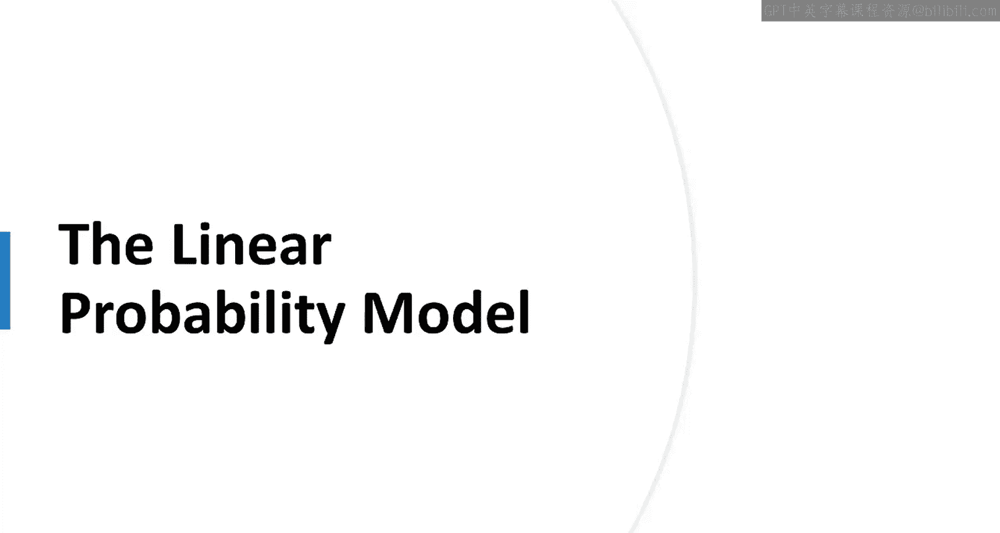
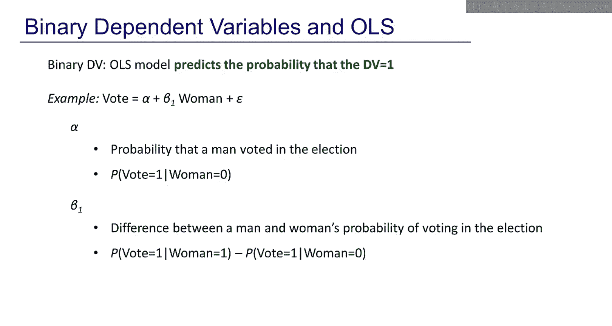
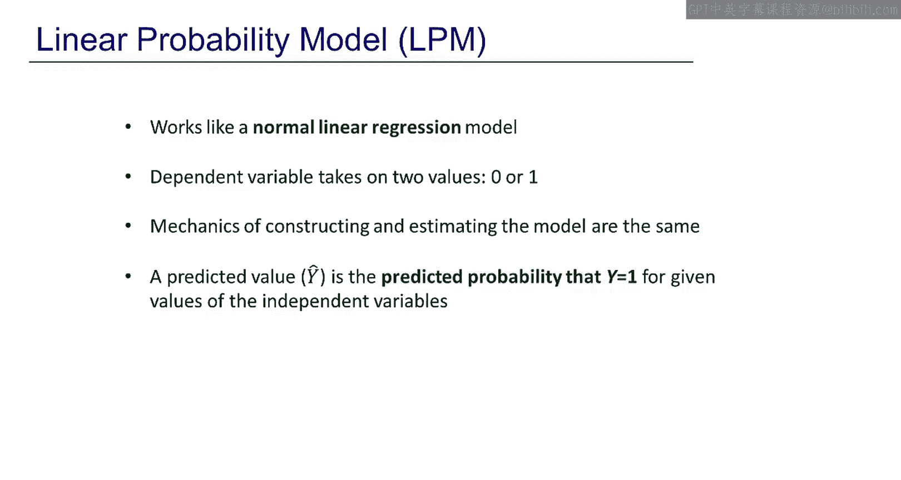
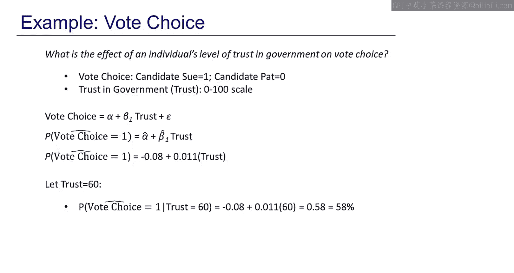
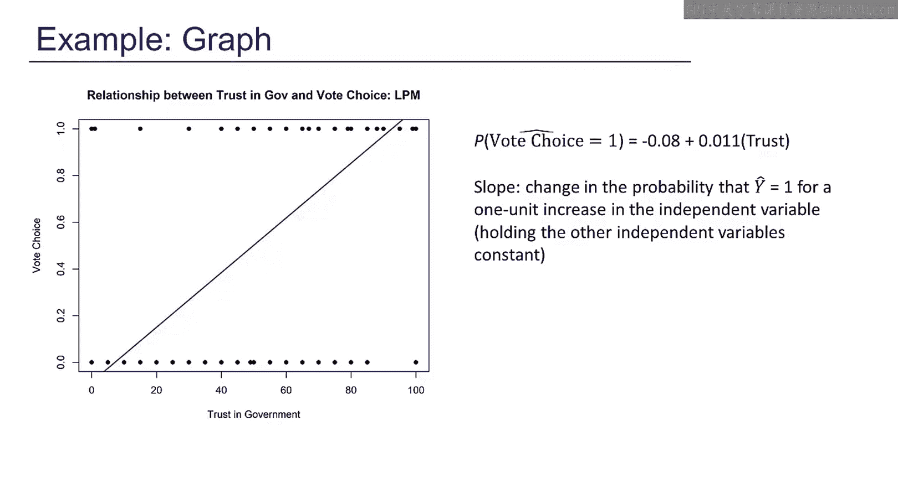
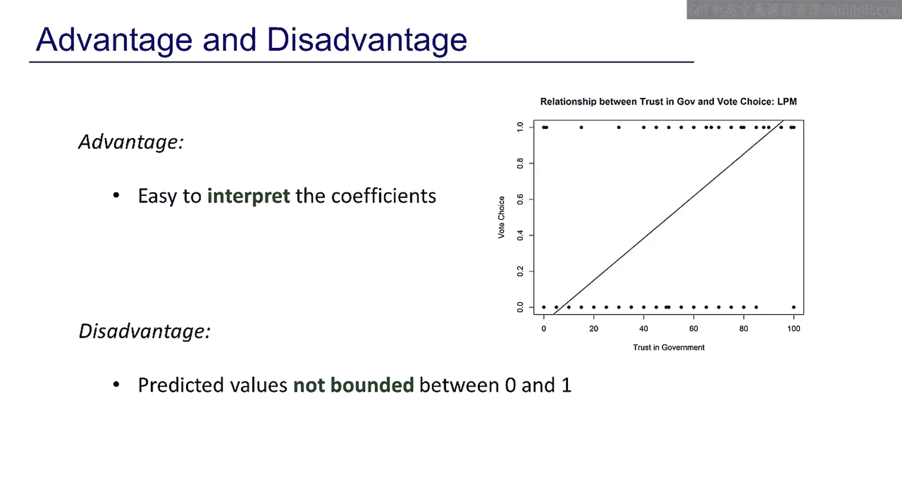

#  045：线性概率模型 📊

在本节课中，我们将要学习如何处理因变量为二元变量（即只有两个可能结果，如“是/否”、“成功/失败”）的情况。我们将介绍一种名为“线性概率模型”的回归方法，它允许我们使用普通最小二乘法来预测事件发生的概率。

到目前为止，我们只使用了可以被视为连续型的因变量。但如果我们的因变量是二元的，我们应该怎么做？例如，假设我们想建立一个模型，其因变量是一个调查问题，询问受访者是否在最近的选举中投票，答案选项是“是”或“否”。通过本视频的学习，你应该能够构建并解释一个因变量只有两种结果的回归模型。

---

## 线性概率模型简介

上一节我们提出了二元因变量的问题，本节中我们来看看如何使用OLS模型来处理它。当你处理二元因变量时，OLS模型将预测因变量等于1的概率。例如，假设你想研究性别与投票行为之间的关系，这两个变量都是二元的。因变量在个人投票时等于1，否则等于0；自变量“女性”在个人为女性时等于1，否则等于0。

因此，总体回归函数为：
`vote = α + β₁ * woman + ε`

在这个模型中，α将告诉我们男性在选举中投票的概率。换句话说，如果你将`woman`设为0，`vote`的期望值将告诉我们男性投票的概率。我们可以用符号表示为：α = P(vote=1 | woman=0)。β₁将告诉我们男性和女性投票概率的差异。如果我们将自变量增加一个单位（即从男性变为女性），β₁告诉我们投票概率的预期变化。用符号表示为：β₁ = P(vote=1 | woman=1) - P(vote=1 | woman=0)。

---

## 模型构建与解释

使用OLS方法处理二元因变量被称为**线性概率模型**。它的工作原理与普通回归模型类似，只是因变量只能取两个值：0和1。构建和估计线性概率模型的机制与普通多元模型相同。关键区别在于，预测值`ŷ`始终是因变量`y`在给定自变量值下等于1的**预测概率**。

让我们来看一个例子。假设你想根据个人对政府的信任度来建模其投票选择。因变量是投票选择，将候选人Sue定义为类别1，候选人Pat定义为类别0。对政府的信任度是一个从0到100的量表。

总体回归函数是：
`vote_choice = α + β₁ * trust + ε`

使用这个模型，我们将估计样本回归函数。`vote_choice`等于1的概率的期望值为：
`E[P(vote_choice=1)] = α̂ + β̂₁ * trust`

使用一个数据集，我们可以估计模型并确定：
`P(vote_choice=1) = -0.08 + 0.011 * trust`

现在，让我们计算一个预测值。假设我们感兴趣的是对政府信任度为60的人的预测投票选择。将60代入估计模型：
`ŷ = -0.08 + 0.011 * 60 = 0.58`

这意味着这个人有58%的概率投票给候选人Sue，因为我们已将该候选人定义为类别1。

---

## 模型的可视化与理解

此幻灯片展示了数据点和回归线的图形。请注意，所有数据点在Y轴上要么落在0处，要么落在1处。请记住，这是因为我们使用的是二元因变量。回归线穿过数据点。回归线的斜率告诉我们，在保持模型中其他自变量不变的情况下（当然，本例中我们只有一个自变量），自变量每增加一个单位，`ŷ`等于1的概率的变化量。

---

## 线性概率模型的优缺点

以下是线性概率模型的一个关键优点和一个关键缺点。

**优点**：它是一个简单的模型，易于估计，并且系数易于解释，因为它们的解释方式与普通多元模型中的系数相同。

**缺点**：该模型的预测值并不限定在0和1之间，因此你最终可能会得到小于0或大于1的预测值。你可以在图表上看到这一点，因为我们是用一条直线来拟合数据，这条直线必然会在某些X值处延伸到0以下和1以上。对于自变量的非常高的值，你可能会得到一个大于1的预测概率。在这种情况下，这只意味着具有该自变量值的人有很大可能属于`y=1`的类别。

在下一个视频中，我们将讨论Logit和Probit模型，它们将预测值限定在0和1之间。

---

## 总结

本节课中我们一起学习了线性概率模型。我们了解到，当因变量是二元变量时，可以使用普通最小二乘回归来预测事件发生的概率。我们学习了如何构建模型、解释系数（它们代表概率的变化），并计算特定情况下的预测概率。同时，我们也认识到该模型的主要局限性在于其预测值可能超出合理的0到1的概率范围。这为后续学习更复杂的二元选择模型（如Logit和Probit）奠定了基础。