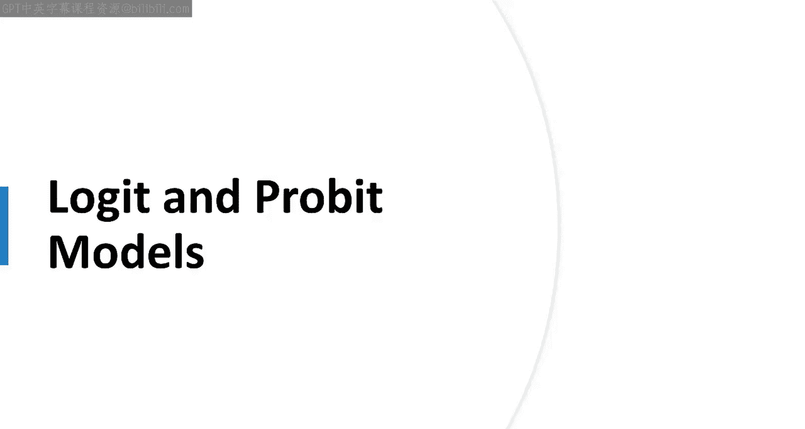
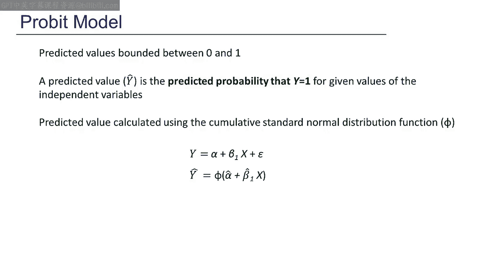
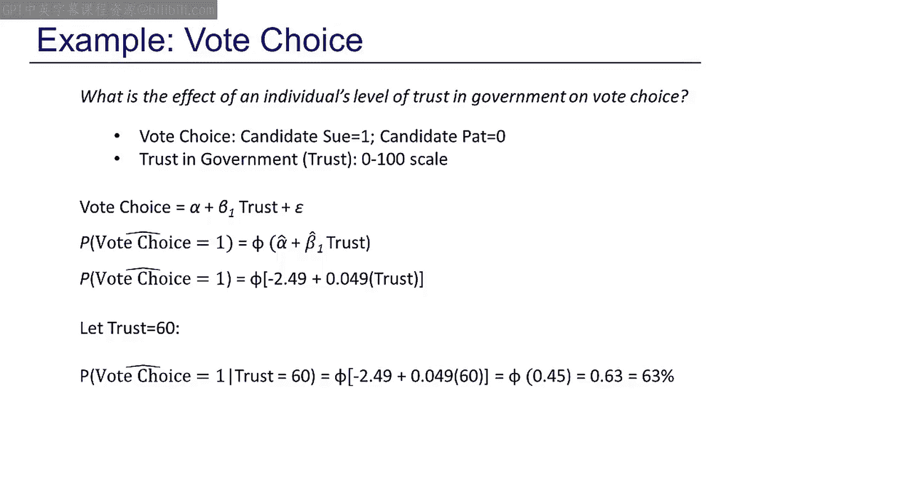
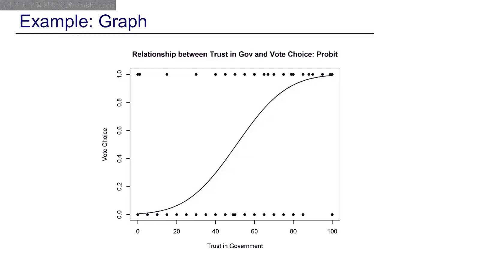
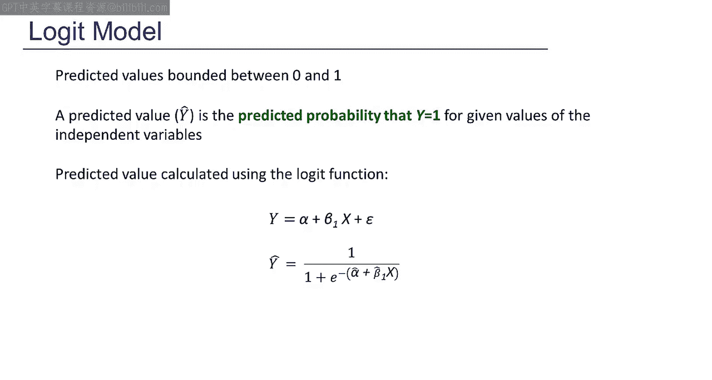
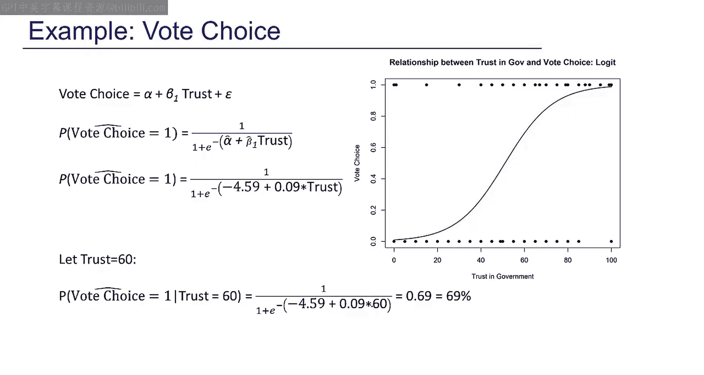
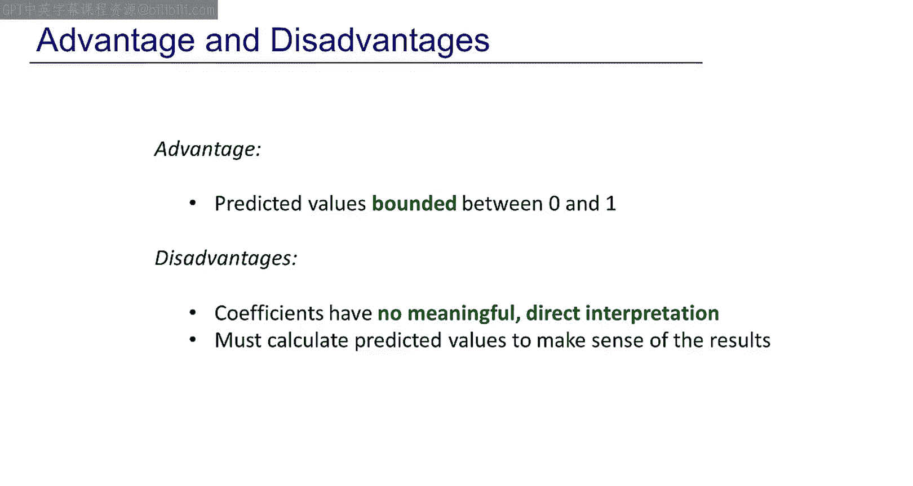

#  046：Logit与Probit模型 📊

在本节课中，我们将要学习Logit与Probit回归模型。这两种模型是线性概率模型的扩展，它们能够将预测值限定在0到1之间，这对于处理二元因变量非常有用。课程结束时，你将能够构建并解释Logit和Probit模型的结果。

## Probit模型

上一节我们介绍了线性概率模型，本节中我们来看看Probit模型。正如之前提到的，当你使用Probit模型时，预测值被限定在0和1之间。

与线性概率模型一样，预测值Y hat表示在给定自变量值时，y等于1的预测概率。然而，在这种情况下，我们计算预测值的方式与线性概率模型不同。

在这种情况下，我们将估计的回归模型代入由Φ表示的累积标准正态分布函数。这不是你手动计算的内容，你需要使用统计软件程序来计算这个预测值。

让我们通过一个例子来理解。

让我们回到在线性概率模型讨论中使用的投票选择例子。提醒一下，我们关注的是个人对政府的信任水平（在0到100分的尺度上衡量）与他在两位候选人之间的投票选择之间的关系，其中候选人Sue被指定为1类别，候选人Pat被指定为0类别。

总体回归函数与之前相同：`vote_choice = α + β₁ * trust + ε`。

然而，如果我们估计一个Probit模型，我们需要在样本回归函数中包含Φ函数。

样本回归函数如下：`P(某人预期的投票选择 = 1) = Φ(α_hat + β₁_hat * trust)`。

使用数据集和统计软件包来估计模型，我们可能会确定某人预期的投票选择等于1的概率等于`Φ(-2.49 + 0.049 * trust)`。在这种情况下，估计的截距是-2.49，估计的斜率是0.049。但是，我们不能像通常那样解释估计的截距和斜率，记住Φ函数的重要性。

为了理解结果，我们需要计算预测值。例如，根据这个Probit模型，对于一个政府信任度为60的人，其预测的投票选择是什么？

为了计算这个预测值，我们将trust设为60，然后计算结果。同样，由于Φ函数的存在，我们需要使用统计软件包来完成这个计算。

结果证明是0.63，意味着这个人有63%的概率支持候选人Sue。注意，这个值与线性概率模型的结果相似，但并不完全相同。

这张幻灯片展示了数据点和估计的Probit线的图表。数据与我们在上一个视频中用于估计线性概率模型的数据相同。

在这种情况下，请注意这条线呈S形，这是由于Φ函数造成的。Probit模型将所有预测值限制在0和1之间，这在二元因变量的情况下效果很好。所有的Probit线都具有S形曲线。

## Logit模型

了解了Probit模型后，我们来看看Logit模型。Logit模型的功能与Probit模型非常相似。实际上，没有充分的理由选择其中一个而放弃另一个。研究人员在处理二元因变量时倾向于使用Logit或Probit模型，但没有充分的理由选择其中一个而非另一个。

与Probit模型一样，Logit模型将预测值限定在0和1之间。并且与Probit模型和线性概率模型一样，预测值Y hat表示在给定自变量值时，y等于1的预测概率。

区别在于用于创建S形曲线的函数。在这种情况下，Y hat是使用Logit函数计算的。`Y_hat = 1 / (1 + e^(-SRF))`。

同样，这不是你手动计算的内容。当运行Logit模型时，统计软件程序将能够使用α和β₁的估计值（以及如果你的模型是多变量Logit模型，还包括其他系数）来计算预测值。

让我们回到关于投票选择的例子。和之前一样，总体回归函数是：`vote_choice = α + β₁ * trust + ε`。

样本回归函数是：`P(投票选择的期望值 = 1) = 1 / (1 + e^(-(α_hat + β₁_hat * trust)))`。

使用我们一直在检查的数据集估计这个模型显示，在这种情况下α_hat是-4.59，β₁_hat是0.09。

为了在这种情况下计算预测值，我们将这些估计的系数以及一个政府信任度的值代入Logit函数。让我们再次使用将政府信任度设为60的例子。像往常一样，预测值是在trust为60的情况下，投票选择等于1的估计概率。

这个计算结果证明是0.69，这意味着根据估计的模型，一个政府信任度为60的人有69%的机会投票给候选人Sue。

一般来说，Probit和Logit模型的结果应该是相似的，尽管它们不会完全相同。如果结果差异很大，那么我们会说结果高度依赖于模型，这是令人担忧的。当基于对模型微小变化不稳健的结果做出决策时，人们当然应该谨慎。相反，当在类似模型（例如使用Probit与Logit模型）之间切换时，结果大致保持不变，我们应该有更多的信心。

## 优势、劣势与总结

我们已经分别介绍了Logit和Probit模型，现在来总结它们的共性与特点。Logit和Probit模型的优势在于预测值被限定在0和1之间。两种模型都生成一条中间线性、两端弯曲的S曲线，使得没有预测值小于0或大于1。

这些模型的劣势在于系数没有有意义的直接解释。这意味着研究人员必须计算预测值来理解结果。尽管如此，这做起来相当简单。当使用Logit和Probit模型时，为感兴趣的自变量的有意义取值提供一个预测值表是很有价值的，类似于我在关于交互项的视频中展示的示例表。

以下是使用Logit和Probit模型时的关键要点：

*   **预测值计算**：理解模型结果的核心是计算并解释预测概率。
*   **结果呈现**：建议通过表格展示关键自变量取值下的预测概率，使结果更直观。
*   **模型稳健性**：如果Probit和Logit模型的结果差异很大，应对结论保持谨慎。

总而言之，请注意Logit和Probit模型通常用于二元因变量，但这些模型中的估计系数不能像在OLS模型中那样解释。相反，你可以使用预测值来评估结果。

本节课中我们一起学习了Logit与Probit回归模型。我们了解到它们是处理二元结果变量的有效工具，通过S形曲线将预测概率限制在合理的0到1范围内。虽然其系数不能直接解释，但通过计算特定自变量取值下的预测概率，我们可以清晰地理解变量之间的关系。记住，在实践中，Probit和Logit模型的结果通常相似，选择哪一种往往取决于学科惯例或个人偏好。