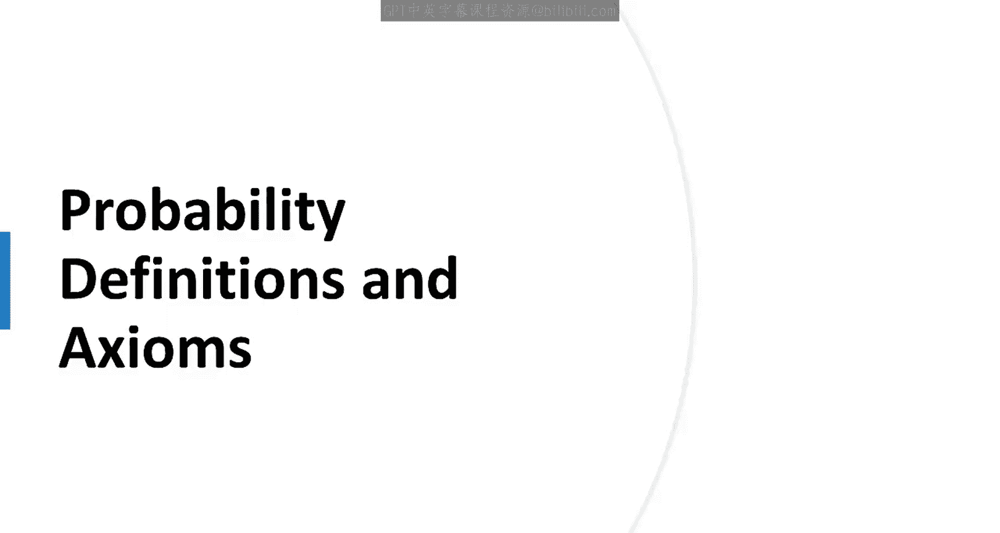
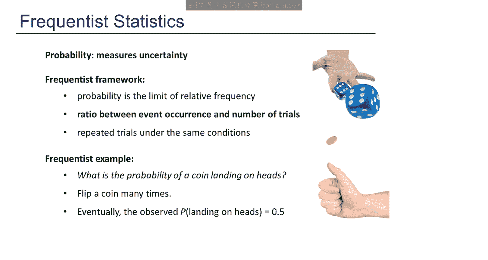
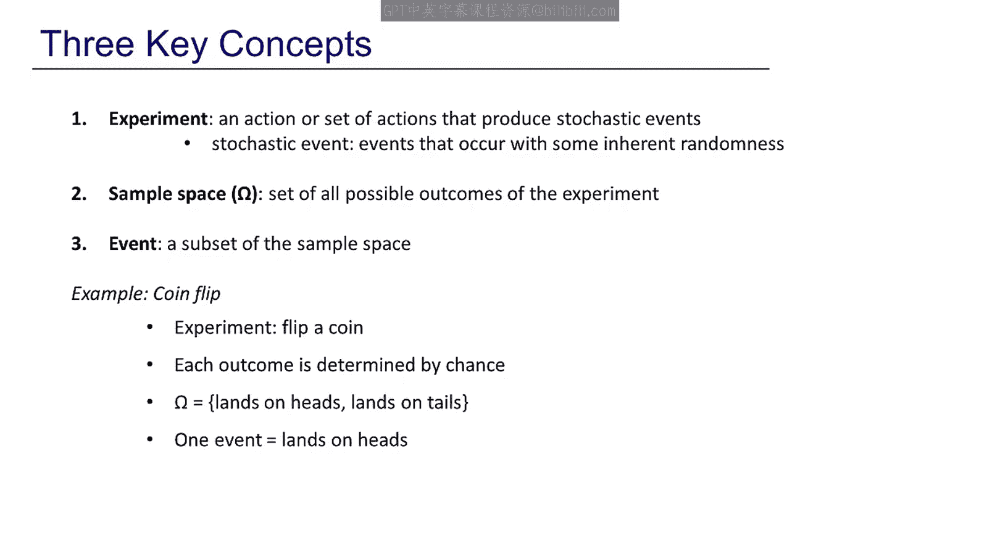
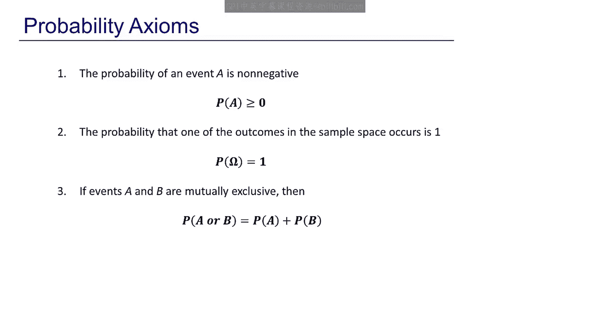
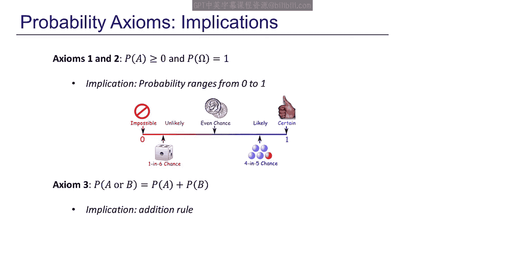
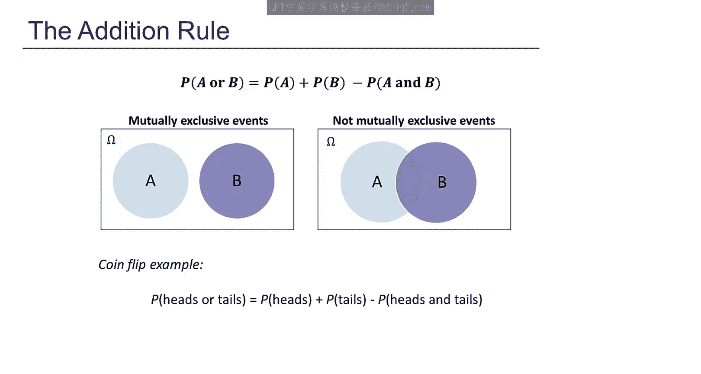
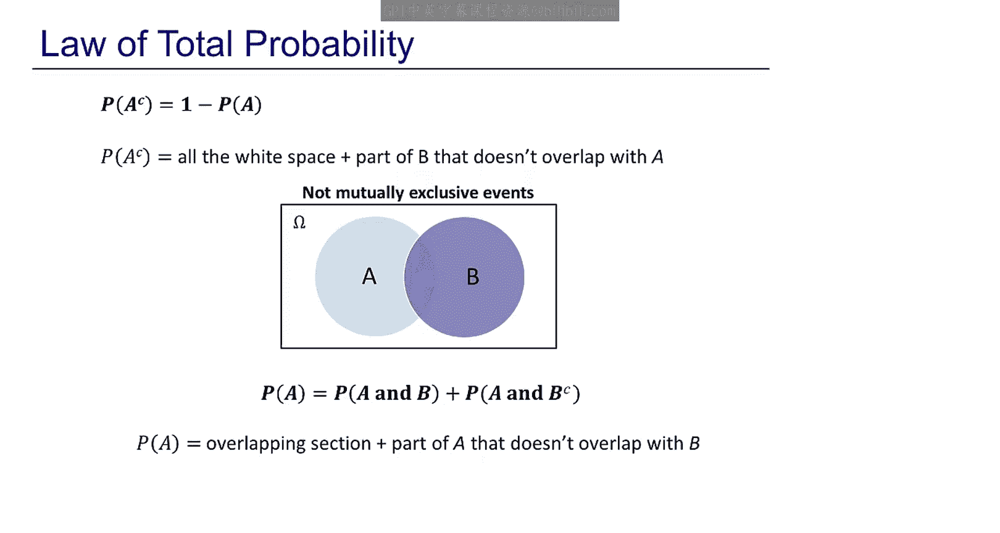
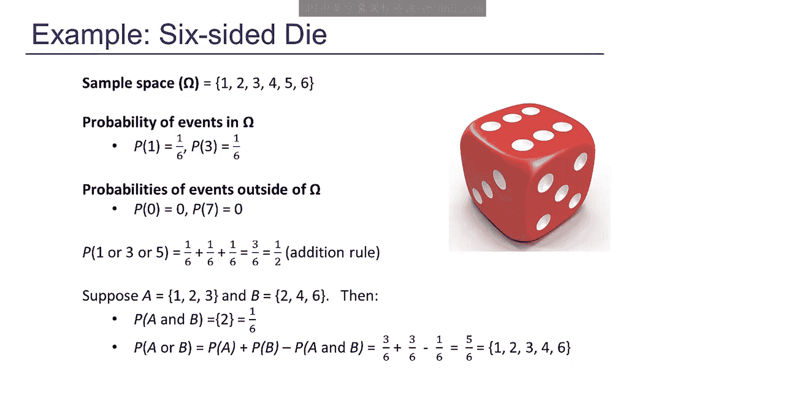

**数据素养：1：概率定义与公理** 🎲

在本节课中，我们将学习概率论的基础定义与公理。概率论是所有统计分析的基础。虽然样本空间、排列组合和独立性等概念的理论与规则看似与统计学有距离，但它们对于建立对统计模型所依赖假设的深刻直觉理解至关重要。此外，理解概率论将使你能够准确解读统计结果，尤其是围绕统计结果的不确定性度量。准确解读不确定性至关重要，特别是当你的目标是基于研究发现提出良好且可操作的建议时。

---

### **频率主义概率** 📊

首先，我们来讨论概率的频率主义框架。

概率衡量不确定性。世界上发生的所有事情都带有某种程度的概率，范围从极不可能发生到极可能发生。在频率主义框架下，概率是相对频率的极限，即事件发生次数与可能发生该事件的试验次数之比。频率主义框架假设，在相同条件下重复试验，将能观察到事件的真实概率。

例如，假设你想知道一枚硬币正面朝上的真实概率。频率主义者会认为，你应该反复多次抛掷这枚硬币。最终，在抛掷硬币许多次之后，你会观察到硬币正面朝上的概率等于0.5。换句话说，在这些重复试验的极限情况下，你会观察到硬币有50%的时间正面朝上。

---

### **定义：实验、样本空间与事件** 🔬

上一节我们介绍了频率主义框架，本节中我们来看看其中的几个核心定义。

首先，在频率主义框架中定义一个**实验**。此处的实验是指产生随机事件的一个或一组行动。**随机事件**是指具有某种内在随机性的事件。回想抛硬币的例子，抛硬币是一个随机事件，因为每次抛掷的结果是随机的，结果由机会决定。

接下来需要定义的重要概念是**样本空间**，我们用符号 **Ω** 表示。样本空间是实验所有可能结果的集合。在抛硬币的例子中，样本空间包含两个可能结果：正面和反面。如果你将实验定义为抛掷硬币三次，那么样本空间将包含这三次抛掷的所有可能结果，例如（正面，反面，正面）等等。

相应地，一个**事件**是样本空间的一个子集。因此，对于抛硬币，实验是抛掷硬币。实验的每个结果由机会决定。样本空间包括硬币正面朝上和反面朝上。而一个可能的事件是“硬币正面朝上”。

---

### **概率的三条公理** 📐

现在，我们来定义概率的三条公理或基本规则。

1.  **非负性**：事件A发生的概率是非负的。我们可以写作：**P(A) ≥ 0**。
2.  **规范性**：样本空间中某个结果发生的概率为1。换句话说，Ω中某个事件发生的概率为1，即 **P(Ω) = 1**。
3.  **可加性**：如果A和B是互斥事件（即一个发生则另一个不发生），那么A或B发生的概率等于A的概率加上B的概率，即 **P(A ∪ B) = P(A) + P(B)**。

在我们后续的概率讨论中，将基于这三条公理进行构建。

---

### **概率公理的推论** ➕

让我们思考一下公理1和公理的推论。公理1指出P(A) ≥ 0，公理2指出样本空间中某个事件发生的概率为1。

这两条公理的推论是：**概率的取值范围是0到1**。任何事件的概率范围从不可能（概率等于0）到必然（概率等于1）。

公理3通常被称为概率的**加法规则**。该规则的公式取决于我们考察的事件是互斥的还是非互斥的。让我们通过一个例子来理解。

加法规则的完整表达式是：**P(A ∪ B) = P(A) + P(B) - P(A ∩ B)**。

在互斥事件的情况下，如左图所示，公式的最后一项为0，因为A和B没有重叠区域。右图描绘了A和B两个重叠的圆。要计算A和B非互斥时A或B发生的概率，我们必须确保在应用加法规则时减去A和B同时发生的概率。

再次回到抛硬币的例子。抛硬币是互斥事件的例子，因为一枚硬币不能同时正面朝上和反面朝上。所以，正面或反面朝上的概率等于正面朝上的概率加上反面朝上的概率，再减去正面和反面同时朝上的概率，而后者为0。

---

### **全概率定律** 🧩

从加法规则出发，我们可以推导出**全概率定律**：事件A的补集的概率等于1减去A的概率，即 **P(Aᶜ) = 1 - P(A)**。

请看本页的图示，它展示了两个非互斥事件A和B。白色矩形是样本空间Ω。A的补集概率包括所有白色区域加上B中不与A重叠的部分。因此，根据全概率定律，我们可以说 **P(A) = P(A ∩ B) + P(A ∩ Bᶜ)**，换句话说，A的概率等于重叠部分的概率加上A中不与B重叠部分的概率。

目前，所有这些规则可能看起来相当抽象且难以应用。让我们来看一个例子。

---

### **示例：掷骰子** 🎲

想象一个传统的六面骰子。样本空间包含六个可能的结果：1, 2, 3, 4, 5, 6。

任何单个事件发生的概率是1/6。例如，掷出1的概率是1/6，掷出3的概率是1/6。

样本空间之外的任何事件的概率为0。例如，掷出0的概率是0，掷出7的概率是0。

根据加法规则，掷出1、3或5的概率是 1/6 + 1/6 + 1/6 = 1/2。

现在，假设事件A是集合 {1, 2, 3}，事件B是集合 {2, 4, 6}。

在这种情况下，A和B同时发生的概率是1/6，即得到结果2的概率。

A或B发生的概率等于P(A) + P(B) - P(A ∩ B) = 3/6 + 3/6 - 1/6 = 5/6。

在我们继续讨论概率的过程中，将把这些规则作为构建更复杂概念（如条件概率和独立性）的基础。

---

**总结**：本节课中我们一起学习了概率论的基础。我们首先介绍了频率主义概率观，即概率是长期相对频率的极限。然后定义了实验、样本空间和事件等核心概念。接着，我们学习了概率的三条基本公理：非负性、规范性和可加性，并探讨了由这些公理推导出的加法规则和全概率定律。最后，通过掷骰子的具体示例，我们应用了这些规则进行计算。这些概念是理解后续更高级概率主题的基石。