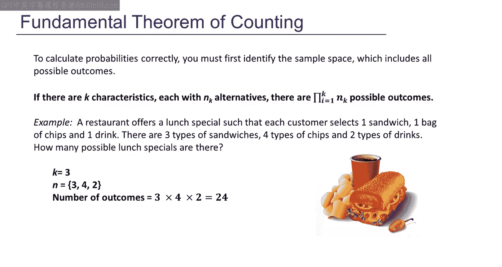
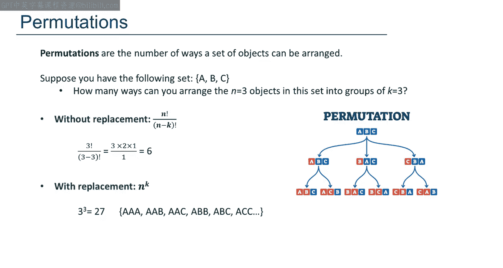
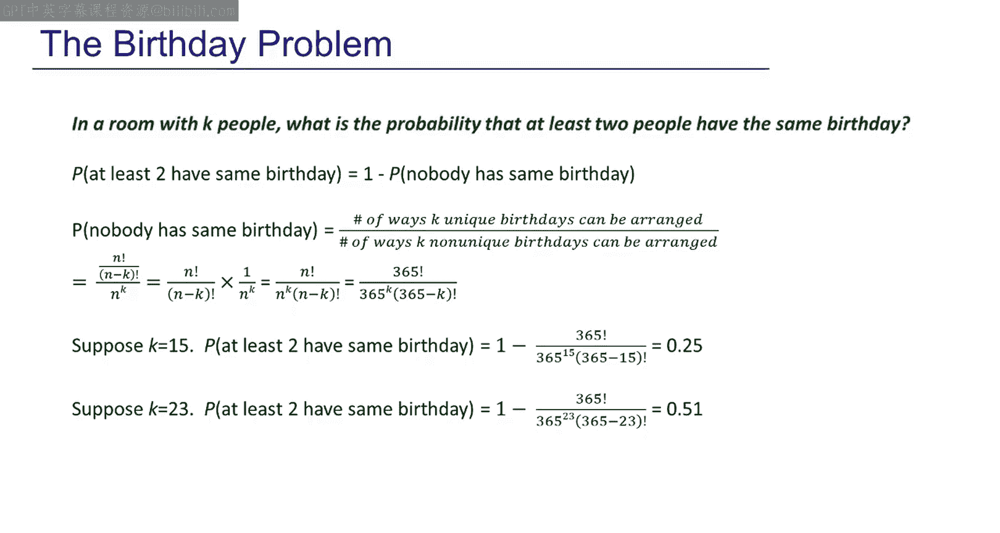
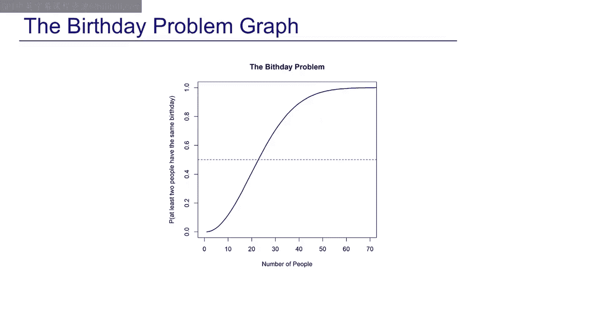
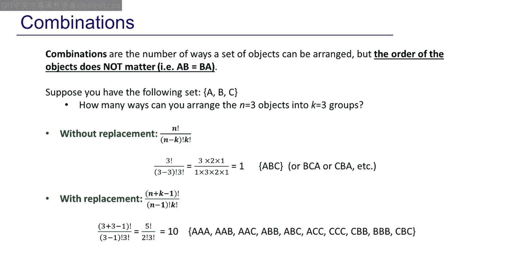
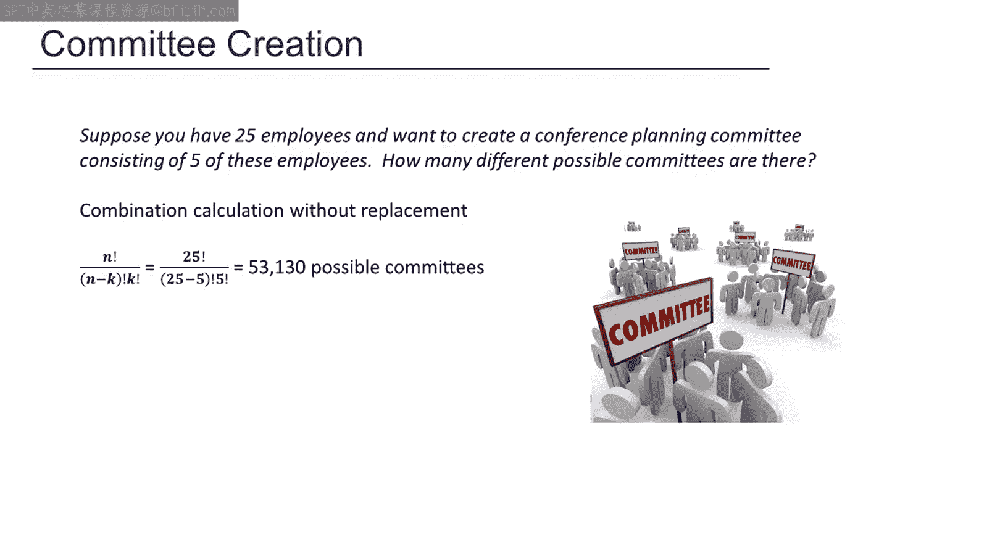
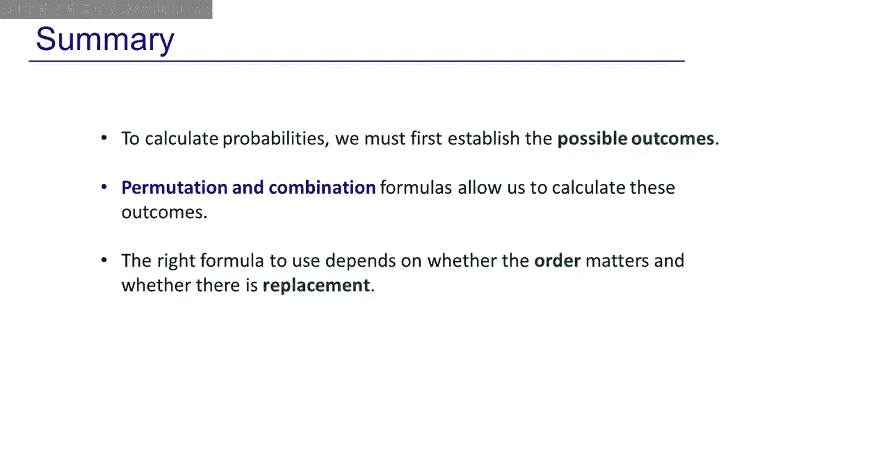

#  049：排列与组合 📊

在本节课中，我们将要学习概率论中的两个核心概念：排列与组合。它们是确定样本空间（即所有可能结果的集合）的基础规则。有时，像抛硬币或掷骰子这样简单事件的样本空间很容易列出。但在处理更复杂的情况时，例如密码锁的组合，或者从100个人中配对，就需要用到这些规则。当对象或个体的数量很大时，组合它们的规则会变得复杂。通过本课的学习，你将掌握如何运用这些基本规则来确定样本空间。

## 基本计数原理 🧮

上一节我们提到了确定样本空间的重要性，本节中我们首先来看看一个最基础的规则：基本计数原理。

这个原理指出：如果一项任务有 K 个特征，每个特征分别有 n₁, n₂, ..., n_K 种选择，那么可能的结果总数等于所有特征选择数的乘积。

让我们通过一个例子来理解。假设一家餐厅提供午餐特惠，每位顾客需要选择一种三明治、一袋薯片和一杯饮料。餐厅提供3种三明治、4种薯片和2种饮料。

在这个例子中，K = 3，因为有3个特征（三明治、薯片、饮料）。n 的集合是 {3, 4, 2}。因此，可能的结果总数等于 3 × 4 × 2 = 24。总共有24种可能的午餐特惠组合。

## 排列 🔄

在计算可能的结果集合时，我们通常使用排列或组合公式。排列关注的是对象的**排列方式**，并且**顺序是重要的**。换句话说，ABC 的排列与 CBA 的排列是不同的。

假设你有一个集合 {A, B, C}。你想知道将这 n=3 个对象排列成 K=3 的组有多少种方式。

进行这个计算，我们首先需要确定是“无放回”操作还是“有放回”操作。“有放回”意味着一个对象在被选中并纳入一个组后，会被放回原处，可以被再次选择。

以下是两种情况的公式：

*   **无放回排列**：公式为 `n! / (n - k)!`。其中，`n!`（n的阶乘）表示从 n 乘到 1 的所有整数的乘积。例如，`4! = 4 × 3 × 2 × 1 = 24`。根据定义，`0! = 1`。
    *   在我们的例子中，无放回排列数为 `3! / (3-3)! = 6 / 1 = 6`。确实有6种不同的方式排列这三个字母（ABC, ACB, BAC, BCA, CAB, CBA）。

*   **有放回排列**：公式为 `n^k`。
    *   在我们的例子中，有放回排列数为 `3^3 = 27`。这意味着有27种可能的排列，例如 AAA, AAB, ABA 等（幻灯片上未全部列出）。

## 生日问题 🎂

生日问题是一个著名的概率挑战，需要使用排列计算，它也凸显了概率的反直觉特性。

问题是：在一个有 K 个人的房间里，至少有两个人生日相同的概率是多少？

让我们思考一下如何计算这个概率。“至少两人生日相同”的概率，等于 1 减去“房间里所有人生日都不同”的概率。

“所有人生日都不同”的概率，等于“K 个不同生日排列方式的数量”除以“K 个生日（允许重复）排列方式的总数”。

我们可以用无放回排列公式计算分子，用有放回排列公式计算分母。这里，n 使用 365（天），并假设没有闰年生日。

简化方程后，计算“所有人生日都不同”概率的公式为：`365! / (365^k * (365 - k)!)`。

*   假设 K = 15（房间里有15人），那么至少两人生日相同的概率为 `1 - [365! / (365^15 * 350!)]`，计算结果约为 0.25。这意味着在15人的房间里，有25%的概率至少两人生日相同。这个概率比大多数人猜测的要高。
*   假设 K = 23，这个概率会上升到约51%，同样远高于人们的直觉猜测。

幻灯片上的图表绘制了 K 从 0 到 75 时，至少两人生日相同的概率。曲线在 0 和 1 之间。你可以看到，在人数大约为10到40之间时，概率上升得非常快。总体而言，并不需要很多人，房间里至少两人生日相同的概率就会变得相对较高。

## 组合 🤝

组合也是计算对象安排方式的数量，但这里**对象的顺序不重要**。换句话说，在组合中，AB 和 BA 被视为同一种组合。

再次假设你有一个集合 {A, B, C}。你想知道从这 n=3 个对象中选出 K=3 个进行组合（不考虑顺序）有多少种方式。

以下是两种情况的公式：

*   **无放回组合**：公式为 `n! / ((n - k)! * k!)`。
    *   在我们的例子中，无放回组合数为 `3! / ((3-3)! * 3!) = 6 / (1 * 6) = 1`。记住顺序不重要，所以包含这三个对象的组合只有一种：{A, B, C}。

*   **有放回组合**：公式为 `(n + k - 1)! / ((n - 1)! * k!)`。
    *   在我们的例子中，有放回组合数为 `(3+3-1)! / ((3-1)! * 3!) = 5! / (2! * 3!) = 120 / (2 * 6) = 10`。幻灯片上列出了这10种可能的组合（例如，AAB 和 BAA 被视为同一种组合）。

## 组合计算示例 👥

让我们看一个组合计算的实际例子。

假设你有25名员工，你想组建一个由5名员工组成的会议策划委员会。有多少种不同的可能委员会组合？

注意，在这个上下文中顺序无关紧要。一个由 Jen, Bob, Jill, Ted, Sarah 组成的委员会，与由 Bob, Ted, Sarah, Jen, Jill 组成的委员会是同一个委员会。

我们使用无放回组合公式，代入 n=25, k=5，计算得出有 53,130 种可能的委员会。这确实是非常多的选择。

## 总结 📝

本节课中我们一起学习了排列与组合。研究它们非常重要，因为如果我们想正确计算概率，必须首先确定所有可能的结果（样本空间）。排列和组合公式使我们能够计算这些结果。

选择正确的公式取决于两个关键因素：
1.  对象的**顺序是否重要**（排列关注顺序，组合不关注）。
2.  操作是**有放回**还是**无放回**。

即使是在无放回操作中，随着对象数量的增加，可能结果的数量也会以惊人的速度增长。总体而言，你可以看到为什么计算正确的概率既具有挑战性，又常常违反直觉。掌握这些基本工具是迈向数据素养的重要一步。