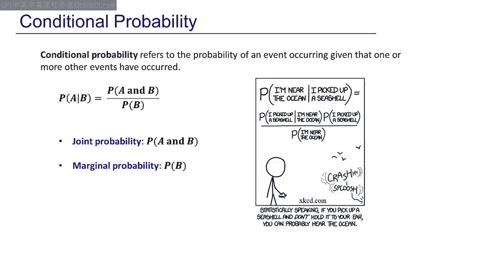
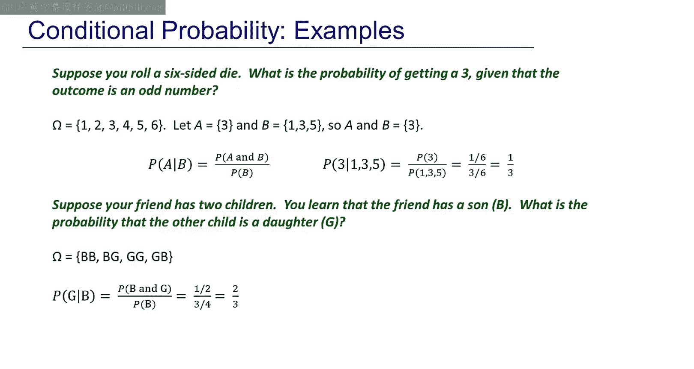
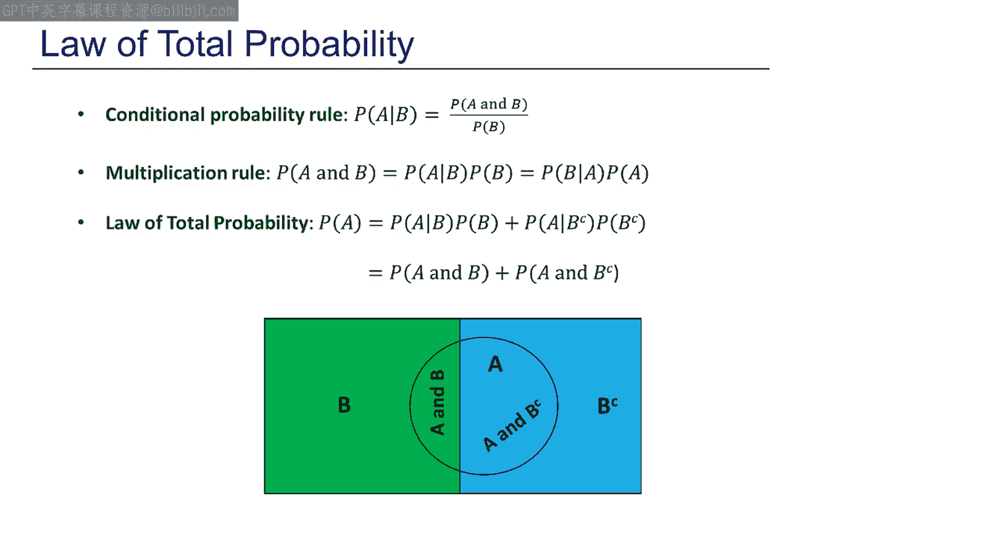
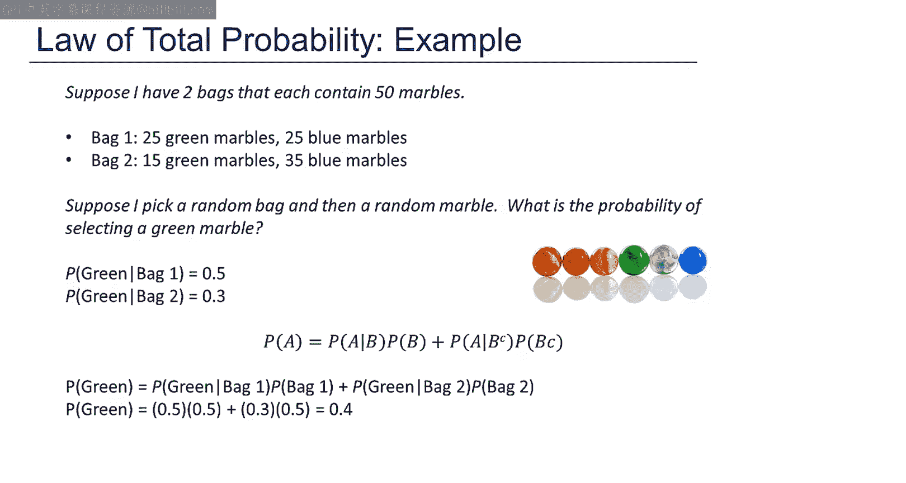
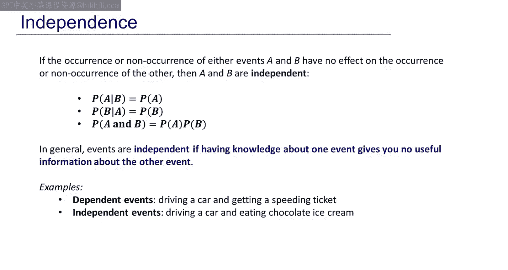

#  050：条件概率与独立性 🎲

在本节课中，我们将要学习概率论中的两个核心概念：条件概率与独立性。我们将了解如何计算在已知某些事件发生的情况下，另一事件发生的概率，并探讨事件之间相互独立意味着什么。

## 概述

在之前的讨论中，我们已经学习了基本概率的计算方法，以及如何根据对象顺序是否重要、是否放回来确定可能结果的数量。本视频将聚焦于两个更复杂的层面：条件概率和独立性。学完本视频后，你应该能掌握这两个重要概念，并拥有解决复杂概率问题的工具。

## 条件概率

条件概率指的是在一个或多个其他事件已经发生的前提下，某个事件发生的概率。

其公式如下：
`P(A|B) = P(A ∩ B) / P(B)`

请注意，这个公式包含两部分。分子被称为事件A和B的**联合概率**。分母是**边缘概率**，即已经发生的事件（本例中为事件B）的概率。

## 条件概率示例

以下是两个使用条件概率公式的示例。

**示例一：掷骰子**
假设你掷一个六面骰子。在已知结果为奇数的前提下，得到点数为3的概率是多少？
*   样本空间 Ω = {1, 2, 3, 4, 5, 6}。
*   设事件 A = {3}，事件 B = {1, 3, 5}（样本空间中的奇数）。
*   事件 A 和 B 的交集是 {3}。
这意味着我们要计算在得到1、3或5的前提下，得到3的概率。为此，我们应该用得到3的概率除以得到1、3或5的概率。
*   得到3的概率是 1/6。
*   得到1、3或5的概率是 3/6。
因此，条件概率是 (1/6) / (3/6) = 1/3。所以，在已知结果为奇数的前提下，得到3的概率是三分之一。

**示例二：朋友的子女**
假设你的朋友有两个孩子。你得知朋友有一个儿子（用B表示男孩）。那么另一个孩子是女儿（用G表示女孩）的概率是多少？
*   样本空间包含以下可能事件：{BB, BG, GB, GG}。
那么，在已知其中一个孩子是男孩的前提下，另一个孩子是女孩的概率是多少？
*   为了计算这个，我们用朋友有一个男孩和一个女孩的概率（1/2），除以至少有一个孩子是男孩的概率（3/4）。
*   得到的概率是 (1/2) / (3/4) = 2/3。
这意味着，在已知一个孩子是男孩的前提下，另一个孩子是女孩的概率是三分之二。

## 乘法法则与全概率法则

一旦我们建立了条件概率规则，就可以看到乘法法则和全概率法则在条件概率的背景下是如何由其推导出来的。

**乘法法则** 是条件概率规则的一个简单变形。
它指出：`P(A ∩ B) = P(A|B) * P(B)`。
同样地，`P(A ∩ B) = P(B|A) * P(A)`。

**全概率法则** 指出：`P(A) = P(A|B) * P(B) + P(A|Bᶜ) * P(Bᶜ)`。
请注意，这只是我们在第一次讨论概率时观察到的全概率法则的一个扩展。
全概率法则也可以表述为：`P(A) = P(A ∩ B) + P(A ∩ Bᶜ)`。
幻灯片上以图形方式描绘了这个法则。设A为圆圈内的区域，B是绿色区域，Bᶜ是蓝色区域。可以看出，事件A的概率等于事件A与B同时发生的概率，加上事件A与Bᶜ同时发生的概率。

## 全概率法则示例

一个用于说明条件背景下全概率法则的经典例子涉及从袋子中选取弹珠。

假设我有两个袋子，每个装有50颗弹珠。
*   袋子1装有25颗绿色弹珠和25颗蓝色弹珠。
*   袋子2装有15颗绿色弹珠和35颗蓝色弹珠。
假设我随机选择一个袋子，然后从该袋中随机抽取一颗弹珠。我选中绿色弹珠的概率是多少？

*   在选中袋子1的前提下，选中绿色弹珠的概率是 0.5（即 25/50）。
*   在选中袋子2的前提下，选中绿色弹珠的概率是 0.3（即 15/50）。
因此，为了计算选中绿色弹珠的概率，我可以运用全概率法则。
*   我计算：`P(绿) = P(绿|袋1) * P(袋1) + P(绿|袋2) * P(袋2)`。
代入正确的概率值：`P(绿) = 0.5 * 0.5 + 0.3 * 0.5 = 0.25 + 0.15 = 0.4`。
所以，选中绿色弹珠的概率是 0.4 或 40%。

## 独立性

对条件概率的讨论自然会引向对独立性的探讨。如果事件A或B的发生与否对另一事件的发生与否没有任何影响，那么A和B就是**独立事件**。

我们可以用三种不同的方式来形式化地定义独立性：
1.  如果A和B独立，则 `P(A|B) = P(A)`。
2.  如果A和B独立，则 `P(B|A) = P(B)`。
简而言之，前两个表达式形式化了“B的发生不改变A的概率，反之亦然”这一思想。
3.  第三个表达式指出，如果A和B独立，则 `P(A ∩ B) = P(A) * P(B)`。

一般来说，如果了解一个事件的发生情况不能为你提供关于另一个事件发生情况的有用信息，那么这些事件就是独立的。

以下是一些例子：
*   **观察到某人开车和收到超速罚单**：这些是**相关事件**。知道其中一个事件发生，能让你对另一个事件是否发生有所了解。如果你知道某人收到了超速罚单，那么此人当时在开车的概率就很高。
*   **开车和吃巧克力冰淇淋**：另一方面，这些是**独立事件**。假设你得知某人吃了巧克力冰淇淋，我看不出这为什么会改变你对该人最近是否开过车的猜测，这就是为什么它们可以被视为独立事件。

我们将在本课程的后续部分再次回到独立性的概念，因为独立性是许多不确定性计算背后的一个关键假设。

## 总结

本节课中，我们一起学习了概率论中的两个重要概念。我们首先定义了**条件概率** `P(A|B)`，并通过掷骰子和子女性别的例子进行了实践。接着，我们由条件概率推导出了**乘法法则**和**全概率法则**，并用选弹珠的例子演示了全概率法则的应用。最后，我们探讨了**独立性**，学习了判断事件独立的三种等价方式，并理解了其核心思想：一个事件的发生不影响另一个事件发生的概率。掌握这些概念是进行更复杂概率推理和分析的基础。