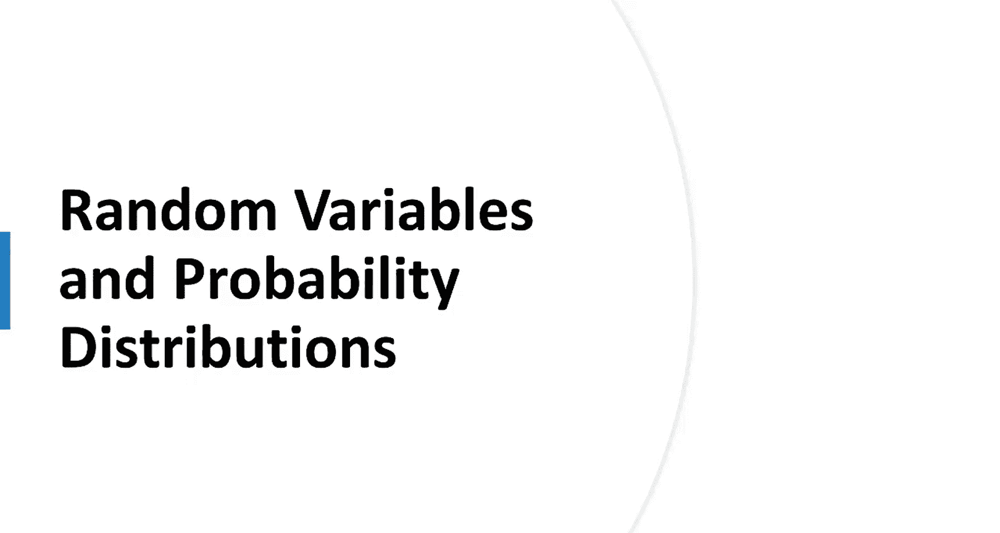
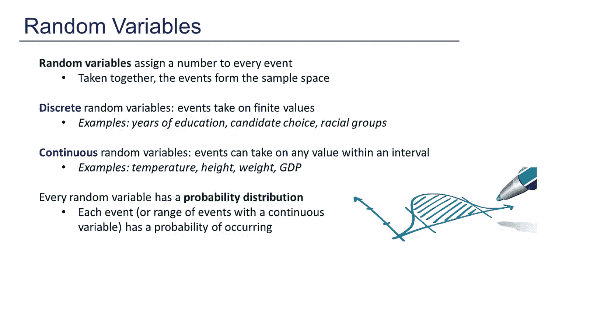
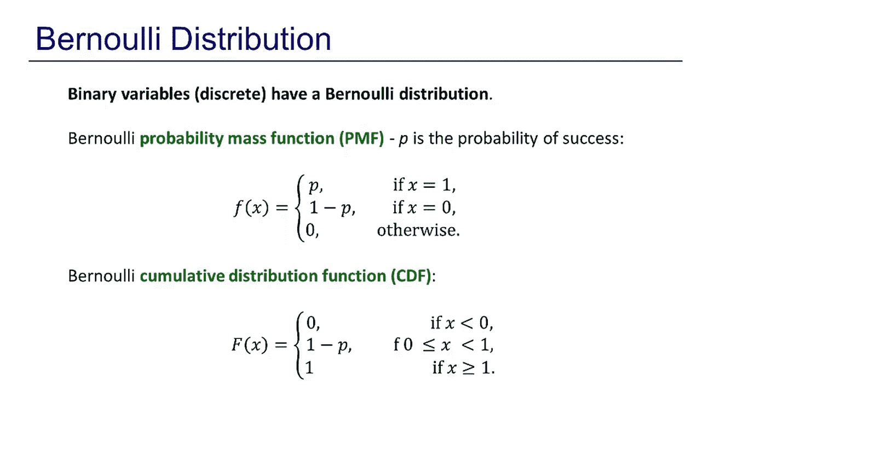
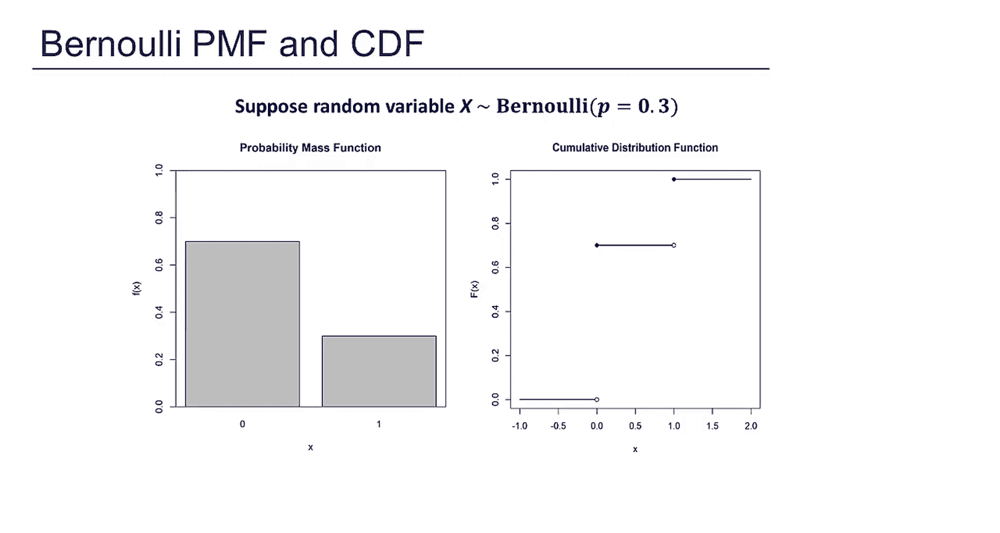
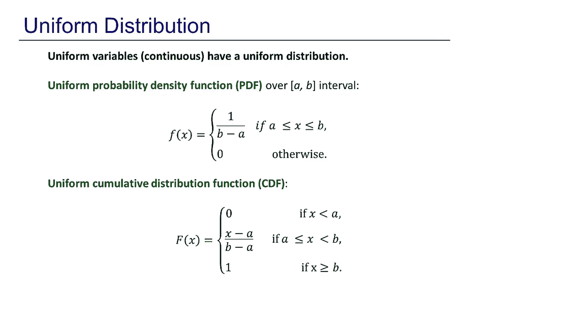
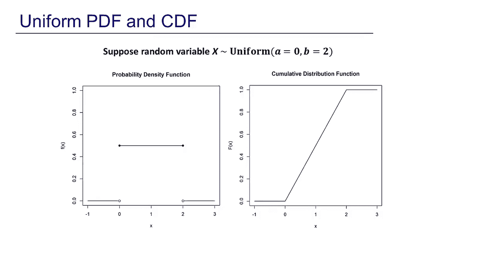
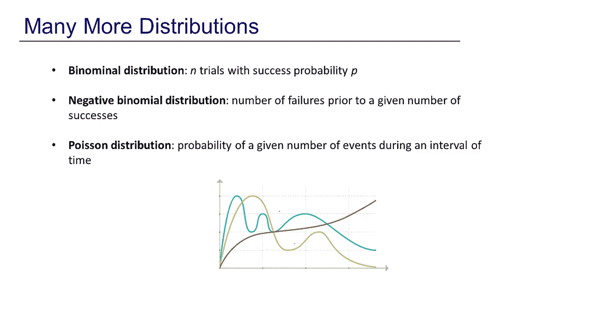

#  051：随机变量与概率分布 📊

在本节课中，我们将要学习随机变量及其概率分布的核心概念。这些概念是社会科学分析的基石，能帮助我们理解变量之间的关系。课程结束时，你将能够解释变量为何被视为“随机”的，并了解随机变量的不同分布方式。

## 随机变量的定义与分类

上一节我们介绍了数据分析的基础，本节中我们来看看随机变量的精确定义及其分类。

随机变量为每一个事件分配一个数值。这些事件共同构成了样本空间，它们应该是互斥且完备的。随机变量主要分为两大类：离散随机变量和连续随机变量。

以下是两类随机变量的具体说明：
*   **离散随机变量**：其事件只能取有限个值。例如：受教育年限、候选人选择、种族群体。
*   **连续随机变量**：可以在一个区间内取任何值。例如：温度、身高、体重、国内生产总值。

需要注意的是，有些变量既可以编码为离散的，也可以编码为连续的。以年龄为例，它可以被视为一个连续变量，也可以被划分为离散的类别，例如：18至24岁、25至40岁等。

## 概率分布：伯努利分布示例

每一个随机变量，无论是离散的还是连续的，都有一个概率分布。这意味着每个事件（对于连续变量是每个事件范围）都有一个发生的概率。

二元变量是一种只能取两个值的离散随机变量，它服从伯努利分布。例如，抛硬币就服从伯努利分布，随机变量“抛硬币”可以取两个值：正面或反面。

离散随机变量拥有概率质量函数（PMF），它显示了每个结果的概率。让我们来解析伯努利分布的PMF。

令 **`P`** 表示成功的概率。以抛硬币为例，我们可以定义“成功”为正面朝上，那么成功的概率 **`P = 0.5`**。

PMF表明：
*   随机变量 **`X`** 等于1的概率是 **`P`**。
*   随机变量 **`X`** 等于0的概率是 **`1 - P`**。

由于 **`X`** 是二元变量，它不能取其他值，因此任何其他值的概率为0。

离散随机变量还有一个累积分布函数（CDF），它计算事件发生的累积概率。

对于伯努利分布，其CDF定义如下：
*   如果 **`x < 0`**，则 **`CDF = 0`**。
*   如果 **`0 ≤ x < 1`**，则 **`CDF = 1 - P`**。
*   如果 **`x ≥ 1`**，则 **`CDF = 1`**。

## 图形化理解PMF与CDF

让我们通过图形来直观地理解PMF和CDF。

假设随机变量 **`X`** 服从成功概率为0.3的伯努利分布。这意味着 **`X`** 取值为1的概率是30%，取值为0的概率是70%。

左侧的图表展示了该分布的PMF。可以看到，**`X = 0`** 的概率是0.7，**`X = 1`** 的概率是0.3。条形图的高度代表了这些概率。

右侧的图表展示了该分布的CDF。空心圆点表示对应点被排除，实心圆点表示对应点被包含。注意：
*   当 **`x < 0`** 时，累积概率为0。
*   当 **`0 ≤ x < 1`** 时，累积概率为0.7。
*   当 **`x ≥ 1`** 时，累积概率为1。

对于还记得高中或大学微积分课程的人来说，CDF是通过对PMF积分计算得出的，并且PMF曲线（或条形图）下的总面积等于1。

## 连续变量示例：均匀分布

为了确保你对概率分布有直观的理解，让我们看看另一个分布：均匀分布。

均匀变量是在区间 **[A, B]** 上服从均匀分布的连续变量。对于连续变量，我们称其概率分布为概率密度函数（PDF）。

对于均匀分布，区间内每个事件发生的概率相等。因此，如果 **`X`** 在区间 **[A, B]** 内取值，其概率密度为 **`1 / (B - A)`**。**`X`** 在区间外取值的概率为零。

其CDF表明，累积概率在区间内从0线性增加到1，当 **`x ≥ B`** 时，累积概率保持为1。

假设随机变量 **`X`** 服从 **`A=0`**, **`B=2`** 的均匀分布。左侧的PDF图显示，**`X`** 在0到2之间任何值的概率密度都是0.5。右侧的CDF图显示，对于小于0的值，累积概率为0；在0到2之间，概率线性增加，在区间末端（此处为2）达到1；之后对于所有更大的值保持为1。PDF曲线下的面积为1，CDF是PDF的积分。虽然你可以用微积分手动进行积分，但分析师通常发现使用统计软件包来完成要简单得多。

## 其他常见概率分布

正如前面提到的，存在许多概率分布。每种分布根据其参数不同而形态各异，并适用于特定类型的随机过程。

以下是几种常见分布及其适用场景：
*   **二项分布**：用于建模一系列 **`N`** 次独立试验，每次试验成功的概率为 **`P`**。它是伯努利分布的扩展。
*   **负二项分布**：用于建模在获得指定次数成功之前所经历的失败次数。例如，假设掷骰子得到6点算成功，该分布可以模拟得到第一个6点之前需要掷骰子的次数。
*   **泊松分布**：用于建模在固定时间间隔内发生给定数量事件的概率。例如，该分布可用于模拟特定地点在特定时间段内的疾病病例数。

关键要点在于，存在许多不同的概率分布，每一种都捕捉了不同的数据生成过程。

接下来，我们将重点介绍最著名和最常用的分布——正态分布，也就是经典的钟形曲线。

## 总结

本节课中我们一起学习了随机变量与概率分布的核心知识。我们明确了随机变量的定义，区分了离散与连续随机变量，并通过伯努利分布和均匀分布的实例，深入理解了概率质量函数（PMF）、概率密度函数（PDF）和累积分布函数（CDF）的图形与含义。最后，我们了解到存在多种概率分布，它们各自描述不同的数据生成机制，为后续学习最重要的正态分布打下了基础。