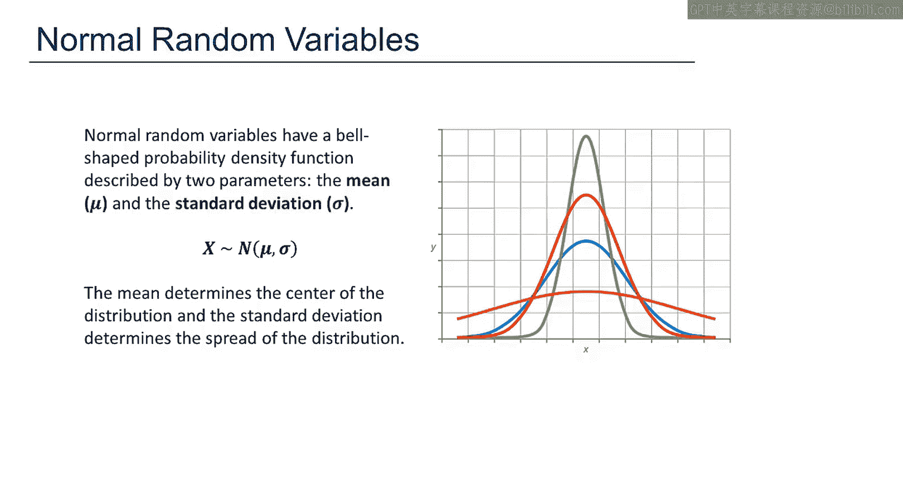
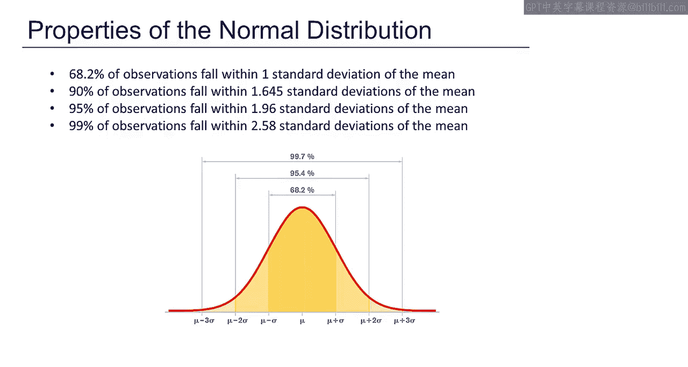
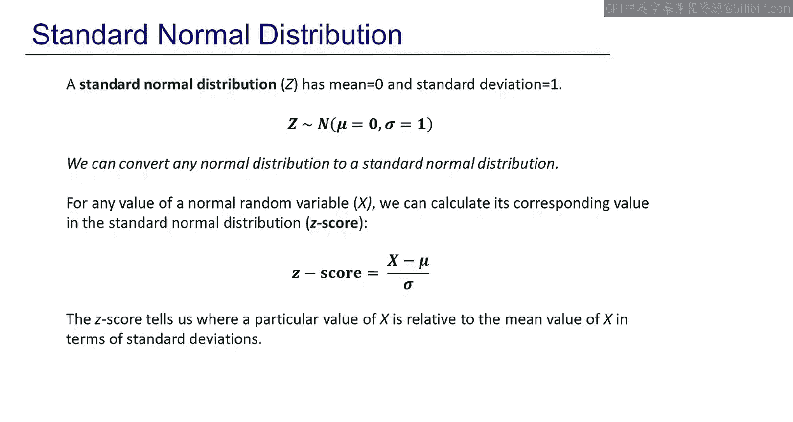
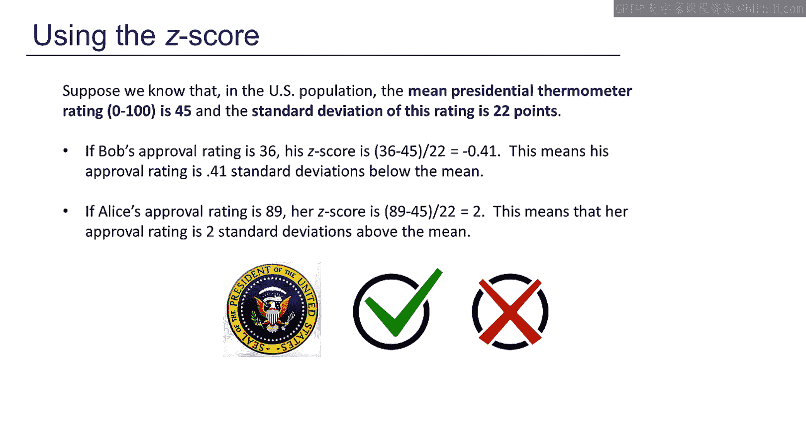
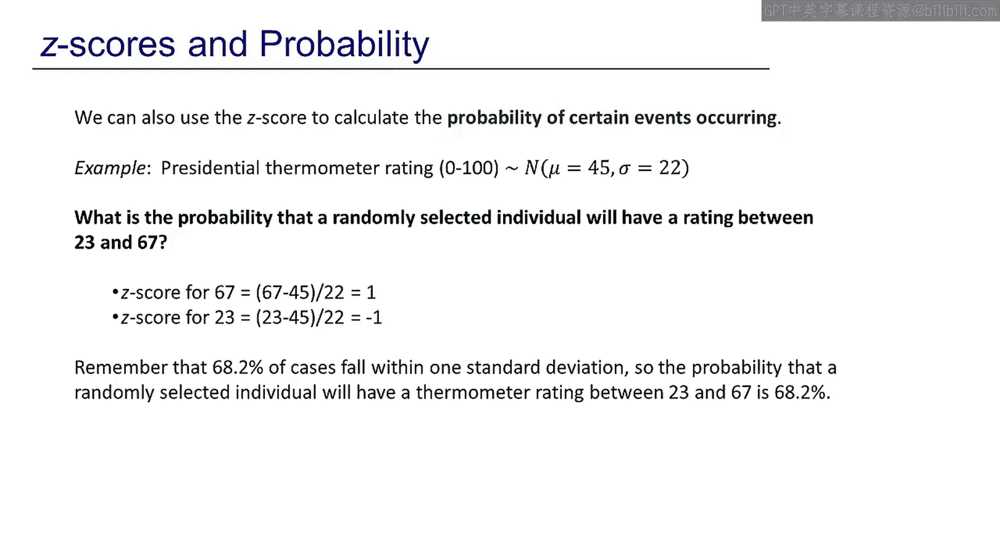
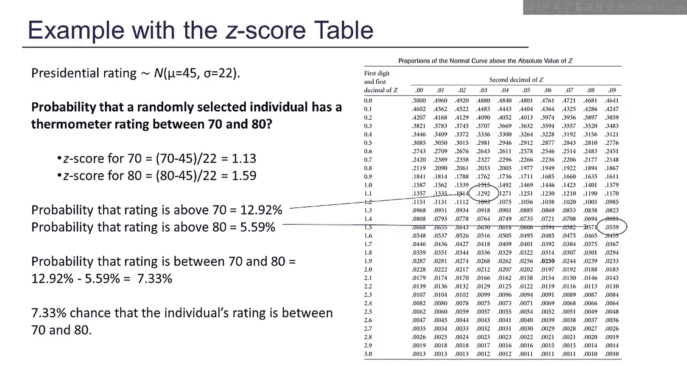
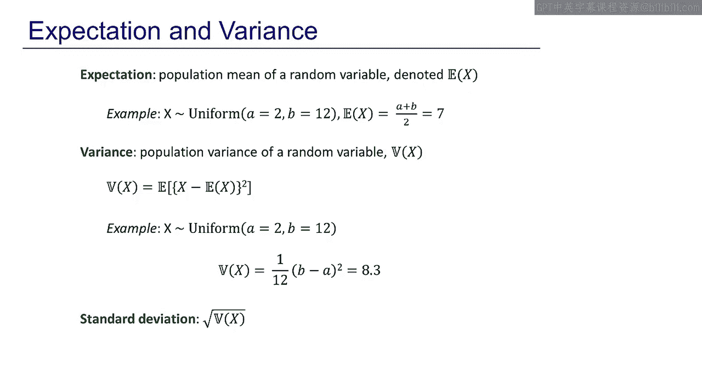

#  052：正态分布 📊

在本节课中，我们将要学习统计学中一个极其重要的概念——正态分布。正态分布是许多自然和社会现象背后常见的概率分布模式，理解它对于后续学习置信区间、假设检验等内容至关重要。

## 正态分布简介 🛎️

正态分布，即经典的钟形曲线，是一个对称的概率分布。其中心点概率最高，两侧各有一条逐渐下降的“尾巴”。许多自然过程和行为过程都符合正态分布。

在本节结束时，你将能够识别正态分布的关键特性，并利用它来估计概率。

## 正态分布的参数 📐

正态随机变量的概率密度函数呈钟形，由两个参数描述：均值（用 **μ** 表示）和标准差（用 **σ** 表示）。

用正式符号表示，我们会说变量 **x** 服从均值为 **μ**、标准差为 **σ** 的正态分布，记作：
`x ~ N(μ, σ)`

均值决定了分布的中心位置，而标准差决定了分布的离散程度。标准差越大，曲线越扁平。在右侧的图表中，橙色正态分布的标准差就大于红色正态分布。

## 正态分布的经验法则 📏

对于所有正态分布，都存在以下经验法则：
*   约 **68.2%** 的观测值落在均值加减 **1** 个标准差的范围内。
*   约 **90%** 的观测值落在均值加减 **1.645** 个标准差的范围内。
*   约 **95%** 的观测值落在均值加减 **1.96** 个标准差的范围内。
*   约 **99%** 的观测值落在均值加减 **2.58** 个标准差的范围内。

从均值到尾部，曲线下的面积逐渐减少，这解释了为何观测值百分比在远离均值时会急剧下降。我们将在讨论置信区间和假设检验时用到这些关键值（1.645、1.96 和 2.58）。

## 标准正态分布与 Z 分数 🔄

标准正态分布是一种特殊的正态分布，其均值为 **0**，标准差为 **1**。我们用大写斜体 **Z** 来表示它。

你可以将任何正态分布转换为标准正态分布。具体来说，如果你有一个服从正态分布的变量，你可以取该变量的一个值，并找到其在标准正态分布中对应的值，这个值称为 **Z 分数**。

转换公式如下：
`z = (x - μ) / σ`
其中，**x** 是你试图转换的变量值，**μ** 是该变量的均值，**σ** 是该变量的标准差。

Z 分数告诉我们，特定的 **x** 值相对于 **x** 的均值，位于多少个标准差的位置上。

## Z 分数计算示例 🧮

让我们看一个例子。假设我们知道美国民众对总统的“温度计”评分（0-100分）均值为 **45**，标准差为 **22**。

如果鲍勃对总统的评分是 **36**，他的 Z 分数计算如下：
`z = (36 - 45) / 22 = -0.41`
这意味着鲍勃的评分比均值低 **0.41** 个标准差。

如果爱丽丝的评分是 **89**，她的 Z 分数为：
`z = (89 - 45) / 22 = 2`
这意味着爱丽丝的评分比均值高 **2** 个标准差。

## 利用 Z 分数计算概率 🎲

我们还可以使用 Z 分数公式来计算特定事件发生的概率。再次以总统支持率变量为例，它服从均值为45、标准差为22的正态分布。

如何计算从总体中随机抽取的个体，其支持率在 **23** 到 **67** 之间的概率？

首先，计算 **67** 的 Z 分数：`(67-45)/22 = 1`，表示它比均值高1个标准差。
然后，计算 **23** 的 Z 分数：`(23-45)/22 = -1`，表示它比均值低1个标准差。

根据之前的经验法则，**68.2%** 的观测值落在均值加减1个标准差的范围内。因此，我们可以说，随机选择的个体支持率在23到67之间的概率是 **68.2%**。

## 使用标准正态分布表 📋

上一节的问题相对简单，因为 Z 分数正好是 ±1。但如果 Z 分数是其他值呢？这时可以使用**标准正态分布表**。该表要求你定位 Z 分数，然后它会告诉你选中高于该值的个案的概率。

例如，假设我们想计算随机个体的评分在 **70** 到 **80** 之间的概率。
*   **70** 的 Z 分数：`(70-45)/22 ≈ 1.13`
*   **80** 的 Z 分数：`(80-45)/22 ≈ 1.59`

查表步骤如下：
1.  找到 Z 分数 **1.13** 对应的概率。在表中，第一列对应 Z 分数的第一位和小数点后第一位（1.1），第一行对应小数点后第二位（0.03）。交叉处的单元格显示概率为 **12.92%**。这意味着有 12.92% 的个案评分高于 70。
2.  同理，找到 Z 分数 **1.59** 对应的概率，查得为 **5.59%**。这意味着有 5.59% 的个案评分高于 80。

因此，评分在 70 到 80 之间的概率，等于评分高于 70 的概率减去评分高于 80 的概率：
`12.92% - 5.59% = 7.33%`
所以，随机选择的个体评分在70到80之间的概率是 **7.33%**。

## 随机变量的期望与方差 📈

虽然我们已经讨论了均值和标准差一段时间，但在随机变量的背景下正式定义这些概念是有用的。

*   **期望值** 是随机变量的总体均值，记作 **E(x)**。每个概率分布都有期望值，尽管计算公式各不相同，有些可能相当复杂。对于均匀分布，期望值的公式很简单：`(a + b) / 2`，即区间长度的一半。例如，若随机变量 x 服从 a=2, b=12 的均匀分布，则其期望值为 `(2+12)/2 = 7`。
*   **方差** 是随机变量的总体方差，记作 **V(x)**。在均匀分布的情况下，方差公式为：`(b - a)² / 12`。对于上述均匀变量 x，方差为 `(12-2)²/12 ≈ 8.3`。
*   **标准差** 就是方差的平方根。

期望、方差和标准差这些概念，在我们接下来讨论不确定性时至关重要。

## 总结 ✨

本节课中，我们一起学习了正态分布的核心知识。我们了解了正态分布由均值 **μ** 和标准差 **σ** 两个参数定义，认识了其对称的钟形曲线特征以及重要的经验法则。我们重点掌握了如何通过 **Z 分数** 公式 `z = (x - μ) / σ` 将任何正态分布转换为标准正态分布，并利用标准正态分布表计算特定范围内的概率。最后，我们在随机变量的框架下回顾了期望、方差和标准差的正式定义。这些工具和概念是进行更高级统计推断的基石。