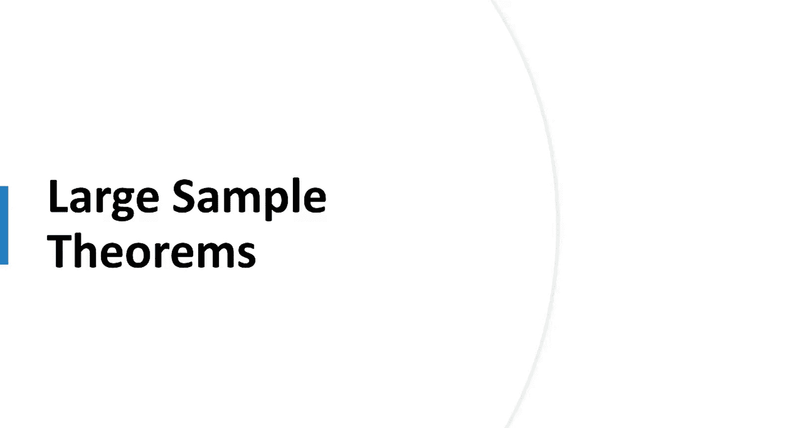
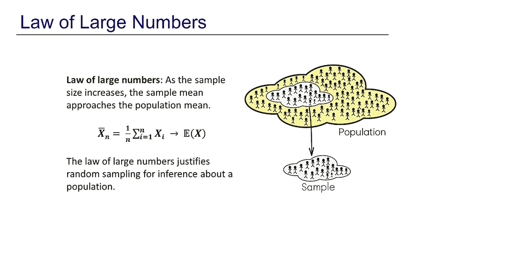
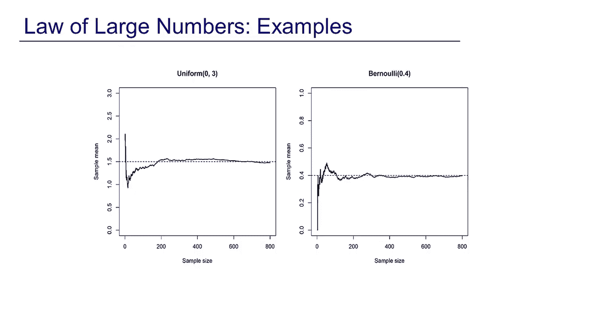
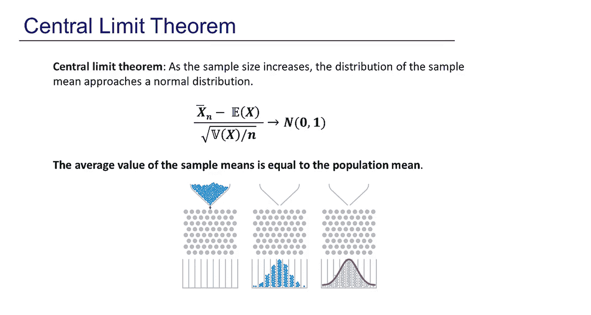
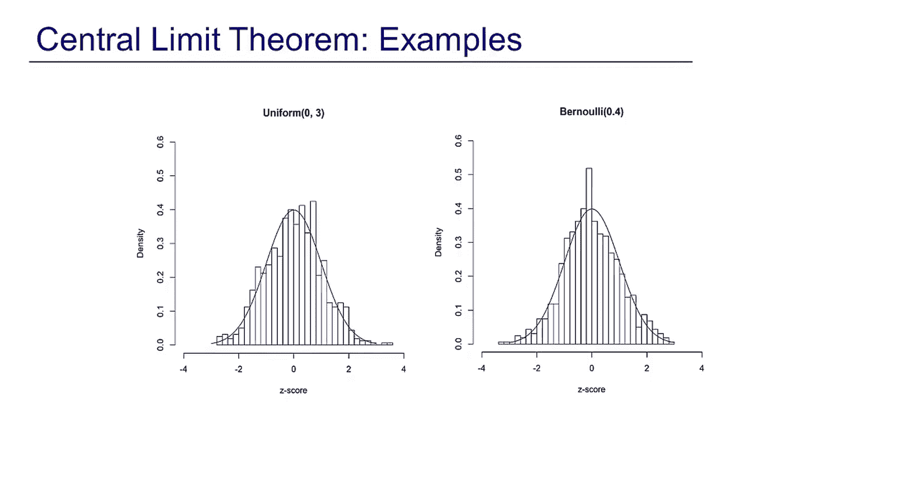
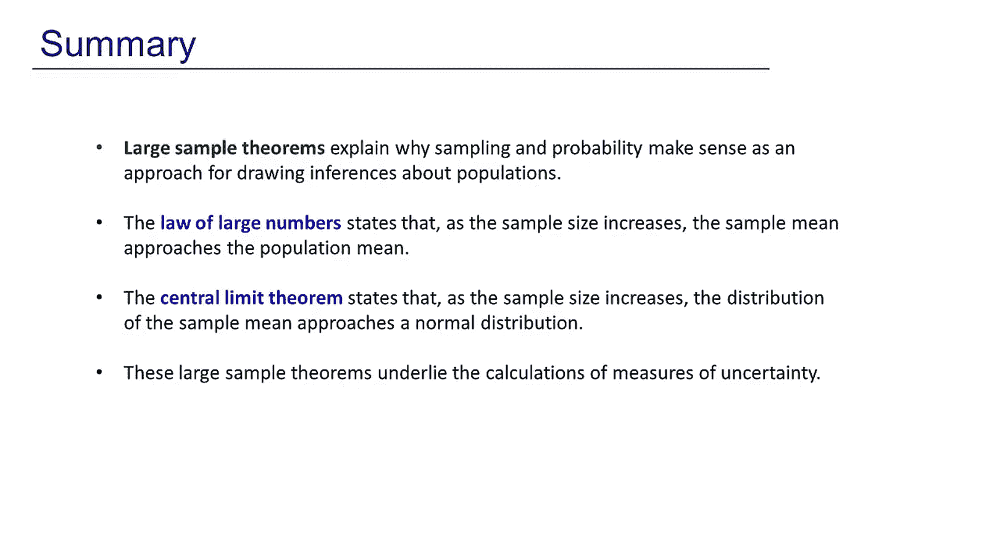

#  053：大样本定理 📊

在本节课中，我们将要学习统计学频率主义框架的两大基石：**大数定律**和**中心极限定理**。理解这两个定理，能帮助我们直观地认识到推断统计学为何是理解世界运行规律的有效方法。

## 大数定律

上一节我们介绍了课程概述，本节中我们来看看第一个核心定理。大数定律指出，随着样本量增加，样本均值会趋近于总体均值。用公式表示，即当样本量 `n` 增大时，样本均值 `x̄` 趋近于总体期望值 `E(X)`。

大数定律证明了随机抽样是推断总体特征的一种合理方法。

以下是两个说明大数定律的例子：

*   **均匀分布示例**：从左图可见，从参数为 `A=0`、`B=3` 的均匀分布中抽取样本，样本量从1增加到80。随着样本量增大，样本均值逐渐趋近于真实均值1.5。
*   **伯努利分布示例**：右图展示了从参数 `P=0.4` 的伯努利分布中抽取样本。同样，随着样本量增大，样本均值趋近于真实均值0.4。

你可以在统计软件或在线模拟器中自行进行这些模拟实验，通过改变样本量和分布参数来加深理解。

## 中心极限定理

了解了大数定律后，我们再来看看与之相关的中心极限定理。该定理描述了样本均值的分布形态。它指出，随着样本量增加，样本均值的分布趋近于正态分布。

我们也可以用标准正态分布来表述这个定理：当样本量增大时，`(x̄ - E(X)) / √(Var(X)/n)` 的分布趋近于标准正态分布。

这个定理的深层含义在于，样本均值的平均值等于总体均值。这意味着，如果我们反复进行抽样，就能了解到总体均值和总体标准差的真实值。

以下是两个说明中心极限定理的例子：

*   **均匀分布示例**：在左图中，从一个均匀分布中抽取了800个随机样本，每个样本包含1000个元素。计算每个样本的Z分数并绘制直方图，再叠加标准正态分布曲线。可以看到，Z分数的分布非常接近标准正态分布。
*   **伯努利分布示例**：右图对一个伯努利分布进行了同样的操作。抽取800个随机样本，计算Z分数并绘制直方图，再叠加标准正态分布曲线。同样，直方图趋近于标准正态分布。

## 总结

本节课中我们一起学习了两个大样本定理，它们解释了为何基于抽样和概率的方法能够有效地对总体进行因果推断。

*   **大数定律**：随着样本量增加，样本均值趋近于总体均值。
*   **中心极限定理**：随着样本量增加，样本均值的分布趋近于正态分布。

这两个定理共同构成了后续计算不确定性度量的理论基础，这也是我们本课程将要探讨的最后一个重要主题。