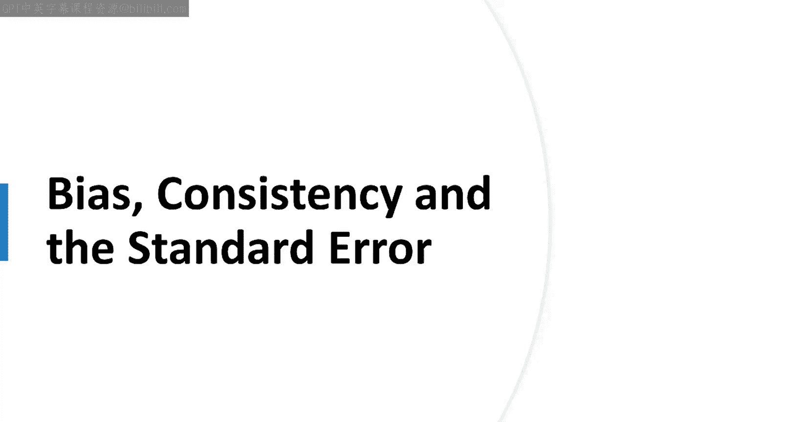
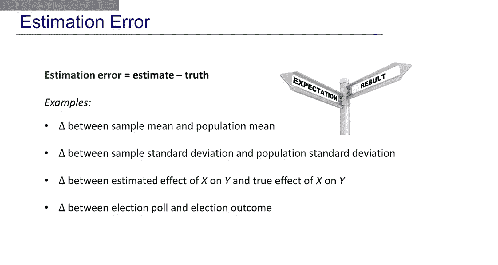
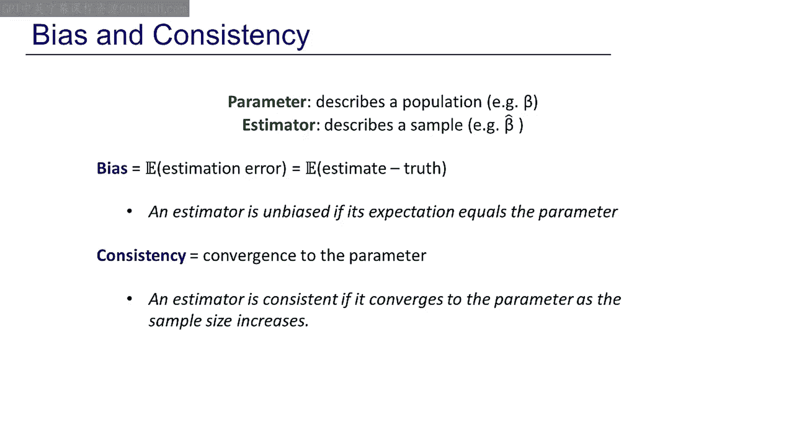
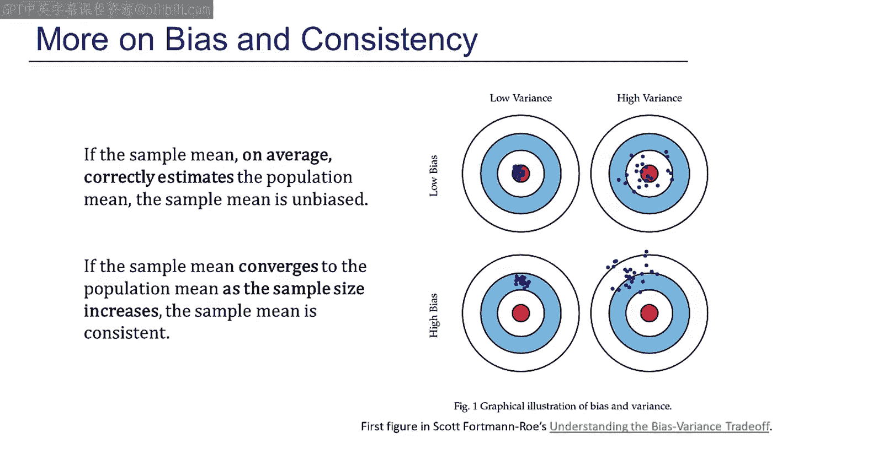
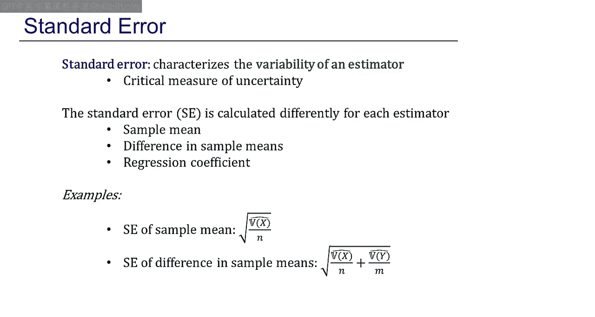
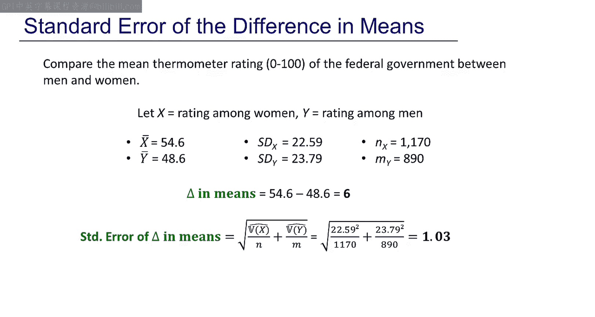
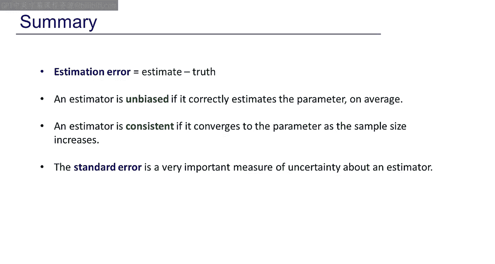

#  054：偏差、一致性与标准误差 📊

在本节课中，我们将要学习如何衡量和解读统计估计中的不确定性。理解统计发现的准确性，对于基于这些发现提出良好且可操作的建议至关重要。简而言之，我们对于某个特定估计值能有多少信心？

事实证明，概念化和衡量不确定性的方法有很多种。估计值可能在重复抽样中非常相似，但这些相似的估计值可能与真实情况存在巨大差异。也可能在重复抽样中，估计值的平均值是正确的，但很难知道任何一个样本的估计值是否接近真实情况。

通过本视频的学习，你将能够评估一个估计值是否是无偏且一致的。此外，你还应该能够解读估计值的标准误差。

## 什么是估计误差？🤔

一般来说，估计误差可以定义为估计值与真实值之间的差异。以下是几个例子。注意，Δ 用于表示两个量之间的差异。

*   样本均值与总体均值之间的差异是一种估计误差。
*   样本标准差与总体标准差之间的差异是另一个例子。
*   或者，X 对 Y 的估计效应与 X 对 Y 的真实效应之间的差异。
*   再比如，选举民调结果与实际选举结果之间的差异。

这个差异就被称为估计误差。

## 关键概念与定义 📖

现在，让我们来定义一些讨论不确定性时至关重要的关键术语。

首先，请注意，**参数**描述的是总体，而**估计量**描述的是样本。β 是一个参数的例子，它描述了 X 和 Y 之间的真实关系。相比之下，β̂ 是一个估计量，它描述了使用样本估计出的 X 和 Y 之间的关系。

**偏差** 被定义为估计误差的期望值，即估计值与真实值之间差异的期望值。如果一个估计量的期望值等于参数，我们就说这个估计量是**无偏的**。如果一个估计量的期望值不等于参数，它就是有偏的。偏差是一个连续的概念，一个估计量可以有非常大的偏差，也可以只有一点点偏差。

**一致性** 被定义为向参数的收敛。如果一个估计量随着样本量的增加而收敛到参数，我们就说这个估计量是**一致的**。

虽然这些术语和定义一开始可能显得抽象，但随着我们深入思考对统计发现的信心程度，它们会变得更有意义。

## 深入理解偏差与一致性 🎯

让我们花几分钟时间更深入地探讨偏差和一致性，希望能帮助你建立直观的理解。

如果样本均值在平均意义上正确地估计了总体均值，那么样本均值就是无偏的。这在右侧图表顶部的两个圆形图中得到了可视化展示。假设每个蓝点代表一个样本均值的估计值，红圈代表真实的总体均值。如果你计算顶部两个图中所有蓝点的平均值，你将能正确估计出总体均值。相反，请看底部的两个圆形图。如果你计算其中任何一个图中蓝点的平均值，这个平均值将与红圈（真实值）严重偏离，这意味着样本均值是有偏的。

如果样本均值随着样本量的增加而收敛到总体均值，那么样本均值就被认为是一致的。请关注图中左侧的两个圆形图。假设这些蓝点反映了非常不同的样本量。注意，在这两个图中，估计的样本均值彼此非常接近。这表明这些估计值是一致的。相反，请注意右侧圆形图中的蓝点分布非常分散。这些估计值是不一致的，均值估计值之间存在很大差异。

## 衡量变异性：标准误差 📏

在讨论了通过重复抽样来刻画估计量不确定性的两种关键方式后，让我们来讨论如何量化特定估计量的变异性。**标准误差** 量化了这种变异性，它是一个至关重要的不确定性度量指标。

每个估计量的标准误差的具体计算方法是不同的。换句话说，计算标准误差的公式取决于具体的估计量。例如，样本均值的标准误差计算公式，与计算两个样本均值之差的标准误差公式不同，也与计算回归系数的标准误差公式不同。

例如，要计算样本均值的标准误差，你需要取变量方差除以观测值数量的平方根。要计算两个样本均值之差（例如 X 的均值与 Y 的均值之差）的标准误差，你需要取 X 的方差除以 X 的观测值数量，加上 Y 的方差除以 Y 的观测值数量，然后对这个和取平方根。

在实践中，统计软件包会为你计算这些量，或者你可能需要在论文或报告中解读他人分析中呈现的这些值。需要记住的重要一点是，标准误差衡量的是特定估计量的变异性。

## 一个具体示例 🔍

让我们来看一个相对简单的例子。假设我们想了解性别与对联邦政府好感度评分之间的关系。我们可能会进行一项调查来研究这个问题。假设结果如下：

令 X 为女性对联邦政府的好感度评分，Y 为男性对联邦政府的好感度评分。

现在，假设 X 的均值是 54.6，Y 的均值是 48.6。X 的标准差是 22.59，Y 的标准差是 23.79。女性人数为 1170，男性人数为 890。

均值差等于 54.6 - 48.6，即 6。这个差值（6）的标准误差是多少？通过将标准差的平方（即估计的方差）和观测值数量代入公式，我们看到均值差的标准误差是 1.03。

一旦我们有了估计值及其标准误差，我们就可以就对该估计值的信心得出结论，这将是接下来两个视频中我们要做的事情。我们将使用标准误差来计算置信区间并确定统计显著性。这将使我们能够判断估计值是否有意义。6 这个均值差是否具有意义？我们能否得出结论，男性和女性对联邦政府的好感度评分存在有意义的差异？在本模块结束时，你将能够回答这些问题。

## 总结 📝

本节课中我们一起学习了：

*   **估计误差** 是某个真实值的估计值与真实值本身之间的差异。
*   如果一个估计量在平均意义上正确估计了参数，我们就说它是**无偏的**。
*   如果一个估计量随着样本量的增加而收敛到参数，我们就说它是**一致的**。
*   **标准误差** 是关于一个估计量的非常重要的不确定性度量指标。

在后续课程中，我们将使用标准误差来计算估计值的置信区间，并判断一个估计值是否具有统计显著性。