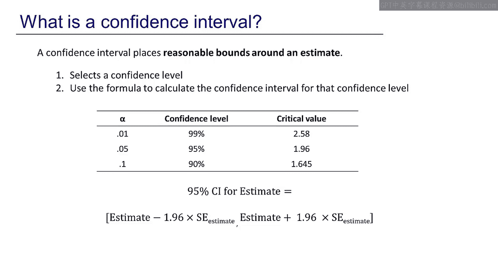
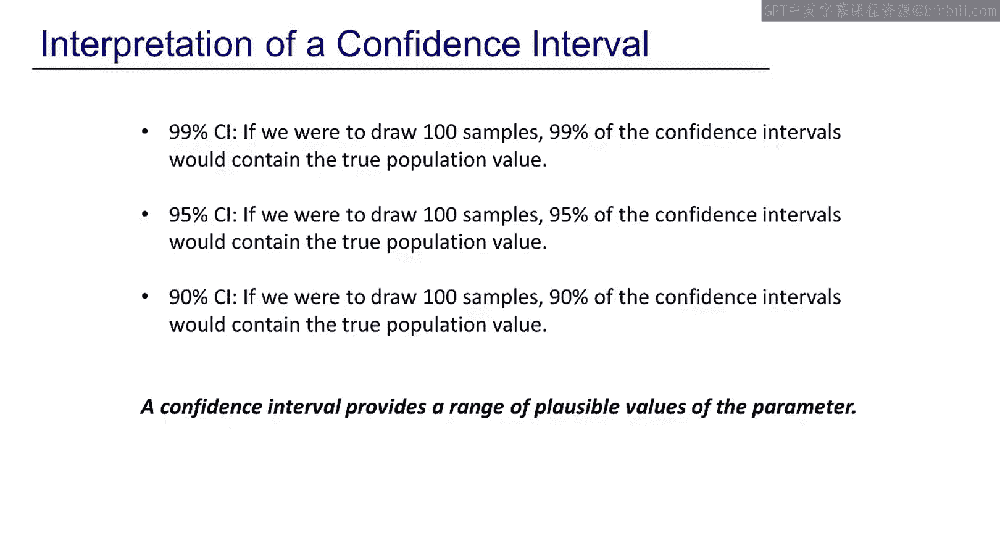
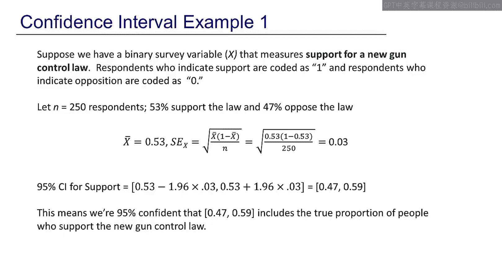
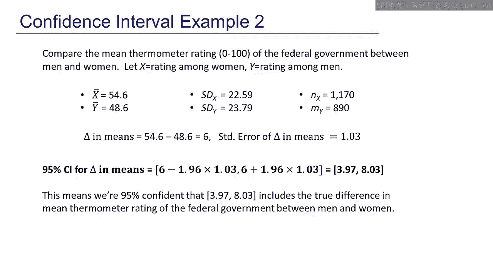
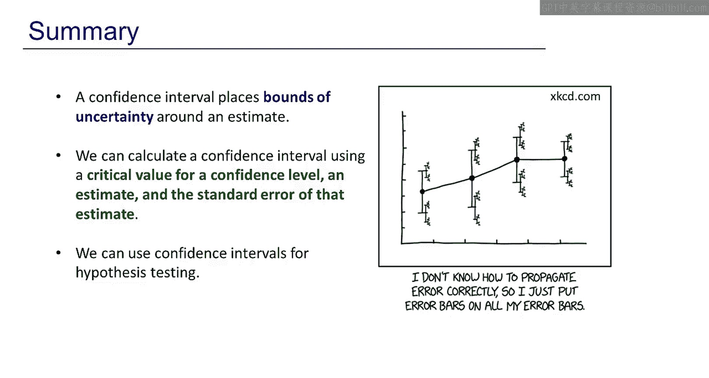

#  055：置信区间 📊

在本节课中，我们将要学习置信区间。置信区间是一种常用的方法，用于总结对某个估计值的不确定性。你很可能在阅读学术文章或技术报告时遇到过它。通过本视频的学习，你将能够构建一个置信区间，并解释其真实含义。

## 什么是置信区间？

置信区间为估计值设置了合理的边界。构建置信区间本质上需要遵循两个步骤。第一步是选择一个置信水平，第二步是使用公式计算该置信水平下构成区间的上下界。

理论上，你可以为任何置信水平计算置信区间，范围可以从略高于0%到略低于100%。然而，研究人员通常计算90%、95%或99%置信水平的置信区间。

请注意，每个置信水平都对应一个**α值**，它只是将置信水平表示在0到1的尺度上。此外，每个置信水平还对应一个**临界值**。

这些临界值与标准正态曲线相关。例如，请记住，标准正态曲线下95%的面积落在**-1.96**和**1.96**之间。同样，99%的面积落在**-2.58**和**2.58**之间。我们将在关于统计显著性的视频中详细讨论这一点的重要性。

## 如何构建置信区间？

现在，让我们回到置信区间的构建。一个估计值的95%置信区间有两个数字：一个下界和一个上界。

下界等于估计值减去临界值乘以估计值的标准误。在95%置信水平下，临界值是**1.96**。

上界等于估计值加上1.96乘以估计值的标准误。

因此，置信区间的通用公式可以表示为：

**置信区间 = 估计值 ± (临界值 × 标准误)**

如果我们把数字代入这个公式，就能得到一个区间。

## 如何解释置信区间？

置信区间有一个非常具体的解释。对于99%的置信区间，其解释是：如果我们抽取100个样本，计算出的置信区间中有99个会包含真实的总体值。

对于95%的置信区间，解释是：如果我们抽取100个样本，计算出的置信区间中有95个会包含真实的总体值。同样的解释格式也适用于90%的置信区间。

然而，一般来说，置信区间提供了参数的一系列合理可能值。研究人员通常会这样说：一个95%的置信区间意味着我们有95%的把握认为该区间包含了真实的总体值。

## 置信区间应用示例

以下是几个具体的例子，帮助你更好地理解。

### 示例一：比例估计

首先，假设我们有一个二元变量，例如调查中对一项新枪支管制法的支持度。表示支持新法的受访者编码为1，表示反对的编码为0。

现在假设你有一项包含250名受访者的调查，其中53%的受访者表示支持新枪支管制法，47%表示反对。如果X代表对新法的支持，那么X的均值是**0.53**，X的标准误是**0.03**。我们可以通过将X的均值和观测数量代入样本均值的标准误公式来计算标准误。

现在我们有了样本均值和样本均值的标准误，就可以计算支持新枪支管制法的人所占比例的95%置信区间。

使用置信区间公式，我们从估计值中加减1.96倍的标准误。在这个例子中，计算出的置信区间是**0.47到0.59**。

因此，我们可以说，我们有95%的把握认为区间0.47到0.59包含了支持新枪支管制法的人的真实比例。

### 示例二：均值差异估计

这是另一个例子。在这个例子中，让我们回到比较男性和女性对联邦政府（温度计评分，范围0-100）的平均评分差异的场景。因此，在这种情况下，我们将计算均值差异的置信区间，而不是单一比例。

设X为女性的评分，Y为男性的评分。数据与之前相同。X的均值是**54.6**。Y的均值是**48.6**。X的标准差是**22.59**。Y的标准差是**23.79**。女性人数是**1170**，男性人数是**890**。均值差是**6分**，差异的标准误是**1.03**。

我们现在可以计算这个差异的95%置信区间。下界等于**6 - 1.96 × 1.03**，上界等于**6 + 1.96 × 1.03**。计算出的置信区间范围是**3.97到8.03**。

这意味着我们有95%的把握认为区间3.97到8.03包含了男性和女性对联邦政府平均温度计评分的真实差异。

## 总结

本节课中我们一起学习了置信区间。置信区间为估计值设置了不确定性边界。我们可以使用特定置信水平的临界值、估计值以及该估计值的标准误来计算置信区间。

我们可以使用置信区间进行假设检验和统计显著性检验，这将是我们在下一个视频中要做的内容。