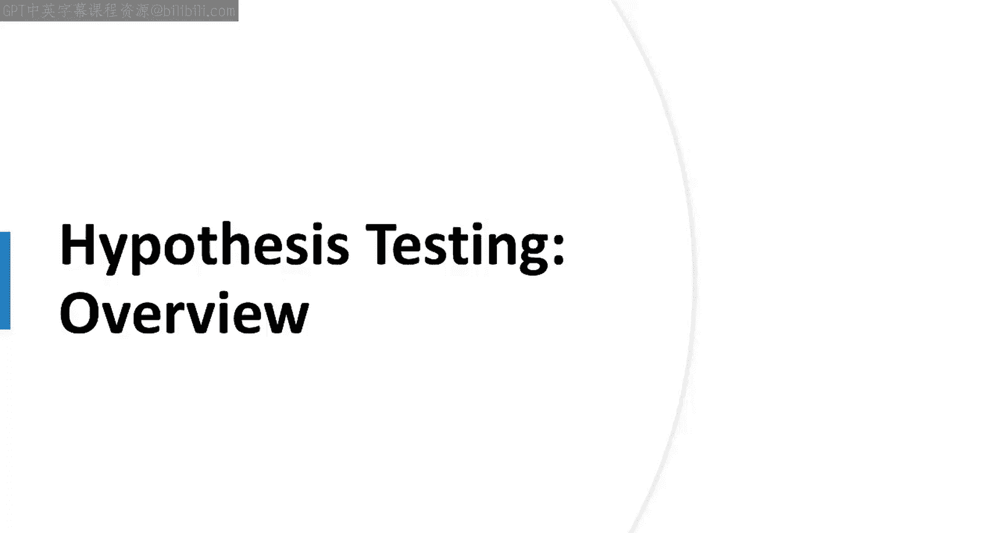
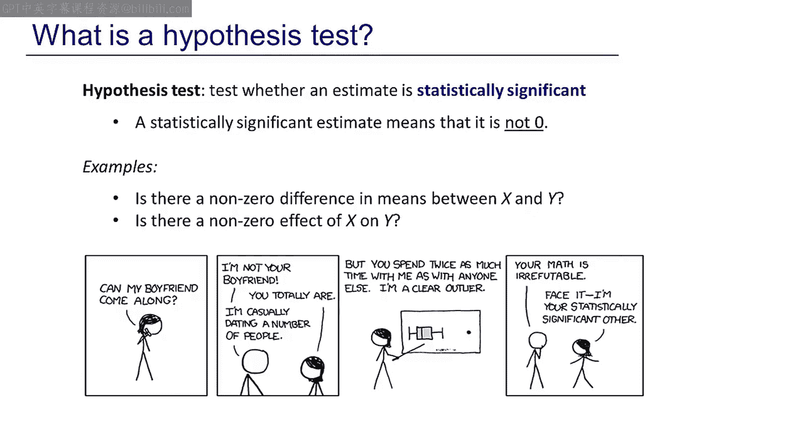
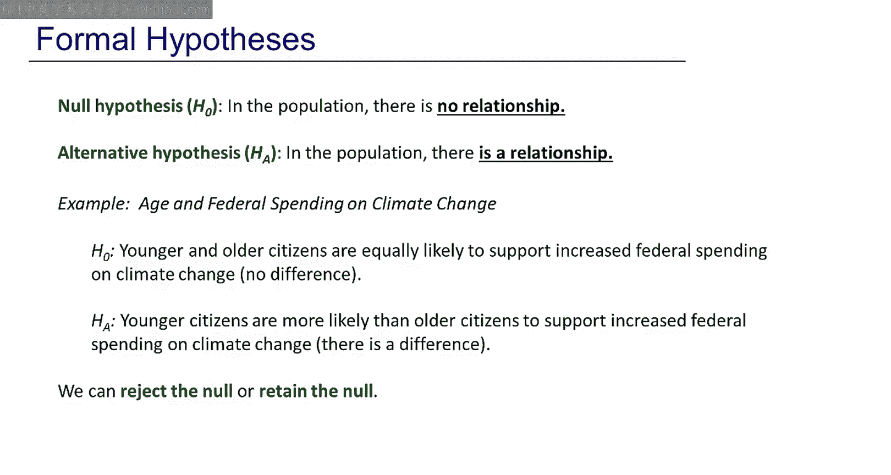
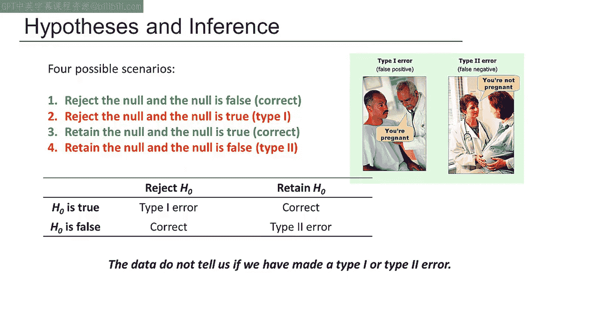

**数据素养：9：假设检验概述 🧪**

在本节课中，我们将学习假设检验的基本概念。假设检验是一种统计方法，用于判断一个结果是否具有统计显著性。通过本视频，你将能够描述假设检验的目的，并理解假设检验与统计推断之间的关系。

---

### **什么是假设检验？**

上一节我们介绍了课程目标，本节中我们来看看假设检验的核心定义。

假设检验用于判断一个估计值是否具有统计显著性。统计显著性通常意味着我们有很高的置信度认为该结果不等于零。

例如，假设我们试图估计两个变量（如小班教学和考试成绩）之间的关系。一个具有统计显著性的效应意味着数据显示班级规模与考试成绩之间存在非零关系。

统计显著性对于区分那些非常不确定的效应和我们有高度信心的效应非常重要。

---

### **构建假设**

理解了假设检验的目的后，现在我们来学习如何构建正式的统计假设。

一个完整的假设由两部分组成：**零假设**（用 **H₀** 表示）和**备择假设**（用 **Hₐ** 表示）。

*   **零假设** 声明：在总体中，自变量与因变量之间没有关系，或者两个组之间的均值没有差异。
*   **备择假设** 声明：在总体中，自变量与因变量之间存在关系，或者两个组之间的均值存在差异。

让我们看一个例子。假设我们研究年龄与对联邦气候变化支出支持度之间的关系。

*   **H₀**：年轻公民和年长公民同样可能支持增加联邦气候变化支出。（即，年龄与支持度无关）
*   **Hₐ**：年轻公民比年长公民更可能支持增加联邦气候变化支出。

根据数据分析的结果，我们**拒绝零假设**或**保留零假设**。这是通常使用的表述，而不是“接受备择假设”。换句话说，假设检验的结果通常表述为对零假设的处理方式：拒绝或保留。

如果我们拒绝零假设，则得出结论认为自变量和因变量之间存在关系。如果我们保留零假设，则得出结论认为两者之间没有关系。

---

### **假设检验的四种结果与两类错误**

在收集数据并计算必要的统计量后，可能会出现以下四种情况之一。以下是这四种可能结果的概述：

1.  **拒绝 H₀，且 H₀ 在总体中为假。** 这是正确的推断。
2.  **拒绝 H₀，但 H₀ 在总体中为真。** 这是**第一类错误**（Type I Error），即“假阳性”。你错误地拒绝了真实的零假设。
3.  **保留 H₀，且 H₀ 在总体中为真。** 这是正确的推断。
4.  **保留 H₀，但 H₀ 在总体中为假。** 这是**第二类错误**（Type II Error），即“假阴性”。你错误地保留了错误的零假设。

一个简单的比喻是医学诊断：
*   医生诊断一个男性怀孕了（拒绝“未怀孕”的零假设） → 这是第一类错误（假阳性）。
*   医生诊断一个怀孕的女性未怀孕（保留“未怀孕”的零假设） → 这是第二类错误（假阴性）。

需要记住的是，你手头的数据本身无法告诉你是否犯了第一类或第二类错误。你只能做出拒绝或保留零假设的决定，这个决定要么正确要么错误。我们只能通过科学严谨的研究设计来极大提高做出正确推断的概率。只有通过重复抽样（即反复进行同一研究），我们才能最终证明我们的推断是否正确。

---

### **总结**

本节课中，我们一起学习了假设检验的基础知识。我们了解到假设检验用于判断结果的统计显著性，其核心是构建零假设和备择假设。根据数据，我们决定拒绝或保留零假设，并认识到在这个过程中可能犯下第一类错误（假阳性）或第二类错误（假阴性）。理解这些概念是进行严谨统计推断的第一步。