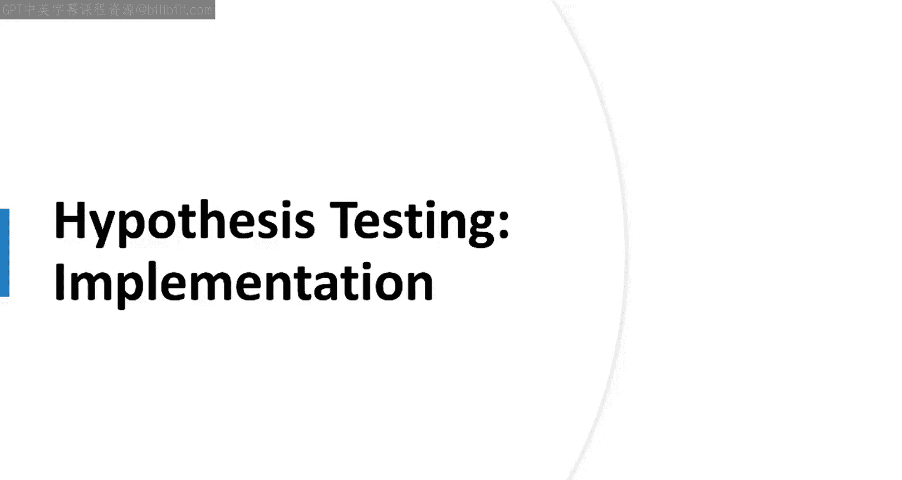
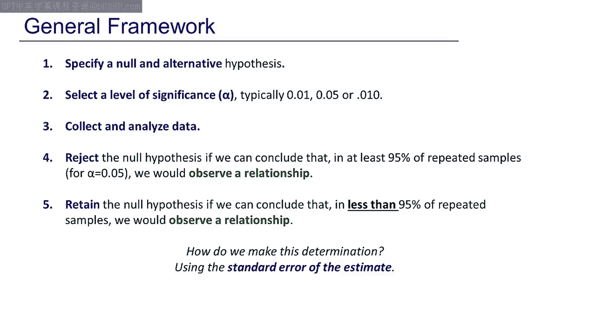
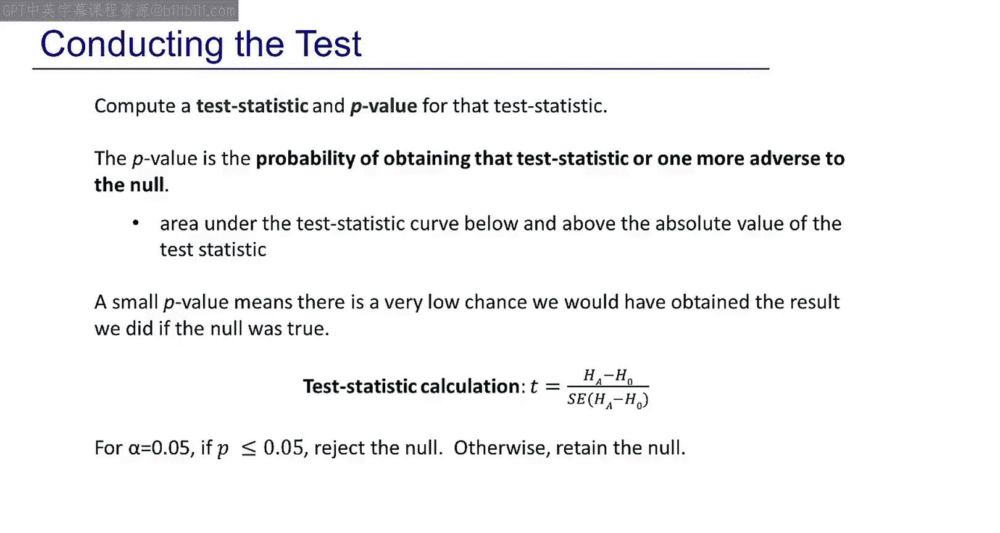
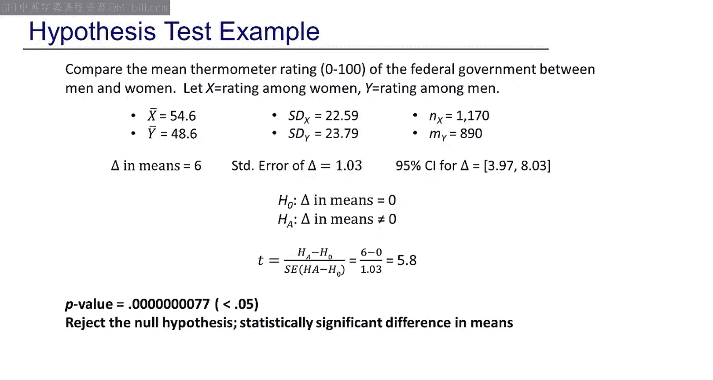
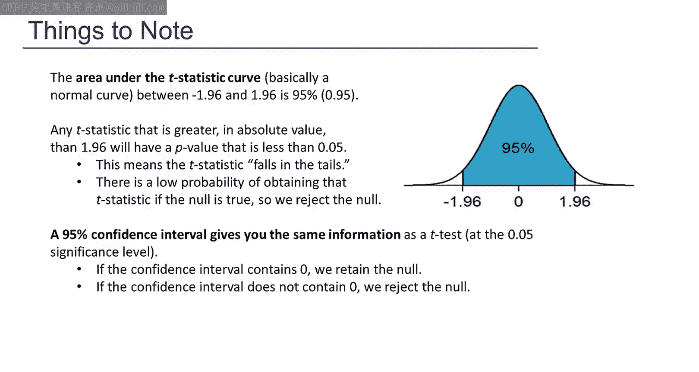
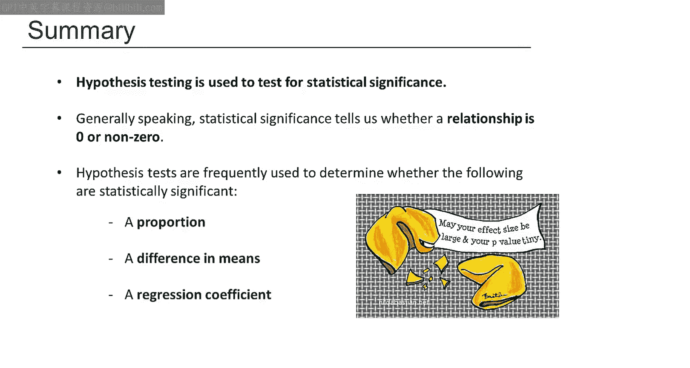

#  057：假设检验实施 🧪

在本节课中，我们将把上一节讨论的假设检验概念付诸实践。课程结束时，你应该能够执行并解读一个假设检验。

## 概述

假设检验是统计学中用于判断研究结果是否具有统计显著性的核心方法。本节将详细介绍假设检验的实施步骤，并通过一个具体例子演示如何计算检验统计量、P值，并做出决策。

## 假设检验的实施步骤

上一节我们介绍了假设检验的基本概念，本节中我们来看看如何具体执行一个假设检验。下图展示了决定拒绝或保留原假设的步骤流程。

以下是执行假设检验的关键步骤：

**第一步：设定原假设与备择假设**
这需要清晰地思考你的研究问题以及你想要检验的关系。

**第二步：选择显著性水平**
社会科学研究者通常使用 **0.05** 或 **5%** 的显著性水平；其他常用水平还有 **0.01** 和 **0.10**（即1%或10%）。显著性水平是当原假设为真时错误地拒绝它的概率。
*   在5%的显著性水平下，你预计会在5%的情况下错误地拒绝原假设，在95%的情况下正确地拒绝原假设。
*   在1%的显著性水平下，你预计会在1%的情况下错误地拒绝原假设，在99%的情况下正确地拒绝原假设。
选择哪个显著性水平是一个判断问题，取决于你在哪个概率水平上最愿意基于结论做出政策决定。

**第三步：收集并分析数据**
使用你的分析结果，你将决定是拒绝还是保留原假设。
*   如果你在5%的显著性水平上拒绝了原假设，你的结论是：在至少95%的重复抽样中，你预计会观察到自变量与因变量之间存在关系。
*   如果你在5%的显著性水平上保留了原假设，你的结论是：你预计在少于95%的重复抽样中会发现关系。

## 如何做出决策：检验统计量与P值

那么，如何具体做出拒绝或保留原假设的决定呢？为了做出这个决定，你需要使用样本估计的标准误。

以下是进行假设检验的核心计算过程：

**计算检验统计量并确定其P值**
*   **P值** 是获得该检验统计量或一个更不利于原假设的统计量的概率。在数学上，它是检验统计量曲线下，绝对值大于当前检验统计量的区域的面积。一个**小的P值**意味着如果原假设为真，我们得到当前结果的概率非常低。
*   **检验统计量** 的计算公式如下：
    `检验统计量 = (估计值 - 原假设值) / 估计值的标准误`
    通常，原假设值为0（即假设所研究的变量之间没有关系）。因此，检验统计量通常通过**将估计值除以其标准误**来计算。

**决策规则**
在5%的显著性水平下：
*   如果检验统计量的P值 **≤ 0.05**，我们**拒绝**原假设。
*   如果检验统计量的P值 **> 0.05**，我们**保留**原假设。

## 实例演示：性别与对联邦政府好感度评分

让我们通过一个例子来演练整个过程，回到性别与对联邦政府好感度评分的关系研究。

已知数据：
*   设X为女性评分，Y为男性评分。
*   女性评分均值 `mean(x) = 54.6`，标准差 `sd(x) = 22.59`，人数 `n_x = 1170`。
*   男性评分均值 `mean(y) = 48.6`，标准差 `sd(y) = 23.79`，人数 `n_y = 890`。
*   均值差 `diff = 6.0`。
*   均值差的标准误 `SE_diff = 1.03`。
*   均值差的95%置信区间为 `(3.98, 8.02)`。

**假设检验过程：**
1.  **设定假设**：
    *   原假设 H₀：男女对联邦政府的平均好感度评分之差 **等于 0**。
    *   备择假设 H₁：男女对联邦政府的平均好感度评分之差 **不等于 0**。
2.  **计算检验统计量 T**：
    `T = (6.0 - 0) / 1.03 ≈ 5.8`
3.  **确定P值**：该T统计量对应的P值极小（通常使用统计软件计算）。
4.  **做出决策**：由于P值远小于0.05，我们可以在5%的显著性水平上**轻松拒绝原假设**。

**与置信区间的联系**：
回顾之前计算出的置信区间 `(3.98, 8.02)`，它**不包含0**。这提供了另一种判断统计显著性的方法：如果置信区间不包含原假设值（此处为0），我们就可以拒绝原假设。简而言之，置信区间和假设检验提供了关于所研究关系是否显著区别于零的相同信息。

## 关键要点与联系

我已经介绍了大量信息，现在停下来强调几个关键点。

以下是需要理解的核心概念：

**T统计量与临界值**
*   在T统计量分布曲线下，**-1.96 到 1.96** 之间的区域面积是95%。在实践中，T统计量曲线近似于标准正态曲线。
*   这意味着，任何**绝对值大于1.96**的T统计量，其P值**必然小于0.05**。请注意，大的T统计量落在分布的尾部。
*   思考其背后的直觉：如果一个T统计量很大并落在尾部，意味着如果原假设为真，获得该统计量的概率很低。因此，如果T统计量很大，我们就拒绝原假设。

**置信区间与假设检验的等价性**
一个**95%的置信区间**与在**5%显著性水平**下进行的T检验提供相同的信息：
*   如果置信区间**包含0**，我们**保留**原假设。
*   如果置信区间**不包含0**，我们**拒绝**原假设。

## 总结

本节课中我们一起学习了假设检验的具体实施。

**总结如下：**
假设检验通常用于检验统计显著性，其框架通常是检验一个关系是否为零（不存在）或非零（存在）。换句话说，正式的假设检验通常用于基于手头数据，判断两个变量之间的关系是否存在。例如，研究者使用假设检验来确定一个比例、均值差或回归系数是否具有统计显著性。

在接下来的课程中，我们将探讨如何在回归分析的背景下使用假设检验，并讨论使用假设检验来驱动决策制定的局限性。