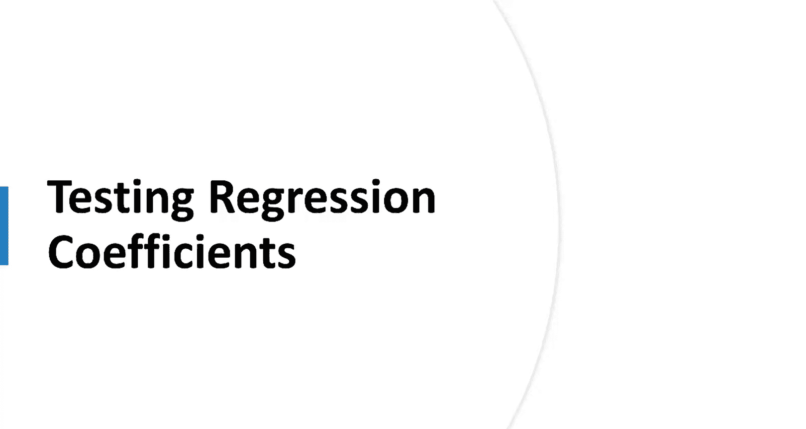
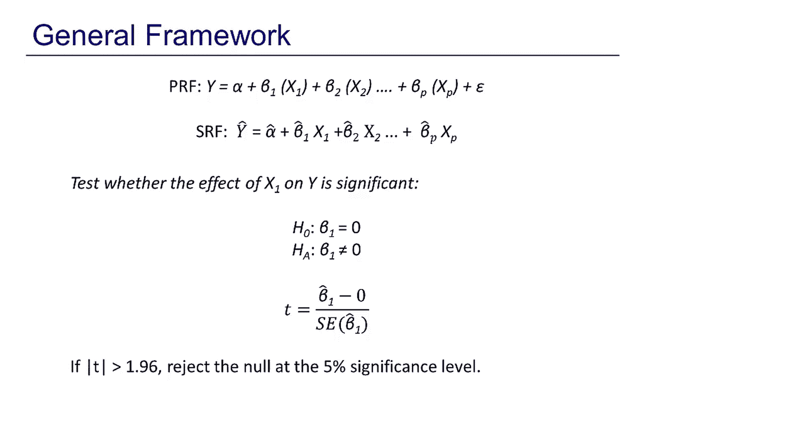
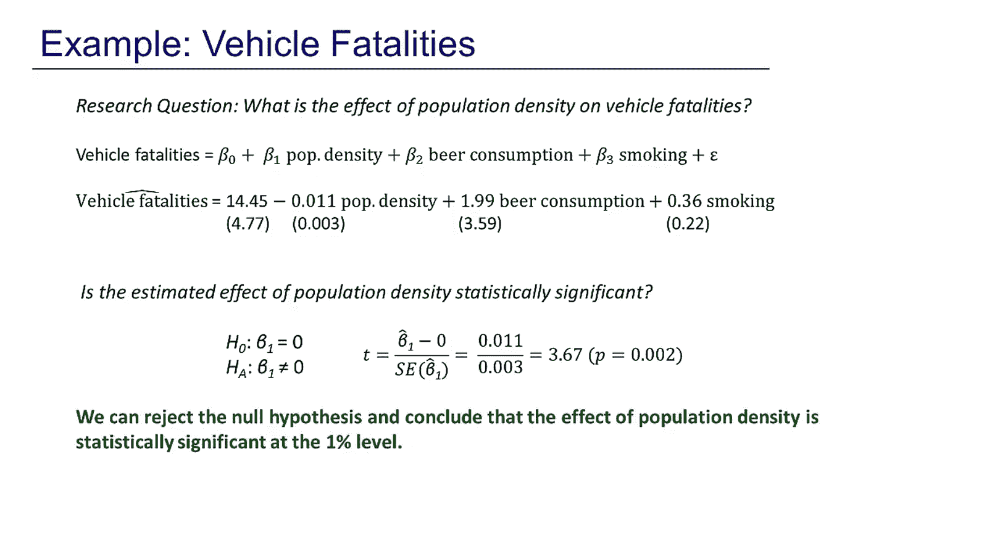
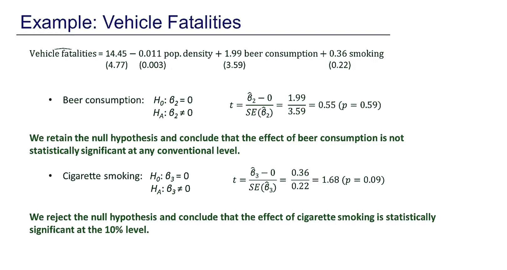
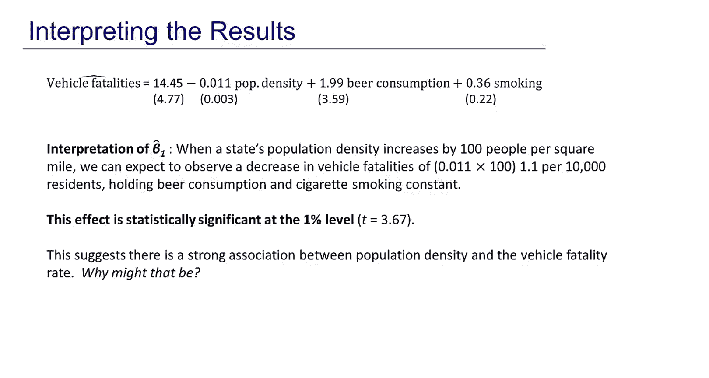
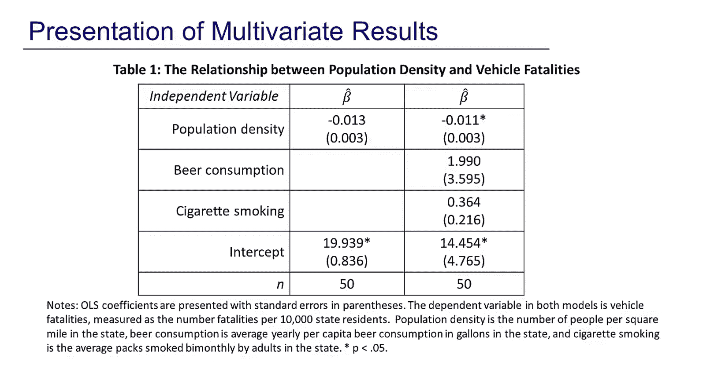

#  058：回归系数检验

在本节课中，我们将学习如何对多元回归模型中的系数进行假设检验。我们将回顾假设检验的步骤，并将其应用于一个具体的例子，以判断某个自变量对因变量的影响是否具有统计显著性。

## 假设检验框架

上一节我们介绍了如何构建和解释多元模型，以及如何计算标准误。本节中，我们将合并这些主题，讨论如何计算和解释多元回归系数的标准误，并对其进行假设检验。

以下是进行多元回归系数假设检验的一般步骤：
1.  首先，设定一个描述变量间关系的总体回归函数。
2.  然后，收集数据并估计样本回归函数。
3.  接着，确定系数的统计显著性。我们通常只关心核心自变量的系数显著性，控制变量的显著性通常不重要，它们的作用是确保核心变量系数的估计更准确。

假设我们想检验自变量 `x1` 对 `y` 的影响是否显著，该影响由系数 `β1` 表示。
*   **零假设**：`β1 = 0`（`x1` 对 `y` 无影响）。
*   **备择假设**：`β1 ≠ 0`（`x1` 对 `y` 有影响）。

我们通过以下公式计算 **t 统计量**：
`t = β1_hat / SE(β1_hat)`
其中，`β1_hat` 是 `β1` 的估计值，`SE(β1_hat)` 是其标准误。

判断规则如下：
*   如果 `|t| > 1.96`，则在 5% 的显著性水平上拒绝零假设。
*   如果 `|t| < 1.96`，则无法拒绝零假设。

## 实例分析：人口密度对车辆死亡率的影响

现在，让我们通过一个具体例子来应用上述框架。假设我们研究的问题是：**人口密度对车辆死亡率有何影响？**

理论上，我们可能认为人口更稠密的地区车辆死亡率更低，因为这些地区步行便利性更高、公共交通更发达、商业与居住区距离更近。

我们设定以下模型进行检验：
*   **因变量**：美国各州的车辆死亡率。
*   **核心自变量**：人口密度（每平方英里人数）。
*   **控制变量**：啤酒消费量和香烟吸烟量（它们可能与人口密度相关，并影响车辆死亡率）。

样本回归函数及其标准误（括号内）如下：
`车辆死亡率 = 2.249 - 0.011 * 人口密度 + 0.001 * 啤酒消费量 + 0.028 * 香烟吸烟量`
`(0.448) (0.003) (0.002) (0.017)`

接下来，我们检验人口密度系数的统计显著性。
*   **零假设**：`β1 = 0`
*   **备择假设**：`β1 ≠ 0`

计算 **t 统计量**：
`t = -0.011 / 0.003 = -3.67`
对应的 **p 值** 约为 0.002。

由于 p 值远小于常规的显著性水平（如 1%），我们可以 confidently 拒绝零假设，并得出结论：**人口密度的影响在 1% 的水平上统计显著。**

## 控制变量系数的检验

如前所述，我们通常不关心控制变量的统计显著性，但计算过程是类似的。

以下是啤酒消费量系数的检验过程：
*   **零假设**：其系数 `β2 = 0`
*   **备择假设**：`β2 ≠ 0`
*   **t 统计量**：`t = 0.001 / 0.002 = 0.55`，p 值约为 0.59。

p 值很大，因此啤酒消费量的影响不显著。**但请注意**：我们不应据此得出啤酒消费与车辆死亡率无因果关系的结论，因为该变量在模型中仅作为控制变量。同时，也不应因其不显著而将其从模型中剔除，它的存在是为了确保人口密度系数的估计更准确。

以下是香烟吸烟量系数的检验结果：
*   **t 统计量**：`t = 0.028 / 0.017 ≈ 1.68`，p 值约为 0.09。

这意味着我们可以在 10% 的显著性水平上拒绝零假设，但在 5% 或 1% 的水平上则不能。当结果在 10% 水平显著而在更低水平不显著时，若事关重大（如测试有严重副作用的药物），可能需要收集更多数据以获得更确定的结论。

## 结果解释与呈现

现在，让我们更深入地解释结果。回顾样本回归函数：
`车辆死亡率 = 2.249 - 0.011 * 人口密度 + ...`

如何解释 `β1_hat = -0.011`？由于“每平方英里增加1人”的变动很小，我们可以解释为“每平方英里增加100人”的影响：
**在控制啤酒消费量和香烟吸烟量的情况下，一个州的人口密度每平方英里增加100人，我们预计其每万居民中的车辆死亡人数将减少1.1人。**

由于我们计算出 t 统计量为 3.67，可以说**这一效应在 1% 的水平上统计显著**。该模型表明人口密度与车辆死亡率之间存在强关联。基于我们对车辆事故的了解，可能的原因是人口稠密地区公共交通更发达、更适宜步行。但分析本身并未提供因果机制的证据，需要进一步研究来理解这种关系。

最后，我们来看看回归结果通常如何以表格形式呈现。一个规范的表格应包含以下要素：
*   **有意义的标题**：概括表格核心内容。
*   **清晰的列**：第一列列出自变量、截距项和观测值数量 `N`，使用易于理解的变量名而非数据集中的标签。后续列呈现不同模型（如双变量模型、多元模型）的回归结果。
*   **必要的注释**：说明表格中呈现的是 OLS 系数，括号内为标准误；描述变量的度量方式；用星号（*）等标记在特定水平（如 5%）上显著的系数。

表格应易于理解且自成一体，读者无需参照正文就能明白其含义，反之亦然。

---

本节课中，我们一起学习了如何对多元回归系数进行假设检验。我们掌握了从设定假设、计算 t 统计量到做出统计推断的完整流程，并通过实例分析了核心自变量与控制变量显著性的不同意义。最后，我们还了解了如何规范地呈现回归结果。掌握这些技能对于理解和报告实证研究发现至关重要。