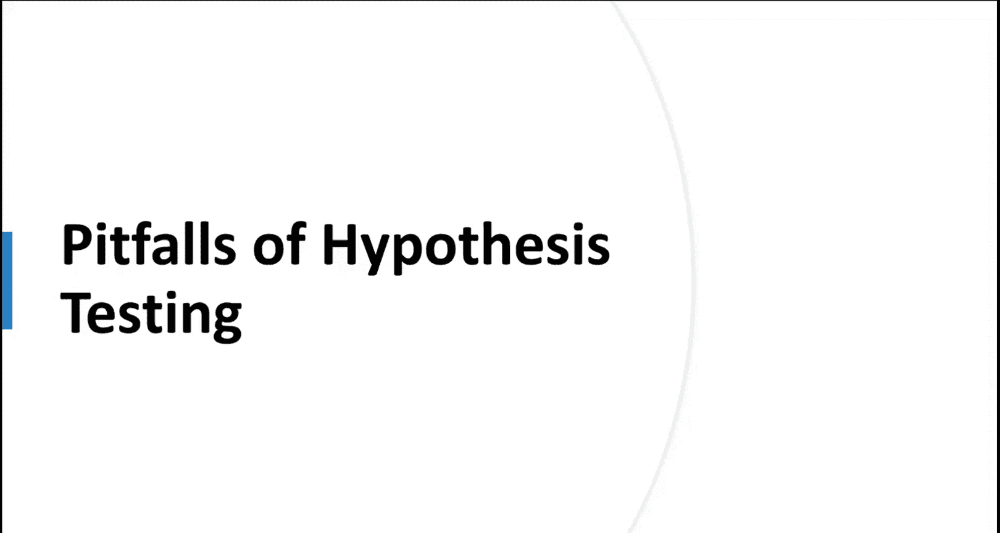
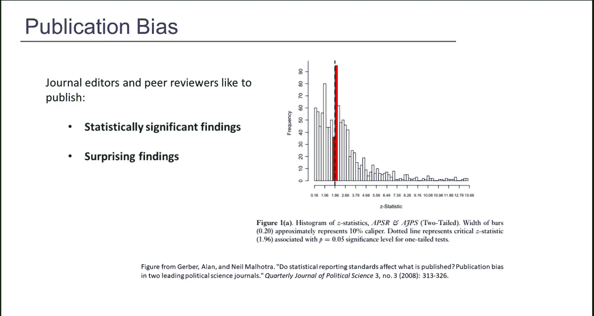
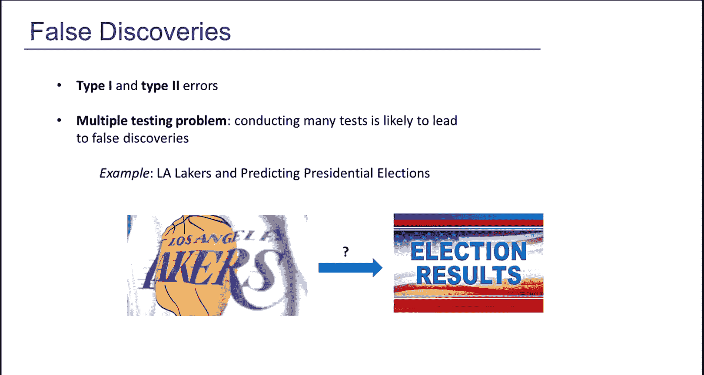
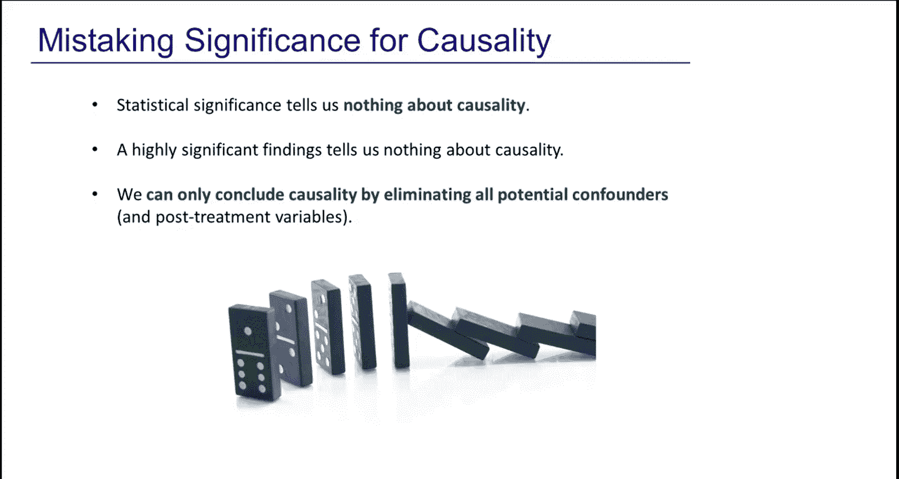
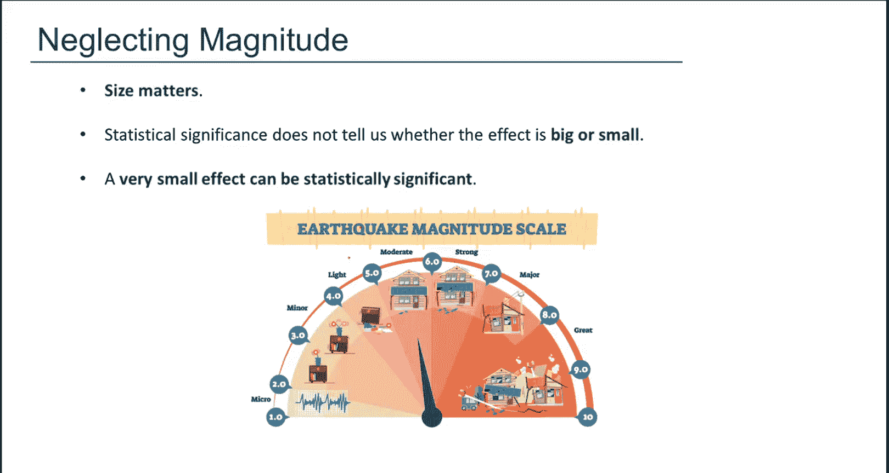
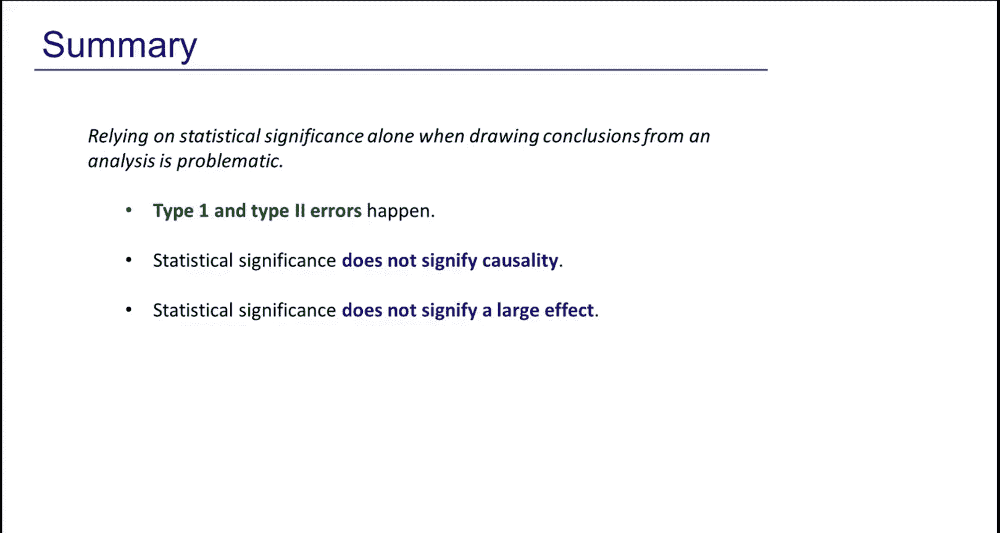

#  059：假设检验的陷阱 🧐

在本节课中，我们将要学习假设检验这一广泛应用的工具背后存在的重要局限性。尽管假设检验被广泛用于总结估计值的不确定性，但它也存在一些关键的缺陷。通过学习，你将能够解释为何不能仅依赖假设检验作为评估估计值的主要手段。

## 发表偏倚 📈

上一节我们介绍了假设检验的广泛应用，本节中我们来看看其第一个主要陷阱：过度依赖统计显著性会导致发表偏倚。

期刊编辑和同行评审倾向于发表那些具有统计显著性且令人惊讶的发现。从商业角度看，这合乎情理，因为读者通常对揭示有趣、新颖的非零关系的研究最感兴趣。相比之下，很少有读者愿意深入研究那些得出“无发现”结论的研究。揭示缺乏某种关系很少能成为好的新闻标题或期刊主题。

下图展示了发表在两家著名政治学期刊上的检验统计量的分布情况。请注意，在数值1.96之后有一个巨大的峰值，并且在大检验统计量区域有一条长尾。这表明，已发表的结果常常只是刚刚跨过5%的显著性水平，许多结果则更为显著，而统计上不显著的结果则极少发表。

## 第一类与第二类错误 ⚠️

了解了发表偏倚后，我们接下来探讨假设检验的另一个现实问题：第一类和第二类错误。

假设检验框架本质上是概率性的。该框架本身就包含了我们有时会在原假设为真时错误地拒绝它（第一类错误），或在原假设为假时错误地接受它（第二类错误）的真实概率。

假设一名研究人员进行了10次假设检验，并且我们已知所有这些检验的原假设实际上都是真的。那么，该研究人员在5%的显著性水平上至少错误地拒绝其中一个原假设的概率是40%。这意味着，在这10次检验中，至少有40%的几率会出现至少一次“错误发现”。

以下是现实世界中“错误发现”的一些例子：
*   许多人曾假设，一些看似无关的事件可以预测美国总统选举结果。
*   这些预测因子包括夏季奥运会的举办地和万圣节面具的购买行为。
*   甚至有人试图论证体育赛事的结果具有预测性。例如，数据显示，在洛杉矶湖人队九次进入NBA总决赛的经历中，有八次是美国共和党候选人赢得了总统选举。

这是否意味着湖人队的表现与总统选举结果存在某种因果关系，或者是一个可靠的预测指标呢？

## 统计显著性与因果关系的混淆 🔗

与上一点相关的是，统计显著性经常与因果关系相混淆。对于那些没有频率派统计学背景的人来说，理解这一点尤其困难。

统计显著性本身并不能告诉我们任何关于因果关系的信息。即使一个发现具有高度统计显著性，它也不能证明因果关系。我们只有通过从分析中排除所有潜在的混杂变量以及所有“处理后变量”，才能得出因果关系的结论。

简而言之，统计上显著的关系并不意味着存在因果关系的证据。在根据研究发现制定可操作的建议时，理解这一点至关重要。

## 忽视效应量 📏

最后，依赖统计显著性作为判断两个变量之间是否存在关系的关键指标，还有一个缺点：它常常导致研究者忽视效应的大小。

统计显著性并不能告诉我们效应的大小是大还是小。一个非常微小的效应也可能是统计显著的，尤其是在我们拥有大量数据的情况下。换句话说，我们可能非常确信一个效应量是微乎其微的。

想象一下测试一种药物是否有效治疗某种疾病。仅仅知道该药物具有正向的、显著的效应，并不足以决定是否使用它，特别是如果该药物存在副作用。你还需要知道效应的大小。这种药物对疾病的影响是很大还是很小？

简而言之，在评估统计发现时，除了统计显著性之外，还有非常重要的问题需要追问。

## 总结与正确评估方法 ✅

总结以上几点，在从分析中得出结论时，仅依赖统计显著性是有问题的。

原因如下：
*   第一，第一类和第二类错误必然会发生，这些错误是预期内的。
*   第二，统计显著性不能说明因果关系。
*   第三，统计显著性并不意味着在现实世界意义上存在巨大或有意义的效应。

为了正确评估一项分析，研究者必须综合考虑多个因素，包括：
*   估计值是否存在偏误。
*   是否存在因果关系。
*   估计效应的大小。

本节课中，我们一起学习了假设检验的几个关键陷阱：发表偏倚、第一类和第二类错误的必然性、统计显著性与因果关系的混淆，以及对效应量的忽视。理解这些局限性对于批判性地解读统计结果和做出明智的决策至关重要。