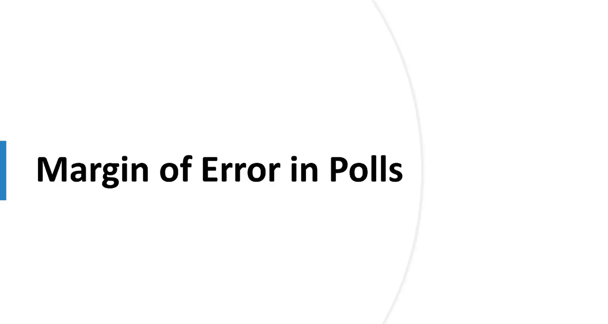
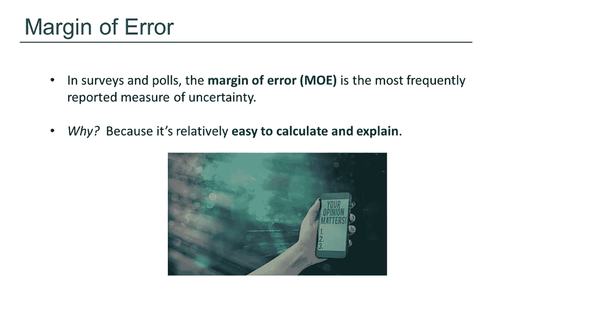
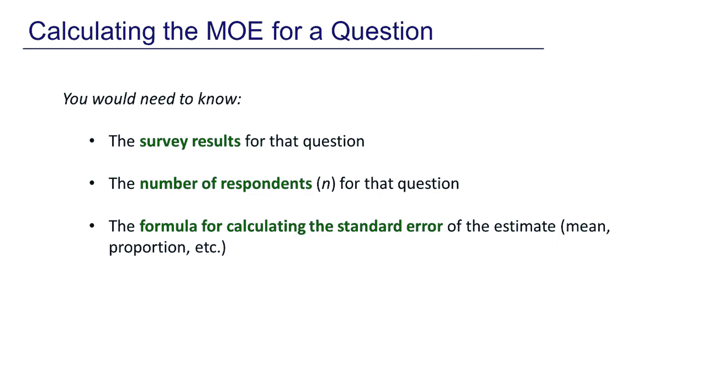
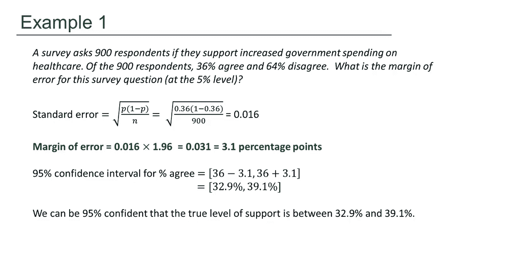
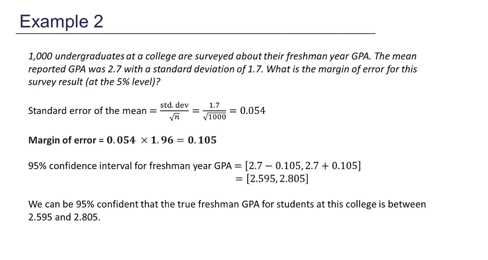
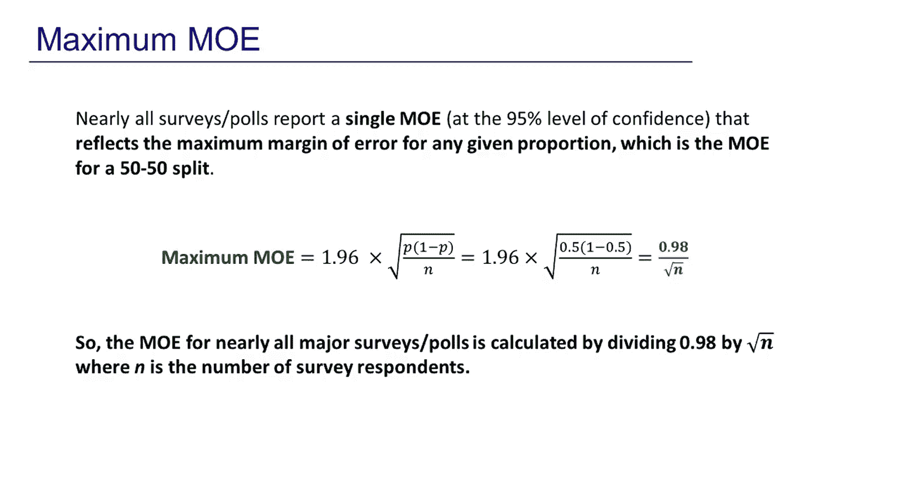
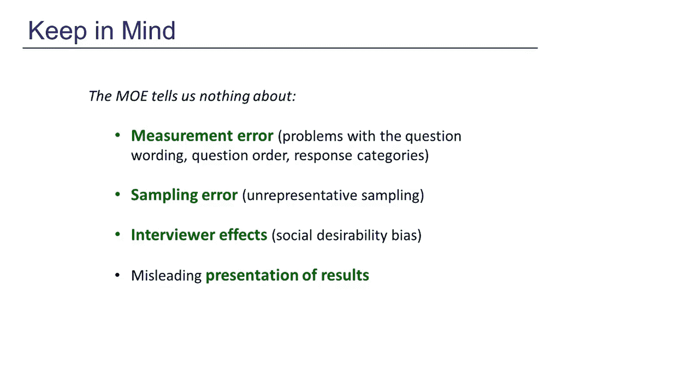

#  060：民意调查中的误差范围 📊

在本节课中，我们将学习民意调查和调查研究中一个核心概念——**误差范围**。我们将了解它的定义、计算方法、如何正确解读，以及它在实际应用中的局限性。

---

## 误差范围的定义

在民意调查和调查研究中，**误差范围**是用于衡量结果不确定性的最常用指标。它与标准误不同，是更常被报告的量。

一般来说，误差范围指的是**95%置信区间的一半**。

在本视频结束时，你应该能够计算误差范围并正确解读它。

---

## 误差范围的重要性

在调查和民意调查中，缩写为 **ME** 的误差范围是最常被报告的不确定性衡量指标。

这是因为它是一个相对容易计算和解释的量。

当你在新闻中读到或电视上听到民意调查结果时，无疑已经遇到过误差范围。

让我们来探讨这个量是如何计算的，以及它的含义。

---

## 误差范围的计算公式

误差范围的确切公式取决于调查问题的类型。如你所知，可以提出的问题类型有很多种。

以下是几种常见的问题类型：
*   **单一比例问题**：例如询问受访者是赞成还是反对某位当选官员。
*   **离散量表问题**：例如从“强烈同意”到“强烈不同意”的五点量表。这类问题常用于询问受访者的政策立场。
*   **连续性问题**：例如要求受访者提供他们的GPA、年龄或薪水。

同样，任何特定调查问题的误差范围公式都取决于该问题的结构。

从概念上讲，误差范围等于**估计值的标准误**乘以 **1.96**。标准误是使用变量的标准差和观测值数量计算的。1.96这个数字是在研究者追求**95%置信水平**（也称为5%显著性水平）的误差范围时使用的。

然后，特定调查问题估计值的置信区间可以通过从估计值中**加减误差范围**来计算。

---

## 计算步骤总结

总结上一张幻灯片的信息，要计算特定调查问题的误差范围，你需要：
1.  记录该问题的调查结果。
2.  记录回答该问题的受访者数量。
3.  使用计算估计值标准误的公式。

同样，这个公式取决于估计值是**均值**、**比例**还是其他度量。

这听起来有些抽象，让我们通过几个例子来具体说明。

---

## 示例一：比例问题

假设一项调查询问了900名受访者是否支持增加政府在医疗保健方面的支出。

在900名受访者中，**36%** 同意，**64%** 不同意。这个调查问题在5%水平上的误差范围是多少？

**第一步是计算标准误**。因为这是一个比例问题，我们可以通过以下公式计算标准误：

`标准误 = sqrt( p * (1 - p) / n )`

其中：
*   `p` 是同意比例（0.36）
*   `n` 是观测值数量（900）

代入计算：
`标准误 = sqrt( 0.36 * (1 - 0.36) / 900 ) = sqrt( 0.36 * 0.64 / 900 ) ≈ 0.016`

**然后计算误差范围**：
`误差范围 = 标准误 * 1.96 = 0.016 * 1.96 ≈ 0.031`

因此，这个特定调查问题的误差范围是 **3.1个百分点**。

**接着计算95%置信区间**：
*   置信区间下限 = 36% - 3.1% = **32.9%**
*   置信区间上限 = 36% + 3.1% = **39.1%**

得到的置信区间范围是 **32.9% 到 39.1%**。这意味着我们有95%的把握认为，对增加医疗保健资金支持的**真实水平**在32.9%到39.1%之间。

---

## 示例二：均值问题

这里是计算特定调查问题误差范围的第二个例子。

假设一项调查要求某大学的1000名本科生报告他们大一学年的GPA。
报告的GPA**均值**为 **2.9**，**标准差**为 **1.7**。
这个调查结果在5%水平上的误差范围是多少？

**第一步是计算估计值的标准误**，在本例中估计值是均值。
这意味着我们需要用估计值的标准差除以观测值数量的平方根。

`标准误 = 标准差 / sqrt(n) = 1.7 / sqrt(1000) ≈ 0.054`

**然后计算误差范围**：
`误差范围 = 标准误 * 1.96 = 0.054 * 1.96 ≈ 0.105`

这意味着报告的GPA的误差范围是 **0.105分**。

**接着计算95%置信区间**：
*   置信区间下限 = 2.9 - 0.105 = **2.795**
*   置信区间上限 = 2.9 + 0.105 = **3.005**

这给出了一个从 **2.795 到 3.005** 的置信区间。意味着我们有95%的把握认为，这所大学学生的**真实大一GPA**在2.795和3.005之间。

---

## 行业标准：最大误差范围

虽然为每个调查问题计算一个误差范围是可能的，但这并非行业标准。几乎所有的调查和民意调查都只报告一个**95%置信水平下的单一误差范围**。

这个误差范围反映了**任何给定比例的最大误差范围**，即它是针对**50/50比例分配**的误差范围。

我们可以通过以下公式计算这个最大误差范围：
`最大误差范围 = 1.96 * sqrt( 0.5 * 0.5 / n )`

这可以简化为：
`最大误差范围 ≈ 0.98 / sqrt(n)`

因此，几乎所有主要调查和民意调查的误差范围都是用这个非常简单的公式计算的。调查研究者可以根据他们**目标的最大误差范围**来确定他们的**样本量**。

---

## 误差范围的局限性

虽然误差范围作为衡量整体调查结果不确定性的通用指标很有价值，但有一些重要事项需要牢记。

以下是误差范围无法反映的几个关键问题：
*   **测量误差**：误差范围无法告诉我们调查是否受到测量误差的困扰。可能存在**问题措辞**、**问题顺序**或**使用的回答类别**方面的问题。这些问题不会反映在误差范围中。
*   **抽样误差**：调查可能使用了不能代表目标人群的样本。同样，这个问题也不会反映在误差范围中。
*   **访问员效应**：仅凭误差范围，我们无法判断回答是否容易受到**社会期望偏差**或其他类型的访问员效应的影响。
*   **结果呈现方式**：误差范围与任何特定调查的结果是否被**恰当呈现**无关。研究者可能报告了正确的误差范围，但仍然以一种未能很好传达研究结果及其不确定性的方式呈现结果。

总体要点是，这也是我不断强调的一点：**误差范围只是我们在评估一项分析时应该考虑的众多因素之一**。

---

## 总结

本节课中，我们一起学习了民意调查中的**误差范围**。

我们首先明确了它的定义，即95%置信区间的一半，是衡量调查结果不确定性的常用指标。接着，我们学习了其计算公式，它取决于问题类型（比例或均值），核心是`误差范围 = 标准误 * 1.96`。通过两个具体示例，我们演练了如何为比例问题和均值问题计算误差范围及置信区间。

我们还了解到，行业通常报告一个基于**50/50分配**计算的**最大误差范围**，其简化公式为`0.98 / sqrt(n)`，这有助于研究者根据所需的精度确定样本量。

最后，我们重点讨论了误差范围的**局限性**。它无法揭示测量误差、抽样偏差、访问员效应或结果呈现不当等问题。因此，在解读任何调查结果时，我们必须记住，误差范围只是评估其可靠性和有效性的一个方面，而非全部。