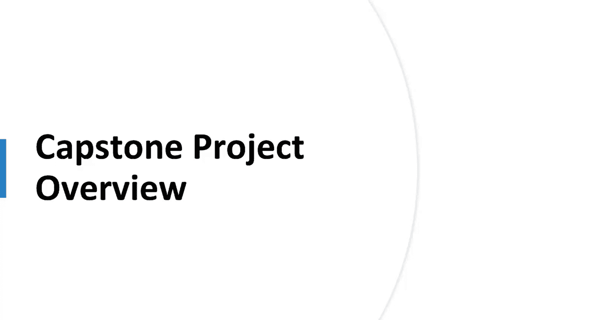
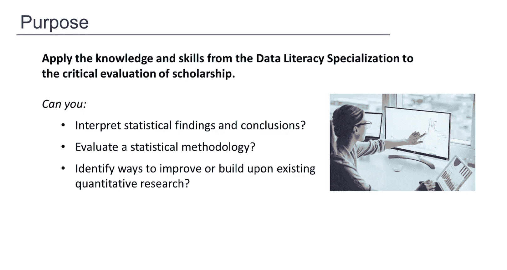
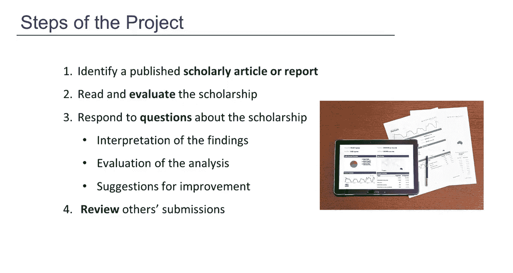
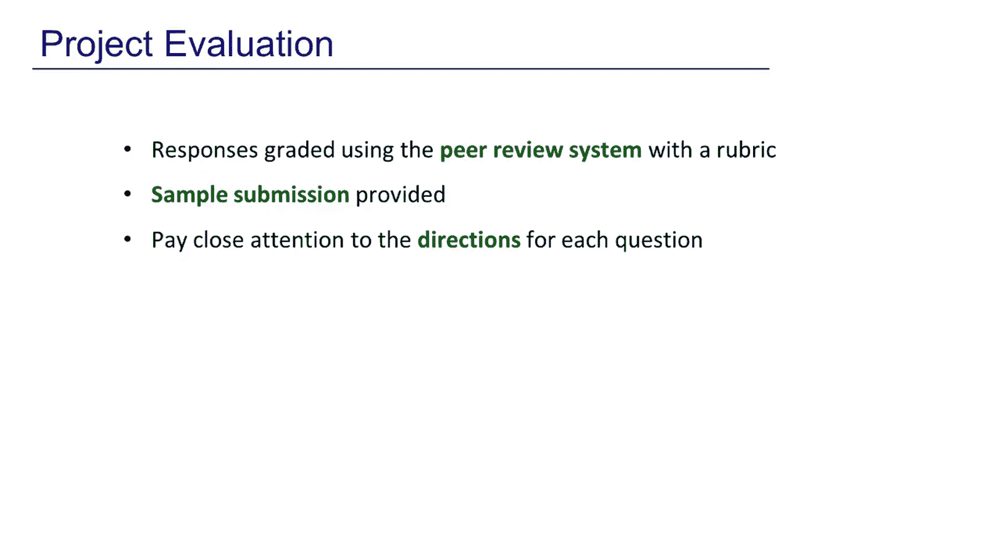

#  061：毕业项目概述 🎓

在本节课中，我们将要学习毕业项目的整体目的、组成部分以及评估流程。通过本节内容，你将明确毕业项目的目标，并了解完成项目所需遵循的步骤。

## 项目目的与目标

首先，我们来明确毕业项目的核心目的。毕业项目旨在评估你将数据素养专项课程中学到的知识和技能，应用于批判性评价一篇自选学术文献的能力。

上一节我们介绍了项目的总体目标，本节中我们来看看项目的具体评估方向。项目中的问题将专门评估你以下三方面的能力：
1.  解释统计发现和结论。
2.  评估用于回答实证研究问题的统计方法。
3.  找出改进或拓展该研究的有前景的方法。

总而言之，这些问题要求你对为该项目选择的学术文献进行阅读、消化、评价和反思。

## 项目步骤详解

了解了评估目标后，接下来我们按步骤拆解如何完成这个项目。以下是完成毕业项目的四个主要步骤：

**第一步：选择文献**
你需要找到一篇已发表的学术文章或报告。课程的下一个模块将提供更具体的文献选择指导，并建议一些寻找合适研究的途径。通常，所选文献应来自可靠来源，使用统计分析来解答研究问题，并且主题是你感兴趣的。

**第二步：阅读与思考**
选定文献后，你需要仔细阅读并思考这项研究。在完整阅读全文后，你应准备好回答同行评审作业中的具体问题。

**第三步：回答问题并提交**
你需要对第三步模块中的同行评审作业做出回应。这些问题将要求你解释研究发现、评估分析方法，并提出具体的改进建议。完成回答后，提交你的项目。

**第四步：同行评审**
提交自己的项目后，你的最终任务将是评审他人的作业。

## 项目评估与建议

最后，我们来了解项目的评估方式以及一些成功完成项目的建议。你的毕业项目将通过包含详细评分标准的同行评审系统进行评估，这与你在专项课程中完成的其他同行评审作业类似。

为了帮助你更好地完成项目，请注意以下几点核心建议：
*   **参考范例**：第三模块中提供了一个提交示例，这有助于确保你的项目符合要求。
*   **仔细阅读要求**：请仔细阅读并遵循作业中每个问题的指示，密切关注所提问题、要求的回答格式以及回答长度。

---

本节课中，我们一起学习了毕业项目的概述。我们明确了项目的目的是综合应用所学技能来评价学术研究，了解了完成项目所需的四个步骤，并掌握了通过仔细遵循指南和参考范例来确保项目成功的要点。希望这个项目能成为你一次宝贵的学习经历，并使你成为一个能明智解读分析结果的消费者。