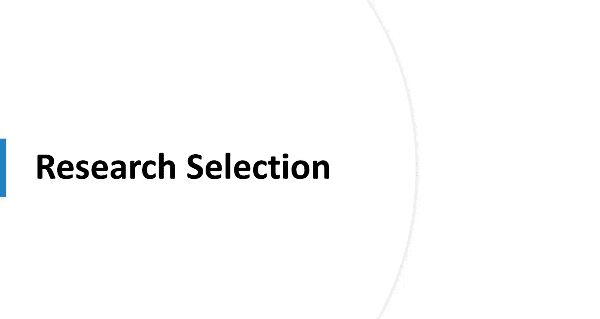
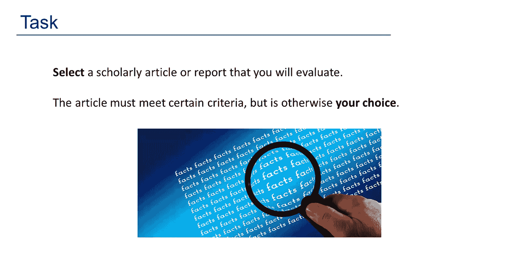
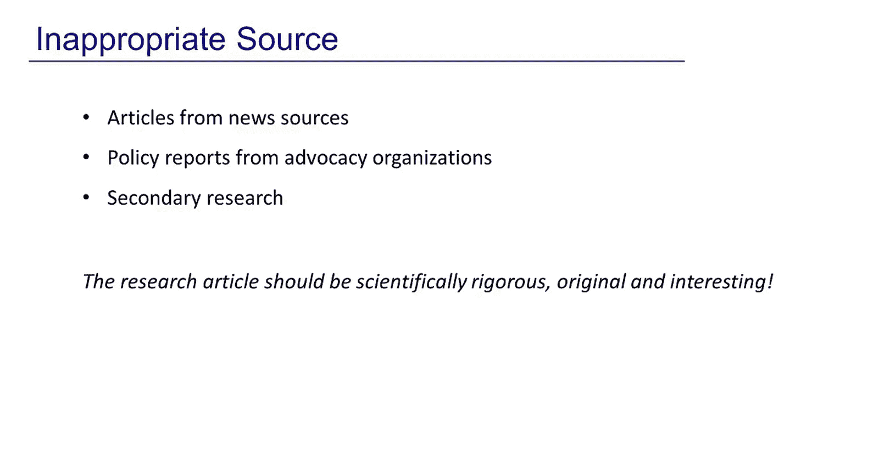

#  062：研究选择

在本节课中，我们将学习如何为毕业项目选择一篇合适的研究文章或报告。通过本节内容，你将掌握选择文章时应遵循的标准，并了解一些潜在的高质量研究来源。

## 项目任务回顾

上一节我们介绍了毕业项目的总体要求，本节中我们来看看具体如何选择研究文章。

你的毕业项目任务是选择一篇学术文章或研究报告，并对其进行评估。所选文章必须满足特定标准，但除此之外，你有很大的灵活性去选择自己感兴趣的实质性领域的文章。建议你将此作业视为深入探索感兴趣主题的机会，并思考如何进一步推进该主题的研究。

## 选择文章的四大标准

所选的文章或报告应满足以下四个核心标准。以下是具体说明：

1.  **完整性**：文章或报告必须是完整的，不应是大型项目的一部分。
2.  **原创性与实证性**：研究必须是原创且实证的。所谓“实证”，是指研究应基于可观察的事实，而非思想评论或反思性文章。思想评论固然是公共讨论的重要组成部分，但不适用于本评估项目。
3.  **信誉良好的发布方**：论文应由信誉良好的组织发布。下一张幻灯片将提供一些示例。不应为本作业选择未完成的工作。
4.  **包含定量分析方法**：研究必须包含定量分析，且使用了我们在“数据素养”专项课程中涵盖的一种或多种方法。请注意，研究无需使用所有方法，但必须使用我们讨论过的部分方法。

例如，研究可能使用**描述性统计**、**数据可视化**、**测量工具**、**实验研究**、**调查研究**、**回归分析**或**因果推断**来支持其论点。如果你选择的报告或文章符合这些标准，那么你的项目就有了一个良好的开端。

## 合适的研究来源

在明确了选择标准后，我们来看看哪些地方可以找到符合要求的文章。以下是一些发布合适报告和文章的机构示例。请注意，并非这些机构发布的每一份文件都符合上一张幻灯片概述的标准，同时也有许多未列出的机构也发布适合本项目的文件。

*   **政府机构**：例如美国教育部、美国总务管理局和千年挑战公司。这只是众多制定高质量研究报告的美国政府机构中的三个。一些州政府以及其他国家的政府同样会制定高质量的研究报告。这些都是本项目研究报告的潜在优质来源。
*   **智库与私人研究机构**：例如阳光基金会、城市研究所、布鲁金斯学会、国家经济研究局和兰德公司。再次提醒，并非这些及类似机构产生的每份报告都合适。文章或报告必须符合上一节描述的标准。
*   **同行评审期刊**：这是原创定量研究的绝佳来源。每个学科领域都有同行评审期刊。虽然许多期刊采用订阅或付费墙模式，但有些期刊会免费提供近期文章。

## 应避免的研究来源

了解了合适的来源，我们也要明确哪些来源不适合本项目。以下是本项目应避免使用的研究来源：

*   **新闻机构**：即使是信誉极高的新闻机构。新闻业与科学研究有本质区别。新闻业对于健康的民主至关重要，但其目的与科学研究不同。此外，大多数新闻文章是报道原创研究，而非由新闻机构自己进行的原创研究。本项目要求你审视原创研究本身，而非其摘要。
*   **倡导组织的政策报告**：在某些情况下，倡导组织与研究组织之间的界限可能模糊，但总体上，请专注于选择那些试图揭示重要问题真相的研究，而非那些旨在利用确证性统计数据来推动特定政策目标的文件。
*   **二手研究**：即总结或报道原始发现的研究，例如关于某项近期研究的新闻报道。

总而言之，你选择的研究文章应具备科学性、严谨性、原创性和趣味性。

## 总结

本节课中，我们一起学习了为毕业项目选择研究文章的核心标准、合适的来源以及应避免的陷阱。核心要点是：选择一篇**完整**、**原创**、**实证**、由**信誉良好机构**发布，并包含我们所学**定量分析方法**的研究报告或文章。请利用这个机会，深入探索你真正感兴趣的领域。