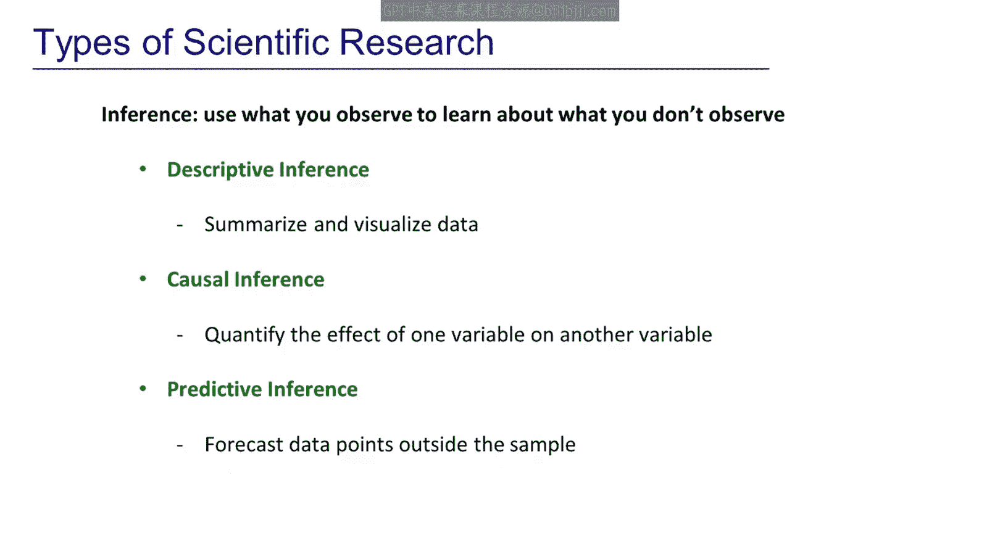
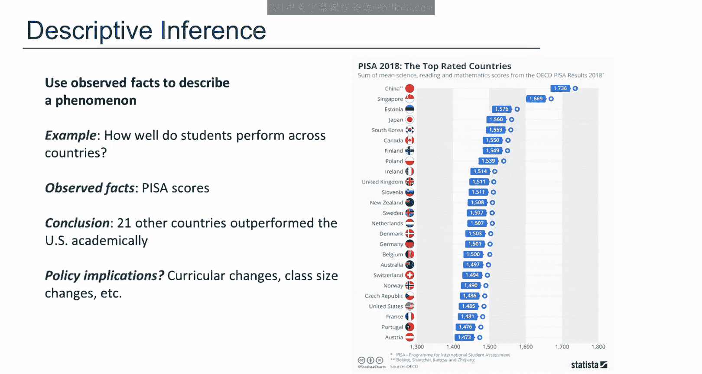
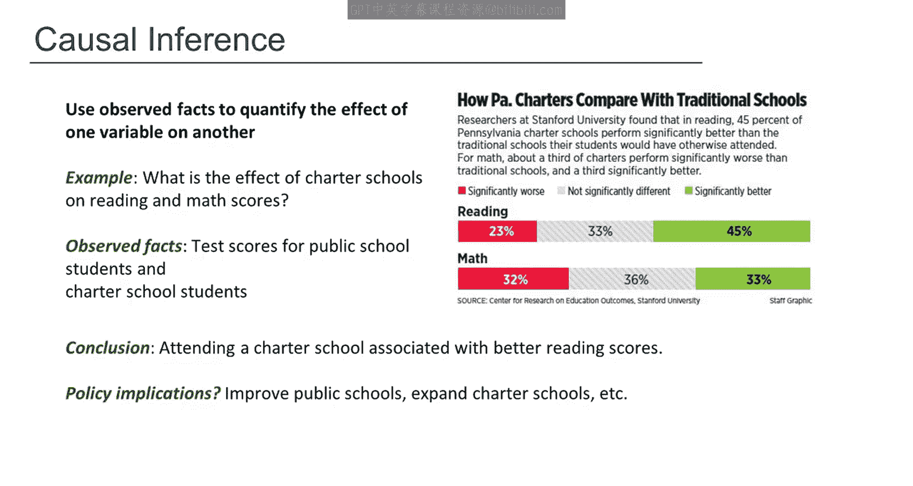
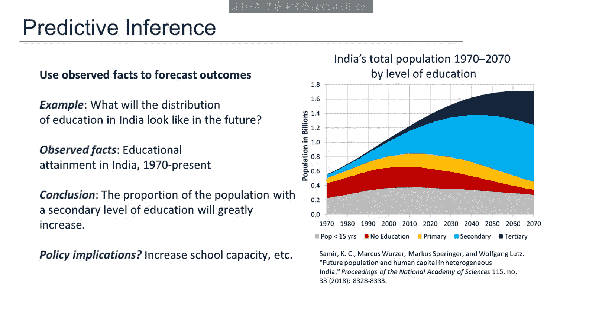
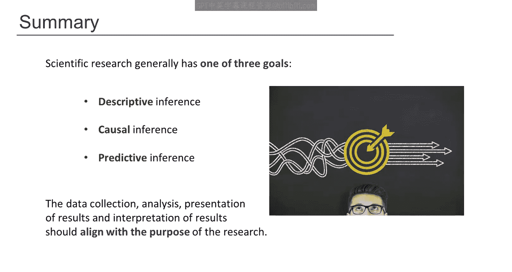

# 约翰霍普金斯大学《数据素养（数据⧸测量⧸回归⧸概率⧸毕业项目）｜Data Literacy》中英字幕（deepseek p02 1_统计推断.zh_en -BV1jXtMemEuh_p2-

Statistical inference。 What is the purpose of quantitative research。

 You've undoubtedly seen statistical results presented many times。

 whether at work on the news or in a book you're reading。

 The first step in making sense of a piece of quantitative analysis is to identify the purpose of that research。

 By the end of this video， you should be able to identify and distinguish between the three main goals of scientific research。

 descriptive inference， causal inference and predictive inference。What is scientific research。

 The overarching goal of scientific research is inference， as three top political scientists explain。

 scientific research is designed to make descriptive or explanatory inferences on the basis of empirical information。

An inference is a conclusion about the world that we draw based on evidence that we observe。

This conclusion can be descriptive， causal， or predictive。

 and I'll explain what I mean by these terms in a moment。As you may know from your own work。

 there are several steps you need to take between having a great research idea and drawing conclusions at the end of the project。

 The first step requires you to formulate a question and develop a motivating theory。

 This theory should be informed by existing scholarship， related to your question。

The second step involves collecting evidence。 That evidence can be either qualitative or quantitative。

 In the third step， it'll analyze the evidence that you've collected。

 There are an infinite number of methods that you can use to analyze evidence。

 The method you select should align with your research question。Lastly。

 after you've performed your analysis， you'll draw conclusions and answer the research question。

And as part of your conclusion， you'll identify the implications of your findings and develop any actionable recommendations that result from your findings。

 Although the steps that I've laid out might seem straightforward。

 The journey from your question to your conclusion is likely to take many twists and turns。

 There are often many hurdles to overcome along the way。

 particularly with the collection and analysis of quantitative evidence。

 Sometimes the research process can feel like you're an amazedze， winding your way through。

 You may try one method that turns out to be faulty。

 You may invest time collecting data that you later realize is not needed。

 The key to success is to stay focused on your question and not be deterred by the inevitable challenges that arise。

Types of scientific research。As I noted， there are three different types of inference。

 which is the use of observed quantitative evidence to learn about something that you don't observe directly。

The purpose of descriptive inference is to use data to better understand a phenomenon。

A researcher conducts descriptive inference by summarizing and visualizing data。

The purpose of causal inference is to use data to better understand how one variable affects another。

 This is accomplished by employing a statistical method to quantify the causal effect。

The purpose of predictive inference is forecasting。

 a researcher will use a sample to predict data points that fall outside the sample。

 Let's take a look at a few examples。

Descriptive inference with descriptive inference， the aim is to better understand how a phenomenon functions or to describe an interesting dynamic。

Suppose that your research question is， how well do students perform academically across different countries。

 This is a research question that aims to provide a descriptive inference。To answer this question。

 a researcher can use observed facts such as reading math and science test scores for students across different countries。

 The researcher can use this data set to draw a conclusion about how well US students， for example。

 are performing compared to other students in different countries The graph on the right side of the slide shows how well students performed in reading math and science using their scores on the program for international student assessment or Psa test。

 There are several conclusions that we can draw from the results。

 One conclusion is that 21 other countries outperformed the US academically。

 If you have a background in education policy， you might be able to develop some recommendations based on the graph and data。

 For example， you might recommend particular curricular changes or class size changes。 Of course。

 this graph alone does not support a particular policy change。

 but it's one piece of evidence that a policy analyst might use in a broader evaluation of what can be done to improve US academic performance。

Takeaway point is that a data set can be used to systematically describe a phenomenon。

 and this process is called descriptive inference。

Casal inference， causal inference is used to quantify the effect of one variable on another。

 With causal inference， the goal is to understand how one variable affects another variable。

Let's look at an example。Suppose you're interested in examining the effect of charter schools versus public schools on students academic achievement。

The observed facts might include reading and math test scores from students in Pennsylvania。

 The graph on the slide shows， for example， that 45% of students in charter schools in Pennsylvania performed better with reading than their peers in public schools。

With respect to math， approximately one third of charter school students performed better than their public school peers。

 yet nearly a third of public school students performed better than the charter school students。

Overall， the results are mixed， though it might be reasonable to conclude that attending a charter school confers a reading benefit to students。

 again， however， you would need more than this one graph alone to draw this causal conclusion。

After arriving at your conclusion， you might formulate policy recommendations about how to improve public schools or expand charter schools。

Predictive inference Predtive inference requires the researcher to generate a forecast。

 an example of a predictive inference research question might be。

 what will the distribution of education in India look like in the future？

The observed facts in this case might be educational attainment in India from 1970 to the present。

 The inference is what we might expect educational attainment to look like over the next several decades based on the historical data。

The graph on the right shows the predicted population of India by level of education up to the year 2070。

 One conclusion from this graph might be that the proportion of the population with a secondary level of education will greatly increase over the next several decades。

 A policymaker looking at this graph might immediately think about how best to increase school capacity in the near future to accommodate the expected population increase。

SummaryTo summarize， scientific research generally has one of three goals， descriptive inference。

 causal inference or predictive inference。The particular data collection， analytical。

 presentation and interpretive approaches a researcher takes should align with the purpose of the research methods that are useful for predictive inference。

 for example， are not always appropriate for causal inference as you become a more experienced analyst or consumer of analytics you'll be able to evaluate whether a particular piece of research has used methods that fit the goal of the project。

