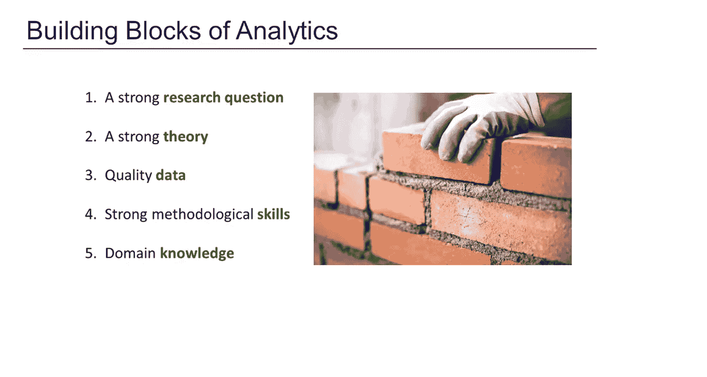
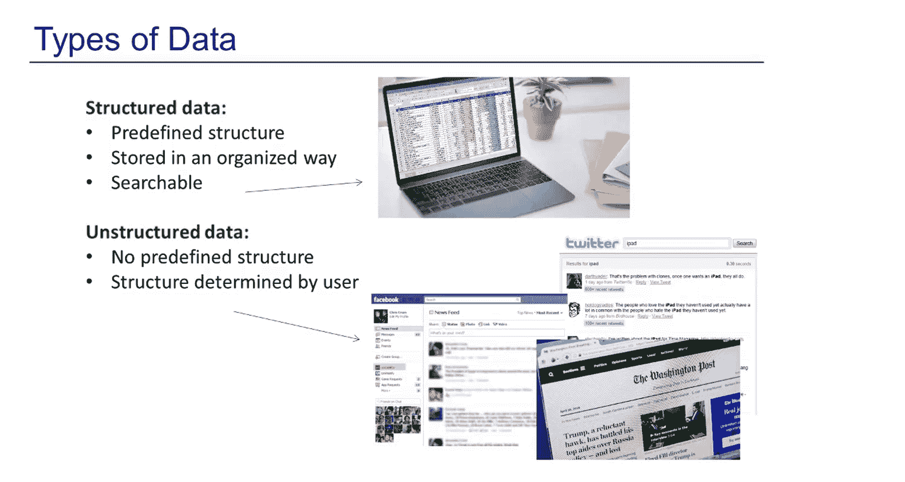
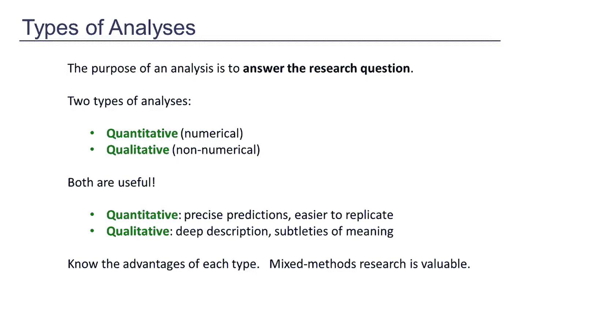
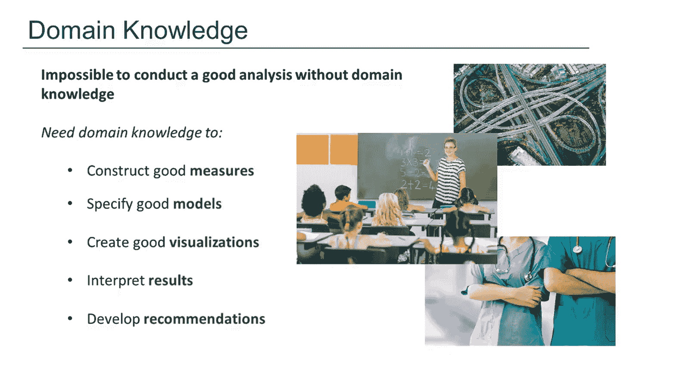
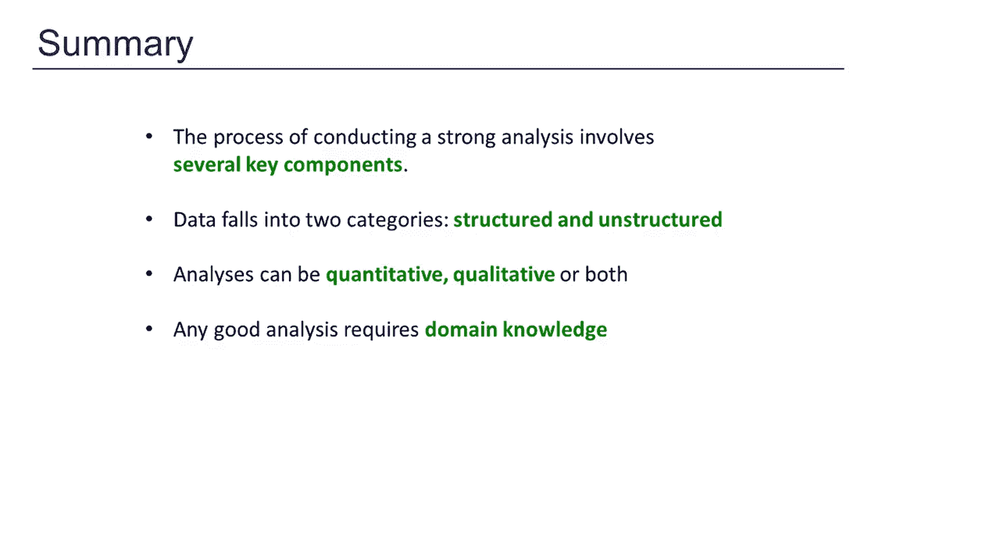

# 约翰霍普金斯大学《数据素养（数据⧸测量⧸回归⧸概率⧸毕业项目）｜Data Literacy》中英字幕（deepseek p03 2_科学研究的组成部分.zh_en -BV1jXtMemEuh_p3-

Components of scientific research， a good analysis requires several key components。

 The research process involves many steps and requires the analyst to make many judgments along the way。

 By the end of this video， you should be able to identify the steps involved in the analytic process。

 as well as different types of data and research approaches。

Building blocks of analytics， regardless of whether an analyst is performing a descriptive。

 causal or predictive inference study， the process should have five components。 First。

 the analyst needs to formulate a good research question， The research question should be specific。

 important and original。 In other words， the research question should have a defined scope。

 address a meaningful issue and aim to contribute original knowledge。 After all。

 what is the point of researching a question that has already been satisfactorily answered in several existing studies。

It's also important that the research question be motivated by a strong theory。

 the theory should outline the expectations for results and why。Further。

 the theory should explain why the question is important and how it fits into existing research on the topic。

 We'll cover the properties of a good theory in the next video。

After situating the research question in a strong theoretical framework。

 the analysts can then collect and assemble a high quality data set。 Quality data is accurate。

 appropriate for the research question and complete。 In some cases。

 statistical techniques can help you deal with data problems， such as missing data。

Related to this point， an analyst needs a strong set of methodological skills。

 These skills can be related to summarizing data， quantifyifying causal effects。

 developing predictive models or other types of analyses。

 These skills are what folks typically think of when they imagine taking a statistics or quantitative methods course。

A sophisticated methodological skill set， however， is insufficient to be a good analyst。

 An analyst must also have a deep understanding of the substantive issues at hand。In other words。

 an analyst needs to have domain knowledge。 You can acquire this domain knowledge from coursework。

 personal experience or professional experience。😊。

Types of data， generallyenerally speaking， there are two types of data an analysts might choose to use for a study structured and unstructured。

 structureucd data have a predefined structure and are stored in an organized searchable manner。

 such as a spreadsheet。 Data sets that appear in tabular form。

 such as those you can view in Excel are structured。

 The variables have been defined by the person who created the dataset set。Unstructured data。

 in contrast have no predefined structure。 The analyst quantifies the data and creates a structure。

 Unstructured data includes social media postings on websites like Twitter and Facebook and news stories that appear in outlets like the Washington Post and New York Times。

The analyst decides how to assign numerical codes to postings， sentences， paragraph， stories。

 or some other defined unit of analysis。An analyst， for example。

 might code tweets according to whether they express positive or negative sentiment toward。

 let's say， the president of the United States。Perhaps the analyst assigns relevant tweets as 0。

 If the tweet is positive， One， if the tweet is neutral and two， if the tweet is negative。

The analyst could then incorporate this measure into a statistical analysis of the relationship between presidential rhetoric and sentiment expressed via Twitter。

The amount of both structured and unstructured data in the world is increasing at an exponential pace。

 Analysts must know how to collect， organize and manage the data they need。

 in addition to knowing how to analyze it using statistical methods。

Types of analyses， while the data literacy specialization focuses on making sense of quantitative data。

 it's important to recognize that qualitative approaches are valuable as well。

 The overarching purpose of any analysis is to answer a research question。

 An analysis might tackle the question using either a quantitative analysis or qualitative analysis。

 Quantit evidence is numerical and can be analyzed with statistical methods。

 Quait evidence is non numerical and can be analyzed using methods such as comparative case studies。

 ethnographies and focus groups。Both quantitative and qualitative evidence are useful for answering research questions。

 and each type of analysis has its advantages and disadvantages。Quantitative evidence。

 allows the analyst， for example， to quantify the effect of one variable on another and generate precise predictions。

 Further， it's easier to replicate a quantitative analysis than a qualitative analysis。

 which is critical for ensuring that the results are reliable。Not everything， however。

 is quantifiable。 Quaative evidence such as images and interviews allow a researcher to develop a deep description of a phenomenon and explore subtle differences in the meaning of terms and concepts。

It's important to remember that both quantitative and qualitative evidence play an important role in scientific research when evaluating research and pursuing your own。

 consider the advantages and disadvantages of each and recognize that much of the best research relies on a mixture of both。

Domain knowledge。Even though the analytic buzzwords of today include machine learning。

 artificial intelligence， natural language processing。

 and other terms related to the analysis of data， it's essential to remember that it is impossible to conduct a good and complete analysis without domain knowledge。

For example， an analyst needs domain knowledge to construct good measures。

 Imagine being tasked with measuring transportation outcomes。

 educational outcomes or health outcomes。 You would need to know a lot about these topics to develop effective measures。

 Suppose you are asked to measure the quality of public transportation in a city。

 You might need to account for buses， a subway system， bike shares， ride shares and even scooters。

 How would you determine whether these and other components of public transportation are operating well。

Would you measure quality as public satisfaction， environmental friendliness， efficiency。

 or some other criterion。Likewise， you need domain knowledge to specify good unbiased statistical models。

 create effective visualizations， interpret results in a meaningful way， and develop useful。

 actionable recommendations。 A master programmer or statistician with insufficient domain knowledge cannot alone produce a quality analysis。

 This is why analytics projects are often undertaken by teams rather than individuals。

Summary， keep in mind that the process of conducting a strong analysis involves several key components。

 including formulating a good question， motivating that question with a strong theoretical framework。

 assembling a quality data set， using appropriate methods to analyze the data and interpreting the results in a meaningful way。

 The data you analyze can be either structured or unstructured。

 and you might decide to use a quantitative analysis。

 qualitative analysis or a mixture of both methods。Regardless of your analytical approach。

 you will need domain knowledge to make good， methodological and interpretive decisions。

Moving forward we'll take a deeper dive into what constitutes a good theory to motivate a statistical analysis。

