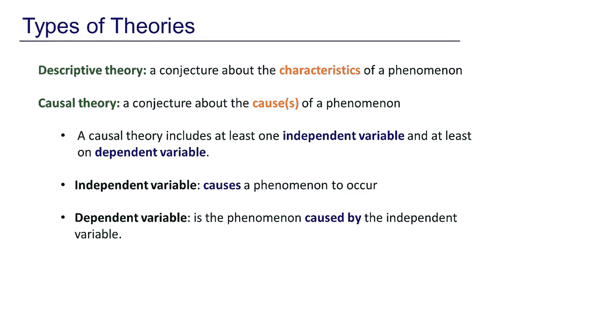
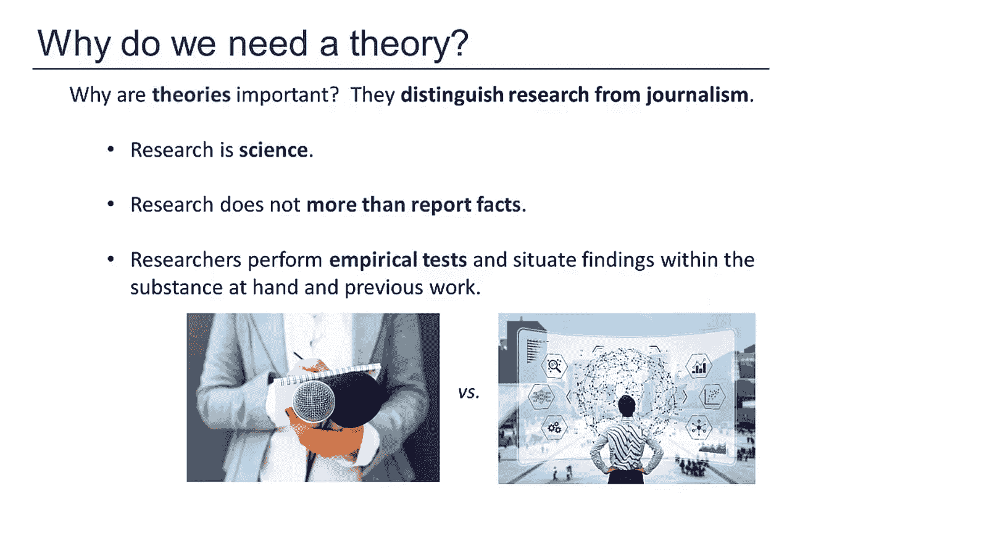
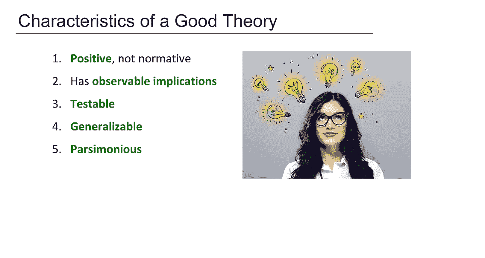
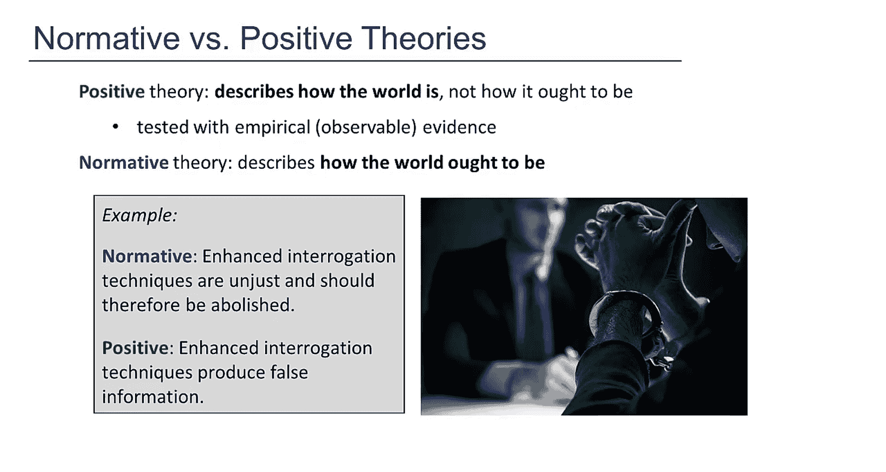
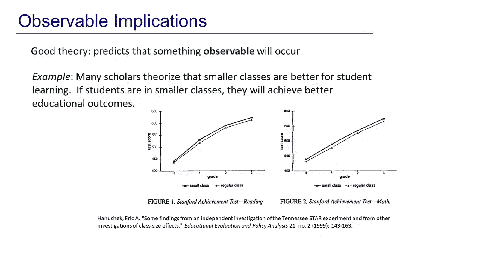
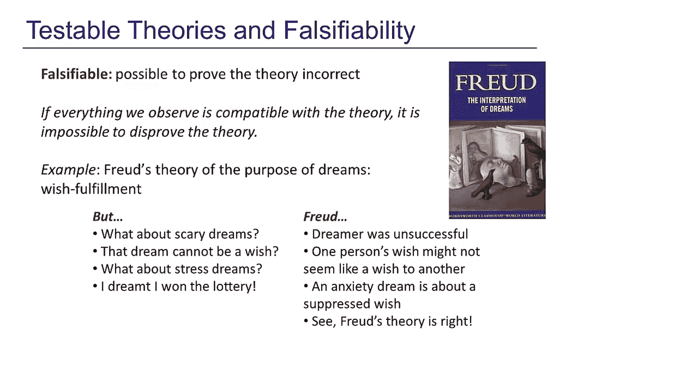
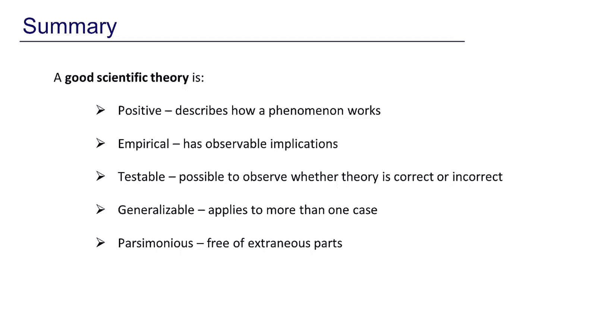

# 约翰霍普金斯大学《数据素养（数据⧸测量⧸回归⧸概率⧸毕业项目）｜Data Literacy》中英字幕（deepseek p04 3_科学理论.zh_en -BV1jXtMemEuh_p4-

Scientific theories prior to conducting a data analysis。

 a researcher should articulate the theory that will guide the methodology。

 not all theories are created equal， however， there are good theories and bad theories and many in between。

By the end of this video， you should be able to evaluate the quality of a scientific theory。

Types of theories。 There are two major categories or types of theories。

 A descriptive theory is a conjecture of the characteristics of a phenomenon。

 We might investigate the theory that US students perform worse academically than students in European countries。

 A causal theory is a conjecture about the causes of a phenomenon。

 We might theorize that term limits in state legislatures lead to increased gubernatorial power。

 or we might theorize that school resource officer programs decrease school violence。

Or we might theorize that in state tuition rates for undocumented immigrants improve a state's economy。

 All of these theories suggest that an observable outcome has a specific cause。

A causal theory includes at least one independent variable and at least one dependent variable。

An independent variable is something that causes a phenomenon to occur。

 and a dependent variable is caused by an independent variable。

Why do we need a theory At this point， you might be wondering why we even need to bother with theories。

 Why can't we just collect data on topics that interest us and report what the data show us， Well。

 theories are important because they make what we're doing a science。

 Theies distinguish science from journalism。 Journalism is essential to our society and a Democratic help but it is distinct from scientific research。

 A research study should do more than report facts。

 Researchers perform empirical tests and situate the findings within the substance at hand and within the existing body of scholarship on the topic。

 In other words， journalists uncover and report facts While scientists test theories。

Characteristics of a good theory， not all scientific theories are equally good。 In this video。

 I'll discuss five characteristics of good scientific theories。 Good theories are positive。

 meaning they are not normative。 They have observable implications。 They are testable。

 they are generalizable， and they are parsimonious。😊，Now， you might ask。

 where do good theories come from in the first place， There is no one right answer to this question。

 Scholas frequently develop a theoretical framework for their research by drawing upon existing research。

 This is generally the most useful resource for theory development。In addition。

 researchers rely on their professional experience and their own ideas about how the world works。

 taken together existing research， professional experience。

 and the research' own ideas will inform the development of a good theory that can be tested with data。

Norative versus positive theories。Let's discuss the first characteristic。

 A theory should be positive。 A positive theory describes how the world is and not how it ought to be。

 A normative theory in contrast describes how the world ought to be。

 Although normative theories are interesting and certainly worth exploring from an intellectual perspective。

 they cannot be tested using data and facts。 Let's look at an example。

The topic of enhanced interrogation is extremely important to the national security and intelligence communities。

 A normative theory about enhanced interrogation could be something like enhanced interrogation techniques are unjust and should therefore be abolished by the United States。

This theory describes how one view of the world should be。It is impossible to test using facts。

 the justness of enhanced interrogation， and based on its justness。

 whether or not the US should abolish these techniques， In other words。

 it is impossible to prove this theory to be correct or incorrect。

A positive version of this theory could be enhanced interrogation techniques produce false information。

 You can imagine testing this theory by examining the veracity of information acquired through enhanced interrogations。

There might be logistical challenges with testing this theory， but that is a different issue。

 For the moment， the point is that it is possible to test this theory with empirical evidence。

Observable implications。In addition to being positive， good theories have observable implications。

 In other words， good theories predict that something observable will occur， and to test a theory。

 the researcher examines whether any of the observable implications have， in fact， occurred。

Let's consider an example about the effect of class size Many scholars theorize that smaller classes are better for student learning。

 there are several reasons for this theory， such as the idea that smaller class sizes permit more frequent and meaningful interactions between students and teachers。

 so the theory articulates that if students are in smaller classes。

 they will achieve better educational outcomes。This theory has clear observable implications。

 The graphs on this slide， for example， show the results of a research study that examined the test scores of students in a class size experiment。

The math and reading test scores for students in small classes， the treatment group。

 and regular sized classes， the control group， were observed and compared for different grade levels。

Testable theories and falsifiability。 Good social science theories are also testable To be testable。

 a theory must be falsifiable， which means that it must be possible to prove the theory incorrect。

If everything we observe in the world is compatible with the theory。

 then it's impossible to disprove the theory。Reated another way， if a theory is unfalsifiable。

 it cannot be tested。Here's an example in Freud's， the interpretation of dreams。

 There is a chapter in which he discusses the purpose of dreams。

 Freud argues that all dreams are aimed at wishfulment。 Now， you might hear this and think。

 what about scary dreams， Well， Freud would respond that a scary dream is simply a dream in which the dreamer is unsuccessful。

The dreamer tried to dream about fulfilling a wish， but did not succeed。 You might then say， well。

 I heard about a dream a friend had。 and that dream can't possibly be wishfulment。

Freud would respond by saying that one person's wish might not seem like a wish to somebody else。

 You are simply interpreting your friend's dream incorrectly。Well。

 what about stress dreams you might ask， Freud would say that a stress dream is really a dream about a suppressed wish。

 Finally， you might remember a great dream you had recently， such as one about winning the lottery。😊。

Freud would say， see， my theory is right。 The point is that Freud has a response for any possible objection to the theory。

 It is impossible to disprove this theory。 As a result。

 the theory is unfalsifiable and therefore not testable from an empirical standpoint。

Testable theories can actually be tested。Beyond being falsifiable， a theory must be testable。

 given practical constraints To be testable， you must be able to answer the following questions about the theory in the affirmative。

 Can I get the necessary data， Do I have enough time to test the theory。

Is the testing procedure ethical？Let's walk through an example。

The first theory states children who have authoritarian parents grow up to be untrusting of political leaders。

One way to test this theory would be to observe children who have both authoritarian and non authoritarian parents。

 and then observe the political trust of the same individuals as adults。

If you do not have 20 or 30 years to devote to a research project， however。

 this research design is not possible。Alternatively。

 you could simply survey adults and ask them both about their parents and about their trust in government。

 While this research design is much more practical。 It has limitations。

 Surs about adults childhoods are subject to recall bias and surveys about sensitive issues are subject to social desirability bias。

 A researcher might still decide to proceed with the project。

 but they should do so with these limitations in mind。Generalizability and parsimony。Lastly。

 good social science theories are generalizable and parsimonious， let's unpack these terms。

A generalizable theory is one that applies to more than one case。

 If you develop a theory about elections， that theory should apply to more than one election。

 A theory that only applies to the 2020 election， for example， is not very useful。

 It does not help us understand elections prior to 2020。

 nor does it have predictive value for future elections。

 A good theory should provide insight into multiple instances of a phenomenon， whether that is war。

 elections， test scores， vote choice or something else。Good theories should also be parsimonious。

 meaning they do not contain unnecessary parts。 Suppose you're interested in developing a theory of voter turnout。

 Your purpose might be to predict the probability that a citizen will turn out to vote based on their background characteristics。

 One theory of voting might state that a citizen's probability of voting is determined by their level of education。

 income and residential stability。 Each of these factors is well established as motivating turnout。

A second theory might add in hair color。 There is nothing to suggest， however。

 that one's hair color has anything to do with one's probability of voting。 As a result。

 both theoryory 1 and theoryory 2 have exactly the same explanatory power。

 but theoryory 1 is simpler。 As a result， theoryory 1 is preferable。Summary。

 this video discussed the key characteristics of good scientific theories， in particular。

 a good scientific theory is positive， meaning it describes how a phenomenon works， it is empirical。

 meaning it has observable implications。 it is testable。

 meaning it is possible to acquire and analyze the data， it is generalizable。

 meaning it applies to more than one case， and finally it is parsimonious。

 meaning it does not contain unnecessary components。

