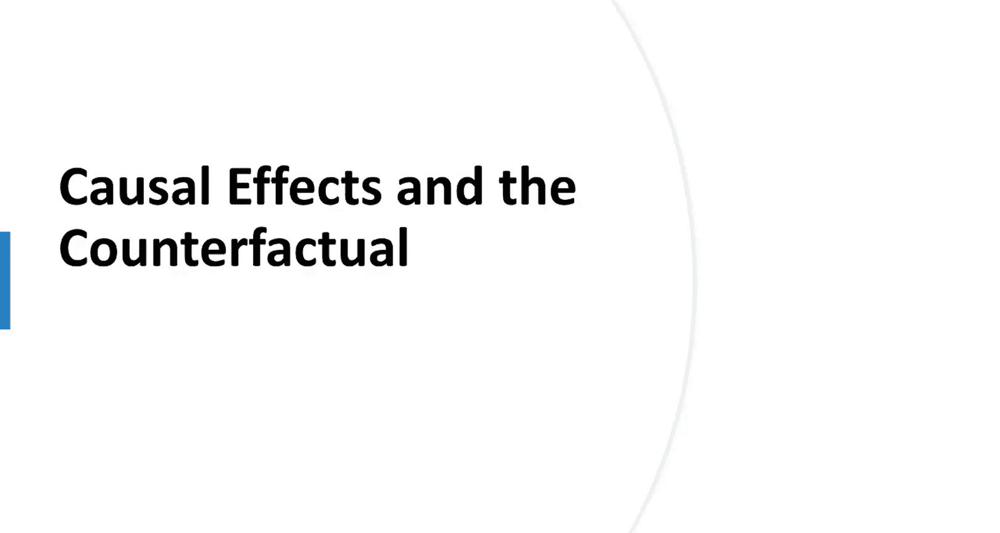
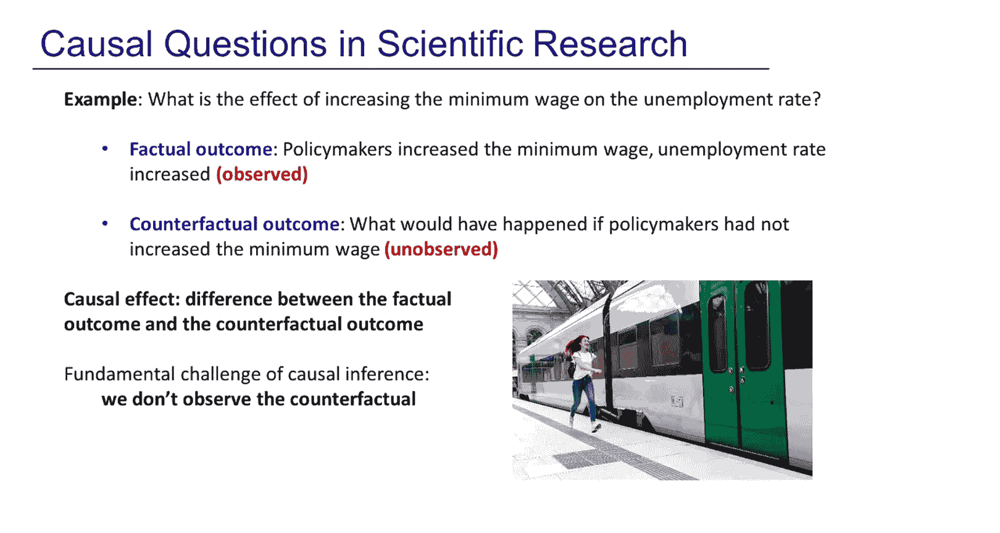
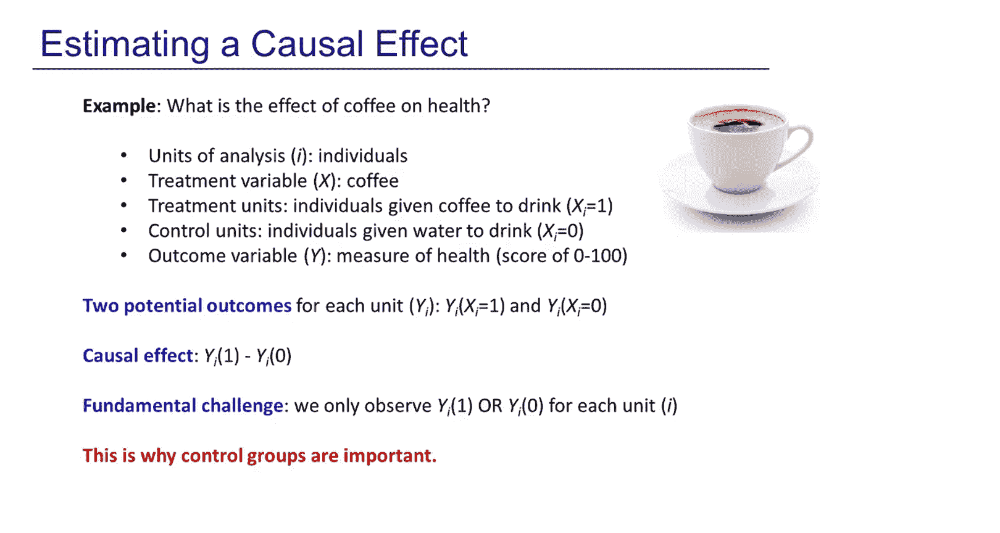
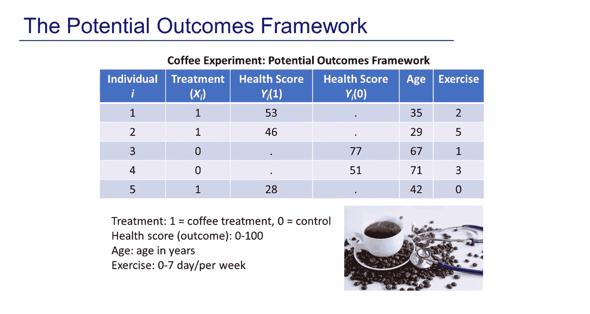
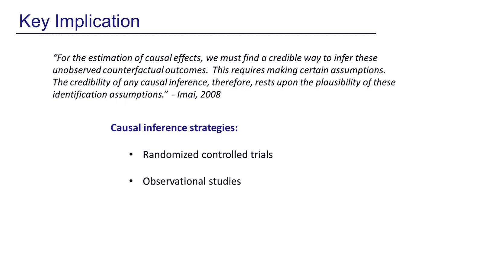

# 约翰霍普金斯大学《数据素养（数据⧸测量⧸回归⧸概率⧸毕业项目）｜Data Literacy》中英字幕（deepseek p05 4_因果效应与反事实.zh_en -BV1jXtMemEuh_p5-

Causal effects and the counterfactual。 It is often the case that the goal of an analysis is to identify a causal effect。

 Perhaps a researcher wants to understand the cause of citizens' feelings about public officials or whether a particular campaign strategy will increase support for a candidate。

Estimating causal effects is challenging， but it's often essential for good decision making in all fields。

 including government， business and public health。By the end of this video。

 you should be able to describe the theory of causal inference and explain why the potential outcomes framework is a valuable way of thinking about how to estimate causal effects accurately。

Causal questions in scientific research Researchers are often interested in understanding how the manipulation of something such as a change in public policy affects an outcome of interest。

Any causal question has a factual outcome， which is what we actually observe given a particular manipulation and a counterfactual outcome。

 which is what would have happened in the absence of that manipulation。

The counterfactual outcome is unobserved。 In other words。

 it is not possible to observe what would have happened to the exact same units of analysis。

 both with the manipulation and without the manipulation。Let's walk through an example。

 Suppose a researcher is interested in estimating the effect of increasing the minimum wage on the employment rate。

 Now， suppose that researcher observed policymakers implementing a minimum wage increase。

 The factual outcome is what they observe。 Let's suppose that to be an unemployment rate increase。

 The counterfactual outcome is what would have happened in that same geographic area and to that same population if those same policymakers had not increased the minimum wage。

 Obviously， this scenario is unobserved。 The true causal effect is the difference between the factual outcome and the counterfactual outcome。

This example highlights the fundamental challenge of causal inference。

 which is that we don't observe the counterfactual。Except in the movies， of course。

 the movie sliding doors， for example， features what happens to a woman who just makes getting onto a departing subway train。

 And later， what happens to that same woman who just misses the subway train by a half second。

This movie， in other words， presents the counterfactual to making the subway train。

 which we can't observe in real life。

Estimating a causal effect， let's now discuss the specifics of how to estimate a causal effect。

 Suppose we are interested in estimating the causal effect of coffee on health。

 Let's first define the key terms we need to understand to estimate this effect。In this case。

 the units of analysis indexed by I are individuals。

 The units of analysis define the rows in a data set Here。

 we are interested in individuals as opposed to other units such as states， countries， senators。

 et cea。The treatment variable denoted by X is coffee。

 We can manipulate the treatment by changing the amount of coffee in individual consumes。

The treatment units include those individuals who are given coffee to drink。For these individuals。

 x is set to1。The control units include those individuals not given the treatment。In this case。

 let's suppose they are given water as the control beverage。 For these individuals， X is set to 0。

The outcome variable denoted by why is a measure of hell。

Let's suppose that's a score ranging from 0 to 100。There are two potential outcomes for each unit。

 the value of y when x is 1， and the value of y when x is0。

The causal effect is defined as the difference between these two potential outcomes。

 Notice that I've dropped the x equal sign inside the parentheses here。

 which is common notation for simplicity。As I noted before， however。

 the fundamental challenge is that we only observe one outcome for each unit。

This example highlights why control groups are important to preview what's coming。

 we're going to use the control units to estimate the counterfactual for the treatment units。

The potential outcomes framework。The potentialent outcomes framework formalizes the example on the previous slide。

This table shows the first five rows of a data set that we might create by running the coffee experiment。

The first column indexes each individual。 The second column is the treatment variable。

 which takes the value of either 0 or  one。An individual is assigned one if that person received the treatment and zero if that person was in the control group。

This type of variable is called a dummy variable， a dummy variable takes two values。

 either zero or1 and is frequently used in statistics。

The third column includes the values of health score for those individuals in the treatment group。

 while the fourth column includes the values of health score for those individuals in the control group。

The fifth and sixth columns includes some additionalic information about the individuals。

 namely age and number of days per week each person exercised。

These variables might be valuable to examine and to ensure there is no bias from confounders。

 a topic that we'll discuss in a subsequent video。The key takeaway from this table and from the potential outcomes framework is that we only observe one outcome for each unit。

 This fundamental fact makes the estimation of causal effects challenging。

Key implication。As one prominent statistician explains for the estimation of causal effects。

 we must find a credible way to infer these unobserved counterfactual outcomes。

 This requires making certain assumptions。 The credibility of any causal inference， therefore。

 rests upon the plausibility of these identification assumptions。Going forward。

 we'll discuss two strategies that we can use to estimate causal effects。

 namely randomized controlled trials and observational studies。

 and the assumptions required for each of these strategies。 When the assumptions hold。

 the strategies work very well。 when the assumptions are violated， however。

 the strategies lead to inaccurate estimations。

