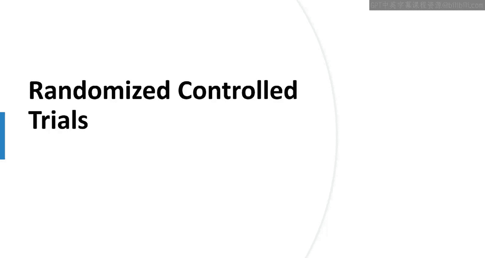
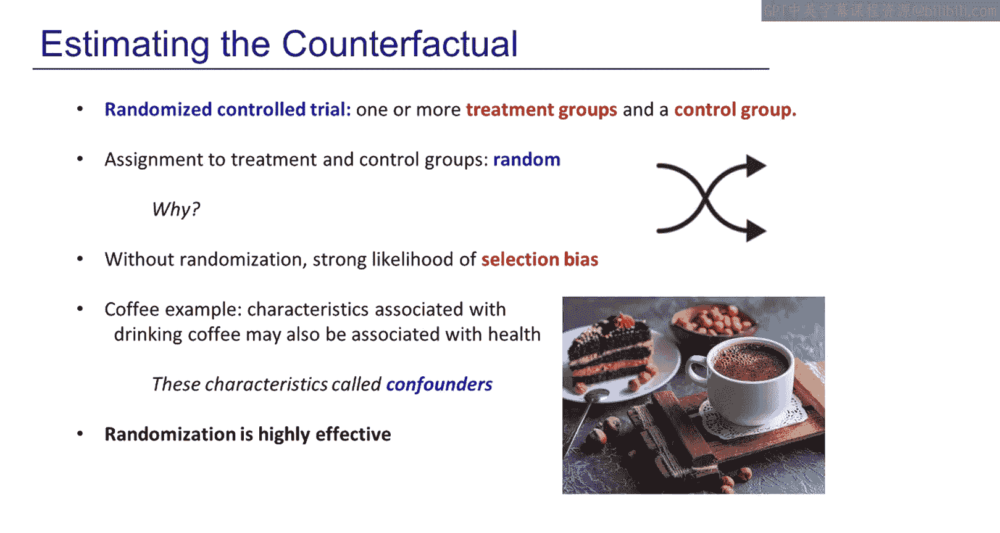
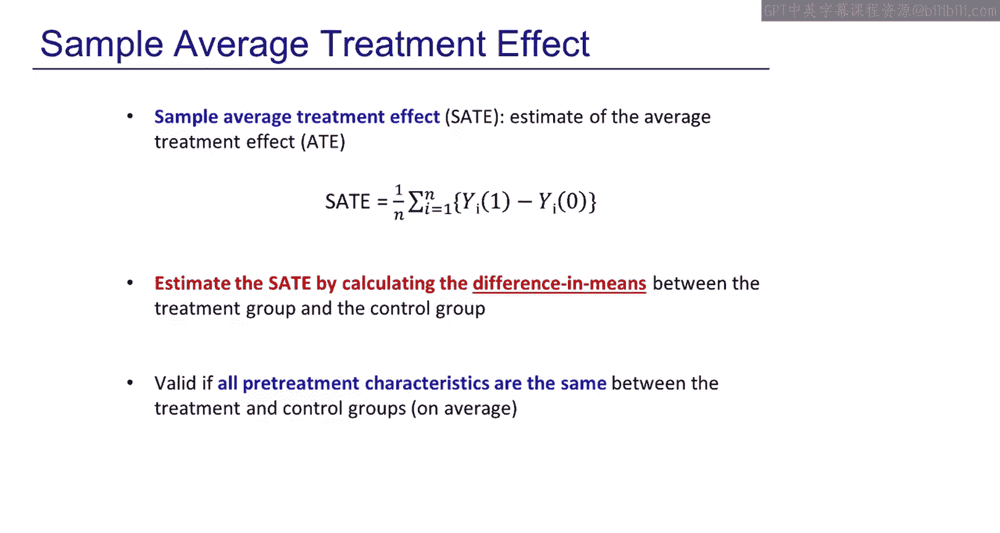
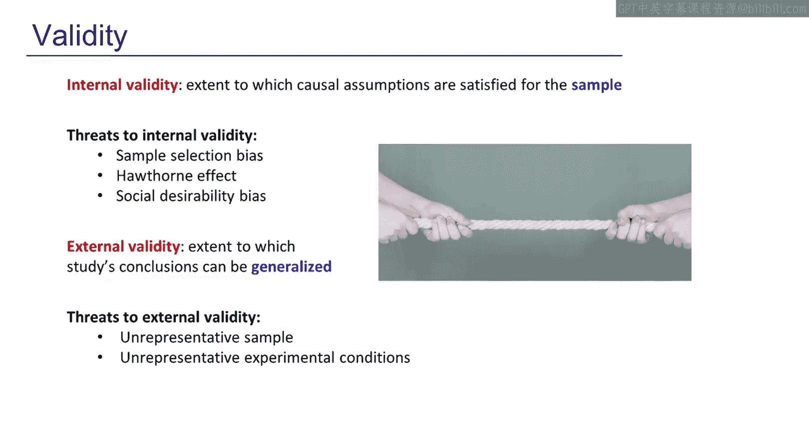
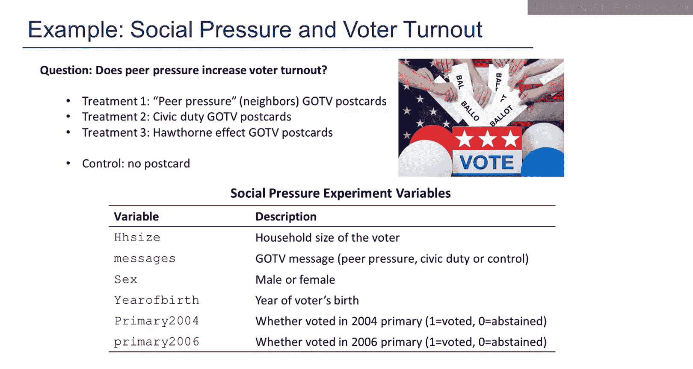
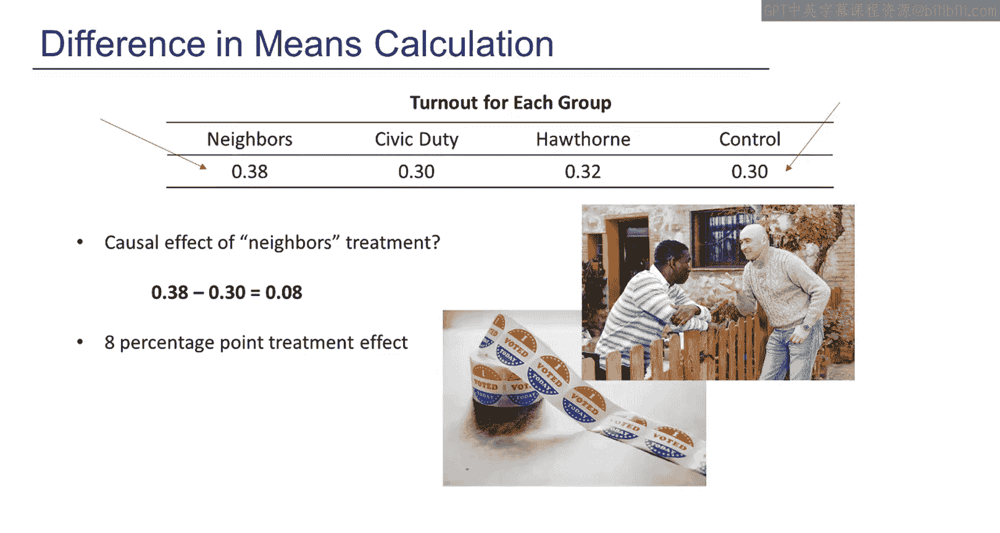
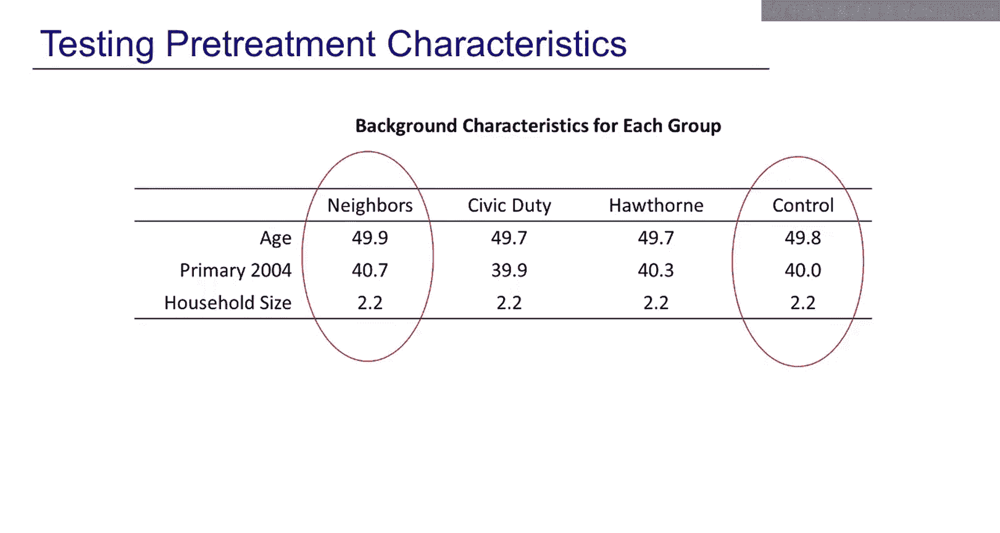

# 约翰霍普金斯大学《数据素养（数据⧸测量⧸回归⧸概率⧸毕业项目）｜Data Literacy》中英字幕（deepseek p06 5_随机对照试验.zh_en -BV1jXtMemEuh_p6-

Randomized controlled trials， the gold standard for estimating causal effects is to use a randomized controlled trial。

 which is another term for experiment。 By the end of this lecture。

 you should be able to identify the key components of a randomized controlled trial。

 Eimate a causal effect using data from a trial and evaluate the potential biases that can undermine a trial。

Estimating the counterfactual in a randomized controlled trial。

 the researcher creates one or more treatment groups and a control group。

 It is essential that assignment to the treatment and control groups is random。

 This means that group assignment is completely unrelated to any of the participants' background characteristics。

 The reason randomization is essential is that it ensures that the treatment groups and control group are similar in every way。

 except their receipt of the treatment。This feature of a randomized controlled trial allows us to estimate an unbiased causal effect of the treatment。

Without randomization， there is a strong likelihood of selection bias。 For example。

 let's return to the coffee experiment。 Imagine what would happen if we allowed participants to select whether they were in the coffee group or the water group。

It may be that those people who choose to drink a lot of coffee also engage in other behaviors associated with health outcomes。

 Maybe coffee drinkers also tend to eat a lot of sugar。 In that case。

 sugar consumption would be a confounder。 Su consumption would be disproportionately high in the treatment group because of its association with coffee consumption。

 And because we know that sugar consumption is likewise related to health。

 This is deeply problematic。In short， without randomization。

 there is a strong likelihood that the treatment and control groups will be different in terms of background characteristics that are relevant to the outcome of interest。

 and when this happens， it's very hard to determine whether the treatment is causally related to an observed change in the outcome or whether one of the confounders is the real driving force behind the change。

The bottom line is that randomization， when done properly， of course， is highly effective。

 it ensures that on average， the control and treatment groups are the same in terms of their pretreatment characteristics。

Sample average treatment effect。After conducting an experiment and assembling the data。

 we can estimate the sample average treatment effect。

 which is actually an estimate of the average treatment effect。

We can't observe either the true average treatment effect or even the sample average treatment effect。

 because remember we can't observe the counterfactual。

But we can estimate the sample average treatment effect by simply calculating the difference in mean outcome between the treatment group and the control group In other words。

 we can calculate the mean value of the outcome variable for the treatment group and compare that to the mean value of the outcome variable for the control group。

If all of the pretreatment characteristics are the same or very similar between the two groups。

 the difference in means is a valid estimate of the sample average treatment effect。

Validity， let's talk a bit more about validity。 There are two types of validity。

 Internal validity and external validity。 Internal validity refers to the extent to which the causal assumptions are satisfied for the sample at hand。

 There are many possible threats to internal validity。

 including sample selection bias the Hawthorne effect and social desirability bias。

 sample selection bias， as I explained earlier， occurs when individuals self select into either the treatment group or the control group。

 This self selection means that individual's background characteristics。

 also known as pretreatment characteristics， are correlated with their group assignment。

 and might therefore be confounders in the analysis。

The Hawthorne effect occurs when individuals participating in an experiment behave differently because they know they are being observed。

For example， you can imagine students and teachers in a class size experiment behaving differently than they might otherwise if they didn't know that their efforts were being documented。

Social desirability bias， as we've discussed previously。

 occurs when participants offer socially desirable responses。

 such as reporting that they voted when in fact， they did not cast a ballot on Election Day。

External validity， in contrast， captures the extent to which a study's conclusions can be generalized to other populations。

 other geographic regions and other time periods。 Often randomized controlled trials lack external validity because the sample is unrepresentative of a population of interest。

 For example， many social science experiments are conducted at universities and draw samples from undergraduate populations。

It is often questionable whether the results from these studies are generalizable to other populations。

 such as the full US population or even to undergraduate populations at other universities。

Other times， randomized controlled trials lack external validity because the experimental conditions are unrepresentative。

For example， imagine an experiment in which participants are asked to watch a series of political campaign ads on a computer in a laboratory setting。

This doesn't replicate the setting in which most people generally see campaign ads。

 They might see campaign ads between non politicalical ads in the middle of watching their favorite TV show in the comfort of their homes。

 This difference in setting might change the effects of these ads on the outcome of interest。

 such as which candidate， a person viewing the ad supports。In general。

 randomized controlled trials tend to have high internal validity and a lower level of external validity。

 There is some tension between the two。When researchers tightly control the conditions。

 they can usually ensure a high degree of internal validity。

 but this often comes at the expense of replicating real world conditions。

Example， social pressure and voter turnout。Let's walk through an example of a randomized controlled trial to see how to estimate the sample average treatment effect and how to evaluate the validity of that finding。

 A group of researchers was interested in studying whether peer pressure increases voter turnout。

 In other words， they wondered whether people would be more likely to vote if they thought that others would be told whether or not they had voted。

The researchers conducted a study during a Michigan primary election in which they mailed three types of treatment postcards to a sample of registered voters。

Those assigned to the first treatment group received a get out the vote postcard。

 letting citizens know that a message would go out after the election to let their neighbors know whether or not they voted。

Those assigned to the second treatment group received a get out the vote postcard that emphasized the importance of voting as as a civic duty。

Those in the third treatment group received a get out the vote postcard。

 simply letting them know that their voting behavior was being observed as part of a study。 Finally。

 those in the control group did not receive a get out the vote postcard。

The resulting data set included the variables listed on the table on this slide。

These variables include participants' household size， which message they received， their sex。

 year of birth， whether they voted in the previous primary election and whether they voted in the 2006 primary。

 which was the outcome of interest。

Difference in means calculation。Because this was a randomized controlled trial。

 it is reasonable to calculate the mean for each treatment and control group and then compare those means to estimate the causal effect of the treatment。

We can see that the mean turnout was 38% in the neighbor's treatment group。

 while turnout was 30% in the control group。Calculating the difference。

 the results suggest that this treatment increased voter turnout by 8 percentage points。

Testing pretreatment characteristics。We can conclude that these effects are causal if we can establish that there were no confounding variables in the analysis。

To examine this， we can look at the mean values of the pretreatment characteristics included in the data set。

The table on this slide presents the mean value of age。

 voter turnout in the 2004 primary and household size for each group。

Notice that the values for each variable are very similar across all four groups。 For example。

 notice that the values of these variables for the neighbors group are extremely similar to the values for the control group。

This indicates that these variables are not confounders in the study。

 This is good evidence to suggest that the respondents were indeed randomly assigned to the treatment and control groups。

 We can be reasonably confident that if the groups are very similar with respect to these characteristics。

 they are similar with respect to other relevant， unobserved characteristics。In general。

 testing to be sure that treatment and control groups are similar with respect to relevant pretrement characteristics is an essential step in conducting a sound randomized controlled trial。

