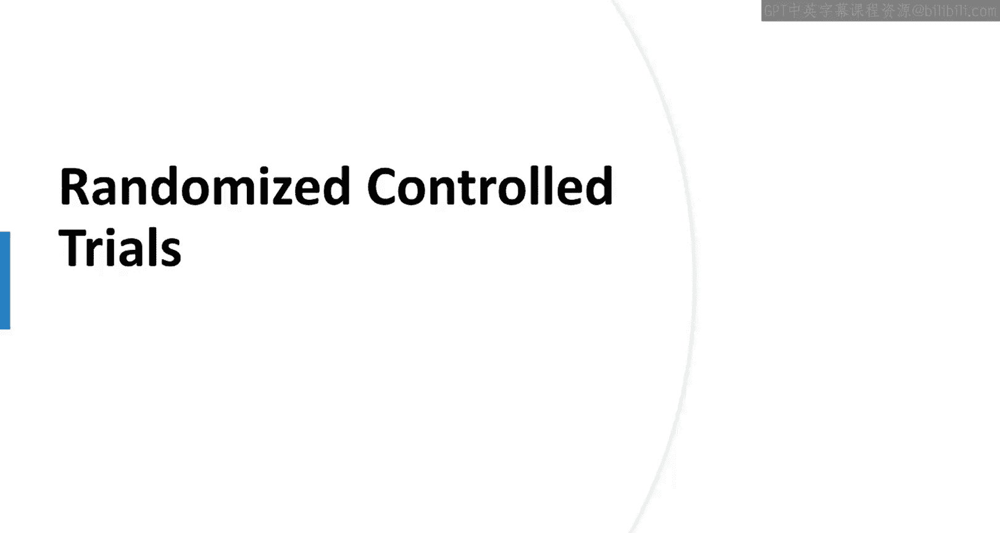
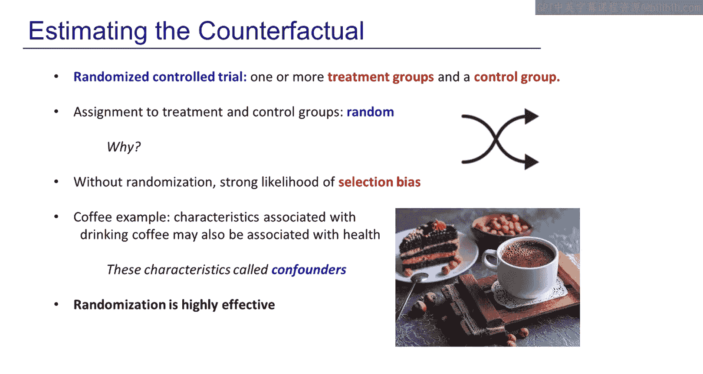
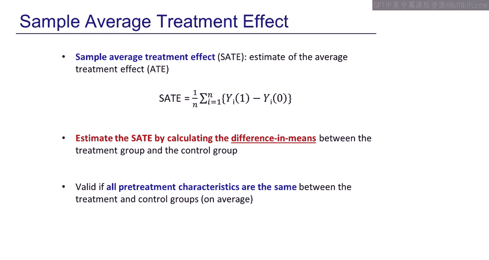
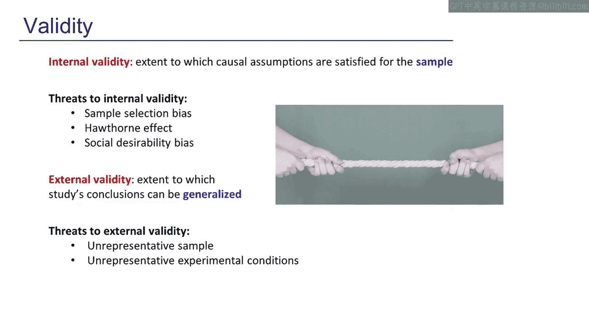
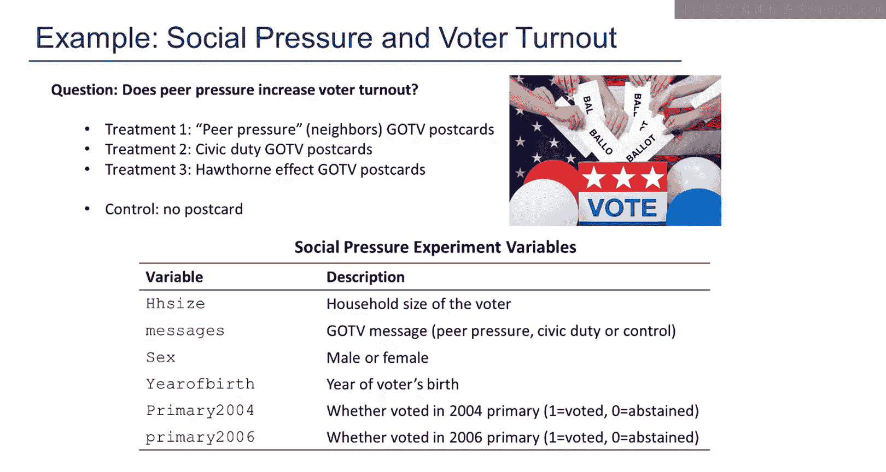
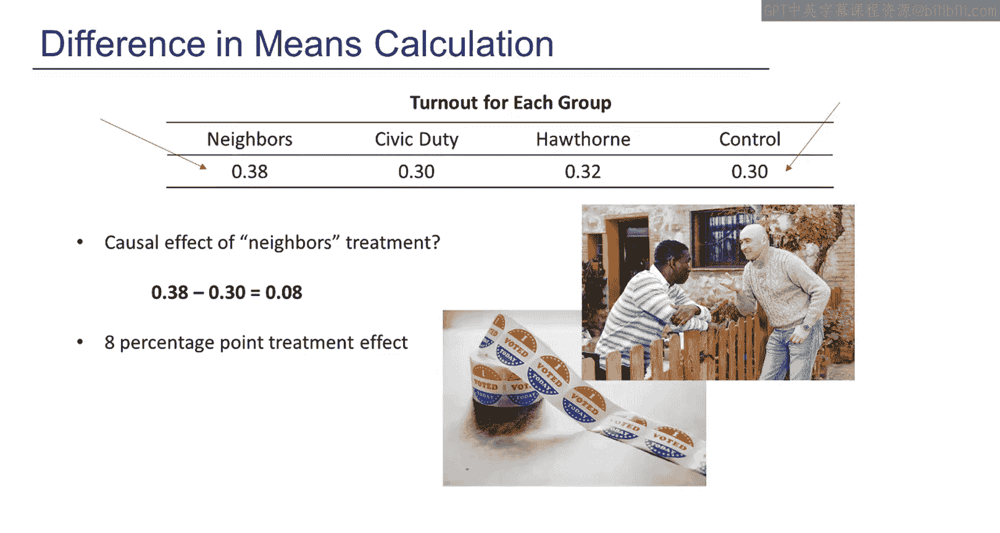
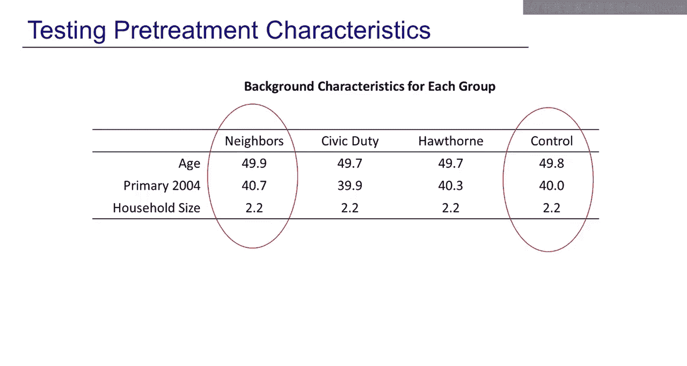

# 数据素养：P06：随机对照试验 🧪

在本节课中，我们将要学习因果推断的“黄金标准”——随机对照试验。我们将了解其核心原理、如何利用试验数据估计因果效应，以及如何评估可能影响试验有效性的各种偏差。

## 随机对照试验：估计反事实

随机对照试验是估计因果效应的黄金标准，它也被称为实验。在试验中，研究者会创建一个或多个**处理组**和一个**对照组**。至关重要的是，分配到处理组和对照组的过程必须是**随机**的。这意味着分组与参与者的任何背景特征都完全无关。

随机化之所以至关重要，是因为它能确保处理组和对照组在各个方面都相似，唯一的区别在于是否接受了处理。随机对照试验的这一特性使我们能够估计出无偏的因果效应。

## 无随机化的问题：选择偏差

如果没有随机化，就很可能出现**选择偏差**。让我们回到咖啡实验的例子。想象一下，如果我们允许参与者自己选择是进入咖啡组还是水组，会发生什么。那些选择喝大量咖啡的人，可能同时也有其他与健康结果相关的行为习惯。例如，喝咖啡的人可能也倾向于摄入大量糖分。在这种情况下，糖分摄入量就会成为一个**混杂变量**。由于糖分摄入与咖啡消费相关，它在处理组中的比例会不成比例地偏高。而我们都知道，糖分摄入同样与健康相关。这会造成严重的问题。

简而言之，如果没有随机化，处理组和对照组很可能在那些与感兴趣的结果相关的背景特征上存在差异。当这种情况发生时，就很难确定观察到的结果变化是由处理引起的，还是由某个混杂变量驱动的。

关键在于，**正确实施的随机化非常有效**，它能确保在平均意义上，对照组和处理组在预处理特征上是相同的。

## 样本平均处理效应

在完成实验并收集数据后，我们可以估计**样本平均处理效应**，它实际上是对**平均处理效应**的一个估计。

我们无法观察到真实的平均处理效应，甚至无法直接观察到样本平均处理效应，因为我们无法观察到反事实。但我们可以通过一个简单的方法来估计样本平均处理效应：计算处理组和对照组之间**结果变量的均值差**。换句话说，我们可以计算处理组结果变量的平均值，并将其与对照组结果变量的平均值进行比较。

如果两组之间所有的预处理特征都相同或非常相似，那么均值差就是样本平均处理效应的一个有效估计。

## 有效性：内部有效性与外部有效性

接下来，我们更详细地讨论一下有效性。有效性分为两种类型：**内部有效性**和**外部有效性**。

*   **内部有效性**指的是因果假设对于当前样本的满足程度。有许多因素可能威胁内部有效性，包括样本选择偏差、霍桑效应和社会期望偏差。
*   **外部有效性**则是指研究结论能够推广到其他人群、其他地理区域和其他时间段的程度。

以下是几种常见的威胁内部有效性的偏差：

*   **样本选择偏差**：如前所述，当个体自行选择进入处理组或对照组时，就会发生样本选择偏差。这种自我选择意味着个体的背景特征（也称为预处理特征）与其分组分配相关，因此可能在分析中成为混杂变量。
*   **霍桑效应**：当参与实验的个体因为知道自己被观察而改变行为时，就会发生霍桑效应。例如，你可以想象，在班级规模实验中，如果学生和老师知道他们的努力被记录，他们的行为可能会与平时不同。
*   **社会期望偏差**：正如我们之前讨论过的，当参与者提供社会期望的答案时，就会发生社会期望偏差。例如，报告自己投了票，而实际上在选举日并未投票。

相比之下，随机对照试验常常缺乏外部有效性，因为样本不能代表感兴趣的人群。例如，许多社会科学实验在大学进行，样本来自本科生群体。这些研究的结果是否能推广到其他人群（如全美人口）或其他大学的本科生群体，常常是值得怀疑的。

其他时候，随机对照试验缺乏外部有效性是因为实验条件不具有代表性。例如，想象一个实验，参与者被要求在实验室环境中在电脑上观看一系列政治竞选广告。这并不能复制大多数人在家中舒适地观看最喜欢的电视节目时，在非政治广告之间看到竞选广告的场景。这种环境差异可能会改变广告对感兴趣结果（如观看者支持哪位候选人）的影响。

总的来说，**随机对照试验往往具有较高的内部有效性和较低的外部有效性**。两者之间存在一定的张力。当研究者严格控制条件时，通常能确保高度的内部有效性，但这往往以牺牲对现实世界条件的复现为代价。

## 实例：社会压力与选民投票率

让我们通过一个随机对照试验的例子，来看看如何估计样本平均处理效应，以及如何评估该发现的有效性。一组研究者有兴趣研究同侪压力是否会增加选民投票率。换句话说，他们想知道，如果人们认为别人会被告知自己是否投票，他们是否更有可能去投票。

研究者在密歇根州的一次初选期间进行了一项研究。他们向一组已登记的选民邮寄了三种类型的处理明信片。

*   分配到**第一处理组**的选民收到一张“动员投票”明信片，告知公民选举后将发布消息，让他们的邻居知道他们是否投票了。
*   分配到**第二处理组**的选民收到一张强调投票作为公民责任重要性的“动员投票”明信片。
*   分配到**第三处理组**的选民收到一张“动员投票”明信片，只是告知他们其投票行为正作为研究的一部分被观察。
*   **对照组**的选民没有收到任何“动员投票”明信片。

最终的数据集包含了本页幻灯片表格中列出的变量。这些变量包括参与者的家庭规模、收到的信息类型、性别、出生年份、是否在之前的初选中投票，以及是否在2006年初选（感兴趣的结果）中投票。

## 均值差计算

由于这是一个随机对照试验，我们可以合理地计算每个处理组和对照组的均值，然后比较这些均值来估计处理的因果效应。

我们可以看到，在“邻居”处理组中，平均投票率为38%，而对照组的投票率为30%。计算差值后，结果表明该处理使选民投票率提高了**8个百分点**。

## 检验预处理特征

如果我们能确定分析中没有混杂变量，就可以得出结论认为这些效应是因果性的。为了检验这一点，我们可以查看数据集中包含的预处理特征的平均值。

本页幻灯片上的表格展示了每个组的年龄、2004年初选投票率和家庭规模的平均值。请注意，每个变量的值在所有四个组中都非常相似。例如，“邻居”组的这些变量值与对照组的值极其相似。这表明这些变量不是研究中的混杂变量。这很好地证明了受访者确实被随机分配到了处理组和对照组。我们可以合理地相信，如果各组在这些特征上非常相似，那么它们在其它相关的、未观察到的特征上也是相似的。

总的来说，**检验处理组和对照组在相关预处理特征上是否相似，是进行一个可靠的随机对照试验的关键步骤**。

## 总结

在本节课中，我们一起学习了随机对照试验这一因果推断的核心方法。我们了解到，通过**随机分配**参与者到处理组和对照组，可以最大程度地消除混杂变量，从而获得对因果效应的**无偏估计**。我们学会了通过计算**处理组与对照组的均值差**来估计样本平均处理效应。同时，我们也认识到试验的有效性包括**内部有效性**（结论对样本本身是否可靠）和**外部有效性**（结论能否推广到更广泛的情境），而随机对照试验通常在内部有效性上表现优异，但在外部有效性上可能存在局限。最后，我们通过一个关于社会压力与投票率的实例，实践了如何计算效应并检验随机分配是否成功。