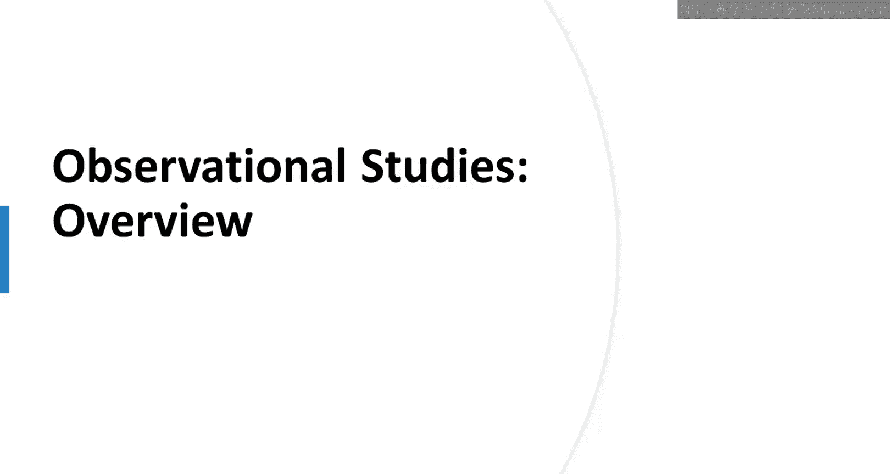
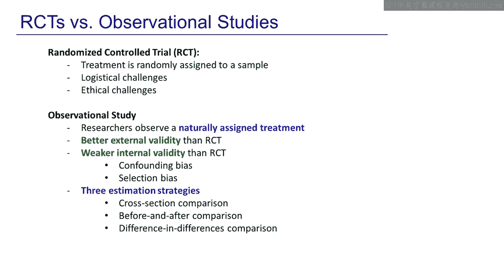
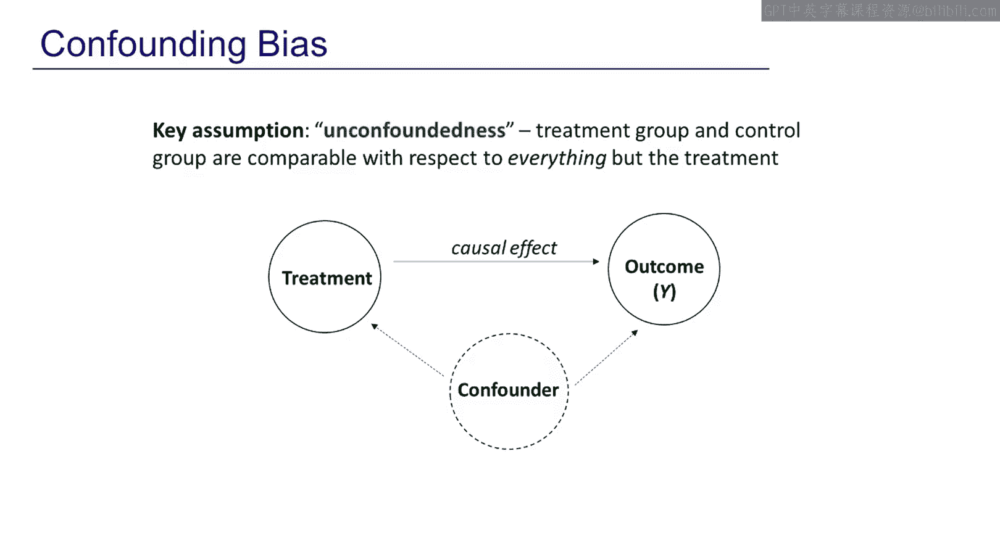

# 约翰霍普金斯大学《数据素养（数据⧸测量⧸回归⧸概率⧸毕业项目）｜Data Literacy》中英字幕（deepseek p07 6_观察性研究概述.zh_en -BV1jXtMemEuh_p7-

Observational studies overview， although randomized controlled trials are the gold standard in research。

 Sometimes it's just not possible to conduct them。In these cases。

 researchers may instead rely on observational data。 By the end of this video。

 you should understand the purpose of an observational study and why confounding bias can undermine the estimation of a causal effect。

Randomized controlled trials versus observational studies。

 Let's first consider why conducting a randomized control trial is a challenge。

Remember that to conduct an RCT， the researcher must randomly assign a treatment to one group in a sample。

 while another group in the sample serves as the control。Sometimes running an RCT is not possible。

 there are many logistical challenges such as the cost and time it takes to carry out a well run RCT。

There are also ethical challenges。 For example， there are major ethical concerns with randomly assigning treatments like smoking。

 drug use and trauma。As a result， many researchers use observational data to estimate causal effects。

In an observational study， researchers observe a naturally assigned treatment。

 meaning a treatment that some units in the analysis have received by some other means than researcher intervention。

Observational studies tend to have better external validity than RCTs。

 because the conditions tend to be more generalizable。In observational studies。

 the treatment was assigned in a natural， real world setting。

 so it's very easy to imagine other situations in which that treatment would be assigned to other units。

In R CTs， the conditions are often highly controlled and therefore do not replicate the real world very well。

In contrast， observational studies tend to have weaker internal validity than RCTs。

This is because they are more vulnerable to confounding bias and selection bias。

 because the researcher does not control the treatment assignment in an observational study。

 there is a high likelihood that the treatment and control groups are dissimilar in important ways。

In other words， there is likely a relevant reason why some units received the treatment while others did not。

In the next video， I'll present three strategies for estimating a causal effect with observational data。

We'll talk about how to implement a cross section comparison。

A before and after comparison and a difference in difference comparison。

Each of these strategies has benefits and drawbacks。Confounding bias。

 let's take a moment to discuss confounding bias。 The key assumption of any causal analysis is unconfoundedness。

 which means that the treatment group and control group are comparable with respect to every single characteristic。

 except receipt of the treatment。If there is a variable that is correlated with the treatment and also affects the outcome variable。

 which we typically denote with why， then this variable is a confounder。

This variable will cause the estimation of the causal effect of the treatment on the outcome to be wrong。

A classic example of confounding bias is the apparent relationship between ice cream consumption and drowning deaths as ice cream consumption increases。

 so does the number of deaths from drowning。 Does this mean that eating ice cream increases once chances of drowning。

 No， it doesn't。 In this case， Of course， the confounder is temperature。

 Higher summer temperatures are the driving force of both variables in this example。

