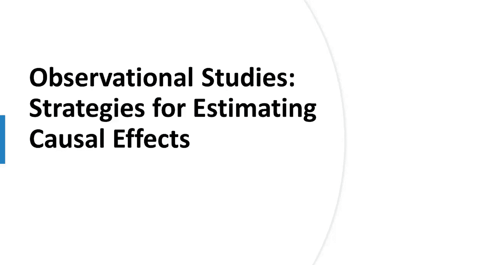
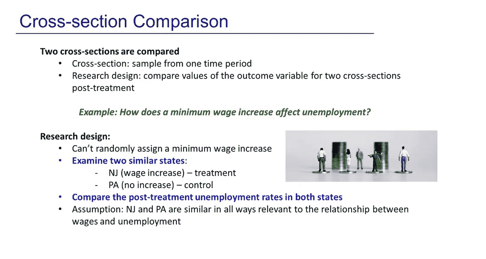
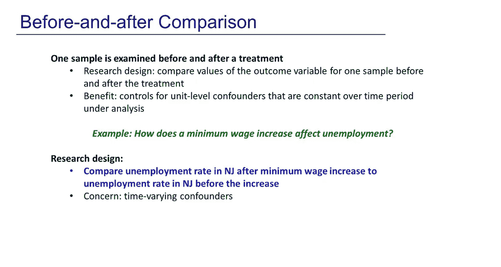
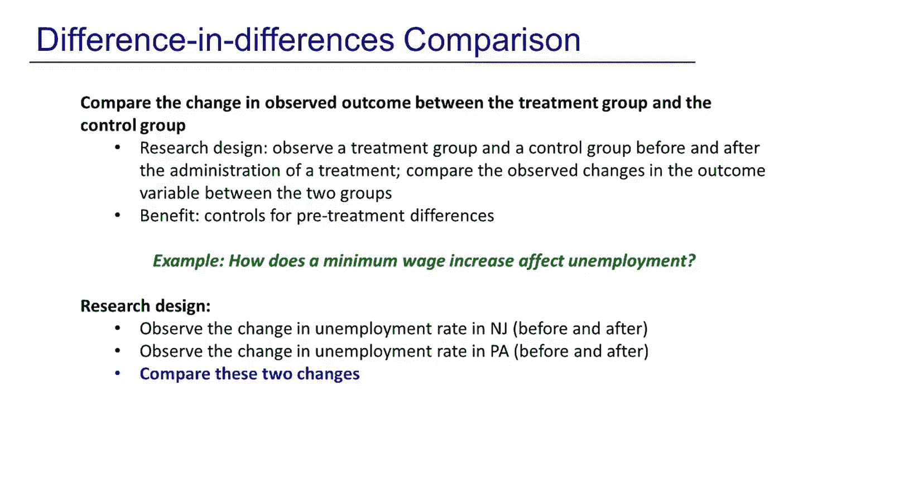
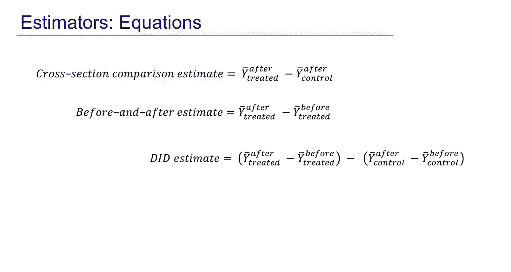
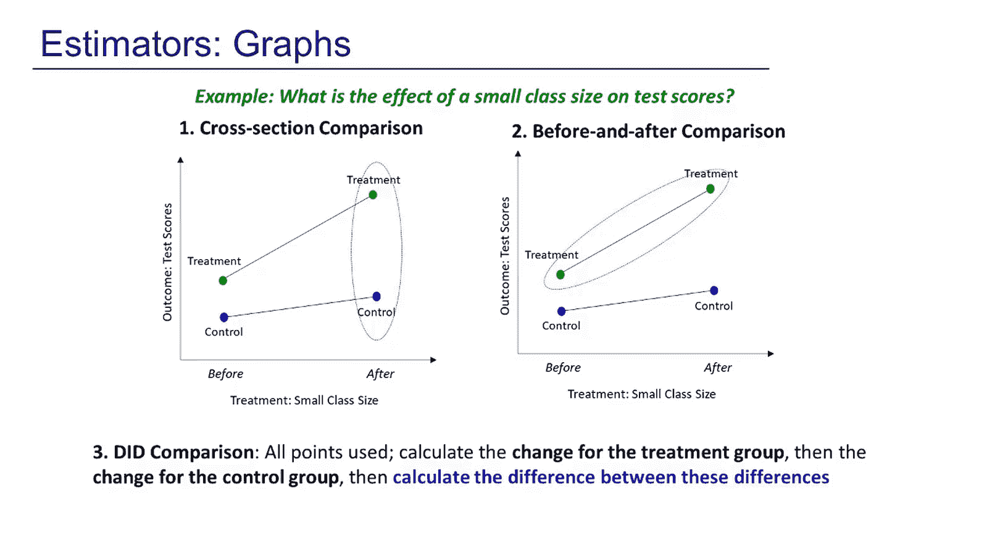
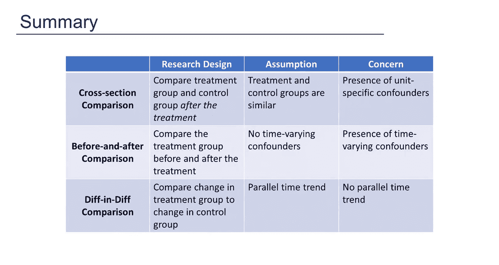

# 约翰霍普金斯大学《数据素养（数据⧸测量⧸回归⧸概率⧸毕业项目）｜Data Literacy》中英字幕（deepseek p08 7_观察性研究中的因果效应估计策略.zh_en -BV1jXtMemEuh_p8-

Observational studies， strategies for estimating causal effects When you're working with observational data。

 there are three primary strategies for estimating causal effects， namely cross section comparison。

 before and after comparison and difference in difference comparison by the end of this video。

 you should be able to calculate causal effects using these strategies and understand the advantages and disadvantages of each。

Cross section comparison。The first strategy for estimating a causal effect using observational data is called a cross section comparison。

 In this case， two cross sections are compared with each other。

 A cross section is a sample of data from one time period。

 such as a sample of individuals in a survey。 The basic research design is fairly straightforward。

 The researcher compares the values of the outcome variable for the two cross sections after the treatment has been administered to one of the cross sections。

 In other words， one cross section serves as the treatment group。

 and the other serves as the control group。 Let's walk through an example。

 Suppose you're interested in examining the causal effect of a minimum wage increase on the unemployment rate。

It's unrealistic to conduct a randomized controlled trial to answer this question。

 because it would be very difficult to randomly assign minimum wage increases to certain geographical units。

 Instead， we can examine similar states。New Jersey and Pennsylvania， for example。

 have similar economies， particularly in areas that are adjacent to each other。 Several years ago。

 New Jersey passed a law to increase the state's minimum wage， while Pennsylvania did not。

 A group of researchers decided to take advantage of this setup to estimate the effect of the wage change on unemployment。

 as there is a disagreement in the scholarly literature about the economic effects of a minimum wage increase。

In this case， the researchers examined full time employment at fast food restaurants in the two states。

 In particular， they compared the unemployment rates in the two states after the New Jersey law went into effect。

The assumption underlying this kind of analysis is that New Jersey and Pennsylvania are similar in all ways that are relevant to the relationship between wages and employment at the time the study was conducted。

Do you think this assumption is reasonable to answer this question。

 you would need to examine whether， in fact， the state's economies were indeed comparable。

Before and after comparison。A second strategy would be to conduct a before and after comparison。

 In this case， the researchers would compare the values of the outcome variable for one sample。

 before and after the administration of a treatment。

The benefit of this approach is that it controls for unit level confounders that are constant over the time period under analysis。

 Let's return to our example about the relationship between the minimum wage increase and the unemployment rate。

To conduct a before and after comparison， the researchers would compare the unemployment rate in New Jersey after the wage increase to the unemployment rate in New Jersey before the increase。

 this approach controls for those aspects of the New Jersey economy that are constant before and after the minimum wage increase。

 these may include variables such as fast food demand population and demographics。Nonetheless。

 there is the possibility that time varying variables would cause confounding bias。 For example。

 if fast food demand dropped between the measurement of the unemployment rate before the treatment and the measurement after。

 then this variable would be a confounder。

Difference in difference is comparison。A third strategy would be to conduct a difference in differences comparison。

 This approach requires the researchers to compare the change in the observed outcome between the treatment group and the control group。

This means that the researchers would observe a treatment group and a control group both before and after the administration of a treatment。

 the researchers compare the changes in the outcome variable between the two groups。 In other words。

 they compare the difference between the differences。

The benefit of this approach is that it controls for pre treatmentment differences between the two groups。

 This is important because remember， this is not a randomized control trial。 As a result。

 there are likely to be important differences between the treatment and control group。

 Even if they are similar in many ways， This approach controls for the differences that exist prior to receipt of the treatment。

Let's again turn to the minimum wage example。To conduct a difference in differences analysis。

 the researcher would observe the change in unemployment rate in New Jersey before and after the minimum wage law went into effect。

And then the researchers would observe this change in Pennsylvania。 Finally。

 the researchers would calculate the difference between these two changes。

 This final calculation is the difference in differences estimate。

Estimators equations。Here are the three equations to calculate each of the estimates discussed。

The first line presents the equation for the cross section comparison estimate。

 It is calculated by comparing the mean values of the outcome variable after the treatment between the treatment group and the control group。

 The second line presents the equation for the before and after estimate。

 It is calculated by comparing the mean values of the outcome variable for just the treatment group before and after receipt of the treatment。

Finally， the third line presents the difference in differences equation。

 notice that this estimate requires the researcher to calculate the changes for the treatment group and control group and then compare these two changes。

I encourage you to spend some time digesting these equations to be sure you understand what's going on in each one。

 Think about why each one makes sense and the limitations of each。

Estimators， graphs。It might also be helpful to think about these three strategies in graphical form。

 Suppose you are interested in estimating the causal effect of small class sizes on test scores。 Now。

 imagine that you observe a treatment group， namely students who were placed in small classes。

 and a control group， namely students who remained in the regularly sized classes。

To conduct a cross section comparison， you could compare the test scores for the treatment group students and the control group students after the change in class size was implemented。

To conduct a before and after comparison， you could compare test scores for the treatment group students before the change in class size and after the change in class size。

 the red circles on the two graphs on this slide highlight the points that are being compared for these two approaches。

A difference in differences comparison would require you to use all four points on the graph。 again。

 you could calculate the change in test scores for both the treatment and control group and then calculate the difference between these two changes。

Summary the table on this slide summarizes these three approaches in one place。

 Each approach has a specific research design and specific method of calculating the estimated causal effect Each approach makes a key assumption about the presence of confounders and each one is vulnerable to concerns about whether that assumption is met。

The key is to use the approach that best fits your research question。

 as well as the data that you have available to you。

