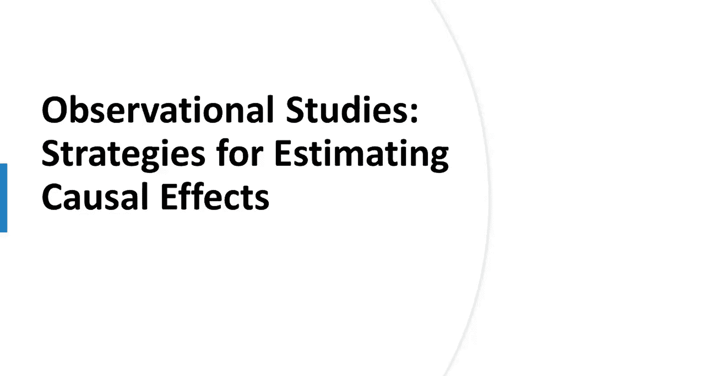
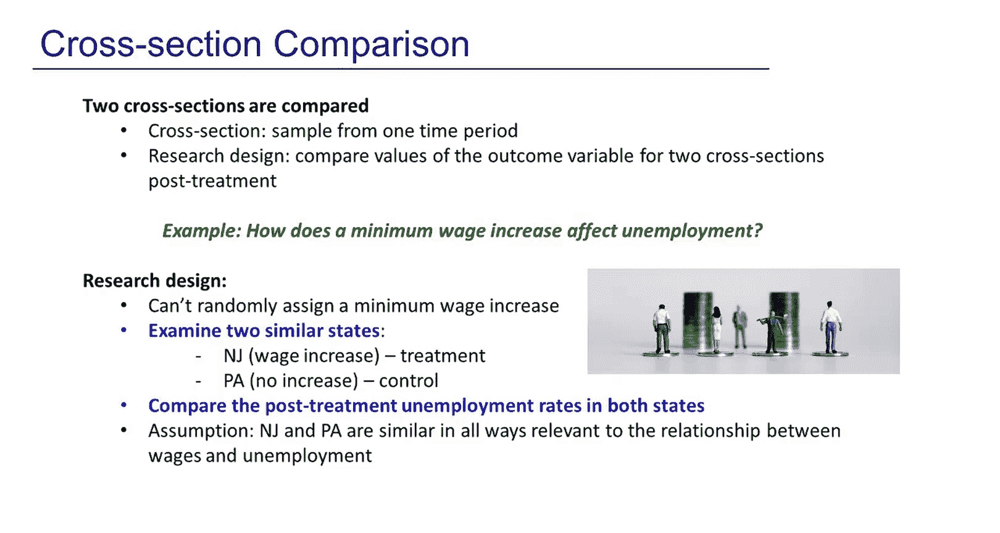
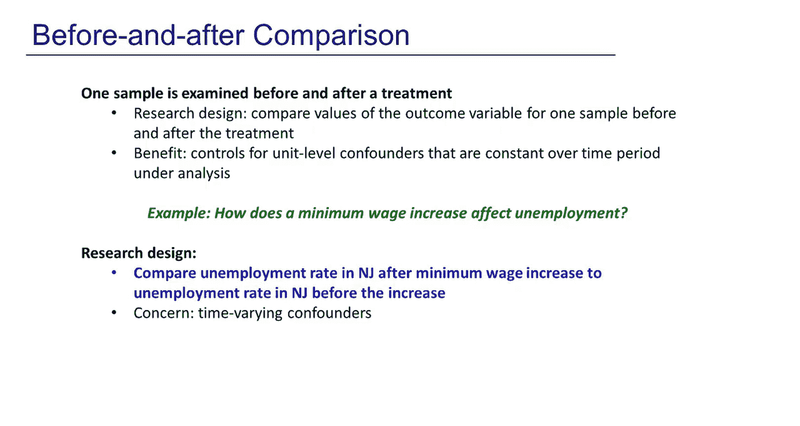
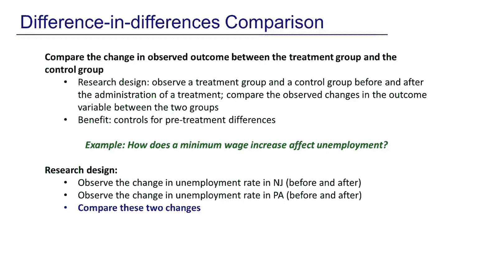
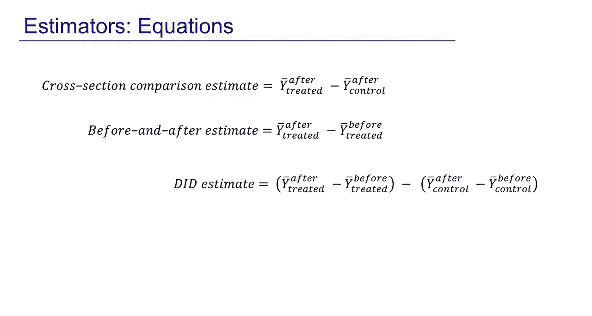
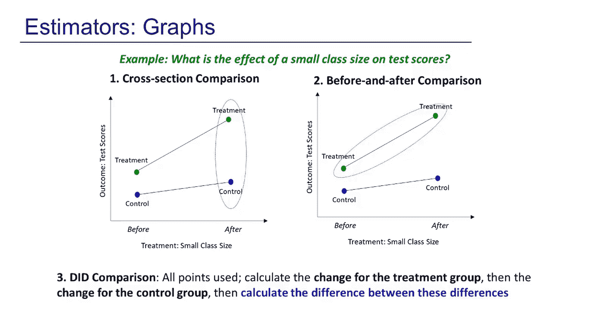
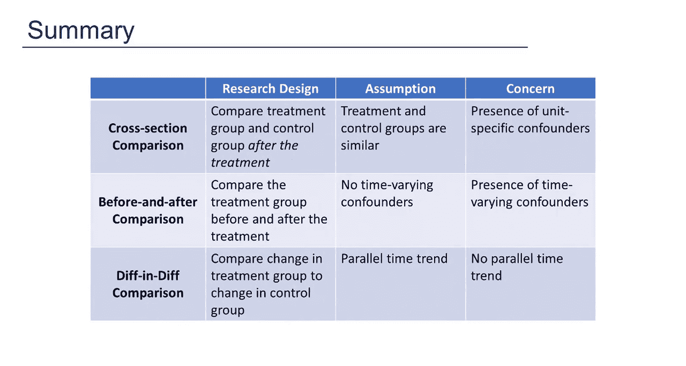

# 数据素养：P08：观察性研究中的因果效应估计策略 📊

在本节课中，我们将学习如何利用观察性数据来估计因果效应。观察性研究不同于随机对照试验，它无法主动干预研究对象，因此需要特定的策略来推断因果关系。我们将重点介绍三种核心策略：横截面比较、前后比较以及双重差分法。通过学习，你将能够理解每种策略的原理、计算方式及其优缺点。

## 横截面比较 🔄

上一节我们介绍了观察性研究的基本概念，本节中我们来看看第一种估计策略——横截面比较。这种方法通过比较两个不同组别在某个时间点的数据来估计处理效应。

横截面比较的基本研究设计相当直接。研究人员在某个处理措施实施后，比较处理组和对照组的结果变量值。换句话说，一个横截面样本作为处理组，另一个作为对照组。

让我们通过一个例子来理解。假设你想研究最低工资上涨对失业率的因果效应。进行随机对照试验来回答这个问题是不现实的，因为很难将最低工资上涨随机分配给某些地理区域。相反，我们可以研究相似的两个州，例如新泽西州和宾夕法尼亚州。几年前，新泽西州通过法律提高了州最低工资，而宾夕法尼亚州没有。一组研究人员决定利用这一情况来估计工资变化对失业的影响。

在这种情况下，研究人员考察了两个州快餐店的全职就业情况。具体来说，他们比较了新泽西州法律生效后两个州的失业率。这种分析基于一个关键假设：在研究进行时，新泽西州和宾夕法尼亚州在与工资和就业关系相关的所有方面都是相似的。要评估这个假设是否合理，你需要考察两个州的经济是否确实具有可比性。

## 前后比较 ⏳

第二种策略是进行前后比较。这种方法的核心是，研究人员比较同一个样本在接受处理前后结果变量的值。

这种方法的优点是，它控制了在分析时间段内保持不变的个体层面混杂因素。让我们回到最低工资上涨与失业率关系的例子。要进行前后比较，研究人员会比较新泽西州工资上涨后的失业率与上涨前的失业率。这种方法控制了新泽西州经济中在最低工资上涨前后保持不变的方面，例如快餐需求、人口和人口统计数据。

然而，这种方法存在时间变化变量导致混杂偏倚的可能性。例如，如果在处理前失业率测量和处理后失业率测量之间，快餐需求下降，那么这个变量就会成为一个混杂因素。

## 双重差分法比较 ➖➖

第三种策略是进行双重差分法比较。这种方法要求研究人员比较处理组和对照组之间观察到的结果变化。

这意味着研究人员需要在处理实施前后同时观察处理组和对照组。研究人员会比较两组之间结果变量的变化。换句话说，他们比较的是“差异之间的差异”。

这种方法的优点是，它控制了两组之间在处理前就存在的差异。这一点很重要，因为请记住，这不是随机对照试验。因此，处理组和对照组之间可能存在重要差异，即使它们在许多方面相似。这种方法控制了在接受处理之前就已存在的差异。

再次以最低工资为例。要进行双重差分分析，研究人员会观察新泽西州在最低工资法生效前后失业率的变化。然后，研究人员会观察宾夕法尼亚州的这种变化。最后，研究人员会计算这两个变化之间的差值。这个最终计算值就是双重差分估计值。

## 估计量公式 📐

以下是计算上述三种估计量的公式。

第一个公式用于计算横截面比较估计量。它通过比较处理后处理组和对照组结果变量的平均值来计算。

**公式：** `横截面估计量 = Y̅_treatment(after) - Y̅_control(after)`

第二个公式用于计算前后估计量。它通过仅比较处理组在接受处理前后结果变量的平均值来计算。

**公式：** `前后估计量 = Y̅_treatment(after) - Y̅_treatment(before)`

第三个公式是双重差分方程。请注意，这个估计量要求研究人员分别计算处理组和对照组的变化，然后比较这两个变化。

**公式：** `双重差分估计量 = [Y̅_treatment(after) - Y̅_treatment(before)] - [Y̅_control(after) - Y̅_control(before)]`

建议你花些时间消化这些公式，确保理解每个公式的含义。思考为什么每个公式是合理的，以及各自的局限性。

## 估计量图示 📈

以图形形式思考这三种策略也很有帮助。假设你感兴趣的是估计小班教学对考试成绩的因果效应。现在，想象你观察到一个处理组（即被安排在小班的学生）和一个对照组（即留在常规班级的学生）。

要进行横截面比较，你可以在班级规模改变实施后，比较处理组学生和对照组学生的考试成绩。要进行前后比较，你可以比较处理组学生在班级规模改变前和改变后的考试成绩。本页幻灯片上的两个图表中的红圈突出了这两种方法正在比较的点。

双重差分比较则需要你使用图表上的所有四个点。同样，你可以分别计算处理组和对照组成绩的变化，然后计算这两个变化之间的差值。

## 总结 📋

本节幻灯片上的表格在一个地方总结了这三种方法。

以下是三种方法的对比总结：
*   **横截面比较**：研究设计是**比较两个不同的组**。关键假设是**两组在处理前是可比的**。主要风险是**可能存在组间混杂因素**。
*   **前后比较**：研究设计是**比较同一个组在处理前后的情况**。关键假设是**没有随时间变化的混杂因素**。主要风险是**可能存在时间趋势混杂因素**。
*   **双重差分法**：研究设计是**比较处理组和对照组在处理前后的变化**。关键假设是**处理组和对照组有共同的时间趋势**。主要风险是**时间趋势可能不同**。

关键在于使用最符合你的研究问题以及你所拥有数据的方法。

本节课中，我们一起学习了在观察性研究中估计因果效应的三种主要策略：横截面比较、前后比较和双重差分法。我们了解了每种策略的计算公式、图形化理解方式、核心假设以及潜在的局限性。掌握这些策略对于在无法进行随机实验时，从观察数据中得出有效的因果推论至关重要。