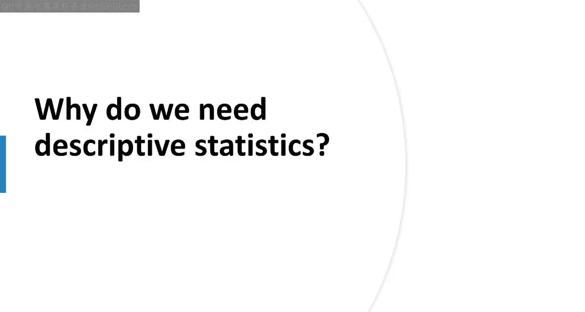
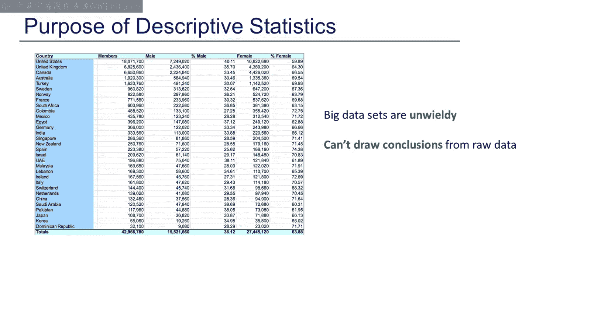
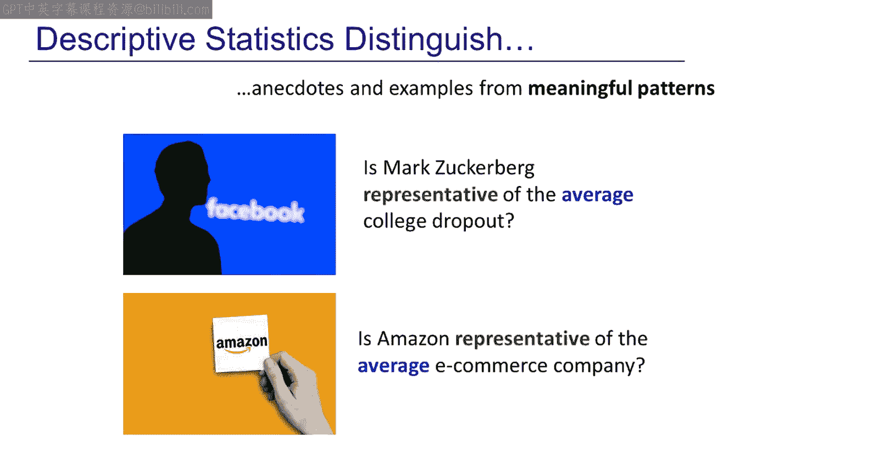
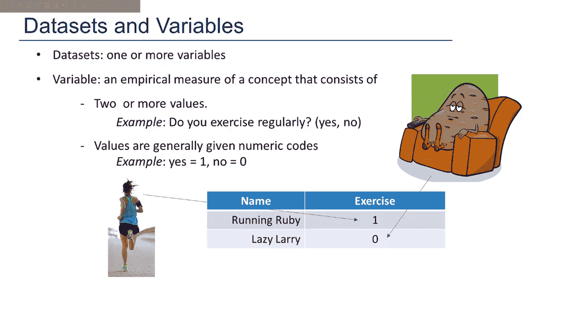

# 约翰霍普金斯大学《数据素养（数据⧸测量⧸回归⧸概率⧸毕业项目）｜Data Literacy》中英字幕（deepseek p09 8_为什么我们需要描述性统计.zh_en -BV1jXtMemEuh_p9-

Why do we need descriptive statistics By the end of this video。

 you should be able to articulate the purpose of descriptive statistics and explain how statistics can help us distinguish meaningful patterns from anomalies。

 In addition， you should be able to define exactly what is meant by a variable in a statistical context。

😊。

Purpose of descriptive statistics。Take a look at the data displayed on this slide。

 it contains information about Facebook membership for a whole bunch of countries。

 including the total number of members， number of male members and number of female members。

Even though this data set is fairly small and organized in a fairly reasonable manner。

 it is still difficult to identify patterns and draw conclusions。

It is hard to compare Facebook membership in， say， India to Japan。Now， imagine a much。

 much bigger data set。 government agencies and private sector organizations assemble data sets that contain billions and sometimes trillions of observations。

 We can learn very little about these data sets by staring at spreadsheets of raw data。 Instead。

 we need to use statistics and visualizations to summarize the information in raw data sets。

At this point， you might be wondering， why can't we simply select interesting observations from an unwieldy data set and examine those cases in more detail？

Well， we could do this， but we would not know if we were examining representative or unrepresent observations。

 The use of statistics and data visualizations help us distinguish between interesting anecdotes and meaningful patterns。

 Suppose， for example， that you're interested in examining whether college dropouts generally go on to have successful careers。

 and it occurs to you that Mark Zuckerberg， the cofounder and CEO of Facebook。

 might be an interesting case study。 Well， indeed， Mr。

 Zuckerberg has a fascinating career story that involves him dropping out of Harvard。

 but it's doubtful that Mr。 Zuckerberg's experience is representative of the average college dropouts experience。

 If we were to assume that Mr。 Zuckerberg is an average college dropout。

 are concluding recommendations about whether or not students should， generally speaking。

 drop out of college， would be quite wrong。😊，Likewise。

 if we were interested in examining the E-commerce industry。

 it would be inaccurate to assume that Amazon is representative of the typical E-commerce company。

 if we wanted to understand what makes an e-commerce company successful and what does not。

 we would need to examine many different companies and learn from a data set that includes substantial variation。

So instead of relying on interesting examples that are unlikely to be representative of the population we care about。

 we are going to use statistics and data visualizations to discover meaningful patterns。

 patterns that allow us to draw accurate conclusions and generate actionable recommendations。

Data sets and variables。Before diving into descriptive statistics， which we'll do in the next video。

 let's define some key terms。 We've used these terms before。

 but let's spend a minute or two discussing exactly what they mean。

A data set is composed of one or more variables。 a variable is an empirical measure of a concept we care about studying。

In your dataset， each variable should have a unique name。

 it would be extremely confusing if two different variables in a data shared a name。

Each variable should also have two or more values。 This is extremely important。 A variable。

 in other words， must have variation。 If a variable consisted of only one value。

 it would be a constant。 Yesterday's average temperature， for example， is not a variable。

 It has a single value and is therefore a constant。Variables in contrast take on two or more values。

 consider the survey question do you exercise regularly， respondents can answer yes or no。

We could also imagine a variable that takes on 3，4， or even an infinite number of values。

Variables assume particular values probabilistically。

 Consider the variable gender for any given individual。

 There is a probability that the individual is a man and a probability that the individual is a woman。

 and that probability is approximately 50%。Likewise， for any individual。

 there is a probability that the individual exercises regularly and a probability that the individual does not。

 We might not know the probability of each value， but that is O。

 What is important is that there is some non0 probability that the variable can assume any one of a set of possible values。

Generally， it is useful to assign numeric codes to nonnumeric variable values。 For example。

 in the survey question about exercise， we might assign yes responses a value of 1 and no response as a value of 0。

 On this slide， there is a table with two observations。

 Run Ruby reported that she exercises regularly。 So she is assigned the value 1。Lay Larry。

 in contrast， reported that he does not exercise regularly， so he has assigned the value 0。

In statisticsatistics， variables， and the data sets they comprise are what we analyze using a variety of methods and tools。

